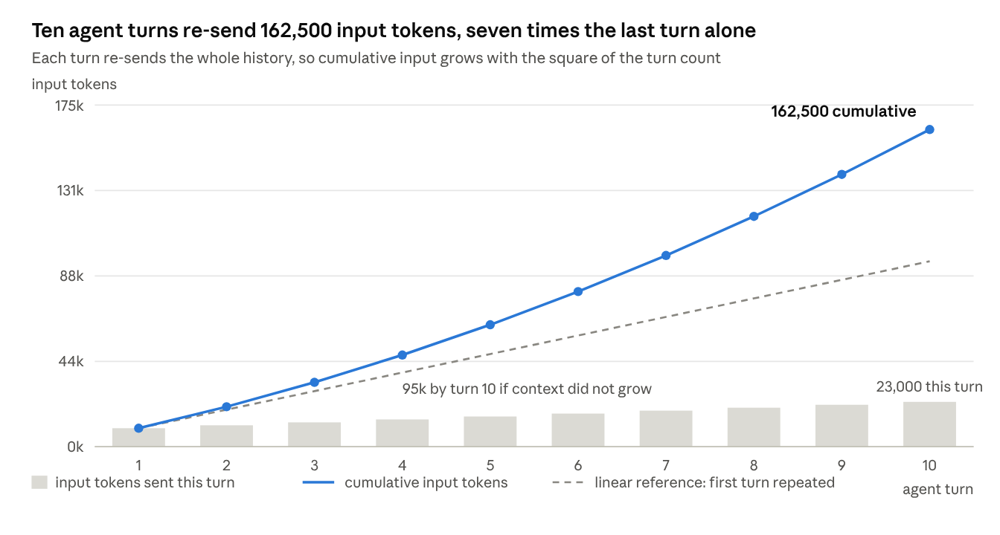
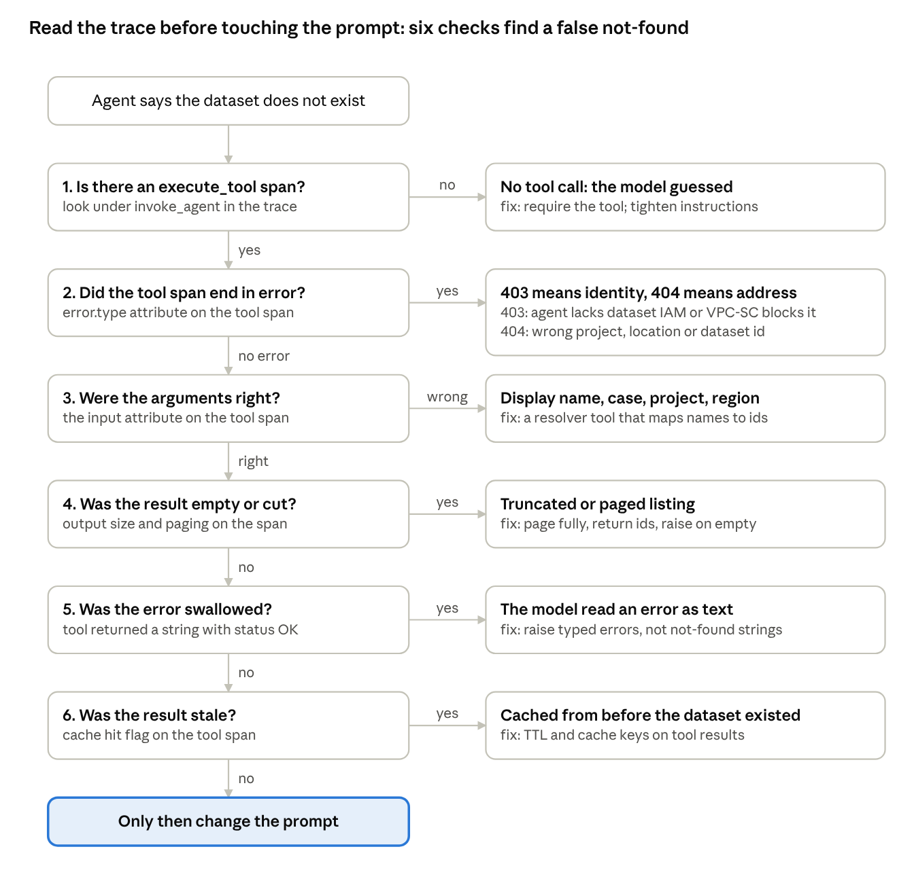
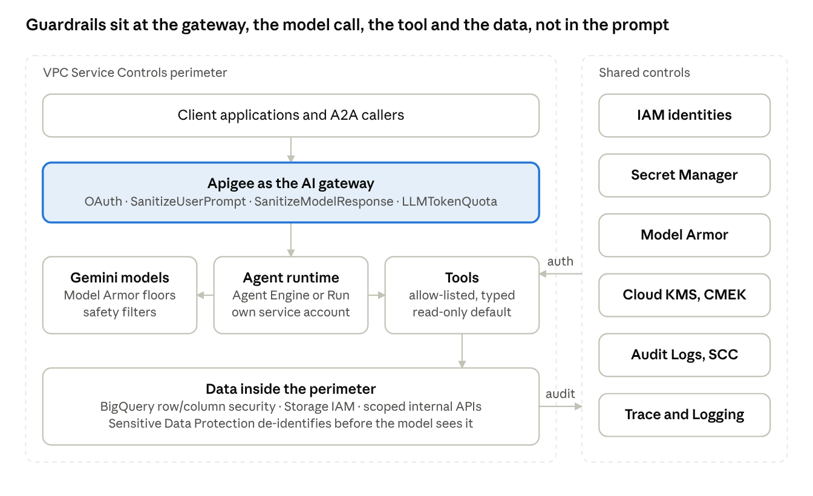

# Agentic AI Field Guide: FinOps, Observability, Design, Evaluation, and Security on Google Cloud

Ahmed Jawad, Ph.D. · October 17, 2026

## Introduction

A production agent is five problems wearing one trench coat. It spends money every time it thinks (FinOps). It fails in ways no log line explains (observability). Its behavior depends on how its loop, tools, and reasoning are arranged (agentic design). Nobody can say whether a change made it better without a judge (evaluation). And it touches data and systems on someone's behalf, which means someone has to decide what it may touch (security and identity). This guide takes each problem in turn, defines its terms precisely, shows the actual schemas and numbers involved, and gives the code that implements the answer, with Google Cloud as the reference platform and Langfuse, OpenTelemetry, the Deep Agents SDK, and Google's Agent Development Kit as the reference tooling.

The five parts are written to be read independently, but they share one spine: the trace. A trace is where token cost is measured per step, where a failing tool call is found, where an agent's reasoning and plan become visible, where evaluation samples come from, and where an unauthorized data access would show up. Build the trace well and the other four problems get easier; skip it and each of them has to be solved blind.

### How the parts connect

**Part 1, FinOps**, starts with what a token actually costs, why an agent that loops ten times does not cost ten times as much as one that answers once but closer to fifty times, how prompt caching cuts that, how to keep reasoning loops short, and how to find the step that is burning the budget.

**Part 2, Observability**, defines traces and spans, gives the OpenTelemetry schema for generative AI and Langfuse's data model on top of it, shows the instrumentation code, walks through a concrete troubleshooting case, an agent insisting a dataset does not exist when it does, and lays out the Google Cloud alternative to Langfuse.

**Part 3, Agentic design**, catalogs the interaction patterns, states the principles that keep agents bounded and debuggable, and explains latent reasoning, the thinking a model does that the user never sees, with code for the Deep Agents SDK and Google ADK.

**Part 4, Quality and evaluation**, is the LLM-as-a-judge handbook: how to build one, which criteria and scales to use, synchronous versus asynchronous judging, the anti-patterns that make judges lie, how to embed expert knowledge, how to judge conversations rather than single answers, and how to run it on Vertex AI.

**Part 5, Security and IAM**, covers who an agent is when it acts, how to confine it to specific data, and where guardrails and gateways sit on Google Cloud.

**Part 6** turns all of it into interview talking points for a forward-deployed engineering loop.

### Conventions

Prices, limits, and feature names are as published by the vendors at the time of writing and are cited where used; they change often, and the links in the appendix are the source of truth. Code is Python unless stated. Where the guide takes a position, it says why, and where practitioners disagree, it says that too.

## Part 1 — FinOps: token economics

## 1. What a token costs

A model bill is a sum of token counts multiplied by per-token prices, and the prices differ by an order of magnitude depending on which kind of token it is. Knowing the kinds is the whole of FinOps literacy; everything else is arithmetic.

### Definitions

A **token** is the unit a model reads and writes. Tokenizers split text into sub-word pieces; in English roughly four characters, or three-quarters of a word, per token, with code, numbers, non-Latin scripts, and whitespace-heavy formats such as JSON costing more tokens per character. Images, audio, and video are converted to fixed token budgets per unit of input, so a page image or a minute of audio has a token price too.

The **context window** is the maximum number of tokens a request may contain, input plus output plus any thinking. It is a ceiling, not a target; cost scales with what you send, not with what you could send.

### The components of a bill

| Component | What it is | How it is priced | What drives it |
| --- | --- | --- | --- |
| Input tokens | Everything the model reads: system prompt, conversation history, retrieved context, tool definitions, tool results | Base input rate per million tokens | Context length, which in agents grows every turn |
| Cached input tokens | The part of the input that matched a cached prefix | A fraction of the base input rate, typically a tenth | How much of each request is a stable prefix |
| Output tokens | What the model writes, including tool-call arguments and structured output | Several times the input rate, often four to eight | Verbosity, output schema, answer length |
| Reasoning (thinking) tokens | Internal reasoning the model produces before answering | Billed as output, whether or not you see the text | Reasoning effort or budget setting, task difficulty |
| Cache writes | Creating a cache entry (on providers that charge for it) | A premium over base input, or storage per token-hour | How often prefixes change |
| Tool definitions | The JSON schemas of every tool offered on a call | Input tokens, on every call that includes them | Number and verbosity of tools |
| Multimodal inputs | Images, audio, video, documents | Fixed tokens per image or per second, charged as input | Resolution, duration, page count |
| Batch and tier discounts | Asynchronous batch endpoints; provisioned capacity; priority tiers | Batch at a discount, often half; provisioned by capacity-hour | Latency tolerance |

The details differ by vendor and change often. Two facts hold across them at the time of writing and shape every optimization that follows: reasoning tokens are billed at the output rate even when only a summary is returned, Gemini's documentation stating that "response pricing is the sum of output tokens and thinking tokens" ([Gemini thinking](https://ai.google.dev/gemini-api/docs/thinking)); and cached input is roughly a tenth of the base input rate across Gemini, Anthropic, and OpenAI, with Anthropic charging a premium on cache writes and Gemini and OpenAI charging none for implicit caching ([third-party pricing summary](https://www.morphllm.com/prompt-caching), verify against vendor price pages).

### Reading the usage object

Every response carries the counts the bill is computed from, under vendor-specific names. The platform records all of them per call; the ones that matter for FinOps are these.

```json
{
  "usage": {
    "input_tokens": 18420,            // everything sent
    "cached_input_tokens": 16100,     // the part that hit the cache (Gemini: total_cached_tokens)
    "output_tokens": 612,             // the answer plus tool-call arguments
    "thinking_tokens": 2200           // reasoning, billed as output (Gemini: total_thought_tokens)
  }
}
```

If your instrumentation stores only `input_tokens` and `output_tokens`, it cannot explain the bill: it will miss the cache discount on the input side and the thinking surcharge on the output side, which in an agent can each be larger than the visible answer.

### A worked example

Take one agent turn with a 12,000-token system prompt and tool catalog, 6,000 tokens of conversation and tool results, 2,000 thinking tokens, and a 500-token answer, at illustrative rates of $1.25 per million input, $0.125 per million cached input, and $10 per million output.

| Line | Tokens | Rate ($/M) | Cost |
| --- | --- | --- | --- |
| Uncached input (no caching) | 18,000 | 1.25 | $0.0225 |
| Output (answer) | 500 | 10 | $0.0050 |
| Thinking | 2,000 | 10 | $0.0200 |
| **Turn, no caching** |  |  | **$0.0475** |
| Cached prefix (12,000 of the 18,000) | 12,000 | 0.125 | $0.0015 |
| Uncached remainder | 6,000 | 1.25 | $0.0075 |
| **Turn, with caching** |  |  | **$0.0340** |

Two things stand out. Thinking cost four times the visible answer. And caching cut the input line by two-thirds but the turn by less than a third, because output and thinking are untouched by caching. Most teams discover the first fact only when a reasoning model is switched on and the bill doubles with no change in traffic.

### What you can edit

Every component above is a knob. Input is edited by trimming prompts, pruning history, and sending fewer tool definitions. Cached input is increased by ordering prompts so the stable part comes first. Output is edited with length limits, structured outputs, and stop sequences. Thinking is edited with the reasoning-effort or budget setting. Multimodal cost is edited with resolution and sampling. Batch discounts are taken by moving anything that can wait off the interactive path. Sections 3 to 5 cover the first four in detail; Section 2 explains why, in an agent, the input line grows faster than everything else.

## 2. Why agent loops are quadratically expensive

An agent that takes ten turns does not cost ten times one turn. It costs closer to fifty times, because every turn re-sends everything that came before it. The cost of a loop is the sum of its context lengths, and that sum grows with the square of the number of turns.



*Ten agent turns re-send 162,500 input tokens, seven times the last turn alone*

The grey bars are what each turn sends; the blue line is their running total; the dashed line is what the total would be if the context stayed the size of the first turn. By turn ten the agent has sent 162,500 input tokens to produce answers whose combined length is a few thousand.

### The arithmetic

Language models are stateless between calls. Each call receives the entire conversation, system prompt, every earlier message, every tool call and its result, and produces the next step. In an agent loop the context at turn *n* is the fixed prefix *P* (system prompt, tool schemas, retrieved documents) plus everything accumulated so far, roughly *g* tokens per turn (the previous model output plus the tool result it triggered):

```latex
\text{input}_n = P + g \cdot n
```

Summed over *N* turns:

```latex
\sum_{n=1}^{N} (P + g n) = N P + g \frac{N(N+1)}{2}
```

The first term is linear in *N* and is what people expect. The second is quadratic and is what the bill shows. With *P* = 8,000, *g* = 1,500 and *N* = 10, the linear term is 80,000 and the quadratic term is 82,500: by ten turns, the growth has overtaken the prefix. By twenty turns the quadratic term is 315,000 against a linear 160,000, and the tool results of a chatty agent push *g* well above 1,500.

Latency follows the same curve. The time to process input, the prefill phase, grows with context length, so late turns are slower as well as dearer, and users feel an agent "getting tired" as a conversation lengthens.

### What makes it worse

- **Large tool results.** A tool that returns a 10,000-token document, or a search that returns twenty results, is paid for on every subsequent turn, not once. Tool output is the most common reason *g* is far larger than teams assume.
- **Verbose tool schemas.** Thirty tools with long descriptions are part of *P* on every call. Tool catalogs of several thousand tokens are routine.
- **Sub-agents that inherit history.** A supervisor that forks its full context into each sub-agent multiplies the quadratic cost by the number of sub-agents.
- **Reasoning on every turn.** Thinking tokens are billed as output on every step, and each step's visible output then becomes input for the next.
- **Retries.** A failed tool call that the agent retries with the same context pays the full context again.

### What makes it better

Three families of mitigation, each covered in the next sections. **Caching** (Section 3) makes the stable prefix *P* nearly free on every turn after the first, which attacks the linear term and, because history that has already been sent is also a prefix, part of the quadratic term too. **Context control** (Section 4) shrinks *g*: summarize or truncate tool results, drop stale history, isolate sub-agents, and end loops early. **Attribution** (Section 5) finds which turns and tools dominate, so the effort goes where the tokens are.

The practical rule that falls out of the arithmetic: **the cheapest token is the one you stop re-sending.** A tool result trimmed from 10,000 tokens to 1,000 before it enters the history saves 9,000 tokens on every one of the remaining turns, not just once.

## 3. How prompt caching works

Prompt caching lets a provider skip re-processing the part of a request it has already seen, and charge you a fraction for it. It works on **prefixes**: the cached part must be byte-identical and must come first. Everything about using it well follows from that one constraint.

### The mechanism

When a transformer reads a prompt, it computes, for every token, a pair of vectors per layer, the keys and values that later tokens attend to. That computation, the prefill, is the expensive part of processing input, and its result, the **KV cache**, depends only on the tokens read so far. If two requests begin with the same 12,000 tokens, the KV cache for those 12,000 tokens is identical, and a provider that kept it from the first request can start the second request at token 12,001. The saved compute is what the discount reflects.

Two consequences fall out immediately. The match is on a prefix, because the state at token *k* depends on tokens 1 to *k*; a change at token 500 invalidates everything after it, however identical the rest is. And the match is exact: a timestamp in the system prompt, a reordered tool list, a user name inserted before the static instructions, each produces a different token sequence and a miss.

### Implicit and explicit caching

|  | Implicit (automatic) | Explicit (managed) |
| --- | --- | --- |
| How it is triggered | The provider detects a repeated prefix on its own | You create a cache object from content and reference it by name in later requests |
| Who pays for creation | Nobody on Gemini and OpenAI; Anthropic charges a write premium when you mark a breakpoint | You pay storage per token-hour while the cache lives |
| Lifetime | Minutes, refreshed on use | A TTL you set |
| Guarantee | Best effort; hits depend on routing and recency | Deterministic for the TTL |
| Best for | Chat and agent loops with a stable system prompt | Large shared context (a codebase, a document set) reused across many requests over hours |

On Gemini, implicit caching is on by default for 2.5 and newer models, with minimum prompt sizes of 2,048 tokens on 2.5 models and 4,096 on 3.x models; hits are reported in `usage.total_cached_tokens`, and Google's guidance is to put large, common content at the start of the prompt and send similar requests within a short window ([Gemini context caching](https://ai.google.dev/gemini-api/docs/caching?lang=rest)). Explicit caching creates a `CachedContent` object with its own TTL and bills storage per token-hour. Anthropic uses explicit `cache_control` breakpoints, up to four per request, with a five-minute default lifetime and a one-hour option, a write premium, and reads at a tenth or less of the input rate; OpenAI caches automatically for prompts above 1,024 tokens, in 128-token increments, with no write charge and reads at a tenth of the input rate, retained for a period after last use ([third-party summary of vendor docs](https://www.morphllm.com/prompt-caching); confirm current figures on each vendor's pricing page).

### Ordering a prompt for cache hits

The prompt is assembled from most stable to least stable, so that the longest possible prefix repeats.

```text
[1] System instructions                 stable for weeks     -> cached on every call
[2] Tool definitions                    stable per release   -> cached on every call
[3] Shared reference documents          stable per session   -> cached within a session
[4] Conversation history so far         grows per turn       -> the prefix sent last turn is cached this turn
[5] Latest tool result / user message   new                  -> never cached, keep it short
```

Three mistakes defeat this order. Putting dynamic content early: a date, a user id, or a request id in the system prompt turns the whole prompt into a miss. Reordering tool definitions between calls: serialize tools in a fixed order. And mutating history: rewriting or summarizing earlier turns changes the prefix, so compaction (Section 4) should happen at defined points, not on every call, and the cache is rebuilt once after each compaction rather than missed on every turn.

### Caching in an agent loop

In a loop the history itself becomes the prefix. Turn *n* sends the prefix plus the history through turn *n*−1, which is exactly what turn *n*−1 sent plus one exchange. With implicit caching, most of each turn is therefore a hit, and the quadratic cost of Section 2 is paid largely at the cached rate rather than the full rate. That does not make the growth free: cached tokens still cost, the uncached tail grows with tool results, and output and thinking tokens are unaffected. It does change the ratio. For the ten-turn run in Section 2, with the 8,000-token prefix and prior history cached at a tenth of the rate, the input bill falls from roughly 162,500 full-rate tokens to the equivalent of about 30,000, a fivefold reduction on the input line and no change on the output line.

### Verifying that it works

Caching is invisible unless measured. The instrumentation records cached-token counts per call, the cost model prices them separately, and the dashboard shows the cache hit ratio per workload, defined as cached input tokens over total input tokens. A ratio that drops after a deploy usually means something dynamic was introduced early in the prompt. A ratio near zero on a workload with a large system prompt means the prompt is below the provider's minimum or is being rebuilt differently per call.

```python
# Reading cache hits from the usage object (Gemini shown; other vendors differ in names)
resp = client.models.generate_content(model="gemini-2.5-pro", contents=messages, config=config)
u = resp.usage_metadata
cached = getattr(u, "cached_content_token_count", 0) or 0
hit_ratio = cached / max(u.prompt_token_count, 1)
span.set_attribute("gen_ai.usage.input_tokens", u.prompt_token_count)
span.set_attribute("gen_ai.usage.cached_input_tokens", cached)   # custom attribute; conventions vary
span.set_attribute("app.cache_hit_ratio", hit_ratio)
```

### When explicit caching wins

Explicit caches earn their storage cost when the same large context is reused many times over a long window by many requests: a document corpus every agent in a session reads, a code repository under analysis, a long video. The break-even is the storage cost per hour against the input cost saved per request times requests per hour, and it is easy to compute from the trace data. Below a few requests per hour against a moderate context, implicit caching or no caching is cheaper.

## 4. Shortening reasoning loops

A loop is shortened in two directions: fewer turns, and less context per turn. The levers below are ordered by how much they usually save; most teams get the bulk of the reduction from the first three.

### Budgets the runtime enforces

The loop stops when a budget is exhausted, and the budget lives in the runtime, not in the prompt. Three budgets, all checked every iteration: a **step budget** (maximum model calls per run), a **token or cost budget** (cumulative, from the usage objects), and a **wall-clock budget**. When one trips, the agent returns a partial result with an explicit status, which is a better outcome than a silent loop that runs until the provider's rate limit stops it. A budget breach is logged as an event on the trace so that it can be counted (Section 5).

```python
@dataclass
class Budget:
    max_steps: int = 12
    max_cost_usd: float = 0.50
    max_seconds: float = 120.0
    steps: int = 0; cost: float = 0.0; started: float = field(default_factory=time.monotonic)

    def charge(self, usage, prices):
        self.steps += 1
        self.cost += (usage.input * prices.input + usage.cached * prices.cached
                      + (usage.output + usage.thinking) * prices.output) / 1e6
        if self.steps > self.max_steps or self.cost > self.max_cost_usd \
           or time.monotonic() - self.started > self.max_seconds:
            raise BudgetExceeded(steps=self.steps, cost=self.cost)
```

### Thinking budgets and effort levels

Reasoning models decide how much to think per request, and that decision is a cost lever. Gemini exposes `thinking_level` (`minimal`, `low`, `medium`, `high`, with model-specific defaults) and reports `total_thought_tokens`; Google's guidance is to use low effort for retrieval and classification, the default for moderate reasoning, and maximum only for complex planning, coding, and math, and to lower the thinking level rather than capping `max_output_tokens`, because a cap that cuts off thinking still bills the thinking and returns an incomplete result ([Gemini thinking](https://ai.google.dev/gemini-api/docs/thinking)). Other vendors expose the same lever as a reasoning-effort setting or a token budget. In an agent the right setting varies by step: the planner may deserve high effort, a tool-argument extraction step does not. The runtime sets effort per call, not per agent.

### Plan first, then execute

A loop that decides what to do next at every step re-derives its plan on every step, paying thinking tokens each time. A loop that writes a plan once, as a numbered list of steps in its working memory, and then executes steps against the plan tends to take fewer turns, retries less, and can be stopped when the plan is done rather than when the model runs out of ideas. This is the planning tool in the Deep Agents SDK and the planner abstraction in ADK (Section 13). The plan is also the cheapest possible progress indicator for a human watching.

### Compact tool results before they enter the history

The single largest reduction in *g* from Section 2 is usually here. A tool result is read once by the model and then re-sent on every later turn. The rules: truncate raw outputs to what the task needs (the first *n* rows, not the whole table); summarize long documents with a cheap model before appending; return structured results with only the fields requested; store large payloads in working memory or a file store and put a reference in the history instead of the content. A search tool that returns titles and a one-line snippet, with a `read` tool for the full document the agent decides it needs, costs a fraction of one that returns full documents.

### Prune and compact the history

Long-running agents need the history to shrink, not just to grow more slowly. Two mechanisms. **Pruning** drops what is no longer useful: tool results that have been superseded, intermediate reasoning, duplicate messages. **Compaction** replaces a run of old turns with a summary at defined checkpoints, every *k* turns or when the context passes a threshold. Both change the prefix, so they are done at checkpoints, not every call, to keep the cache (Section 3) effective between checkpoints. Frameworks increasingly do this for you; the Deep Agents SDK compresses conversation history and large tool results automatically, and ADK and LangGraph expose hooks for it. Whatever does it, the summary should preserve decisions, constraints, and identifiers, which is what later turns actually need, and the compaction event should appear in the trace so a confused agent can be traced to a lossy summary.

### Smaller outputs

Output tokens cost several times input tokens and become input on the next turn. Structured outputs with a schema remove prose; `max_output_tokens` caps the answer; instructions such as "answer in the schema and nothing else" are cheap and effective. Tool-call arguments are output too: a tool that takes an id is cheaper than one that takes a pasted document.

### Route by difficulty

Not every step needs the strongest model. A router step on a small, fast model classifies the request and dispatches to a workflow or an agent; sub-agents for extraction, formatting, and lookup run on small models; the planner and the final synthesis run on the large one. The saving compounds with Section 2: the cheap steps are also the ones with the longest histories.

### Parallel tool calls

When the model asks for several independent tools in one turn, run them concurrently and return all results in one message. This does not reduce tokens, but it reduces turns, and every turn avoided is one fewer re-send of the full context.

### Stop conditions that fire

A loop ends when the model produces a final answer, and models are bad at deciding that. Make the end explicit: a `finish` tool whose call ends the run, a plan whose steps are all complete, a validator that accepts the output. Pair it with a reflection cap, at most one self-review before returning, because unbounded reflection is the most common source of loops that run to the budget.

### Measuring the effect

Every lever above shows up in two metrics the trace already carries: steps per run and input tokens per run, each tracked as a distribution per workload. Before and after any change, compare the medians and the 95th percentiles. The tail is where loops live, and it is where the money goes.

## 5. Finding what consumes the most

Cost is found the way latency is found: by attributing it to the span that incurred it and sorting. The precondition is that every model call is its own span with its usage recorded; without that, the bill is a single number and nothing can be done about it.

### Record cost where it happens

Each model call becomes an observation that carries the model name, the four token counts from Section 1, and the dimensions needed to roll it up: workload, agent, sub-agent, step index, tool that preceded it, and the prompt version. In Langfuse these are `generation` observations with `usage_details` (input, output, and optionally cached tokens) and, if the model is in its pricing table, automatically computed `cost_details`; the model name must match a model definition for the price to apply ([Langfuse tracing best practices](https://langfuse.com/docs/observability/best-practices)). In OpenTelemetry the same data is a span with `gen_ai.usage.input_tokens` and `gen_ai.usage.output_tokens`, plus the `gen_ai.client.token.usage` metric split by token type, which is what Cloud Monitoring or any Prometheus-compatible backend aggregates.

One attribute most teams forget is the size of each tool result. A tool observation records its output's token count, estimated with the tokenizer or the provider's count endpoint. Without it, the question "which tool is inflating the history?" cannot be answered from the trace.

### Three views that find the money

**By workload and model, over time.** The first cut is the bill by workload per day, split by model and by token type. It shows which workload grew, whether growth was volume or tokens per request, and whether thinking or output is the driver. Langfuse's dashboards give this per project, user, session, and tag; on Google Cloud it is a Monitoring chart on the token-usage metric or a BigQuery query over exported traces.

**By observation name within a workload.** The second cut is cost by step name: `plan`, `retrieve`, `draft`, `review`, `tool:search`, `tool:read-file`. Stable observation names are what make this cut possible, which is why Langfuse recommends verb-first names that do not vary with runtime values. A single step that accounts for most of the cost of a workload is the normal finding, and it is usually either the step with the longest context or the step that runs the most times.

**By trace, sorted.** The third cut is the most expensive traces of the day. The tail is where loops, retries, and oversized tool results live, and ten traces read end to end usually explain more than any dashboard.

### The detection recipe

1. Sort yesterday's traces by total cost; open the top ten.
2. For each, list its generations in order with input, cached, output, and thinking tokens. The pattern names the problem: input growing by a large constant each step means a large tool result in the history; thinking dominating means the effort level is too high for the step; many generations with small inputs means a loop.
3. For the generation with the largest uncached input, find which message segment is large. The tool observation immediately before it, with its output token count, is the usual answer.
4. Compute the cache hit ratio per generation. Zero after the first turn means the prefix is not stable (Section 3).
5. Compute, per tool, tokens introduced into the history times the number of turns that followed: the **carry cost**. This is the quadratic multiplier made visible, and it reorders the fix list; a 5,000-token result at step 2 of a 12-step run costs more than a 20,000-token result at step 11.
6. Compare steps per run and input tokens per run against the workload's 95th percentile. Runs beyond it are candidates for a tighter budget or a missing stop condition.

### A script that does it

The same analysis, run over traces exported from Langfuse, ranks the carry cost of each tool. The export endpoint and field names are the Langfuse API's; the arithmetic is the point.

```python
from collections import defaultdict
from langfuse import Langfuse

lf = Langfuse()
carry = defaultdict(int)          # tool name -> tokens introduced x turns that followed
cost_by_name = defaultdict(float)

for t in lf.api.trace.list(limit=100, order_by="timestamp.desc").data:
    obs = sorted(lf.api.observations.get_many(trace_id=t.id).data, key=lambda o: o.start_time)
    gens = [o for o in obs if o.type == "GENERATION"]
    for o in obs:
        if o.type == "GENERATION":
            cost_by_name[o.name] += (o.calculated_total_cost or 0.0)
        elif o.type == "TOOL":
            introduced = (o.metadata or {}).get("output_tokens", 0)
            turns_after = sum(1 for g in gens if g.start_time > o.start_time)
            carry[o.name] += introduced * turns_after

print("cost by step:", sorted(cost_by_name.items(), key=lambda kv: -kv[1])[:10])
print("carry cost by tool:", sorted(carry.items(), key=lambda kv: -kv[1])[:10])
```

On Google Cloud the equivalent is a BigQuery query over the trace export, grouping spans by `gen_ai.operation.name` and the tool name attribute and summing token attributes; the shape of the analysis does not change with the backend.

### Alerts that catch it early

Three alerts cover most cost incidents: a workload's daily spend exceeding its moving average by a threshold; steps per run or input tokens per run crossing the workload's 95th percentile for a sustained period; and cache hit ratio dropping after a deployment. Each names the workload owner, and each links to the sorted-traces view, because the alert says that something changed and the trace says what.

## Part 2 — Observability

## 6. Traces, spans, and OpenTelemetry

Observability for an agent means being able to reconstruct, after the fact, exactly what the agent saw, decided, and did, in order, with timings and costs. The data structure that holds that reconstruction is the trace, and the standard for producing it is OpenTelemetry. This section defines the terms precisely and gives the schema.

### Definitions

| Term | Definition |
| --- | --- |
| Trace | The record of one request's journey through the system: a tree of spans sharing a trace id. For an agent, one trace per user turn or per autonomous run. |
| Span | One unit of work within a trace: a name, a start and end time, a status, attributes, events, and a parent span. A model call, a tool call, a retrieval, and an agent invocation are each a span. |
| Attribute | A key-value pair on a span describing it: the model name, the token counts, the tool name. Low cardinality keys, any values. |
| Event | A timestamped record attached to a span: a log line in context. Content such as prompts and completions is often carried as events so it can be captured or dropped independently of the span. |
| Context propagation | Passing the trace id and parent span id across process boundaries, in the W3C `traceparent` header for HTTP and in message metadata for queues, so that a tool running in another service appears as a child span in the same trace. |
| Metric | An aggregated measurement over time, such as token usage per model or operation duration, derived from spans or emitted directly. |
| Log | A standalone record; in OpenTelemetry, correlated to a trace by carrying the trace and span ids. |
| Semantic conventions | Agreed names for attributes and spans so that tools from different vendors can interpret the same data. The generative-AI conventions are the ones that matter here. |

### The shape of an agent trace

An agent turn produces a tree whose shape mirrors the loop.

```text
invoke_agent  contract-review                           trace root, 8.4 s, $0.041
├─ chat gemini-2.5-pro                                 step 1: plan            1,900 in / 210 out / 640 thinking
├─ execute_tool retrieve_documents                      820 ms, 6 results, 4,100 output tokens introduced
├─ chat gemini-2.5-pro                                 step 2: read findings   6,300 in (4,000 cached) / 180 out
├─ execute_tool get_contract_metadata                   140 ms, error.type=PermissionDenied
├─ chat gemini-2.5-pro                                 step 3: decide           6,700 in (6,200 cached) / 95 out
└─ invoke_agent  obligations-extractor                 sub-agent, 2.1 s
   ├─ chat gemini-2.5-flash                            step 1               3,200 in / 410 out
   └─ execute_tool parse_clauses                          60 ms
```

Everything in Part 1 reads off this tree: cost per step, cached share, tool result sizes, and the sub-agent's share. Everything in Section 8's troubleshooting case reads off it too: the failed tool call is a span with an error, and the model's next step is the span after it.

### The OpenTelemetry GenAI schema

The generative-AI semantic conventions define span kinds by operation and a vocabulary of `gen_ai.*` attributes. They are still marked as in development, which means names can change between versions; adopting them is still the right call, because every major framework emits them and every backend reads them. The conventions have moved to their own repository ([semantic-conventions-genai](https://github.com/open-telemetry/semantic-conventions-genai)), and the OpenTelemetry project's own description is that they are under active development while already widely used, with content captured only when explicitly enabled ([OpenTelemetry blog](https://opentelemetry.io/blog/2026/genai-observability/)). The core of the vocabulary:

| Attribute | Meaning | Example |
| --- | --- | --- |
| `gen_ai.operation.name` | What the span does; also the first word of the span name | `chat`, `generate_content`, `embeddings`, `execute_tool`, `invoke_agent`, `create_agent` |
| `gen_ai.provider.name` | The model provider | `gcp.gemini`, `gcp.vertex_ai`, `openai`, `anthropic` |
| `gen_ai.request.model` / `gen_ai.response.model` | Model requested and model that answered | `gemini-2.5-pro` |
| `gen_ai.usage.input_tokens` / `gen_ai.usage.output_tokens` | Token counts for the call | 6300 / 180 |
| `gen_ai.response.finish_reasons` | Why generation stopped | `["stop"]`, `["tool_calls"]`, `["length"]` |
| `gen_ai.conversation.id` | The thread or session the call belongs to | a session id |
| `gen_ai.agent.name` / `gen_ai.agent.id` | The agent on `invoke_agent` spans | `contract-review` |
| `gen_ai.tool.name` / `gen_ai.tool.call.id` | The tool on `execute_tool` spans and the id linking the call to the model's request | `retrieve_documents` |
| `gen_ai.request.temperature`, `gen_ai.request.max_tokens` | Request parameters | 0.2 / 1024 |
| `error.type` | Set when the span failed | `PermissionDenied` |
| `gen_ai.input.messages`, `gen_ai.output.messages`, `gen_ai.system_instructions` | Content, captured only when enabled | role-tagged message arrays |

Two metrics accompany the spans: `gen_ai.client.token.usage`, a histogram split by `gen_ai.token.type` (input or output), and `gen_ai.client.operation.duration`. These are what dashboards aggregate without touching individual traces.

Thinking and cached tokens do not yet have stable names in every implementation. The practical approach is to record them under the convention's attribute if the instrumentation library supports it and under a documented custom attribute otherwise, and to keep the mapping in one place in the code.

### Langfuse's data model on top

Langfuse is an LLM-engineering backend whose Python and JavaScript SDKs are built on OpenTelemetry, so it ingests the spans above and adds a model with more structure ([glossary](https://langfuse.com/docs/glossary)).

- A **trace** is a single request or operation, with overall input, output, and metadata, containing nested **observations**.
- An **observation** is a step within a trace and has a type: `span`, `generation` (a model call, carrying model, usage, and cost), `event` (a point in time), and the agent-specific types `agent`, `tool`, `chain`, `retriever`, `embedding`, `guardrail`, and `evaluator`.
- A **session** groups traces from one interaction such as a multi-turn conversation; a **user id** attaches traces to a person for per-user analytics.
- **Scores** are evaluation results attached to a trace or observation: numeric, categorical, boolean, or text, with a score config that says how to interpret them. Judge outputs (Part 4) land here.
- **Prompts** are versioned text or chat templates with labels such as `production`, linked to the generations that used them, so a regression can be traced to a prompt version.
- **Datasets** hold test cases; a **dataset run** executes them through the application and links each item to its trace, which is how offline evaluation reuses the tracing pipeline.
- **Model definitions** hold per-token prices so cost is computed from usage automatically; **tags**, **metadata**, and an **environment** label separate production from staging and carry filterable context.

The mapping is direct: an OpenTelemetry `invoke_agent` span becomes an `agent` observation, a `chat` span a `generation`, an `execute_tool` span a `tool`. Where a team runs Langfuse, the OpenTelemetry attributes are the shared vocabulary and Langfuse's types, sessions, scores, prompts, and datasets are the additions that make the data useful for evaluation and cost work. Where a team runs Google Cloud's native stack instead (Section 9), the same spans land in Cloud Trace and the additions are provided by the Vertex AI evaluation service and BigQuery.

## 7. Building observability in code

Instrumentation has three layers: automatic instrumentation of the model SDK and the framework, which gives model-call spans for free; explicit spans around the agent loop and each tool, which give the tree its shape; and a handful of attributes and events the automatic layer cannot know, such as tool result sizes, budget breaches, and compaction points. The code below uses Langfuse's Python SDK, which is built on OpenTelemetry, so the same spans can be exported to Cloud Trace instead by swapping the exporter (Section 9).

### Setup

```python
# pip install langfuse opentelemetry-instrumentation-google-genai google-genai
import os
from langfuse import Langfuse, observe, get_client
from opentelemetry.instrumentation.google_genai import GoogleGenAiSdkInstrumentor

os.environ.setdefault("LANGFUSE_HOST", "https://langfuse.internal.example.com")  # self-hosted, in-VPC
# LANGFUSE_PUBLIC_KEY / LANGFUSE_SECRET_KEY from the secret store, never from code

langfuse = Langfuse()                        # initializes the OpenTelemetry tracer provider
GoogleGenAiSdkInstrumentor().instrument()    # every Gemini call becomes a generation span
os.environ["OTEL_INSTRUMENTATION_GENAI_CAPTURE_MESSAGE_CONTENT"] = "true" if TIER == "low" else "false"
```

The content-capture flag is the one setting to think about before anything else. On, prompts and completions are attached to spans and the backend becomes a store of user data; off, you get structure, timing, and tokens but cannot read what the model saw. The platform sets it per workload tier and never globally.

### The agent loop and its tools

```python
@observe(name="contract-review", as_type="agent")
def run_agent(task: str, user_id: str, session_id: str) -> str:
    lf = get_client()
    with lf.propagate_attributes(user_id=user_id, session_id=session_id,
                                 tags=["workload:contract-review"], metadata={"prompt_version": PROMPT_V}):
        messages = [{"role": "system", "content": SYSTEM}, {"role": "user", "content": task}]
        for step in range(budget.max_steps):
            out = call_model(messages, step)                 # a generation span (auto + enrich below)
            if not out.tool_calls:
                return out.text
            for call in out.tool_calls:
                result = run_tool(call)                     # a tool span
                messages += [out.as_message(), {"role": "tool", "name": call.name,
                                                "tool_call_id": call.id, "content": result}]
        lf.update_current_trace(metadata={"budget_exceeded": True})
        raise StepBudgetExceeded()


@observe(as_type="generation", name="model-step")
def call_model(messages, step: int):
    resp = client.models.generate_content(model="gemini-2.5-pro", contents=messages, config=CONFIG)
    u = resp.usage_metadata
    get_client().update_current_generation(
        model="gemini-2.5-pro",
        usage_details={"input": u.prompt_token_count, "output": u.candidates_token_count,
                       "cache_read_input_tokens": getattr(u, "cached_content_token_count", 0) or 0,
                       "reasoning": getattr(u, "thoughts_token_count", 0) or 0},
        metadata={"step": step, "finish_reason": resp.candidates[0].finish_reason.name},
    )
    return parse(resp)


def run_tool(call):
    lf = get_client()
    with lf.start_as_current_observation(as_type="tool", name=f"tool:{call.name}", input=call.args) as span:
        try:
            result = TOOLS[call.name](**call.args)             # allow-list: KeyError on unknown tool
        except Exception as e:                                 # the error is the point; never swallow it
            span.update(level="ERROR", status_message=f"{type(e).__name__}: {e}",
                        metadata={"error.type": type(e).__name__})
            raise
        span.update(output=result, metadata={"output_tokens": count_tokens(result)})
        return result
```

Three details carry most of the value. `propagate_attributes` stamps user, session, tags, and metadata onto every observation created inside the block, so filtering by user or workload works without threading ids through every function. `update_current_generation` records the four token counts, so cost is computed per step and the cache and thinking lines are visible (Section 5). And the tool span records its error and its output size, which is what makes the troubleshooting case in Section 8 and the carry-cost analysis in Section 5 possible.

### Frameworks

For LangGraph or LangChain agents the callback handler replaces most of the manual spans: every node, model call, and tool call becomes an observation in the right place.

```python
from langfuse.langchain import CallbackHandler

handler = CallbackHandler()
result = graph.invoke({"messages": [("user", task)]},
                      config={"callbacks": [handler], "metadata": {"langfuse_session_id": session_id,
                                                                   "langfuse_user_id": user_id}})
```

For ADK agents, the framework emits OpenTelemetry spans itself; pointing the exporter at Langfuse's OTLP endpoint, or at Cloud Trace, is the integration. The Deep Agents SDK runs on LangGraph and takes the same callback handler.

### Context across services

When a tool is a remote service, the trace continues into it only if the trace context travels with the request. OpenTelemetry's propagator injects the `traceparent` header on the way out, and the service's instrumentation picks it up on the way in; the tool then appears as a child span, with its own database and HTTP children, in the same trace.

```python
from opentelemetry import propagate
headers = {}
propagate.inject(headers)                          # adds traceparent / tracestate
resp = httpx.post(TOOL_URL, json=call.args, headers=headers, timeout=10)
```

### Redaction before export

Where content capture is on, a span processor scrubs what must not leave the process. It runs before the exporter and rewrites the content attributes; the model still saw the real data, the trace store never does.

```python
from opentelemetry.sdk.trace import SpanProcessor

class Redact(SpanProcessor):
    KEYS = ("gen_ai.input.messages", "gen_ai.output.messages", "input", "output")
    def on_end(self, span):
        for k in self.KEYS:
            if k in span.attributes:
                span._attributes[k] = scrub_pii(span.attributes[k])   # regex + DLP client for classes that matter

langfuse._otel_tracer_provider.add_span_processor(Redact())   # or the provider you configured yourself
```

### What to record that nothing records for you

A short list, each as an event or attribute on the relevant span: budget breaches with the counts at the time; compaction and pruning events with the token counts before and after; the prompt version on every generation; the retrieval filters applied and the number of results trimmed by access control; the human-approval decision and who made it; and the cache hit ratio per generation. None of these appear in automatic instrumentation, and each answers a question that will be asked in an incident review.

## 8. Troubleshooting case: the dataset exists, the agent says it does not

The agent answers "I could not find a dataset called finance\_2026," and the dataset is right there in the console. The temptation is to edit the prompt. The right move is to open the trace, because the model's sentence is the last step of a chain, and the fault is almost never in the last step.



*Troubleshooting flow: six checks read off the trace, each with its fix*

Work down the left column; each check is a span attribute, and each finding on the right names the fix. Most cases end at check one or two.

### Reproduce with the trace open

Run the failing request with content capture on for this one trace, in a test environment if production forbids it, and find the `invoke_agent` span. Everything below is read from its children.

### Check 1: did the agent call the tool at all?

Look for an `execute_tool` span for the lookup tool, `list_datasets` or `get_dataset`. If there is none, the model did not look; it answered from its own sense of what exists, which is to say it guessed. This is the most common cause and the one prompt edits are blamed for. The fixes are structural: the tool's description must say that it is the only source of truth for dataset existence; the instructions must forbid answering questions about data without calling it; for a workload where this matters, force a tool call on the first step; and add the case to the evaluation set so a regression is caught. A model that is offered thirty tools with vague descriptions will often skip the right one; trimming the tool list for this agent is part of the fix.

### Check 2: did the tool fail, and how?

If the tool span exists and carries `error.type`, the error is the answer, and its kind tells you where to look. A **403 PermissionDenied** means the identity the agent runs under cannot see the dataset: the service account lacks `bigquery.datasets.get` on that dataset, the dataset's IAM does not include it, or a VPC Service Controls perimeter rejects the call from where the agent runs. The dataset "does not exist" from the agent's point of view because BigQuery, correctly, does not reveal the existence of resources a caller may not read. A **404 NotFound** means the address was wrong: a different project, a different location (a dataset in `EU` queried as `US`), or an id that is not the one the agent used. The agent's identity is in the `gen_ai.agent.id` attribute or the runtime's logs; the request parameters are in the tool span's input. Section 15 covers the identity design that prevents the 403; the 404 is usually fixed by the next check.

### Check 3: were the arguments right?

The tool span's input shows what the model actually sent. Typical findings: the dataset's display name instead of its id; `Finance_2026` where the id is `finance_2026`; the dataset qualified with the wrong project; a region the tool defaults to incorrectly. Models are reliable at calling tools and unreliable at spelling identifiers they have only seen in prose. The durable fix is a resolver tool, `find_dataset(name_fragment)`, that returns candidate ids with their projects and locations, so that the lookup tool is always called with an id the system produced rather than one the model typed.

### Check 4: was the result empty or cut off?

If the tool returned successfully, read its output and its size. A listing call that returns the first page of fifty datasets, when the one in question is the sixty-first, has returned a true but incomplete answer. A result truncated by the tool wrapper to fit a token budget may have cut the relevant line. A tool that returns an empty list when it should have raised lets the model conclude, reasonably, that nothing exists. Fixes: page through listings completely or expose a search; return ids rather than large blobs so truncation is unnecessary; raise on empty results where emptiness is suspicious; and record `output_tokens` on every tool span so truncation is visible.

### Check 5: was the error swallowed?

A tool wrapper that catches exceptions and returns `"Error: dataset not found"` as a string produces a span with status OK and a model that faithfully relays the string. The trace shows a successful tool call followed by a confident wrong answer, which is the signature of this bug. The fix is a rule: tools raise typed exceptions, the runtime records them on the span with `error.type`, and the message passed back to the model distinguishes "the lookup failed because of permissions" from "the lookup succeeded and found nothing". The model can act sensibly on the first, by escalating, and only on the second should it say the dataset does not exist.

### Check 6: was the result stale?

Tool results cached for performance, by the runtime or by a gateway, can predate the dataset. The tool span's cache-hit flag, or a timestamp on the cached entry, confirms it. The fix is a time to live appropriate to the data and a cache key that includes the identity, since a cached empty listing seen by one user must not be served to another.

### Then, and only then, the prompt

If every check passes, the model looked, succeeded, saw the dataset in the result, and still said it was absent. That is a reasoning failure, and it is rare enough to be interesting. The trace shows the exact context the model had; the fix is usually to reduce what it had to read (a result list of two hundred entries, or a dataset id buried in a large JSON blob) rather than to add instructions. Record the case in the evaluation set either way.

### Why Langfuse, or any trace tool, is the right instrument here

Every check above is a query over spans: existence of a span by name, an attribute value, an input, an output size, a flag. In Langfuse the trace view shows the tree with each observation's input, output, metadata, and level, and the session view shows the turns before the failure, which matters when the wrong id was introduced three turns earlier. The Google Cloud equivalent is the Trace Explorer with the span details panel (Section 9). What neither can do is reconstruct a tool's output after the fact if the span never recorded it, which is why the instrumentation in Section 7 records outputs and sizes even when content capture is off for prompts.

## 9. The Google Cloud alternative to Langfuse

Google Cloud's native answer is not one product but the observability suite reading OpenTelemetry: Cloud Trace for spans, Cloud Logging for logs and captured content, Cloud Monitoring for metrics, with Vertex AI Agent Engine and ADK emitting the spans for you. It covers the trace half of what Langfuse does well; the evaluation, prompt-management, and dataset half comes from the Vertex AI evaluation service and BigQuery instead.

### What the native stack provides

| Need | Langfuse | Google Cloud native |
| --- | --- | --- |
| Trace storage and viewer | Trace tree with inputs, outputs, usage, cost per observation | Cloud Trace with Trace Explorer; a generative-AI view shows prompts and responses extracted from spans that follow the GenAI conventions ([observability for agent developers](https://docs.cloud.google.com/stackdriver/docs/instrumentation/ai-agent-overview)) |
| Content capture | Per observation, controlled by the SDK | Events on spans when `OTEL_INSTRUMENTATION_GENAI_CAPTURE_MESSAGE_CONTENT` is set; Google recommends storing large or multimodal content in Cloud Storage rather than in log entries |
| Cost per step | Automatic from model definitions | Token attributes on spans; cost computed in BigQuery or Monitoring from your own price table |
| Sessions and users | First-class | Attributes you set (`gen_ai.conversation.id`, `user.id`), filtered in Trace Explorer; Agent Engine's session view groups them |
| Scores and evaluation | Scores on traces; datasets and runs | Vertex AI Gen AI evaluation service, with results in Vertex AI Experiments (Section 16) |
| Prompt management | Versioned prompts linked to generations | Vertex AI prompt management, or prompts in source control with the version as a span attribute |
| Dashboards and alerts | Built-in | Cloud Monitoring dashboards and alerting on `gen_ai.client.token.usage` and your custom metrics |
| Hosting | Self-hosted in your VPC, or Langfuse Cloud | Fully managed; data stays in the project |

### Agent Engine: tracing by configuration

Agents deployed to Vertex AI Agent Engine get tracing without instrumentation code. For an ADK agent the switch is an environment variable at deployment, `GOOGLE_CLOUD_AGENT_ENGINE_ENABLE_TELEMETRY=true`, which turns on traces, logs, and metrics but not content; `OTEL_SEMCONV_STABILITY_OPT_IN=gen_ai_latest_experimental` opts into the latest GenAI conventions, and `OTEL_INSTRUMENTATION_GENAI_CAPTURE_MESSAGE_CONTENT=EVENT_ONLY` adds prompts, responses, and the user id as events. LangChain and LangGraph agents take `enable_tracing=True` in the constructor. Traces land in Cloud Trace in the agent's project and are viewed from the deployment's Traces tab in session or span view, with a DAG of spans and their inputs, outputs, and attributes ([Agent Engine tracing](https://docs.cloud.google.com/agent-builder/agent-engine/manage/tracing)).

```python
from vertexai import agent_engines

app = agent_engines.AdkApp(agent=root_agent)
remote = agent_engines.create(
    app,
    requirements=["google-cloud-aiplatform[adk,agent_engines]"],
    env_vars={
        "GOOGLE_CLOUD_AGENT_ENGINE_ENABLE_TELEMETRY": "true",
        "OTEL_SEMCONV_STABILITY_OPT_IN": "gen_ai_latest_experimental",
        "OTEL_INSTRUMENTATION_GENAI_CAPTURE_MESSAGE_CONTENT": "EVENT_ONLY" if TIER == "low" else "false",
    },
)
```

### Self-hosted agents: OpenTelemetry to the Telemetry API

For an agent on Cloud Run, GKE, or a laptop, the instrumentation is standard OpenTelemetry exported over OTLP to Google's telemetry endpoint. Google's own LangGraph guide installs the Vertex AI and Google GenAI SDK instrumentations, sends traces and metrics to `https://telemetry.googleapis.com:443`, and logs through the Cloud Logging exporter, with content capture and Python logging auto-instrumentation controlled by environment variables ([instrument a LangGraph agent](https://docs.cloud.google.com/stackdriver/docs/instrumentation/ai-agent-langgraph)).

```python
# pip install opentelemetry-sdk opentelemetry-exporter-otlp-proto-grpc opentelemetry-exporter-gcp-logging \
#             opentelemetry-instrumentation-google-genai opentelemetry-instrumentation-vertexai
from opentelemetry import trace, metrics
from opentelemetry.sdk.trace import TracerProvider
from opentelemetry.sdk.trace.export import BatchSpanProcessor
from opentelemetry.exporter.otlp.proto.grpc.trace_exporter import OTLPSpanExporter
from opentelemetry.instrumentation.google_genai import GoogleGenAiSdkInstrumentor
import google.auth, google.auth.transport.requests
from opentelemetry.exporter.otlp.proto.grpc import _OTLPMetricExporter  # metrics analogous; omitted for brevity

creds, project = google.auth.default()
creds.refresh(google.auth.transport.requests.Request())
headers = {"authorization": f"Bearer {creds.token}", "x-goog-user-project": project}

provider = TracerProvider()
provider.add_span_processor(BatchSpanProcessor(
    OTLPSpanExporter(endpoint="https://telemetry.googleapis.com:443/v1/traces", headers=headers)))
trace.set_tracer_provider(provider)
GoogleGenAiSdkInstrumentor().instrument()

tracer = trace.get_tracer("contract-review")
with tracer.start_as_current_span("invoke agent") as span:       # the root the guide filters on
    span.set_attribute("gen_ai.agent.name", "contract-review")
    span.set_attribute("gen_ai.conversation.id", session_id)
    result = run_agent(task)
```

In production the bearer-token header is replaced by the Google Cloud OTLP exporter's auth, or by an OpenTelemetry Collector sidecar that holds the credentials, and the application exports to the collector over plain OTLP.

### Viewing and querying

Trace Explorer filters by span name, attribute, latency, and status; a span's details show the generative-AI inputs and outputs when captured, and the Logs & Events tab shows correlated log entries. For analysis beyond a single trace, Cloud Trace data is exported to BigQuery, where the Section 5 cost analysis and the Section 8 checks become SQL over span attributes. Cloud Monitoring charts the token-usage and duration metrics and drives the alerts.

### Choosing between them

Choose the native stack when the organization already lives in Google Cloud Observability, when traces must not leave the project, when Agent Engine hosts the agents and tracing-by-configuration is enough, and when the evaluation workflow runs on the Vertex AI evaluation service anyway. Choose Langfuse when the team wants one tool for traces, prompts, datasets, scores, and cost in a single view, when agents run across clouds or frameworks, or when engineers debugging prompts need the LLM-shaped interface rather than a general trace viewer. Many teams run both: OpenTelemetry to Cloud Trace for operations and alerting, and the same spans to a self-hosted Langfuse for prompt engineering and evaluation. Because the instrumentation is OpenTelemetry in both cases, the choice is a configuration of exporters rather than a rewrite, and it can be revisited.

## Part 3 — Agentic design

## 10. Agentic patterns of interaction

An agentic system is a small number of patterns composed. Naming them matters because each has a known cost profile, a known failure mode, and a known test strategy, and because the first design decision, workflow or agent, is a decision about how much control flow the model owns.

### The catalog

| Pattern | Shape | When it fits | Failure mode | Cost profile |
| --- | --- | --- | --- | --- |
| Single agent with tools | One model, a tool set, a loop with a budget | Most tasks; start here | Loops; wrong tool; over-calling | Quadratic in turns (Section 2) |
| Prompt chaining (workflow) | Fixed sequence of model calls, each consuming the last output | Pipelines with known steps: extract, transform, draft, check | Brittle to input variety | Linear; each step sees only what it needs |
| Routing | A classifier dispatches to one of several specialists or workflows | Heterogeneous requests; cost tiering | Misroutes; new categories | One cheap call plus the chosen path |
| Parallelization | Independent sub-tasks run concurrently, results merged | Sectioning (parts of a document) or voting (several attempts, pick best) | Merge conflicts; wasted compute on voting | Fan-out multiplies tokens, divides latency |
| Orchestrator and workers | A supervisor plans, delegates to specialists, composes results | Open-ended tasks that decompose; separate tool sets per specialist | Supervisor loops; context inheritance blows up cost | Supervisor pays for every hand-off; workers pay for isolated context |
| Evaluator and optimizer | A generator produces, an evaluator critiques, loop until accepted | Tasks with clear acceptance criteria: code that must pass tests, text that must meet a rubric | Infinite refinement; evaluator agreeing with generator | Each round is a full generation plus a judge call; cap the rounds |
| Planner and executor | A plan is written once, steps executed against it, plan revised on failure | Long multi-step tasks; tasks a human must follow | Stale plans; executor ignoring the plan | Thinking spent once on the plan; execution steps run cheap |
| Human in the loop | A designated interrupt before a side effect or on low confidence | Side effects above a risk threshold; regulated outputs | Approval fatigue; blocking on absent humans | Negligible tokens; wall-clock dominated |
| Agent to agent (A2A) | Independent agents, separately hosted, exchanging tasks over a protocol | Reuse across applications and organizations; separate security boundaries; independent scaling | Discovery and trust; partial failures across boundaries | Each hop is a network call plus the remote agent's own loop |

The first two rows of the table are where most production value lives. Anthropic's advice from its work with customers, that the most successful implementations use simple, composable patterns rather than complex frameworks, holds: a workflow when the flow can be drawn, an agent when it cannot, and a single agent before a multi-agent system.

### Workflows versus agents

A **workflow** is control flow written by an engineer in which model calls are steps. It is predictable, testable step by step, and cheap, because each step sees only the context it needs rather than the whole history. An **agent** is control flow chosen by the model at runtime from the tools it has. It handles inputs the engineer did not anticipate, at the price of being tested statistically rather than deterministically and costing more per task. The rule of thumb: if you can draw the flow on a whiteboard, build the workflow; if you cannot, build the agent and bound it.

### Composition

Real systems nest the patterns. A router in front of three workflows and one agent. An orchestrator whose workers are single agents with narrow tool sets. An evaluator-optimizer loop as the last step of a workflow. A planner-executor whose executor steps are parallelized where independent and gated by a human where risky. The composition is drawn as a graph, which is why graph-based frameworks such as LangGraph and ADK's workflow agents (`SequentialAgent`, `ParallelAgent`, `LoopAgent`) are the natural way to express it: the graph is the control flow the engineer owns, and the `LlmAgent` nodes are the control flow the model owns.

### Orchestrator and workers, in detail

The supervisor pattern deserves its own rules because it is the one most often built badly.

- **Isolate worker context.** A worker receives a task description and the inputs it needs, not the supervisor's whole history. The Deep Agents SDK makes this the default: sub-agents run in `isolated` mode with a fresh context and return one final report, with a `fork` mode that inherits history for the cases that need it.
- **Narrow worker tools.** Each worker has the tools its job needs and no others. This is both a cost and a security measure.
- **Return structured reports.** Workers return a schema the supervisor can read cheaply, not prose it must re-read on every turn.
- **Budget the supervisor separately.** Supervisor loops are the expensive ones; cap its steps, and treat a worker's failure as a reportable event, not a reason to retry blindly.
- **Co-locate by default.** Workers in the same process as the supervisor share state cheaply. Split a worker into its own hosted agent only for independent scaling, a separate security boundary, or reuse by other applications, and then talk to it over A2A.

### Agent to agent: the A2A protocol

When agents are separately hosted, by different teams, in different runtimes, or in different organizations, they need a wire protocol. The **Agent2Agent protocol** is that protocol: Google published it in April 2025, donated it to the Linux Foundation that June, froze version 1.0 in March 2026, and in August 2026 it moved under the Agentic AI Foundation alongside MCP ([A2A v1.0 builder's guide](https://aaif.io/blog/a2a-v1-0-a-builder-s-guide-part-1-discovery-tasks-and-clients)). The split of responsibilities is worth stating plainly: **MCP connects an agent to tools and data; A2A connects an agent to other agents.** A tool is called with arguments and returns a result; an agent is given a task and works on it, possibly for a long time, possibly asking for more input, possibly producing several artifacts.

The protocol's four objects:

- **Agent Card.** A JSON document served at `/.well-known/agent-card.json` that describes the agent's identity, skills, capabilities (`streaming`, `pushNotifications`), authentication, and endpoints; in v1.0 the single URL became an ordered `supportedInterfaces` list with a protocol binding and version each. Discovery is reading the card.
- **Task.** The unit of work: an id, a context id, a state, a history, and artifacts. The states in v1.0 are SUBMITTED, WORKING, INPUT\_REQUIRED, AUTH\_REQUIRED, COMPLETED, FAILED, CANCELED, REJECTED, and UNSPECIFIED; the last four before UNSPECIFIED are terminal, and sending to or canceling a terminal task is an error.
- **Message.** What the client and the agent exchange within a task, made of parts: text, bytes, a URL, or structured data.
- **Artifact.** What a task produced.

Operations are `SendMessage` and `GetTask`, over JSON-RPC, gRPC, or HTTP+JSON bindings that are functionally equivalent. `SendMessage` blocks until a terminal or interrupted state unless `returnImmediately` is set. Delivery is by polling with `GetTask`, by streaming over server-sent events when the card declares `streaming`, or by push notifications to a client webhook when it declares `pushNotifications`. Clients send an `A2A-Version` header; an absent header is treated as version 0.3.

### A2A with ADK

ADK exposes any agent over A2A with one call and consumes a remote agent as if it were a local sub-agent.

```python
# Exposing: the remote side
from google.adk.a2a.utils.agent_to_a2a import to_a2a

a2a_app = to_a2a(root_agent, port=8001)      # builds the agent card from the agent; serve with uvicorn
# uvicorn my_pkg.agent:a2a_app --host 0.0.0.0 --port 8001
# card at http://host:8001/.well-known/agent-card.json
```

```python
# Consuming: the orchestrator side
from google.adk.agents import LlmAgent
from google.adk.agents.remote_a2a_agent import RemoteA2aAgent

obligations = RemoteA2aAgent(
    name="obligations_extractor",
    description="Extracts obligations, dates and parties from contract text.",
    agent_card="https://obligations.internal.example.com/.well-known/agent-card.json",
)

supervisor = LlmAgent(
    name="contract_supervisor", model="gemini-2.5-pro",
    instruction="Coordinate contract review. Delegate extraction to obligations_extractor.",
    sub_agents=[obligations],                   # the remote agent is a sub-agent like any other
)
```

The exposing call builds the card from the agent's definition and serves the protocol endpoints; a custom card can be passed as an `AgentCard` object or a JSON path ([ADK A2A quickstart](https://adk.dev/a2a/quickstart-exposing/)). On the consuming side the remote agent participates in delegation exactly as a local sub-agent would, which is what makes the co-locate-first rule above cheap to reverse later.

### Security and operations across the A2A boundary

A remote agent is an external caller and an external callee. It authenticates with the scheme its card declares, gets its own identity and quota on the receiving side, and is reached through the gateway so that the same policies that govern model and tool calls govern agent calls (Section 15). Trace context travels in the request so the remote agent's spans join the caller's trace. Timeouts, retries only for idempotent messages, and treatment of INPUT\_REQUIRED and AUTH\_REQUIRED as first-class states rather than errors are the operational basics; a task that needs more input is not a failure, it is the protocol working.

### Choosing

Start with a single agent or a workflow. Add routing when requests are heterogeneous. Add workers when tool sets or contexts naturally separate, co-located. Add an evaluator loop when there is an objective acceptance test, capped. Add a human interrupt wherever a side effect's blast radius warrants it. Add A2A when an agent must be reused across applications, scaled independently, or operated by someone else. Each addition should be forced by a measured need, because each adds a place for the system to fail and a line to the bill.

## 11. Design principles for production agents

The principles below are the ones that separate agents that survive contact with production from demos. None is novel; several are restatements of ordinary distributed-systems discipline for a component whose control flow is partly chosen by a model. They are written as rules so they can be checked in review.

### 1. Autonomy is bounded by the runtime, not the prompt

Step, token, cost, and time budgets are enforced by code that counts, not by instructions the model may or may not follow. Tool access is an allow-list the runtime checks on every call. Stop conditions are explicit: a finish tool, a completed plan, a validator's acceptance. An agent that "usually stops" is an agent that sometimes does not, and the sometimes is where incidents and bills live.

### 2. Tools are contracts

A tool has a schema, a description written as carefully as a prompt, an owner, and a version. Its arguments are ids, not pasted documents. It raises typed errors rather than returning error strings, so the model and the trace can tell failure from absence. It is idempotent or takes an idempotency key, so a retried call does not act twice. It returns the smallest result that serves the task, because its output will be re-sent on every later turn (Section 2). And it runs with the least privilege its job needs, under an identity the runtime controls.

### 3. State is explicit

Everything the agent knows that is not in the current prompt lives in a named place: a state object, a plan, a scratchpad, a file in working memory, a checkpoint. Hidden state in a long prompt is state that cannot be inspected, resumed, or trimmed. Checkpointing after every step is what lets a run survive a crash, wait a day for an approval, or be replayed against an evaluator.

### 4. Context is engineered, not accumulated

The context window is a budget, and what enters it is a decision. Sub-tasks get fresh, narrow context rather than the parent's history. Retrieval is a tool called when needed, not a block prepended to every prompt. Tool results are compacted before they enter the history. History is pruned and summarized at checkpoints. The prompt is ordered stable-first for caching. Most of what people call prompt engineering in agents is context engineering: deciding what the model should not see.

### 5. Deterministic where it can be, probabilistic only where it must

If a step's logic is known, it is code, not a model call. Extraction uses structured outputs with a schema and low temperature. Routing uses a classifier with a fixed label set. The model is reserved for the steps that need judgment, and those steps are the ones tested statistically against a golden set. This principle is the practical form of the workflow-versus-agent decision in Section 10.

### 6. Observable by default

Every model call, tool call, and hand-off is a span with usage, size, and status; every budget breach, compaction, approval, and retrieval filter is an event. Content capture follows the data classification. The trace is built before the first production run, because the first incident will need it and it cannot be reconstructed afterward.

### 7. Evaluated before and after every change

A golden set exists from the first week, grows from production traces, and gates every change to a prompt, a model, a tool, or a framework version. A judge (Part 4) scores it; online evaluation samples production. Changes without evidence do not ship. This is the only principle on the list that is a process rather than a code property, and it is the one that most determines whether the others are maintained.

### 8. Identity is first-class

The agent has its own identity. When it acts for a user, it carries the user's identity downstream, so that data access is trimmed to what the user may see and the audit trail names the person as well as the agent. Credentials are never in prompts, environment files, or tool arguments. Part 5 is the detail.

### 9. Fail loudly and recover deliberately

Errors propagate as errors, with types and context. A failed tool is reported to the model in terms that distinguish "could not check" from "checked and found nothing". Retries are bounded and only for idempotent operations. When the agent cannot complete the task, it says so and routes to a human, which is a success condition for the system even when it is a failure for the run. Silent degradation, the agent producing a plausible answer after a failure it did not surface, is the worst outcome and the one most designs permit by default.

### 10. Side effects are gated by blast radius

Read-only tools run freely. Tools that change state in the organization's systems are classified by what they can break and by whether the change is reversible, and above a threshold they require human approval through an interrupt the runtime provides. Reversible actions are preferred over irreversible ones where both achieve the goal; drafting an email beats sending it; a proposed change beats an applied one.

### 11. Prompts, models, and tools are versioned artifacts

A prompt change is a release. A model change is an alias remap with evaluation evidence. A tool schema change is a versioned API change. Each is recorded on the traces it produced, so a regression can be traced to the version that introduced it and rolled back in one step.

### 12. The person on the other side is told the truth

The user sees that they are talking to an agent, sees progress on long tasks, sees citations where retrieval was used, sees uncertainty rather than confident fabrication, and has a path to a human. These are governance obligations in regulated settings and good product in all settings, and they are cheaper to build in than to retrofit.

### Two codifications worth reading

Two documents say much of the above in their own words and are the ones a reviewer is likely to cite: Anthropic's guidance on building effective agents, with its case for simple composable patterns over frameworks, and the "12-factor agents" set of principles from the open-source community, which emphasizes owning the control flow, the context window, and the prompts as code. Neither needs to be quoted; both should be recognizable in a design.

## 12. Latent reasoning for agentic workflows

**Latent reasoning** is the reasoning an agent does that the user never sees: the model's internal thinking before it answers or acts, the plans and notes it keeps in working memory, and the self-critique it runs before committing. It is latent in the sense of hidden, not absent; it is where most of an agent's quality and most of its hidden cost come from. This section defines the kinds, says when each pays, and shows how to build them with the Deep Agents SDK and Google ADK.

### Three kinds of hidden reasoning

| Kind | Where it lives | Visible to | Cost | Controlled by |
| --- | --- | --- | --- | --- |
| Thinking tokens | Inside the model, before the visible output of a single call | Nobody by default; summaries on request | Billed as output tokens | Reasoning effort or thinking budget per call |
| Scratchpad and plan | The agent's state: a plan, notes, intermediate results | The system and operators, not the user | Input tokens on later turns, once written | The planning tool and the state design |
| Reflection | A separate pass that critiques a draft or a trajectory | The system; sometimes surfaced as a revision | A second generation plus a judge | A capped evaluator-optimizer loop |

A fourth kind exists in research, reasoning carried in continuous latent vectors rather than in tokens, which trades interpretability for efficiency; it is not something an application developer builds today, and the term latent reasoning in production discussions means the three kinds above.

### Thinking tokens: when effort pays

Reasoning models spend tokens thinking before they answer, and the amount is a per-call setting: Gemini's `thinking_level` (`minimal`, `low`, `medium`, `high`, with the default depending on the model) and, on 2.5 models, a numeric `thinking_budget`; thought summaries can be returned for debugging, and the full thinking is billed whether or not it is shown ([Gemini thinking](https://ai.google.dev/gemini-api/docs/thinking)). The guidance that falls out of Part 1 is to set effort per step: high for planning and for steps that synthesize across many inputs, low or minimal for classification, extraction, and tool-argument formation, and off for steps that are deterministic in all but name. Thought summaries are the best debugging aid an agent has when a step goes wrong, and they are read from the trace, not shown to users.

### Plans: reasoning that happens once

An explicit plan converts repeated per-step reasoning into one up-front investment. The agent writes a numbered list of steps into its state, executes against it, marks steps done, and revises the plan on failure. The benefits compound: fewer turns, because the agent does not re-decide what to do; cheaper turns, because execution steps need low effort; a progress indicator for humans; and a checkpoint structure for resumability. The cost is a plan that goes stale when the world changes, which is why the plan is revised at failures and at checkpoints rather than followed blindly.

### Reflection: reasoning about the result

A reflection step has the model, or a judge (Part 4), critique a draft against criteria before it is returned, and revise if the critique finds a problem. It is the evaluator-optimizer pattern of Section 10 in miniature, and it works when the criteria are concrete: tests that must pass, a rubric, a schema, a citation requirement. It fails, by looping or by agreeing with itself, when the criteria are vague. One reflection pass, with explicit criteria, capped, is the production setting.

### Building it with the Deep Agents SDK

The Deep Agents SDK, built on LangGraph, packages the scratchpad-and-plan pattern as middleware. `create_deep_agent` takes a model, tools, and a system prompt; `TodoListMiddleware` adds a `write_todos` tool whose items carry `pending`, `in_progress`, and `completed` states and persist in agent state; a file-system toolset (`ls`, `read_file`, `write_file`, `edit_file`, `glob`, `grep`) backed by a state, store, or real file system gives the agent working memory it can read back selectively instead of carrying in context; the built-in `task` tool spawns sub-agents, in `isolated` mode by default with fresh context, and `interrupt_on` pauses before named tools for human approval ([Deep Agents docs](https://docs.langchain.com/oss/python/deepagents)).

```python
# pip install deepagents langchain-google-genai
from deepagents import create_deep_agent
from deepagents.middleware import TodoListMiddleware
from langchain_google_genai import ChatGoogleGenerativeAI

planner_model = ChatGoogleGenerativeAI(model="gemini-2.5-pro", thinking_budget=4096)   # high effort for the planner
worker_model  = ChatGoogleGenerativeAI(model="gemini-2.5-flash", thinking_budget=0)    # cheap, no thinking

clause_extractor = {
    "name": "clause-extractor",
    "description": "Extract obligations, dates and parties from one contract. Call once per contract.",
    "prompt": "Return a JSON list of obligations with clause citations. Nothing else.",
    "tools": [read_contract],              # narrow tool set; isolated context by default
    "model": worker_model,
}

agent = create_deep_agent(
    model=planner_model,
    tools=[search_contracts, read_contract, file_renewal_notice],
    system_prompt=("You review contract portfolios. First write a plan with write_todos, then work "
                   "through it, delegating per-contract extraction to the clause-extractor sub-agent. "
                   "Write findings to /findings/<contract_id>.json rather than keeping them in the conversation."),
    middleware=[TodoListMiddleware()],          # the plan: reasoning that happens once
    subagents=[clause_extractor],               # the task tool spawns these with fresh context
    interrupt_on={"file_renewal_notice": True}, # side effect gated by a human
)

result = agent.invoke({"messages": [{"role": "user", "content": "Review the Q4 renewals portfolio."}]},
                      config={"callbacks": [langfuse_handler], "configurable": {"thread_id": session_id}})
```

The three latent-reasoning kinds are all present: thinking is budgeted per model and highest on the planner; the plan lives in `write_todos` and the findings in files the agent reads back only when it needs them; and reflection is added, if wanted, as one more todo item ("review findings against the rubric before filing") rather than as an uncapped loop. The SDK's automatic compaction of history and large tool results, together with isolated sub-agents, is what keeps Section 2's quadratic growth in check.

### Building it with Google ADK

ADK separates the model's internal thinking from the agent's workflow structure. An `LlmAgent` takes a `planner`: `BuiltInPlanner` passes a `ThinkingConfig` to a model that thinks natively, and `PlanReActPlanner` imposes an explicit plan-act-reason structure on models that do not. Workflow agents provide the structure around it: `SequentialAgent` for chains, `ParallelAgent` for fan-out, and `LoopAgent` with `max_iterations` for reflection, exited early when a sub-agent sets `escalate`. Session state is the scratchpad, written by tools through `tool_context.state` and read by later agents through templated instructions.

```python
from google.adk.agents import LlmAgent, SequentialAgent, LoopAgent
from google.adk.planners import BuiltInPlanner
from google.adk.tools import ToolContext
from google.genai import types

planner = LlmAgent(
    name="planner", model="gemini-2.5-pro",
    planner=BuiltInPlanner(thinking_config=types.ThinkingConfig(include_thoughts=True, thinking_budget=4096)),
    instruction="Write a numbered plan for reviewing the portfolio into state['plan'], then stop.",
    output_key="plan",                                     # the plan lands in session state
)

extractor = LlmAgent(
    name="extractor", model="gemini-2.5-flash",
    planner=BuiltInPlanner(thinking_config=types.ThinkingConfig(thinking_budget=0)),   # no thinking: cheap
    instruction="Follow the plan in {plan}. For each contract call read_contract and write findings to state.",
    tools=[read_contract],
)

def accept_findings(tool_context: ToolContext, verdict: str) -> dict:
    """Critic calls this with 'pass' or 'revise'; pass ends the loop."""
    if verdict == "pass":
        tool_context.actions.escalate = True
    return {"status": verdict}

critic = LlmAgent(
    name="critic", model="gemini-2.5-pro",
    instruction="Check {findings} against the rubric. Call accept_findings with 'pass' or 'revise' and reasons.",
    tools=[accept_findings],
)

review = LoopAgent(name="review", sub_agents=[extractor, critic], max_iterations=2)   # one reflection, capped
root_agent = SequentialAgent(name="portfolio_review", sub_agents=[planner, review])
```

Here the planner thinks hard once and writes a plan into state; the extractor executes with thinking off; the critic reflects once, and the loop's `max_iterations` is the cap. Everything hidden from the user is visible in the trace: ADK emits the thinking summaries, the state writes, and each loop iteration as spans, and Agent Engine's tracing captures them with the configuration of Section 9.

### Choosing the mix

Use thinking tokens for the few steps that need judgment, and set them low or off elsewhere. Use a plan whenever a task has more than a handful of steps or a human will watch it. Use reflection when there is an objective check to reflect against, once, capped. Measure all three in the trace: thinking tokens per step, plan revisions per run, reflection iterations per run. If any of them is growing, the agent is reasoning more and achieving the same, and the design, not the prompt, is where to look.

## Part 4 — Quality and evaluation

## 13. LLM-as-a-judge: purpose, construction, criteria, scoring

An **LLM-as-a-judge** is a model prompted to assess another model's output against stated criteria and return a verdict. Its purpose is to scale human judgment: a few hundred expert labels teach a judge that then scores a hundred thousand outputs, every day, consistently. It is not a replacement for human judgment; it is a compression of it, and it is only as good as the human judgment it was calibrated against.

### Three purposes, three deployments

| Purpose | Where it runs | What it decides | Constraint |
| --- | --- | --- | --- |
| Offline evaluation | In the pipeline, against a golden set | Whether a change ships | Accuracy over speed; expensive judges are fine |
| Online monitoring | Asynchronously, over sampled production traces | Whether quality is drifting; which traces to review | Cost per sample; sampling design |
| Inline guardrail or reflection | Synchronously, in the request path | Whether this response may be returned, or needs revision | Latency and cost on every request; small, fast, binary |

The same rubric can serve all three; the judge model, the sampling rate, and the scoring scale differ.

### Anatomy of a judge

A judge is a prompt with five parts and a contract.

1. **The task definition**: what the response was supposed to do, so the judge evaluates against the task and not against its own preferences.
2. **The inputs**: the user query, the response, and depending on the criterion, the retrieved context, the reference answer, the conversation history, or the tool trajectory.
3. **The rubric**: the criterion, stated precisely, with what counts as passing and failing, and examples of each where the boundary is subtle.
4. **The reasoning instruction**: an explicit request to analyze before deciding, which measurably improves agreement with humans.
5. **The output schema**: structured, machine-readable, with the reasoning first and the verdict last.

The contract is that the judge is run with temperature zero, with a fixed prompt version recorded on every score, and with its agreement to human labels measured and published (Section 14).

```python
from google import genai
from pydantic import BaseModel

class GroundednessVerdict(BaseModel):
    unsupported_claims: list[str]    # claims in the response not supported by the context
    reasoning: str                   # the analysis, produced before the verdict
    verdict: str                     # "PASS" or "FAIL"

JUDGE_PROMPT = """You are evaluating whether a response is grounded in the provided context.
A response PASSES only if every factual claim in it is supported by the context. Paraphrase is fine;
new facts, numbers, dates or entities not in the context are unsupported, even if true in the world.
A refusal that states the context does not contain the answer PASSES.

<context>{context}</context>
<question>{question}</question>
<response>{response}</response>

List every unsupported claim, explain your reasoning, then give the verdict."""

def judge_groundedness(question: str, context: str, response: str) -> GroundednessVerdict:
    client = genai.Client()
    r = client.models.generate_content(
        model=JUDGE_MODEL,                                  # a different family from the model under test where possible
        contents=JUDGE_PROMPT.format(context=context, question=question, response=response),
        config={"temperature": 0, "response_mime_type": "application/json",
                "response_schema": GroundednessVerdict},
    )
    return GroundednessVerdict.model_validate_json(r.text)
```

The design choices in that snippet are the ones that matter: one criterion per judge; binary verdict; reasoning and evidence (the list of unsupported claims) before the verdict; an explicit rule for the hard case (a refusal); structured output; temperature zero.

### Judge types

| Type | Inputs | Question it answers | Use |
| --- | --- | --- | --- |
| Pointwise, reference-free | Query, response, context | Is this response acceptable on criterion X? | Online monitoring; guardrails; most offline criteria |
| Pointwise, reference-based | Query, response, reference answer | Does this response match the known-good answer? | Factual tasks with ground truth; extraction |
| Pairwise | Query, response A, response B | Which is better on criterion X, or tie? | Comparing prompts, models, or versions; preference data |
| Rubric-based, adaptive | Query, response, generated per-item rubric | Does this response satisfy each specific requirement of this prompt? | Instruction following, text quality; Vertex AI's rubric-based metrics generate per-item rubrics then score each (Section 16) |
| Trajectory | Task, tool-call sequence, expected trajectory | Did the agent take the right actions in the right order? | Agent evaluation |
| Conversation | Full multi-turn transcript | Did the conversation achieve its goal; was each turn appropriate in context? | Conversational AI (Section 14) |

Pairwise judgments are more reliable than absolute scores for ranking versions, because humans and models agree more on "which is better" than on "how good"; pointwise binary judgments are more useful for gates and monitoring, because they attach to one output and need no comparator.

### Criteria

The criteria worth a judge each have a precise definition; vague criteria produce vague judges.

| Criterion | Definition | Needs |
| --- | --- | --- |
| Correctness | The response's claims are true with respect to a reference | A reference answer |
| Groundedness (faithfulness) | Every claim is supported by the provided context | The retrieved context |
| Relevance | The response addresses the question asked | The query |
| Completeness | The response covers all parts of the question or all required elements | The query; sometimes a checklist |
| Instruction following | The response obeys the explicit constraints: format, length, language, scope | The instructions |
| Coherence and fluency | The response is well structured and readable | The response alone |
| Safety | The response contains no content in the prohibited categories and does not comply with a harmful request | Policy definitions |
| Tone and persona | The response matches the required voice and role | A style guide |
| Conciseness | The response contains nothing unnecessary | The query |
| Tool-call accuracy | The right tools were called with the right arguments | The trajectory and the tool schemas |
| Task adherence | The agent's actions stayed within the user's task | The task and the trajectory |
| Intent resolution | The agent correctly identified what the user wanted | The conversation |

The last three are agent-specific and are the ones the Vertex AI and Azure evaluation SDKs added most recently; they are judged over trajectories, not just final text.

### Industry guidelines

Several bodies of practice converge. The research that established judges (the MT-Bench and Chatbot Arena work) found that strong models agree with human preferences at roughly the rate humans agree with each other, and named the biases to control for: position, verbosity, and self-preference. G-Eval established the form of asking for reasoning before a form-filled score. Anthropic's and OpenAI's published evaluation guidance both favor many small, binary, criterion-specific judges over one holistic score, and grading rubrics written by the people who own the task. Google's Gen AI evaluation service formalizes pointwise and pairwise model-based metrics with templates, adds rubric-based evaluation that generates specific, measurable criteria per data point and then rates against them, and ships tooling to evaluate the judge itself against a human-rated benchmark and to tune the judge prompt ([Google Cloud blog](https://cloud.google.com/blog/products/ai-machine-learning/how-to-evaluate-your-gen-ai-at-every-stage)). The common thread: specific criteria, reasoning before verdict, binary or pairwise where possible, and a measured judge.

### Scoring scales

**Binary pass/fail** is the default. It is the easiest for humans to label consistently, the easiest to aggregate (a pass rate), and the easiest to act on (a gate). **Likert scales** (1 to 5) with anchored descriptions per level are used when degrees matter, but judges cluster at the top of the scale and humans disagree on the middle, so a 5-point scale is often reported as a pass rate at a threshold anyway. **Pairwise preference** with a tie option is the scale for ranking. **Probabilities**, the judge's confidence that the response passes, are useful for routing borderline cases to human review and are obtained by asking for them explicitly or, with some APIs, from token log-probabilities.

Whatever the scale, scores are aggregated per criterion, reported with the sample size and the judge's measured agreement with humans, and compared against a baseline from the previous version, not against an absolute number alone.

### Synchronous and asynchronous judging

**Asynchronous** judging is the default: offline over a golden set in the pipeline, or online over a sample of production traces scored minutes after the fact. It can use the strongest judge, several judges, and expensive reasoning, because nothing waits for it. **Synchronous** judging sits in the request path, as a guardrail that blocks a response or a reflection step that triggers a revision. It adds the judge's latency and cost to every request, so it uses a small fast model, one criterion, a binary verdict, a strict timeout, and a fail-open or fail-closed policy decided per workload. A groundedness check before returning a cited answer is a typical synchronous judge; a style score is never one.

The purpose decides the mode. Gates and drift detection are asynchronous. Preventing a specific bad output from reaching a specific user is synchronous. Many workloads use both: a cheap synchronous check for the one failure that must never ship, and asynchronous judges for everything else.

## 14. Judge patterns, anti-patterns, human knowledge, and conversations

A judge is a measurement instrument, and like any instrument it is biased in known ways, drifts, and has to be calibrated against something more trustworthy than itself. This section is the maintenance manual: what goes wrong, how to improve a judge, how to get expert knowledge into it, and what changes when the thing being judged is a conversation rather than an answer.

### Patterns and anti-patterns

| Anti-pattern | What happens | Pattern that fixes it |
| --- | --- | --- |
| One holistic score | "Rate this response 1 to 10" collapses correctness, tone, and safety into a number nobody can act on | One criterion per judge, binary where possible, aggregated separately |
| Verdict before reasoning | The judge commits, then rationalizes | Reasoning and evidence first in the output schema, verdict last |
| Position bias | In pairwise comparisons the first (or second) response wins more often regardless of quality | Judge both orders; count a preference only if it survives the swap, otherwise record a tie |
| Verbosity bias | Longer responses score higher | State in the rubric that length is not quality; include a conciseness criterion; compare against reference lengths |
| Self-preference | A model prefers its own outputs and style | Judge with a different model family than the one under test; ensemble two judges on contested criteria |
| Unanchored scales | A 3 means different things on different days | Anchored descriptions per level, with examples; or binary |
| Rubric drift | The rubric is edited ad hoc and old scores become incomparable | Version the rubric; record the version on every score; re-baseline when it changes |
| Judging without context | A groundedness judge that is not given the retrieved context | Feed the judge exactly the inputs its criterion needs, and nothing else |
| Trusting the judge | Scores reported with no measure of the judge's accuracy | Publish agreement with human labels alongside every judge's scores |
| Judging the golden set it trained on | Few-shot examples drawn from the evaluation set inflate agreement | Keep calibration examples and evaluation items disjoint |
| Overfitting the prompt to the judge | Teams tune the system to please the judge rather than the user | Rotate judges; sample human review; track user signals alongside scores |
| Synchronous judge on every request | Latency doubles and cost rises for a check that rarely fires | Reserve synchronous judging for the one failure that must never ship; everything else asynchronous |

### Improving a judge

The loop is the same one used to improve any classifier, with the judge prompt as the model.

1. **Build a calibration set.** A few hundred items labeled by the people who own the task, with the label and a one-line critique explaining it. The critique is what makes the labels teachable; a bare pass/fail does not say why.
2. **Measure agreement.** Run the judge on the calibration set and compute accuracy against the human labels, plus Cohen's kappa to correct for chance agreement, plus precision and recall of the FAIL class specifically, because missing a failure is usually the costly error. Report these numbers with the judge's scores forever after.
3. **Analyze the disagreements.** Read every item where the judge and the humans differ. The disagreements cluster: a rule the rubric did not state, a boundary case the humans handle one way and the judge another, a formatting pattern that confuses it.
4. **Edit the rubric, not the verdicts.** Add the missing rule, add a worked example of the boundary case to the prompt, tighten the definition. Few-shot examples drawn from the critiques are the most effective edit; two or three per failure mode is usually enough.
5. **Re-measure.** Agreement should rise; if it does not, the criterion itself may be one humans do not agree on, which the inter-rater agreement in step 1 reveals.
6. **Version and re-baseline.** The new rubric gets a version; scores from the old one are not compared with the new.

When prompt editing plateaus, two further levers exist. An ensemble of two or three judges from different model families, taking the majority or flagging disagreement for human review, trades cost for reliability on contested criteria. A fine-tuned judge, trained on the calibration labels and critiques, trades setup effort for a cheaper and more consistent instrument; Google's evaluation service supports bringing a tuned judge and evaluating it against a human-rated benchmark the same way ([Google Cloud blog](https://cloud.google.com/blog/products/ai-machine-learning/how-to-evaluate-your-gen-ai-at-every-stage)).

### Embedding human knowledge in the judge's requirements

The judge knows only what the rubric tells it, so the rubric is where expertise goes.

- **Experts write the rubric.** The tax analyst, the compliance officer, the support lead writes what a passing response contains and what disqualifies one, in their words, before any engineer edits it for the model. The engineer's job is to make it precise, not to invent it.
- **Worked examples carry the tacit rules.** For each criterion, a handful of real responses with the expert's verdict and critique, chosen to cover the boundary cases, do more than paragraphs of definition.
- **Checklists for completeness.** When a correct response must contain specific elements, a disclosure, a date, a next step, the rubric lists them and the judge checks each, which is also the form Vertex AI's rubric-based metrics take by generating per-item checklists.
- **Reference answers where they exist.** For factual tasks, the expert writes or approves the reference and the judge compares against it; the judge then measures agreement with the expert, not with its own knowledge.
- **Inter-rater agreement as the ceiling.** Two experts label the same hundred items. Their agreement is the best any judge can be expected to reach, and a criterion on which experts disagree needs a clearer definition before it needs a better judge.
- **Active learning.** The judge reports confidence; low-confidence and disagreement cases route to experts; their labels join the calibration set; the rubric is updated on a cadence. The experts' time goes where the judge is weakest.
- **Production feedback as labels.** Escalations, corrections, and thumbs-down that turn out to be deserved become calibration items with the reason attached.

### Judging conversational AI

A conversation is not a list of answers. Each turn is correct or not relative to everything before it, and the conversation as a whole succeeds or fails at a goal no single turn contains. Judging it needs two levels and some additional criteria.

**Turn level, in context.** The judge receives the conversation history and the latest turn, and judges the latest turn only, against the usual criteria plus two conversational ones: did it correctly use what the user said earlier (context use), and was it the appropriate next move (asking a clarifying question when the request was ambiguous, not when it was clear).

**Conversation level.** The judge receives the whole transcript and judges the outcome: was the user's goal achieved (task completion); how many turns did it take relative to what was needed (efficiency); did the assistant stay in persona and policy throughout (consistency); did it escalate when it should have and not when it should not (escalation correctness); did it repeat itself or loop (repetition); did anything unsafe happen at any turn (safety over the whole exchange).

```python
class ConversationVerdict(BaseModel):
    goal_identified: str            # the judge's statement of what the user wanted
    goal_achieved: bool
    turns_needed_estimate: int      # the judge's estimate of the minimum reasonable turns
    turns_taken: int
    escalation: str                 # "correct", "missed", "unnecessary", "not_applicable"
    persona_breaks: list[str]       # turn indexes where tone or policy slipped
    unsafe_turns: list[int]
    reasoning: str
    verdict: str                    # "PASS" or "FAIL" on task completion with no unsafe turns
```

**Simulated users.** Multi-turn evaluation needs conversations, and real ones are scarce and sensitive. A simulated user, a model given a persona, a goal, and a behavior profile (cooperative, vague, frustrated, adversarial), drives the system through a conversation, and the transcript is judged. Simulations cover the long tail of conversations production has not produced yet; they are generated from the same scenario list the golden set uses, and they are reviewed by humans before they are trusted, because a simulator that is too agreeable makes every assistant look good.

**Sampling production conversations.** Online, whole sessions are sampled rather than individual turns, redacted, and judged at both levels; the session is the unit of drift. Langfuse's sessions and Agent Engine's session view (Sections 6 and 9) are what make that sampling possible, and Vertex AI's evaluation service supports multi-turn inputs for its model-based metrics (Section 16).

The usual anti-patterns apply with extra force. A turn judged without its history rewards answers that ignore context. A conversation judge with a holistic score hides which turn went wrong. And simulated users drawn from the same prompt as the assistant's tests teach the assistant to pass tests. The remedy is the same discipline as for single answers: criteria one at a time, reasoning before verdict, a calibration set of real conversations labeled by the people who handle them, and the judge's agreement published next to its scores.

## 15. Evaluation on Google Cloud

Google Cloud's evaluation tooling has two layers: the Vertex AI Gen AI evaluation service, which runs model-based and computation-based metrics over datasets, agents, and conversations and stores results with experiments, and ADK's built-in evaluation, which runs scenario files against an agent locally and in CI. Together they implement Sections 13 and 14 without a custom harness.

### The Gen AI evaluation service

The service supports pointwise and pairwise **model-based metrics**, where a judge model scores or compares responses against a prompt template, and **computation-based metrics** such as ROUGE, BLEU, and exact match that need no judge. Its newer **rubric-based evaluation** generates, for each data point, a unique set of specific, measurable criteria adapted to that item, lets you review and customize them, and then has the judge rate the response against those rubrics so every score ties to a task-relevant criterion ([Google Cloud blog](https://cloud.google.com/blog/products/ai-machine-learning/how-to-evaluate-your-gen-ai-at-every-stage)). That is the adaptive-rubric pattern from Section 13 as a managed feature, and it is the right default for instruction following and text quality where a fixed rubric cannot anticipate every prompt.

**Agent evaluation** scores both the final response and the **trajectory**, the sequence of tool calls, so that "did it choose the right tool" and "did it follow a logical sequence" are measured rather than assumed; it works with ADK, LangGraph, CrewAI, and other frameworks, locally or on Agent Engine, and records results in Vertex AI Experiments. The documented trajectory metrics compare the predicted tool-call sequence to a reference: exact match, in-order match, any-order match, precision, recall, and single-tool use ([evaluate agents](https://docs.cloud.google.com/vertex-ai/generative-ai/docs/models/evaluation-agents)). **Batch evaluation** runs any of the metrics over large datasets through one API, and the service's **judge-model tooling** lets you evaluate the autorater against a human-rated benchmark, refine its prompt with criteria and chain-of-thought instructions, or bring a tuned judge, which is the calibration loop of Section 14.

### A pointwise and a pairwise evaluation

The shape of a run is a dataset, a list of metrics, and an evaluation task tied to an experiment.

```python
# pip install google-cloud-aiplatform[evaluation]
import pandas as pd, vertexai
from vertexai.evaluation import EvalTask, PointwiseMetric, PairwiseMetric, MetricPromptTemplateExamples

vertexai.init(project=PROJECT, location="us-central1")

dataset = pd.DataFrame({
    "prompt":    golden["question"],
    "context":   golden["retrieved_context"],
    "response":  candidate_answers,                 # from the version under test
    "baseline_model_response": baseline_answers,    # from the current production version
    "reference": golden["reference_answer"],
})

groundedness = PointwiseMetric(
    metric="groundedness",
    metric_prompt_template=MetricPromptTemplateExamples.Pointwise.GROUNDEDNESS,   # Google's template, or your own
)
prefer_candidate = PairwiseMetric(
    metric="pairwise_quality",
    metric_prompt_template=MetricPromptTemplateExamples.Pairwise.QUESTION_ANSWERING_QUALITY,
)

task = EvalTask(
    dataset=dataset,
    metrics=[groundedness, prefer_candidate, "exact_match", "rouge_l_sum"],
    experiment="contract-review-eval",
)
result = task.evaluate(experiment_run_name=f"prompt-v{PROMPT_V}")
print(result.summary_metrics)      # e.g. groundedness/mean, pairwise_quality/candidate_model_win_rate

# The gate, as in Section 13: blocking thresholds from the workload's manifest.
m = result.summary_metrics
assert m["groundedness/mean"] >= 4.2, m
assert m["pairwise_quality/candidate_model_win_rate"] >= 0.5, m
```

Custom criteria are written as your own prompt template with the rubric and output format from Section 13; Google's templates are a starting point, and a judge model and its parameters can be configured per task.

### Evaluating an ADK agent

ADK ships an evaluation harness that runs **evalsets**, JSON files of multi-turn scenarios with expected tool trajectories and responses, against an agent, and scores trajectory match and response match. The files are created from recorded sessions in the developer UI or written by hand, and the harness runs from the CLI, from pytest, or in CI.

```json
// contract_review.evalset.json (abridged): one scenario, one turn, with the expected trajectory
{
  "eval_set_id": "contract_review_core",
  "eval_cases": [{
    "eval_id": "renewal_notice_due",
    "conversation": [{
      "user_content": {"parts": [{"text": "Is a renewal notice due for contract C-1042 this quarter?"}]},
      "final_response": {"parts": [{"text": "Yes. Clause 14.2 requires notice 90 days before 2026-12-31, so by 2026-10-02."}]},
      "intermediate_data": {
        "tool_uses": [
          {"name": "find_contract", "args": {"query": "C-1042"}},
          {"name": "read_contract", "args": {"contract_id": "C-1042"}}
        ]
      }
    }],
    "session_input": {"app_name": "contract_review", "user_id": "eval", "state": {}}
  }]
}
```

```bash
# Run locally or in CI; thresholds come from the config file
adk eval contract_review/ contract_review.evalset.json \
    --config_file_path contract_review/test_config.json      # e.g. tool_trajectory_avg_score and response_match_score thresholds
```

```python
# Or from pytest, so the same gate runs on every pull request
from google.adk.evaluation.agent_evaluator import AgentEvaluator

async def test_contract_review_core():
    await AgentEvaluator.evaluate(agent_module="contract_review",
                                  eval_dataset_file_path_or_dir="contract_review.evalset.json")
```

The trajectory check catches the regression that a response-only judge misses: an agent that produced the right sentence without calling `read_contract`, which is Section 8's check one turned into a test.

### The loop on Google Cloud

Traces from Cloud Trace or Langfuse supply the cases: a sampled production session becomes an evalset scenario or a dataset row after redaction and labeling. The evaluation service and ADK's harness score them in the pipeline, and results land in Vertex AI Experiments, where runs are compared across prompt and model versions. Human labels from the calibration set are stored alongside, the judge's agreement is computed from them, and the rubric is versioned with the code. The same trace-to-case-to-gate flywheel as any platform; the parts are managed.

## Part 5 — Security and IAM

## 16. Authorization for agents: who the agent is, and what it may touch

Authorization for an agent answers two questions on every tool call: *as whom* is this call made, and *what* may that identity see or change. The model never answers either; the runtime and the data platform do. On Google Cloud the answers are built from IAM, BigQuery's row- and column-level controls, VPC Service Controls, and a disciplined choice between the agent's own identity and the user's.

### Principals

Three kinds of principal act in an agent system, and each needs a real identity.

- **The user**, authenticated through the application, whose permissions decide what data a request may return.
- **The agent**, a workload with its own service account, whose permissions decide what the agent may do when it is not acting for a specific user, and which bound what it can do even when it is.
- **Tools and downstream services**, each with their own identity, so that a tool service cannot do more than the tools it exposes.

On Google Cloud the agent's identity is a service account: on GKE through Workload Identity, on Cloud Run through the service's identity, on Vertex AI Agent Engine through the service agent or a custom service account configured at deployment. No key files, no long-lived credentials in environment variables; short-lived tokens from the metadata server or workload identity federation.

### Two models of acting

**Acting as the agent.** Every tool call uses the agent's service account. Simple, auditable, and correct for autonomous workloads with no user, but it means every user of the agent sees whatever the agent may see, so the agent's permissions must be the intersection of all its users' permissions, or data leaks.

**Acting on behalf of the user.** The tool call carries the user's identity, so that BigQuery, Drive, or an internal API applies the user's permissions. The agent's own permissions still cap the result. This is the model for any agent that serves people with different entitlements, and it is what makes row-level security with `SESSION_USER()` and Purview-style audit work. It is implemented with the user's OAuth token, or with service-account impersonation under an IAM condition that scopes what can be impersonated, and the identity is carried through the runtime into the tool exactly as the trace context is.

```python
# A BigQuery tool that runs as the user when a user token is present, else as the agent (read-only either way)
from google.cloud import bigquery
from google.oauth2.credentials import Credentials

def query_bigquery(sql: str, user_access_token: str | None, max_bytes: int = 2_000_000_000) -> list[dict]:
    creds = Credentials(token=user_access_token) if user_access_token else None   # None -> ambient agent identity
    client = bigquery.Client(project=PROJECT, credentials=creds)
    if not sql.lstrip().upper().startswith("SELECT"):
        raise ToolRefused("read-only tool")                       # DML/DDL never reaches the warehouse
    job = client.query(sql, job_config=bigquery.QueryJobConfig(
        maximum_bytes_billed=max_bytes,                              # a cost budget per query
        use_query_cache=True, labels={"workload": "contract-review", "agent": AGENT_ID}))
    return [dict(r) for r in job.result(max_results=500)]
```

The labels on the job attribute the warehouse cost to the agent and workload, which closes the loop with Part 1; the byte cap bounds the blast radius of a bad query.

### Limiting an agent to specific data

The confinement recipe for BigQuery, each layer independent of the others.

**1. Dataset-scoped roles.** The agent's service account gets `roles/bigquery.dataViewer` on the specific datasets it serves, never on the project, and `roles/bigquery.jobUser` on the project so it can run queries. It gets no write roles at all. An IAM condition can narrow further, to tables matching a name pattern or to a time window.

**2. Row-level security.** A row access policy filters what any principal, the agent's service account included, can see in a table, with no change to the query. Policies apply to service accounts like any other principal, and a principal outside every policy's grantee list sees no rows ([BigQuery row-level security](https://docs.cloud.google.com/bigquery/docs/row-level-security-intro)).

```sql
-- The agent's identity sees only the EMEA region of this table
CREATE ROW ACCESS POLICY emea_only
ON finance.contracts
GRANT TO ("serviceAccount:contract-agent@proj.iam.gserviceaccount.com")
FILTER USING (region = "EMEA");

-- When the agent acts on behalf of the user, each user sees only their own accounts
CREATE ROW ACCESS POLICY own_accounts
ON finance.contracts
GRANT TO ("domain:example.com")
FILTER USING (owner_email = SESSION_USER());
```

**3. Column-level security.** Sensitive columns carry a policy tag from a Data Catalog taxonomy; reading them requires the Fine-Grained Reader role on the tag, in addition to dataset access. The agent's identity is simply not granted it, so `SELECT *` fails with an error naming the blocked columns and the tool learns to `SELECT * EXCEPT (ssn, salary)`. Dynamic data masking can return nulls or hashes instead of errors where the agent needs the row but not the value ([column-level access control](https://docs.cloud.google.com/bigquery/docs/column-level-security-intro)).

**4. Authorized views.** Where the agent needs a shaped subset, an authorized view in its own dataset exposes exactly the columns and rows intended, and the agent is granted the view, not the underlying table.

**5. VPC Service Controls.** A service perimeter around the project's BigQuery, Storage, and Vertex AI resources blocks access from outside the perimeter, including from an agent running in another project or an exfiltration attempt by a compromised tool, and ingress and egress rules name the exceptions. A 403 from a correctly permissioned identity is often the perimeter, which is why Section 8 lists it.

**6. Tool-level limits.** The tool itself is read-only, caps bytes billed, limits result rows, times out, and allow-lists the datasets it will touch, so that a model-chosen query cannot wander even within what IAM permits.

**7. Audit.** Cloud Audit Logs record every data access with the principal, and the labels on each job tie it to the agent run; the trace carries the same ids, so an investigation moves from "which agent read this table" to "which conversation caused it" in one join.

### The same recipe elsewhere

The pattern generalizes: scope the identity, filter rows, restrict columns, expose views, fence the network, bound the tool, and log. For documents in Cloud Storage it is bucket- and object-level IAM with conditions; for a vector index it is the security filters of Part 6 in the companion guide; for internal APIs it is scopes on the OAuth client the agent uses. In every case the question to ask of a design is the same: if the model is tricked into asking for everything, what does the infrastructure allow it to get?

## 17. Enterprise guardrails and gateways on Google Cloud

A guardrail in the prompt is a request; a guardrail in the infrastructure is a rule. Google Cloud supplies enforcement points at four places a request passes, the gateway, the model call, the tool, and the data, and shared controls that apply to all of them. The picture is where each sits; the sections after it say what to do at each.



*Guardrail placement on Google Cloud: four enforcement points inside one perimeter, six shared controls*

A request enters through Apigee, is sanitized there and again at the model call by Model Armor, reaches data only through allow-listed tools whose identity is scoped by IAM, and never leaves the perimeter; identity flows in from the shared controls and audit flows out.

### At the gateway: Apigee

Apigee fronts the agent's API and, where the organization routes model calls through it, the models too. Its AI policies make it the control plane of the companion guide's Section 5 on Google Cloud: `SanitizeUserPrompt` sends incoming prompts to Model Armor before they reach the application and `SanitizeModelResponse` screens outputs on the way back, with allow, block, or redact outcomes depending on the template; `LLMTokenQuota` and `PromptTokenLimit` cap tokens per user or application per period to control cost and abuse; standard policies add OAuth, API keys, rate limits, and logging ([Apigee and Model Armor](https://docs.cloud.google.com/model-armor/model-armor-apigee-integration)). Apigee and Model Armor should be deployed in the same region to avoid added latency, and Model Armor's per-filter token limits mean very long content may not be fully scanned, which argues for chunked scanning of large documents elsewhere.

### At the model call: Model Armor and safety filters

Model Armor screens prompts and responses for Gemini on Vertex AI. Its filters are prompt-injection and jailbreak detection, responsible-AI content filters (hate speech, harassment, dangerous content, sexually explicit content) with confidence levels, Sensitive Data Protection for personal and confidential data, and malicious-URL detection. Two ways to apply it: **templates** passed per request in `model_armor_config` for prompts and responses, and **floor settings** at the project level that sanitize every `generateContent` call to the project's Gemini endpoints with no client change, once the Vertex AI integration is enabled. Enforcement is `INSPECT_ONLY` or `INSPECT_AND_BLOCK`; a blocked request returns `promptFeedback.blockReason` of `MODEL_ARMOR`; request-level templates take precedence over floor settings, which take precedence over Gemini's built-in safety filters ([Model Armor and Vertex AI](https://docs.cloud.google.com/model-armor/model-armor-vertex-integration)). Two cautions from the documentation: documents and file uploads are not sanitized through this integration and need the Model Armor API directly, and if Model Armor is unavailable in a region the call proceeds unscreened, so floor settings are a baseline, not the only line.

```bash
# Project-level baseline: every Gemini call in the project is sanitized, inspect-and-block
gcloud model-armor floorsettings update --full-uri="projects/$PROJECT/locations/global/floorSetting" \
    --add-integrated-services=VERTEX_AI --enable-floor-setting-enforcement \
    --malicious-uri-filter-settings-enforcement=enabled \
    --pi-and-jailbreak-filter-settings-enforcement=enabled --pi-and-jailbreak-filter-settings-confidence-level=MEDIUM_AND_ABOVE
```

```python
# Per-request template for a high-tier workload, stricter than the floor
resp = client.models.generate_content(
    model="gemini-2.5-pro", contents=messages,
    config={"model_armor_config": {
        "prompt_template_name":   f"projects/{PROJECT}/locations/{REGION}/templates/high-tier-prompt",
        "response_template_name": f"projects/{PROJECT}/locations/{REGION}/templates/high-tier-response"}},
)
if resp.prompt_feedback and resp.prompt_feedback.block_reason == "MODEL_ARMOR":
    escalate_to_human(session_id, reason="blocked by policy")
```

Gemini's own safety settings, thresholds per harm category on the request, remain the last layer and apply when no template is in force.

### At the tool: the runtime's rules

Section 16's confinement recipe is enforced here: an allow-list of tools per agent, read-only defaults, typed errors, byte and row caps, idempotency keys on side effects, and the human-approval interrupt on anything whose blast radius warrants it. Tool results are labeled untrusted so that an injection planted in a document does not become an instruction. On Agent Engine, each agent runs under its own identity with content filters and guardrails against direct and cross-prompt injection; on Cloud Run or GKE the runtime code applies them.

### At the data: perimeter, identity, and de-identification

VPC Service Controls fence the project's data services so that only identities inside the perimeter, from inside it, can reach them; IAM with dataset-scoped roles, row-level and column-level security, and authorized views decide what those identities see; Cloud KMS customer-managed keys give the organization the revocation switch; and Sensitive Data Protection de-identifies personal data in documents and tables before any of it reaches a model, with re-identification only where a tool is explicitly entitled to it.

### Shared controls and evidence

IAM and service accounts are the spine; Secret Manager holds the few remaining secrets; Cloud Audit Logs record every data access and administrative change; Security Command Center aggregates findings, and its AI protection surfaces Model Armor violations and misconfigurations; Cloud Trace and Logging carry the per-request trail of Part 2. Google frames the whole in its Secure AI Framework, which is a checklist of the same controls: strong foundations, extended detection and response, automated defenses, platform-level controls, adaptive feedback, and context for risk.

### What to do, by case

| Situation | Do |
| --- | --- |
| A user prompt contains an injection or a jailbreak attempt | Block at Apigee or by Model Armor floor settings; log the sanitization result; route repeat offenders to review |
| A retrieved document contains instructions | Runtime labels tool output untrusted; tool allow-list and approval interrupt bound what the model can do with it |
| The model's answer would contain personal data it should not | Sensitive Data Protection de-identifies the source before retrieval; Model Armor response filter catches the remainder; column-level security keeps the field out of the tool's reach |
| An agent must serve users with different entitlements | On-behalf-of identity to BigQuery with row-level security keyed to `SESSION_USER()`; the agent's own roles as the cap |
| An agent must never see a dataset | No IAM grant, a row policy that excludes it, and the perimeter; verify with a cross-tenant test in CI |
| A tool call would change a system of record | Idempotency key, approval interrupt above the risk threshold, audit label on the job |
| A regulator or customer asks what happened | Audit Logs for the data access, the trace for the conversation, the job labels joining them |
| A partner's agent calls over A2A | Apigee with OAuth per partner, its own quota and tool allow-list, same sanitization as any client |

### How Google handles it internally

The honest answer is that Google's internal practice is visible only through what it publishes and ships: the Secure AI Framework as the posture, Model Armor and the Gemini safety filters as the model-side controls, VPC Service Controls and IAM as the data-side controls, Agent Engine's per-agent identity and Apigee's AI policies as the runtime and gateway controls, and red-teaming of models before release as the evaluation practice. A candidate asked "how is it handled at Google" answers with those, and with the principle under them: every control is enforced by infrastructure the model cannot talk its way past.

## Part 6 — Interview readiness

## 18. Interview talking points for the Google forward-deployed loop

Each answer below is sized for a minute, states the mechanism first, and ends with the proof point from my own work. The section numbers point back to the detail.

### FinOps

**What is a token cost made of?** Input tokens at the base rate, cached input at about a tenth, output at several times input, and thinking tokens billed as output whether or not you see them; plus tool schemas on every call and multimodal inputs at fixed token rates. The usage object has all four counts, and if the instrumentation only stores two of them the bill cannot be explained. Section 1. *Proof:* at Capital Group every model call is a Langfuse generation with usage and cost per step, so I can say what a workflow costs per document, not per month.

**Why are loops quadratically expensive?** The model is stateless, so turn *n* re-sends everything before it: total input is *NP* plus *gN(N+1)/2*. Ten turns with an 8k prefix and 1.5k growth is 162k input tokens, seven times the last turn alone. Tool results are the usual culprit, because they are paid on every later turn. Section 2. *Proof:* on the AgentCore supervisor I budget steps and tokens in the runtime and compact tool results before they enter history; the carry cost of a 10k-token tool result at step two is the first thing I look at.

**How does prompt caching work?** Prefix matching on the KV cache: identical leading tokens are not re-processed, so order the prompt stable-first, keep dynamic content at the end, and never put a timestamp in the system prompt. Gemini caches implicitly above a model-specific minimum and reports hits in the usage object; explicit caches trade storage per token-hour for determinism. Section 3. *Proof:* I measure cache hit ratio per generation and alert when a deploy drops it.

**How do you shorten a reasoning loop?** Budgets enforced by the runtime, thinking effort set per step rather than per agent, plan once then execute, compact tool results, prune history at checkpoints, structured outputs, route easy steps to small models, parallel tool calls, and an explicit finish condition with one capped reflection. Section 4.

**How do you find what is consuming the most?** Cost by step name, cost by trace sorted, and per-tool carry cost, tokens introduced times turns that followed; the tail of expensive traces, read end to end, explains more than any dashboard. Section 5.

### Observability

**The agent says the dataset does not exist, but it does.** Open the trace and check in order: is there an `execute_tool` span at all (if not, the model guessed); did the tool span fail, and is it a 403 (identity, IAM, or VPC-SC) or a 404 (project, location, id); were the arguments right; was the result paged or truncated; was the error swallowed into a string; was the result cached from before. Only then touch the prompt. Section 8. *Proof:* this is how I debug the Capital Group agents in Langfuse: tool span inputs and outputs first, prompt last.

**Trace, span, OpenTelemetry?** A trace is one request's tree of spans; a span is one unit of work with timing, attributes, events, and a parent; OpenTelemetry is the standard for producing and exporting them, with GenAI conventions naming `invoke_agent`, `chat`, and `execute_tool` spans and `gen_ai.*` attributes for model, tokens, and tools. Langfuse's SDK is built on it and adds observation types, sessions, scores, prompts, and datasets. Section 6.

**How do you build it in code?** Auto-instrument the model SDK, wrap the loop and each tool in spans, record usage per generation and output size per tool, propagate context across services with `traceparent`, redact before export, and set content capture per data tier. Section 7.

**The GCP alternative to Langfuse?** Cloud Trace, Logging, and Monitoring reading OpenTelemetry, with Agent Engine tracing enabled by configuration and the GenAI view in Trace Explorer; evaluation and datasets come from the Vertex AI evaluation service and BigQuery instead. Many teams run both, since the spans are the same. Section 9. *Proof:* at Noctal I ran serving on Vertex AI and GKE with GCP-native monitoring; the OpenTelemetry layer is what I would keep constant across both.

### Agentic design

**Patterns of interaction?** Single agent with tools, prompt chaining, routing, parallelization, orchestrator-workers, evaluator-optimizer, planner-executor, human in the loop, and agent-to-agent; workflow when you can draw the flow, agent when you cannot, single agent before multi-agent. Section 10. *Proof:* the Capital Group supervisor delegates to specialized sub-agents in one runtime, isolated context, structured reports, with the A2A split documented as the path when a specialist needs independent scale.

**A2A versus MCP?** MCP connects an agent to tools and data; A2A connects agents to agents: an Agent Card for discovery, tasks with a state machine, messages with parts, artifacts, streaming or push for long work, now under the Agentic AI Foundation at version 1.0. In ADK, `to_a2a` exposes an agent and `RemoteA2aAgent` consumes one as a sub-agent. Section 10.

**Design principles?** Autonomy bounded by the runtime, tools as contracts, explicit state, engineered context, deterministic where possible, observable by default, evaluated on every change, first-class identity, loud failure, side effects gated by blast radius, versioned prompts and models, honesty to the user. Section 11.

**Latent reasoning?** The reasoning nobody sees: thinking tokens inside a call, the plan and scratchpad in agent state, and reflection passes. Set thinking effort per step, plan once, reflect once capped. In Deep Agents that is `TodoListMiddleware`, the file-system tools, and isolated sub-agents; in ADK it is `BuiltInPlanner` with a `ThinkingConfig`, state as the scratchpad, and `LoopAgent` with `max_iterations`. Section 12.

### Evaluation

**Walk me through building an LLM-as-a-judge.** Task definition, inputs the criterion needs, a precise rubric with the hard cases spelled out, reasoning before verdict, a structured output, temperature zero, one criterion per judge, binary where possible, a different model family than the one under test, and a published agreement rate against a human-labeled calibration set. Section 13. *Proof:* at Virtual Minds I shipped a 10K QPS ranking model behind A/B harnesses and statistical gates with rollback; the same discipline, measured judges gating releases, is what I apply to LLM systems.

**How do you improve it, and how do you embed human knowledge?** Calibration set with critiques, measure accuracy and kappa and FAIL recall, read every disagreement, edit the rubric not the verdicts, few-shot the boundary cases, re-measure, version. Experts write the rubric and the worked examples; inter-rater agreement is the ceiling; low-confidence cases route to humans and come back as labels. Section 14.

**Patterns and anti-patterns?** Position swap for pairwise, verbosity and self-preference controls, anchored scales or binary, versioned rubrics, judge-the-judge, disjoint calibration and evaluation sets, synchronous judging only for the one failure that must never ship. Section 14.

**Conversational AI?** Two levels: the latest turn judged in context, and the whole conversation judged on goal completion, efficiency, consistency, escalation correctness, repetition, and safety over all turns; simulated users with personas to generate coverage; sample whole sessions online. Section 14.

**On Google Cloud?** Vertex AI's evaluation service with pointwise and pairwise model-based metrics, computation metrics, rubric-based evaluation that generates per-item rubrics, agent trajectory metrics, batch evaluation, and judge-evaluation tooling; ADK evalsets for trajectory and response match in CI. Section 15.

### Security and IAM

**How do you limit an agent to certain data?** Give it its own service account with dataset-scoped roles and no write roles; row access policies that include it, or `SESSION_USER()` when it acts for the user; policy tags on sensitive columns without the Fine-Grained Reader role; authorized views for shaped subsets; a VPC Service Controls perimeter; read-only, byte-capped, allow-listed tools; audit logs with job labels. Then test it adversarially in CI. Section 16. *Proof:* the Capital Group graph is retrieval-only by design and agents run with least-privilege identities; the question I ask of any design is what the model gets if it is tricked into asking for everything.

**Enterprise guardrails and gateways?** Four enforcement points: Apigee with `SanitizeUserPrompt`, `SanitizeModelResponse`, and token quotas; Model Armor floor settings and templates on every Gemini call; the runtime's tool rules and approval interrupts; and the data layer's IAM, row and column security, perimeter, CMEK, and de-identification. Section 17.

**How is it handled at Google?** Through what Google ships and publishes: the Secure AI Framework, Model Armor and Gemini safety filters, VPC Service Controls and IAM, Agent Engine's per-agent identity, Apigee's AI policies, and pre-release red-teaming, all on the principle that a control is enforced by infrastructure the model cannot talk its way past. Section 17.

### Questions to ask them

1. Which of the five problems hurts your customers most today, cost, debuggability, design, evaluation, or data access, and which does the forward-deployed team get pulled into first?
2. How much of a typical engagement is building on Agent Engine and ADK versus meeting a customer on their own stack?
3. What does a customer's evaluation practice usually look like when you arrive, and what do you leave behind?
4. How do forward-deployed engineers feed what they learn back into the product and the published guidance?
5. What does the best engagement you have seen in the last year look like from first call to handover?

## Appendix: glossary and sources

### Glossary

| Term | Meaning in this guide |
| --- | --- |
| A2A | Agent2Agent protocol: discovery by Agent Card, tasks with a state machine, messages with parts, artifacts; version 1.0 under the Agentic AI Foundation |
| ADK | Google's Agent Development Kit: `LlmAgent`, workflow agents, planners, tools, sessions, evaluation, A2A support |
| Agent Card | The JSON document at `/.well-known/agent-card.json` describing an A2A agent's skills, capabilities, and endpoints |
| Agent Engine | Vertex AI's managed runtime for agents, with tracing by configuration |
| Attribute | A key-value pair on a span |
| Cached input tokens | The part of a request's input that matched a cached prefix and was billed at the cached rate |
| Calibration set | Human-labeled items used to measure a judge's agreement, kept disjoint from the evaluation set |
| Carry cost | Tokens a tool result introduces into the history multiplied by the turns that follow; the quadratic multiplier made visible |
| Context engineering | Deciding what enters the model's context window and what does not |
| Deep Agents SDK | LangChain's SDK for planning, file-system memory, and sub-agents on LangGraph |
| Explicit caching | A provider-managed cache object with a TTL, billed for storage |
| Floor settings | Model Armor's project-level baseline applied to every Gemini call |
| Generation | Langfuse's observation type for a model call, carrying model, usage, and cost |
| Implicit caching | Automatic prefix caching by the provider with no request changes |
| Judge | A model prompted to assess another model's output against a rubric and return a verdict |
| KV cache | The per-token key and value vectors a transformer computes during prefill, which prefix caching reuses |
| Latent reasoning | Reasoning the user never sees: thinking tokens, plans and scratchpads, reflection passes |
| Model Armor | Google Cloud's prompt and response screening service: injection and jailbreak detection, content filters, sensitive data, malicious URLs |
| Observation | Langfuse's name for a step within a trace, typed as span, generation, event, agent, tool, and others |
| On behalf of | Acting with the user's identity carried downstream so their permissions apply |
| Policy tag | A Data Catalog tag on a BigQuery column that gates reading it behind the Fine-Grained Reader role |
| Prefill | The processing of a request's input tokens, whose cost prompt caching avoids |
| Reasoning (thinking) tokens | Tokens a model produces while reasoning before its answer, billed as output |
| Reflection | A pass in which the model or a judge critiques a draft before it is returned |
| Row access policy | A BigQuery filter applied per principal to the rows a table returns |
| Rubric-based evaluation | Evaluation against per-item generated criteria, each checked and aggregated |
| Session | A group of related traces, such as the turns of one conversation |
| Span | One unit of work within a trace, with timing, status, attributes, events, and a parent |
| Thinking budget or level | The per-call setting that bounds how much a reasoning model thinks |
| Trace | The tree of spans recording one request end to end |
| Trajectory | The sequence of tool calls an agent made; evaluated against a reference sequence |
| VPC Service Controls | A perimeter around Google Cloud services that blocks access from outside it |

### Sources opened for this guide

The vendor-specific facts were checked against these pages at the time of writing; names, prices, and preview labels change, and these links are the authority.

- [Gemini context caching](https://ai.google.dev/gemini-api/docs/caching?lang=rest)
- [Gemini thinking](https://ai.google.dev/gemini-api/docs/thinking)
- [Prompt caching across vendors, third-party summary](https://www.morphllm.com/prompt-caching)
- [Langfuse glossary](https://langfuse.com/docs/glossary) and [tracing best practices](https://langfuse.com/docs/observability/best-practices)
- [OpenTelemetry GenAI semantic conventions repository](https://github.com/open-telemetry/semantic-conventions-genai) and [Inside the LLM Call: GenAI Observability with OpenTelemetry](https://opentelemetry.io/blog/2026/genai-observability/)
- [Observability for AI agent developers, Google Cloud](https://docs.cloud.google.com/stackdriver/docs/instrumentation/ai-agent-overview) and [Instrument a LangGraph agent with OpenTelemetry](https://docs.cloud.google.com/stackdriver/docs/instrumentation/ai-agent-langgraph)
- [Vertex AI Agent Engine tracing](https://docs.cloud.google.com/agent-builder/agent-engine/manage/tracing)
- [Deep Agents SDK documentation](https://docs.langchain.com/oss/python/deepagents)
- [Google ADK overview](https://adk.dev/get-started/about/) and [ADK A2A quickstart](https://adk.dev/a2a/quickstart-exposing/)
- [A2A v1.0 builder's guide, Agentic AI Foundation](https://aaif.io/blog/a2a-v1-0-a-builder-s-guide-part-1-discovery-tasks-and-clients)
- [How to evaluate your gen AI at every stage, Google Cloud](https://cloud.google.com/blog/products/ai-machine-learning/how-to-evaluate-your-gen-ai-at-every-stage) and [Evaluate Gen AI agents](https://docs.cloud.google.com/vertex-ai/generative-ai/docs/models/evaluation-agents)
- [BigQuery row-level security](https://docs.cloud.google.com/bigquery/docs/row-level-security-intro) and [column-level access control](https://docs.cloud.google.com/bigquery/docs/column-level-security-intro)
- [Model Armor integration with Vertex AI](https://docs.cloud.google.com/model-armor/model-armor-vertex-integration) and [Model Armor with Apigee](https://docs.cloud.google.com/model-armor/model-armor-apigee-integration)

### Referenced by name

Anthropic's guidance on building effective agents; the 12-factor agents principles; the MT-Bench and Chatbot Arena work on judging with LLMs; G-Eval; Google's Secure AI Framework; the OWASP Top 10 for LLM Applications. None were quoted; each is named so a reader knows where a term comes from.
