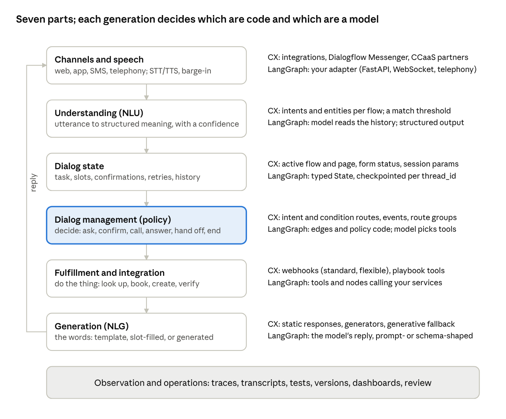
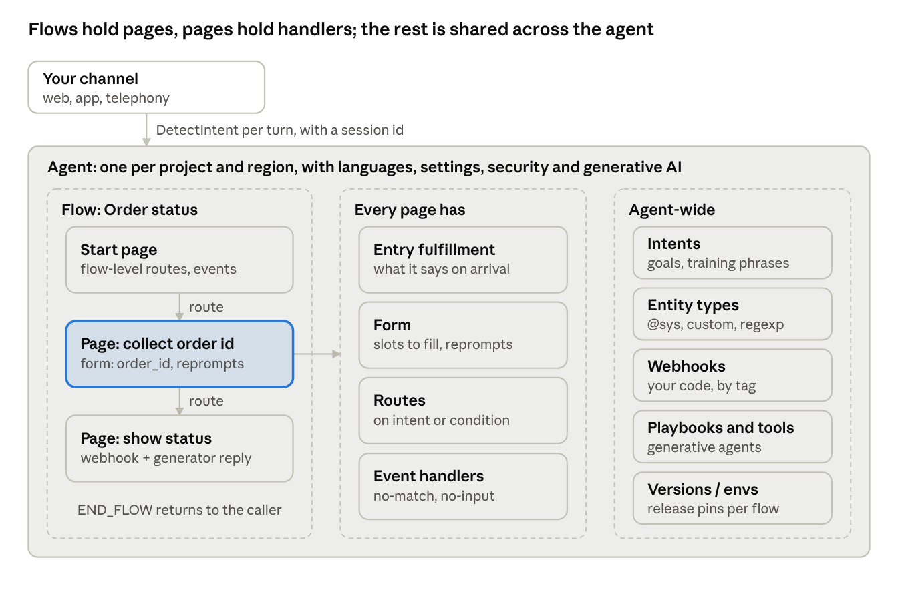
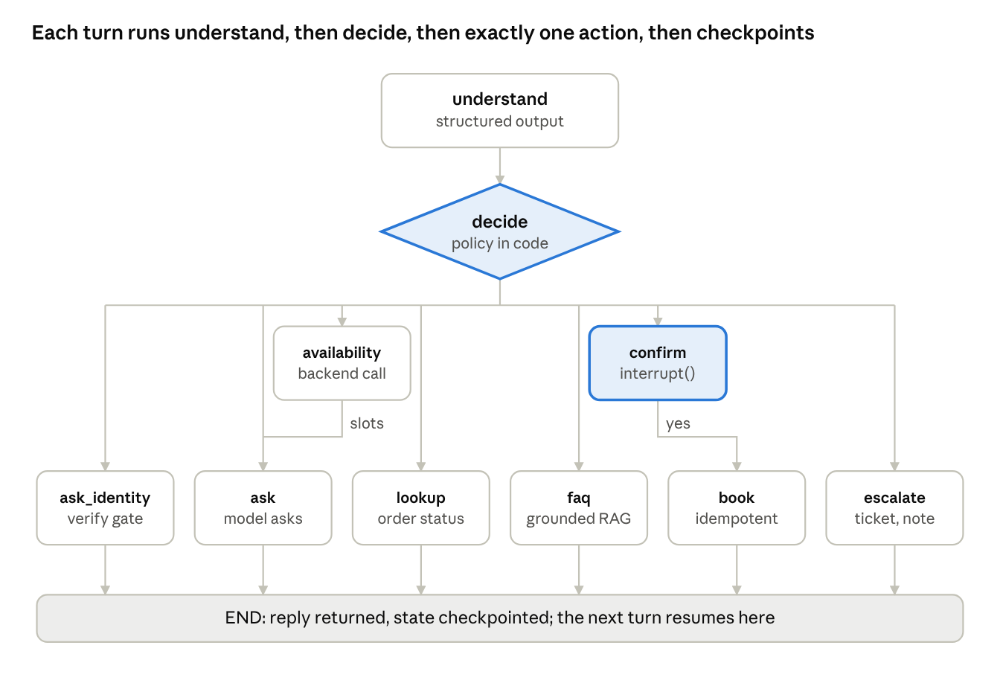
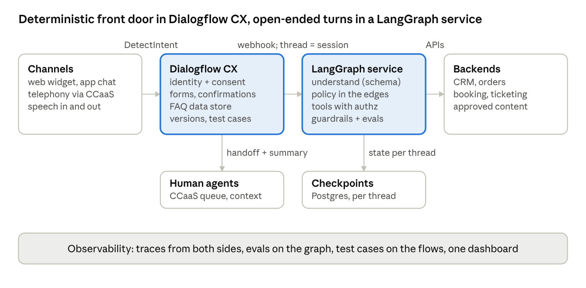

# Conversational AI Primer: Dialogflow CX in Depth, with LangChain and LangGraph as the Alternative

Ahmed Jawad, Ph.D. · October 17, 2026

## Preface

This primer teaches conversational AI the way an engineer needs it for a client project or an interview: the vocabulary, the architecture, one production platform in depth, one code-first alternative in depth, and a defensible way to choose between them. The platform is Google's Dialogflow CX, which Google now surfaces inside the Conversational Agents console together with its generative playbooks; the alternative is LangChain and LangGraph, the LLM-first toolkit in which the model itself does most of the understanding and the dialog management. Both are covered with working code.

It is written for three readers. The engineer who has built chatbots on intent-based platforms and now has to decide how much of that stack to keep in the LLM era. The engineer who has built LLM agents and is asked, by a bank or a telco or a hospital network, why not just use Dialogflow. And the interviewer's counterpart: the candidate who will be asked to design a customer-facing assistant on a whiteboard and defend every box. The final section speaks in the first person because it holds the author's own talking points and experience, drawn from shipping a Dialogflow CX assistant at Noctal, an intent-classification chatbot at E.ON, and human-in-the-loop agentic workflows at Capital Group.

Read Part I once for vocabulary. Read Part II (Dialogflow CX) and Part III (LangGraph) in whichever order matches the job in front of you; each stands alone and each ends with a worked build of the same appointment-and-order assistant, so the two can be compared line by line; two further builds, a voice-first drive-through and a prediction-market agent, follow in sections 13 and 14. Part IV is the decision guide and the interview material. Facts about products are as published on the pages cited in the appendix on 17 October 2026; pricing and model names change, so re-check those two before quoting them to a client.

## Part I — Foundations

## 1. What conversational AI is, and the three generations

Conversational AI is software that holds a goal-directed, multi-turn exchange with a person in natural language, by text or voice, and acts on what it hears. The word that matters is *multi-turn*: a search box answers one query; a conversational system keeps state across turns, asks for what it still needs, recovers from misunderstandings, and finishes a task. Everything in this primer is a technique for doing those four things reliably.

### 1.1 Three generations

**The rule-and-intent generation (roughly 2010 to 2020).** The system has a closed catalogue of *intents* (things a user might want: `check_order_status`, `book_appointment`), each trained from example phrases; a classifier maps each utterance to one intent; *entities* extract the structured values (a date, an order number); and a hand-built *dialog manager*, usually a state machine, decides what to say and do next. Dialogflow ES, Amazon Lex, Microsoft LUIS and Bot Framework, Rasa Open Source and IBM Watson Assistant are this generation. Strengths: deterministic, auditable, cheap per turn, easy to test. Weaknesses: brittle outside the catalogue, expensive to extend, and every sentence the bot says is written by a human.

**The hybrid generation (roughly 2020 to 2023).** The state machine stays in charge of the conversation, but language models help at the edges: better intent classifiers (BERT-class encoders), paraphrase generation for training data, LLM-written responses at specific points, and an LLM *fallback* when nothing matches. Dialogflow CX is the canonical hybrid platform: flows and pages are the deterministic skeleton; generators, generative fallback and data-store answers are the LLM tissue attached to it ([generative vs. deterministic](https://docs.cloud.google.com/dialogflow/cx/docs/generative-deterministic)).

**The LLM-first, agentic generation (2023 onward).** The language model is the dialog manager. It reads the whole conversation, decides which *tool* to call (a function, an API, a database query, a retrieval step), reads the tool's result, and composes the reply. Developers steer it with a system prompt, tool schemas, structured-output schemas and a small amount of code around the model; frameworks such as LangChain and LangGraph, the OpenAI Agents SDK, Google's ADK and Dialogflow's own *playbooks* are this generation. Strengths: handles the long tail of phrasings and tasks nobody enumerated, composes answers from live data, needs far less authoring. Weaknesses: non-deterministic, harder to test and certify, latency and cost per turn an order of magnitude higher, and new failure modes (hallucinated facts, prompt injection, tool misuse) that need their own controls.

The honest summary for a client: the third generation did not make the first two obsolete. It changed the question from "which platform" to "which parts of this conversation must be deterministic, and which parts benefit from a model that improvises?" Section 16 turns that into a decision guide.

### 1.2 Core vocabulary

| Term | Meaning | Dialogflow CX name | LangGraph equivalent |
| --- | --- | --- | --- |
| Utterance | One thing the user says or types in one turn | end-user input, `text` / `transcript` | a `HumanMessage` |
| Intent | The user's goal, from a closed catalogue | Intent, with training phrases | no catalogue; the model infers the goal, or a router node classifies into a small set |
| Entity | A typed value extracted from the utterance | Entity type (system `@sys.date`, custom, regexp, composite) | a structured-output schema (Pydantic) or tool-call arguments |
| Slot / parameter | A value the task needs; collected until complete | Parameter (intent, form, session) | a field in the graph `State`; the model or a node fills it |
| Slot filling / form filling | Asking for missing required values in order | Page form with required parameters and reprompts | a loop node that checks state and asks for what is missing |
| Context / dialog state | What has been established so far | Session parameters, the active flow and page, the flow stack | the checkpointed `State` for a `thread_id` |
| Dialog manager | Decides the next action given state and input | Flows, pages, state handlers (routes, event handlers) | the graph: nodes, edges, conditional edges, and the model's own tool choice |
| Fulfillment | Doing the thing: call a system, fetch data, reply | Fulfillment (static response, generator, webhook) | a tool call or a node that calls a service |
| NLG | Producing the words the assistant says | Static responses, generators, playbook output | the model's reply, often constrained by a prompt or schema |
| Fallback / repair | What happens when input is not understood | `sys.no-match-*` and `sys.no-input-*` events, generative fallback | a clarification node, a retry policy, or the model asking back |
| Handoff / escalation | Passing the user to a human | `END_FLOW_WITH_HUMAN_ESCALATION`, live-agent integrations | an `interrupt()` that waits for a human, or an escalation tool |
| Session | One conversation with a lifetime and an id | Session (id chosen by the client), expires after 30 minutes of inactivity | a thread (`thread_id` in the config), persisted by the checkpointer |
| Channel | Where the conversation happens | Integrations: web, telephony, messaging, contact-center partners | whatever front end you build; the graph is a library |

Two terms from voice deserve a note because they decide architecture even for text-first teams. *Barge-in* is the user interrupting the assistant's speech; a voice platform must stop playback and start listening, which is why Dialogflow bills voice by listened and spoken seconds rather than by turns ([pricing](https://cloud.google.com/products/conversational-agents/pricing)). *Endpointing* is deciding the user has finished speaking; a bad endpointer feels like being interrupted, and no language model fixes it.

## 2. Anatomy of a conversational system, and the design principles that survive every generation

Every conversational system, from a 2012 IVR to a 2026 agent, has the same seven parts; what changes across generations is which parts are code and which are a model. Naming the parts first makes both Dialogflow CX and LangGraph easy to read, because each is just a particular way of filling the boxes.



*The seven parts of a conversational system: what each does, and how Dialogflow CX and LangGraph fill it*

A turn flows down the left column and the reply returns to the channel; the highlighted box, dialog management, is the one whose owner changed across the three generations, from a hand-built state machine to the model itself.

### 2.1 The seven parts

**Channels and speech.** The surface: a web widget, a mobile SDK, WhatsApp or SMS, a contact-center platform, a phone line. Voice adds speech-to-text in front and text-to-speech behind, plus barge-in and endpointing. The channel layer owns the session id and the user identity; everything downstream trusts it for both.

**Understanding (NLU).** Turning an utterance into something structured: an intent and entities in the classic stack, or the model's own reading of the message in an LLM stack. Confidence scores live here, and so does the first decision: *did we understand well enough to act?*

**Dialog state.** What has been established: the task in progress, the values collected, what has been confirmed, how many times the user has been misunderstood in a row, and the history. In Dialogflow CX this is the active flow and page, the form status and the session parameters; in LangGraph it is the typed `State` object the checkpointer saves after every step.

**Dialog management (policy).** Given state and input, decide the next action: ask for a missing value, confirm, call a backend, answer, hand off, or end. Deterministic platforms encode this as a state machine; LLM-first systems delegate most of it to the model's tool choice and keep a thin graph of hard rules around it.

**Fulfillment and integration.** Doing things in the world: looking up an order, booking a slot, creating a ticket. Always code, in every generation; the difference is whether a state machine calls it (webhook) or the model calls it (tool). This is where authorization, idempotency and timeouts live.

**Generation (NLG).** Producing the words. Static templates, templates with parameter slots, model-written text under a prompt, or model-written text constrained by a schema. The more the model writes, the more the system needs a review and guardrail layer.

**Observation and operations.** Transcripts, traces, intent-level and outcome-level analytics, test suites, versioning and environments, human handoff and quality review. The part most often skipped in demos and most often the reason production systems fail quietly.

### 2.2 Design principles that do not depend on the technology

*Design the happy path, then design the repairs; the repairs are the product.* A booking flow that works when the user is cooperative is a demo. Users mis-hear, change their mind, answer two questions at once, ask something unrelated mid-task (a *digression*), or go silent. Each needs a planned response, a maximum retry count and an exit (rephrase, offer choices, hand off). In Dialogflow CX these are the `sys.no-match-1..6` and `sys.no-input-1..6` event handlers; in a LangGraph agent they are explicit counters in state and a branch to escalation.

*Confirm in proportion to risk.* Implicit confirmation ("Booking Tuesday at 3. Which doctor?") for low-stakes values; explicit confirmation ("Shall I cancel order 4471? Yes or no.") before anything irreversible or costly. Never confirm every slot; the conversation becomes a form.

*Ask one thing at a time, but accept many at once.* Prompts should request a single value; the understanding layer should still capture every value the user volunteers ("Tuesday afternoon with Dr. Kim") and skip the questions already answered. Dialogflow CX does this through parameter propagation into the page form; a LangGraph slot-filling node does it by extracting all fields present in the message before deciding what to ask next.

*Keep the user oriented.* Say what the assistant can do at the start, say what it understood when it acts, say what it is doing when it calls a system that takes time, and make leaving or reaching a human obvious at every point. Disorientation, not misunderstanding, is the main reason users abandon assistants.

*Separate what must be deterministic from what may be generated.* Identity verification, consent, payment, anything regulated, anything that writes to a system of record: scripted, logged, tested. Explanations, summaries, answers from documents, small talk: a model may write them, behind guardrails. Most production designs in 2026 are hybrids along exactly this line.

*Measure outcomes, not turns.* Containment rate (resolved without a human), task completion rate, time to completion, escalation reasons, and user-rated satisfaction. Intent accuracy and no-match rate are diagnostics, not goals; a bot can classify perfectly and still fail to help.

*Write for the ear even when it is text.* Short sentences, one idea per message, numbers and dates in the user's format, no markdown in voice, and a persona that is consistent and modest about being software.

## Part II — Dialogflow CX

## 3. Dialogflow CX: the mental model

Dialogflow CX is a state machine for conversations in which Google's models do the understanding and you own the control flow. An *agent* is the whole assistant; it contains *flows*, each a self-contained sub-conversation; a flow contains *pages*, each a state in which the agent is trying to accomplish one thing; and the transitions between pages are *state handlers* that fire on an *intent*, a *condition*, or an *event*. Parameters are collected into page *forms*, remembered as *session parameters*, and acted on through *fulfillment*, which is either a canned response, a generated one, or a *webhook* call to your code. That is the entire model; everything else is detail ([Conversational Agents documentation](https://docs.cloud.google.com/dialogflow/cx/docs)).



*The Dialogflow CX object model: a flow of pages, what every page carries, and the agent-wide resources*

The channel talks to the agent one turn at a time; inside, the highlighted page is where a form collects values and its routes decide the next page, while intents, entities, webhooks, playbooks and release pins are defined once for the whole agent.

### 3.1 Where it sits in Google's product line in 2026

Google has folded the Dialogflow CX console and the former Vertex AI Agent Builder console into one **Conversational Agents** console, which builds agents from deterministic *flows* and generative *playbooks* against the same Dialogflow API; the old Dialogflow CX console is marked deprecated, and the documentation notes that some products are still being renamed ([console overview](https://docs.cloud.google.com/dialogflow/cx/docs/concept/console-conversational-agents)). Dialogflow ES, the older single-flow product, still exists and is priced separately; nothing in this primer uses it. In conversation with Google people and in job descriptions you will hear "Dialogflow CX", "CX agent", "Conversational Agents" and "CES" (the Customer Engagement Suite umbrella that also holds Agent Assist and Conversational Insights) used interchangeably; they all mean this agent model.

### 3.2 The hierarchy, top down

**Agent.** One per project-and-region (for example `projects/p/locations/us-central1/agents/a`). Holds the default language and extra languages, the time zone, speech settings, generative-AI settings (which Gemini model playbooks use, banned phrases), security settings (redaction, retention), and the list of flows, intents, entity types, webhooks, playbooks, tools, generators, versions and environments. Exportable as a JSON or a ZIP blob, which is how agents move between environments and into source control.

**Flow.** A reusable sub-conversation with its own start page, its own NLU model and its own flow-level routes and event handlers. A typical customer-service agent has a Default Start Flow that greets and routes, then one flow per task: `Order status`, `Book appointment`, `Cancel`, `Account`. Flows call each other like functions: a route targets another flow, that flow runs, and `END_FLOW` returns to the calling page with the caller's state intact. The flow stack is limited to 25 nested flows ([state handlers](https://docs.cloud.google.com/dialogflow/cx/docs/concept/handler)).

**Page.** A state with a purpose: "collect the appointment details", "show order status", "confirm cancellation". A page has an *entry fulfillment* (what the agent says on arrival), a *form* (the parameters it must collect, in order, each with its own prompt and reprompt handlers), and its own routes and event handlers. The agent is always on exactly one page of exactly one flow; that pair plus the session parameters is the dialog state.

**State handlers.** Three kinds. *Intent routes* fire when the user's utterance matches an intent (optionally also requiring a condition). *Condition routes* fire when an expression over parameters is true, with no user input needed; the canonical example is `$page.params.status = "FINAL"`, which fires when the page's form is complete. *Event handlers* fire on built-in or custom events: `sys.no-match-default`, `sys.no-input-default`, `webhook.error`, `flow-cancelled`, and so on. Every handler has requirements, an optional fulfillment and an optional transition target (a page, a flow, or a symbolic target such as `END_FLOW` or `END_SESSION`).

**Intents and entity types.** Agent-wide. An intent is a name, training phrases and the parameters annotated in them; the NLU model is trained per flow on the intents that flow's routes reference, which is why the same intent can mean different things in different flows. Entity types are system (`@sys.date`, `@sys.number`, `@sys.person`, dozens more), custom with synonyms, regexp, or composite (an entity whose value is a structured object of other entities).

**Parameters.** Three scopes that confuse everyone the first week: *intent parameters* exist only in the turn the intent matched; *form parameters* belong to a page and are referenced only through their status (`$page.params.status`, `$page.params.<name>.status`); *session parameters* are created automatically whenever any parameter is set and live for the session, referenced as `$session.params.<name>`. Propagation rules tie them together: a matched intent parameter fills a same-named form parameter on the active page, and a page activating pulls same-named session parameters into its form ([parameters](https://docs.cloud.google.com/dialogflow/cx/docs/concept/parameter)).

**Fulfillment.** What a handler or a page entry *does*: static response messages (text, rich payloads for the channel, speech markup), parameter presets, a *generator* (an LLM prompt whose output lands in a session parameter), and a *webhook* with a *tag* that your code reads to know which fulfillment called it. The webhook can reply with messages, set session or form parameters, mark a parameter invalid, and force a transition to a page or flow.

**Session.** Identified by a client-chosen id in the request path; the state and parameters persist for 30 minutes of inactivity and then expire. The client (your web app, the telephony gateway) sends each utterance as a `DetectIntent` call on that session and receives the response messages plus the full `QueryResult` (matched intent, confidence, parameters, current page).

### 3.3 One turn, step by step

1. The channel sends `DetectIntent` with the session id and the user's text or audio.
2. Dialogflow runs the active flow's NLU model over the utterance: intent match with a confidence, entity extraction, and the result compared against the agent's classification threshold (default 0.3; below it, the turn is a no-match).
3. If the current page has an active form, the utterance is first used to fill the parameter being collected; matched intent parameters also propagate into the form.
4. Handlers are evaluated in scope order: page-level routes, page-level route groups, flow-level routes, flow-level route groups for intents; for condition-only routes, page level first and flow level only on the flow's start page; for events, parameter level, then page, then flow ([evaluation order](https://docs.cloud.google.com/dialogflow/cx/docs/concept/handler)).
5. The first handler whose requirements are met runs its fulfillment (including any webhook); if it has a transition target, evaluation stops and the agent moves there, running the new page's entry fulfillment and starting its form.
6. If the form is now complete, the page's `$page.params.status = "FINAL"` condition route typically fires in the same turn and transitions onward.
7. The response messages accumulated along the way are returned, and the session parameters are saved.

The one rule to remember: *an intent is consumed when it matches, a condition is not.* Only one intent route can fire per turn, but several condition routes can fire in sequence, which is how a single utterance can fill a form, trigger the completion route, call a webhook and land on a confirmation page in one round trip.

### 3.4 What CX is not

It is not an LLM agent framework, even with playbooks attached; the flow model is the product and the generative pieces are bolted onto it with deliberately narrow interfaces (a parameter here, a no-match handler there). It is not a channel; integrations exist but the web widget and telephony gateways are thin, and enterprise deployments usually front it with a contact-center platform (Genesys, Avaya, Twilio, Google's own CCaaS). And it is not cheap to author: a serious agent has dozens of pages and hundreds of training phrases, and the discipline to maintain them is the main hidden cost.

## 4. Dialogflow CX concepts in depth

This section is the reference you reach for while building. It covers the pieces that the mental model in section 3 named but did not specify: condition syntax, route groups, the event catalogue, forms and reprompts, the webhook contract, and the version-and-environment model that makes an agent deployable.

### 4.1 Conditions and the expression language

A condition is a boolean expression over parameters and system values. Comparisons use `=`, `!=`, `<`, `<=`, `>`, `>=`, the string operator `:` (contains), and `AND`/`OR` with parentheses. References you will use constantly:

| Reference | Meaning |
| --- | --- |
| `$session.params.order_id` | A session parameter (any parameter set at runtime) |
| `$session.params.address.city` | A member of a composite parameter |
| `$page.params.status = "FINAL"` | The current page's form is complete |
| `$page.params.date.status = "UPDATED"` | That form parameter was filled this turn |
| `$intent.params.size.resolved` / `.original` | A parameter from the intent that just matched (static responses on intent routes only) |
| `$flow.retries` | A flow-scoped parameter that does not persist to the session |
| `$request.nlu-confidence-score`, `$request.user-utterance`, `$request.language`, `$request.payload.channel` | Request-scoped values and the client's custom payload |
| `$request.knowledge.answers[0]`, `$request.knowledge.sources[0]` | Data-store handler results |
| `$sys.func.NOW()`, `$sys.func.IF(cond, a, b)`, `$sys.func.CONCATENATE(...)`, `$sys.func.COUNT(list)`, `$sys.func.rand()` | System functions, usable in conditions and in fulfillment text |

The condition `$sys.func.rand() < 0.1` is the documented way to A/B a response on 10% of traffic; `true` is the idiom for "always transition after entry fulfillment" ([state handlers](https://docs.cloud.google.com/dialogflow/cx/docs/concept/handler), [parameters](https://docs.cloud.google.com/dialogflow/cx/docs/concept/parameter)).

### 4.2 Routes, route groups and scope

A route is an intent requirement, a condition requirement, or both; when both are present both must hold. Routes live on pages or on the flow's start page (flow-level). *Transition route groups* bundle routes so that a set of intents ("talk to a human", "start over", "what can you do") is available from many pages without copy-paste: define the group once, attach it to pages or to the whole flow. The scope rules decide what is live on a given turn: page-level routes while their page is active; flow-level routes on the start page always, and on other pages only if they have an intent requirement (so a flow-level condition route cannot hijack a page); event handlers for the active flow, the current page and the parameter being filled. Among candidates, page-level beats flow-level, and a handler with a transition target ends evaluation while one without lets evaluation continue ([state handlers](https://docs.cloud.google.com/dialogflow/cx/docs/concept/handler)).

Design consequence: put *digressions* (FAQ intents the user may raise mid-task) in a flow-level route group with no transition target, or with a transition back to `CURRENT_PAGE`; the answer is spoken and the form resumes. Put *task switches* ("actually, cancel my order") in flow-level routes that target the other flow.

### 4.3 Events

Events are how the platform tells the agent something happened that is not an intent. The built-ins, from the documentation: `sys.no-match-default` and `sys.no-match-1` through `sys.no-match-6`, counted per page or parameter and fired in order (the numbered handlers run first, then the default); `sys.no-input-default` and `sys.no-input-1..6` for silence or empty input; `sys.invalid-parameter`, raised when a webhook sets a form parameter's state to `INVALID`; `sys.long-utterance` for input over 256 characters; `webhook.error` and its specific forms `webhook.error.timeout`, `.bad-request`, `.rejected`, `.unavailable`, `.not-found`; and the flow-ending events `flow-cancelled`, `flow-failed` and `flow-failed-human-escalation`, raised by the matching symbolic targets. Every flow is created with no-match and no-input default handlers that cannot be deleted. You can also define custom events and fire them from the client through `queryInput.event` to inject state ("payment succeeded") without a user utterance ([state handlers](https://docs.cloud.google.com/dialogflow/cx/docs/concept/handler)).

The escalation ladder is a pattern, not a feature: `sys.no-match-1` rephrases the question, `sys.no-match-2` offers choices or an example, `sys.no-match-3` transitions to a handoff page. Three strikes is the convention; voice channels often use two.

### 4.4 Forms, required parameters and reprompts

A page's form lists parameters in collection order. Each has a display name, an entity type, a required flag, an `isList` flag, a redaction flag, an initial prompt and reprompt handlers; optional parameters may have a default (required ones ignore defaults). Collection proceeds in order until every required parameter is filled, then `$page.params.status` becomes `FINAL`. A webhook can set a parameter's state back to `INVALID` after checking it against a backend ("that order number does not exist"), which raises `sys.invalid-parameter` and reprompts. Values the user volunteers early are captured through propagation; values from earlier pages arrive through same-named session parameters when the page activates ([parameters](https://docs.cloud.google.com/dialogflow/cx/docs/concept/parameter)).

Redaction matters for regulated clients: "Redact in log" on a parameter replaces its value in logs and internal storage with `$<name>_redacted`; only text input can be redacted, so voice transcripts of a card number still need to be handled by not collecting them in the agent at all (collect through DTMF to a secure IVR, or hand off).

### 4.5 The webhook contract

A *standard webhook* receives a fixed `WebhookRequest` and returns a `WebhookResponse`; a *flexible webhook* lets you shape the request body and map response fields, for calling existing APIs without an adapter. Standard is the one to learn. The request carries `detectIntentResponseId`, the query (`text`, `transcript`, `triggerIntent`, `triggerEvent` or `dtmfDigits`), `languageCode`, `fulfillmentInfo.tag`, `intentInfo` (`lastMatchedIntent`, `displayName`, `parameters` with `originalValue` and `resolvedValue`, `confidence`), `pageInfo` (`currentPage`, `displayName`, `formInfo.parameterInfo[]` with `displayName`, `required`, `state`, `value`, `justCollected`), `sessionInfo` (`session`, `parameters`), the `messages` accumulated so far, the client `payload`, and `sentimentAnalysisResult` when enabled ([WebhookRequest](https://docs.cloud.google.com/dialogflow/cx/docs/reference/rest/v3/WebhookRequest)). The response may set `fulfillmentResponse.messages` with a `mergeBehavior` of `APPEND` or `REPLACE`, `sessionInfo.parameters`, `pageInfo.formInfo.parameterInfo` (to mark a parameter `INVALID` or `EMPTY`), a free-form `payload` returned to the client, and exactly one of `targetPage` or `targetFlow` to force a transition ([WebhookResponse](https://docs.cloud.google.com/dialogflow/cx/docs/reference/rest/v3/WebhookResponse)).

A minimal response that looks up an order and sets two session parameters:

```json
{
  "fulfillmentResponse": {
    "messages": [{"text": {"text": ["Order 4471 shipped on Tuesday and arrives Friday."]}}],
    "mergeBehavior": "APPEND"
  },
  "sessionInfo": {
    "parameters": {"order_status": "shipped", "eta": "2026-10-23"}
  }
}
```

And one that rejects the collected value and keeps the form open:

```json
{
  "pageInfo": {
    "formInfo": {
      "parameterInfo": [{"displayName": "order_id", "required": true, "state": "INVALID"}]
    }
  },
  "fulfillmentResponse": {
    "messages": [{"text": {"text": ["I could not find an order with that number."]}}]
  }
}
```

Operational rules: the webhook has a configurable timeout (up to 30 seconds; keep p99 under 2 seconds for voice), is called with a service-agent identity or a static header you configure, should be idempotent per `detectIntentResponseId`, and must handle every tag it is registered for; a tag it does not recognise should return an empty 200, not a 500, or the `webhook.error` ladder fires.

### 4.6 Versions, environments and the release model

Each flow is versioned independently: a *version* is an immutable snapshot of one flow (its pages, routes and trained NLU). An *environment* (for example `draft`, `staging`, `production`) pins a specific version of every flow, and the client selects the environment in the session path (`.../agents/a/environments/e/sessions/s`). Editing in the console changes the draft; nothing reaches production until a version is cut and the environment is updated, which makes rollback a one-field change. Environments also carry their own webhook URLs and test-case runs, so staging can point at a staging backend. Treat the exported agent blob plus the version-pin table as the deployable artifact; section 7 shows the automation.

### 4.7 Settings that bite

*ML classification threshold* (per flow, default 0.3): below it the turn is a no-match. Raising it reduces wrong matches and increases no-matches; tune it with the test suite, not by feel. *Advanced NLU* improves intent matching for complex agents at some latency. *Spell correction* helps typed channels and hurts product codes. *Speech adaptation* and *endpointer sensitivity* decide how voice feels. *Logging* (Cloud Logging interaction logs, conversation history) is off by default and must be on for analytics and for debugging production. *Agent settings → Generative AI* holds the model choice for playbooks, the banned-phrase list that also governs generators and generative fallback, and the generative-fallback prompt templates ([generative fallback](https://docs.cloud.google.com/dialogflow/cx/docs/concept/generative-fallback)).

## 5. Generative features: generators, generative fallback, data stores, playbooks and tools

Google attached large language models to Dialogflow CX at four points, in increasing order of how much control the model takes: *generators* write a value inside a deterministic flow; *generative fallback* answers when the flow has no idea what the user said; *data stores* answer questions from your documents and website; *playbooks* run whole conversations from natural-language instructions and call *tools*. The first three live inside flows and keep the flow in charge; playbooks are a second kind of agent that can call flows and be called by them ([generative vs. deterministic](https://docs.cloud.google.com/dialogflow/cx/docs/generative-deterministic)).

### 5.1 Generators

A generator is a prompt attached to a fulfillment (route, event handler, page entry, parameter reprompt) whose output is written to a session parameter you name. Placeholders in the prompt are `$conversation` (the history, excluding the latest user turn), `$last-user-utterance`, and any `$word` you declare and map to a session parameter. Several generators on one fulfillment run in parallel. Typical jobs from Google's own examples: summarise the conversation for the handoff note, extract a structured value from a messy utterance, rewrite a backend JSON blob into a sentence, generate a search query, or decide whether the user wants a human. The result is referenced as `$session.params.<output>` in the next response or condition. Generators are excluded from the Dialogflow SLA and share the agent's banned-phrase list; the simulator shows the resolved prompt under "Generators LLM Inputs", which is where you discover that a `$` in a price was read as a placeholder ([generators](https://docs.cloud.google.com/dialogflow/cx/docs/concept/generators)).

A generator prompt that turns a webhook result into a spoken answer:

```text
You are a support assistant. Using only the facts in $order_json, tell the customer in one
sentence where their order is and when it arrives. Use the customer's words from
$last-user-utterance to decide whether they asked about timing or location. Do not invent
dates. If $order_json is empty, say you could not find the order.
```

### 5.2 Generative fallback

Generative fallback replaces the scripted "Sorry, I didn't get that" on a `sys.no-match-*` handler with a model-written reply, and silently falls back to the scripted text if generation fails or trips a banned phrase. It is enabled per handler (flow start page, any page, any parameter) and configured under *Agent Settings → Generative AI → Generative Fallback*, where you pick or write a prompt template. The default template handles greetings, goodbyes, "repeat that", "hold on" and "summarise"; a custom template can use `$conversation`, the parameterised `${conversation USER:"..." AI:"..." TURNS:n}`, `$last-user-utterance`, `$flow-description` and `$route-descriptions`, which is why writing good flow and intent descriptions suddenly matters: they are the model's only map of what the agent can do. It is available only in languages the Gemini API supports and is excluded from the SLA ([generative fallback](https://docs.cloud.google.com/dialogflow/cx/docs/concept/generative-fallback)).

Design rule: generative fallback is for *recovery*, not for answering. Its prompt should steer the user back to what the flow can do ("I can check an order or book an appointment"), never promise actions the flow cannot take, and never state facts from memory.

### 5.3 Data stores

A data store is an index over your content, built on Vertex AI Search, that a flow can query to answer questions it has no intent for. Three connection types: `PUBLIC_WEB` (crawled site content), `UNSTRUCTURED` (uploaded PDFs, HTML, documents) and `STRUCTURED` (FAQ pairs, where an entry overrides the generated answer for its question). In a flow it is attached as a *data store handler*, a special state handler on a page or flow that fires when no intent matches and the retrieved content answers the question; the response then references `$request.knowledge.answers[0]`, with `$request.knowledge.sources[0]` for citations, `$request.knowledge.grounding_confidences[0]` for a grounding score and `$request.knowledge.questions[0]` for the matched FAQ question. A new data store takes up to 15 minutes to become queryable and new content up to 4 hours to index; supported regions are `global`, `us` and `eu`; the feature is excluded from the SLA ([data store handlers](https://docs.cloud.google.com/dialogflow/cx/docs/concept/data-store/handler)). In a playbook the same index is a *data store tool*. Storage is free to 10 GiB a month and $5.00 per GiB-month beyond, with refreshes free ([pricing](https://cloud.google.com/products/conversational-agents/pricing)).

A grounding score threshold plus a scripted fallback below it is the standard safety pattern; for regulated clients, pair it with an FAQ data store for the answers legal has approved, so the override wins when the question is one of those.

### 5.4 Playbooks

A playbook is Google's LLM agent inside the same product: a name, a *goal*, *instructions* (numbered steps in natural language), *examples* (sample conversations used as few-shot prompts), *parameters* and a set of *tools*. Each turn, Dialogflow assembles a prompt from the playbook's goal and instructions, as many examples as fit, the available tools and the conversation, and lets the model decide what to say or which tool to call. Instructions reference tools, other playbooks and flows by name with the `${TOOL: name}`, `${PLAYBOOK: name}` and `${FLOW: name}` markers, which is how a playbook hands a verified step ("take payment") to a deterministic flow and gets control back ([playbooks](https://docs.cloud.google.com/dialogflow/cx/docs/concept/playbook)).

Two kinds. *Routine playbooks* are sequential stages of a conversation: they read session parameters on entry, write them on exit, can call task playbooks and transition to other routines or flows, and if they do not transition the session returns to the last flow or ends. *Task playbooks* are reusable sub-tasks with explicit input and output parameters, called by routines or other tasks; each nested call is another LLM call, so deep chains cost latency and can regenerate parameters. The console creates a *Default Generative Playbook* as the entry point. The model is chosen at the agent level (Agent settings → Generative AI → Playbook) or per request through `query_params.llm_model_settings.model`; the documented GA choices on 17 October 2026 are `gemini-2.5-flash`, `gemini-2.5-flash-lite`, `gemini-3.1-flash-lite` and `gemini-3.5-flash-lite`, with playbook languages tested on `gemini-2.5-flash`. Playbooks do not support DTMF input ([playbooks](https://docs.cloud.google.com/dialogflow/cx/docs/concept/playbook)).

A playbook that does the appointment task, in the documented style:

```text
Goal
Help the customer book, change or cancel an appointment at one of our clinics.

Instructions
- Greet the customer and ask what they need.
- If they want to book, collect the clinic, the preferred date and time, and the reason in one or two questions.
- Use ${TOOL: clinic-availability} to find open slots; offer at most three.
- Once the customer picks a slot, confirm the clinic, date, time and reason back to them and wait for a yes.
- On yes, use ${FLOW: verify-identity} and then ${TOOL: book-appointment}.
- Read back the confirmation number. If the tool fails, apologise and offer ${FLOW: human-handoff}.
- Never invent availability. Never discuss prices; say that the clinic will confirm cost.
```

### 5.5 Tools

Tools are what playbooks act with. **OpenAPI tools** wrap any REST API described by an OpenAPI schema (the console can draft the schema with Gemini and test it); authentication options are the Dialogflow Service Agent's ID token (grant it `roles/run.invoker` for Cloud Run), a service account whose token Dialogflow mints, an API key in a header or query string, OAuth client-credentials, or a bearer token taken from a session parameter; secrets belong in Secret Manager with `roles/secretmanager.secretAccessor` for the service agent; mutual TLS and custom CAs are agent-level settings, and private VPC targets are reached through Service Directory. Parameters bind to session values with `x-agent-input-parameter` and the session id with `@dialogflow/sessionId`; path, query and header parameters of scalar or array type are supported, request and response bodies must be JSON. **Data store tools** expose an index to the model with configurable citations and fallback. **Function tools** run on the client: the agent returns a tool call with arguments, the session pauses, your client executes and sends back a `toolCallResult`; OpenAPI and data store tools can also be forced client-side with `playbook_execution_mode: ALWAYS_CLIENT_EXECUTION`. **Connector tools** use Integration Connectors (about seventy systems, BigQuery, Salesforce and PostgreSQL among them) for entity CRUD and connector-specific actions such as `ExecuteCustomQuery`, with the connection in the agent's region. The built-in **Code Interpreter** generates and runs code for calculations and data analysis ([tools](https://docs.cloud.google.com/dialogflow/cx/docs/concept/playbook/tool)).

### 5.6 What the generative layer costs

Chat turns in flows are $0.007 per request and in playbooks $0.012; voice is $0.001 per second in flows and $0.002 per second in playbooks, billed on listened plus spoken seconds rounded up per turn. There is no separate charge for generators, generative fallback or data-store queries: a flow turn that uses any of them is billed as a playbook request, and in a voice session where a playbook calls a flow the whole conversation bills at the playbook rate. New users get $600 of flow credit and $1,000 of playbook credit for twelve months ([pricing](https://cloud.google.com/products/conversational-agents/pricing)). The practical reading: a generator on every turn nearly doubles the chat bill, so put generators where they change the outcome, not where a template would do.

## 6. Worked build: an appointment and order-status agent in Dialogflow CX

The example used in both halves of this primer is a clinic-and-pharmacy assistant that can tell a customer where their order is and book, change or cancel an appointment, with identity verification before anything personal is read out and a human handoff when the assistant is stuck. It is small enough to hold in your head and large enough to exercise every concept: multiple flows, forms, webhooks, digressions, repair, escalation and a generative fallback.

### 6.1 Conversation design before configuration

Start from the outcomes and the user's likely first sentences, not from the console. Outcomes: *order status told*, *appointment booked / changed / cancelled*, *handed to a human with context*, *politely ended*. Likely openings: "where is my order", "I need to see a doctor next week", "cancel my Thursday appointment", "what are your hours", "I want to talk to someone". Rules the business imposes: verify identity (date of birth plus postcode) before reading any order or appointment detail; never give medical advice; after three misunderstandings in a row, hand off; confirm explicitly before cancelling anything.

That yields five flows and about a dozen pages:

| Flow | Pages | Purpose |
| --- | --- | --- |
| Default Start Flow | Start | Greet, state capabilities, route to a task flow; hold the flow-level route group for digressions (hours, location, "talk to a human", "start over") |
| Verify Identity | Collect DOB & postcode → Verified / Not verified | Form with two required parameters; webhook `verify-identity`; returns to caller with `$session.params.verified = true` |
| Order Status | Collect order id → Show status | Form with `order_id`; webhook `lookup-order` validates and fills `order_status`, `eta`; generator writes the spoken summary |
| Appointments | Intake → Offer slots → Confirm → Done / Cancel confirm | Forms for clinic, date, time window, reason; webhooks `check-availability`, `book-appointment`, `cancel-appointment`; explicit yes/no confirmation page |
| Human Handoff | Summarise → Transfer | Generator summarises the conversation into `handoff_note`; webhook `create-ticket`; `END_FLOW_WITH_HUMAN_ESCALATION` |

### 6.2 Intents and entities

Agent-wide intents, each with 15 to 30 training phrases that vary vocabulary, length and word order (the model generalises from variety, not from volume):

- `order.status` — "where's my order", "track order 4471", "has my prescription shipped", "delivery status" — annotated parameter `order_id` of a custom regexp entity `@order_id` matching `[0-9]{4,8}`.
- `appointment.book`, `appointment.change`, `appointment.cancel` — with `@sys.date-time`, `@sys.date`, `@sys.time` and a custom `@clinic` entity with synonyms per site ("downtown", "Main Street clinic", "the one on Main").
- `faq.hours`, `faq.location`, `agent.human`, `agent.restart`, `smalltalk.thanks` — digressions and controls, grouped in a route group attached at flow level.
- `confirm.yes` and `confirm.no` — kept deliberately broad ("yep", "go ahead", "that's right" / "no", "wait", "not that one").

Entities worth the extra care: `@sys.date-time` resolves relative phrases ("next Tuesday afternoon") against the agent's time zone, so set the time zone per agent and pass the user's zone in the request payload if it differs; `@order_id` as a regexp avoids the model inventing numbers; `@clinic` with `isList=false` and fuzzy matching on.

### 6.3 Pages and routes for the Appointments flow

*Intake page.* Entry fulfillment: "Which clinic, and roughly when?" Form: `clinic` (`@clinic`, required), `date` (`@sys.date`, required), `time_window` (`@time_window`, custom: morning / afternoon / evening, required), `reason` (`@sys.any`, optional, redacted in logs). Reprompts: `sys.no-match-1` on `clinic` lists the three clinics; `sys.no-match-2` offers to text a link; `sys.no-match-3` targets the Human Handoff flow. Route: condition `$page.params.status = "FINAL"`, fulfillment webhook tag `check-availability`, target *Offer slots*.

*Offer slots page.* Entry fulfillment reads `$session.params.slots_spoken` (set by the webhook). Routes: `confirm.yes` with condition `$sys.func.COUNT($session.params.slots) = 1` → *Confirm*; intent `appointment.pick` with parameter `slot_index` → *Confirm*; `confirm.no` → back to *Intake* with `date` cleared by a parameter preset (`$session.params.date = null`); `sys.no-match-default` with generative fallback enabled.

*Confirm page.* Entry: "That's $session.params.clinic on $session.params.date\_spoken at $session.params.slot\_spoken. Shall I book it?" Routes: `confirm.yes` → webhook `book-appointment` → *Done*; `confirm.no` → *Offer slots*. This page's intent routes are the only place `confirm.yes` leads to a booking; the same intent on other pages does other things, which is why intents are routed per page.

*Done page.* Entry: reads back `$session.params.confirmation_number`; condition route `true` → `END_FLOW`, which returns to the Default Start Flow's start page, where the agent asks "Anything else?"

The identity gate is a flow-level condition route on the Appointments flow's start page: `$session.params.verified != true` → target flow *Verify Identity*; when that flow ends with `END_FLOW`, control returns and the start page's `true` route proceeds to *Intake*.

### 6.4 The webhook

One Cloud Run service, one endpoint, dispatch on the tag. The code below is complete enough to deploy; the two backend functions are stubs for your systems.

```python
# webhook/main.py  — Dialogflow CX standard webhook on Cloud Run (Python 3.12, FastAPI)
from datetime import date, datetime
from typing import Any

from fastapi import FastAPI, Header, HTTPException, Request

from backend import appointments, identity, orders  # your systems of record

app = FastAPI()
WEBHOOK_SECRET = "set-from-secret-manager"  # Dialogflow sends it as a static header you configure


def say(*lines: str) -> dict[str, Any]:
    return {"text": {"text": list(lines)}}


def response(messages=None, params=None, invalid: list[str] | None = None,
             target_page: str | None = None) -> dict[str, Any]:
    body: dict[str, Any] = {}
    if messages:
        body["fulfillmentResponse"] = {"messages": messages, "mergeBehavior": "APPEND"}
    if params:
        body["sessionInfo"] = {"parameters": params}
    if invalid:
        body["pageInfo"] = {"formInfo": {"parameterInfo": [
            {"displayName": name, "required": True, "state": "INVALID"} for name in invalid]}}
    if target_page:
        body["targetPage"] = target_page
    return body


def session_params(req: dict[str, Any]) -> dict[str, Any]:
    return (req.get("sessionInfo") or {}).get("parameters") or {}


@app.post("/dialogflow")
async def dialogflow(request: Request, x_webhook_secret: str = Header(default="")):
    if x_webhook_secret != WEBHOOK_SECRET:
        raise HTTPException(status_code=401)
    req = await request.json()
    tag = req["fulfillmentInfo"]["tag"]
    params = session_params(req)
    handler = HANDLERS.get(tag)
    if handler is None:
        return {}  # unknown tag: say nothing, let the flow continue
    return handler(req, params)


def verify_identity(req, params):
    ok = identity.verify(dob=params.get("dob"), postcode=params.get("postcode"),
                         session=req["sessionInfo"]["session"])
    if not ok:
        return response([say("Those details don't match what we have. Let's try the date of birth again.")],
                        params={"verify_attempts": int(params.get("verify_attempts") or 0) + 1},
                        invalid=["dob"])
    return response(params={"verified": True, "customer_id": identity.customer_id_for(params["dob"], params["postcode"])})


def lookup_order(req, params):
    order = orders.get(params.get("order_id"), customer_id=params.get("customer_id"))
    if order is None:
        return response([say("I couldn't find an order with that number on your account.")], invalid=["order_id"])
    return response(params={"order_status": order.status, "eta": order.eta.isoformat(),
                            "order_json": order.model_dump_json()})  # the generator reads order_json


def check_availability(req, params):
    slots = appointments.free_slots(clinic=params["clinic"], day=date.fromisoformat(params["date"][:10]),
                                    window=params["time_window"], limit=3)
    if not slots:
        return response([say("Nothing is free then. Would another day work?")],
                        params={"date": None, "slots": []}, target_page=params.get("intake_page"))
    spoken = "; ".join(f"option {i + 1}, {s.strftime('%-I:%M %p')}" for i, s in enumerate(slots))
    return response(params={"slots": [s.isoformat() for s in slots], "slots_spoken": spoken})


def book_appointment(req, params):
    slot = datetime.fromisoformat(params["slots"][int(params.get("slot_index") or 0)])
    booking = appointments.book(customer_id=params["customer_id"], clinic=params["clinic"], when=slot,
                                reason=params.get("reason"),
                                idempotency_key=req["detectIntentResponseId"])
    return response(params={"confirmation_number": booking.reference, "slot_spoken": slot.strftime("%A %-d %B at %-I:%M %p")})


def create_ticket(req, params):
    ticket = appointments.handoff_ticket(customer_id=params.get("customer_id"), note=params.get("handoff_note"),
                                         transcript_ref=req["sessionInfo"]["session"])
    return response([say(f"I've passed this to a colleague with reference {ticket.reference}.")])


HANDLERS = {
    "verify-identity": verify_identity,
    "lookup-order": lookup_order,
    "check-availability": check_availability,
    "book-appointment": book_appointment,
    "create-ticket": create_ticket,
}
```

Points a reviewer will look for: the secret header check (or, better, the Dialogflow service-agent ID token verified with Google's library); idempotency on the booking call keyed by `detectIntentResponseId`, because Dialogflow retries on timeout; the `INVALID` state rather than a free-text error so the form machinery reprompts; `None` to clear a parameter; and the unknown-tag path that returns `{}` rather than an error. Deploy with `gcloud run deploy webhook --source . --no-allow-unauthenticated` and give the Dialogflow service agent `roles/run.invoker`.

### 6.5 Generator, fallback and the handoff note

On the *Show status* page the entry fulfillment runs the generator from section 5.1 with `$order_json` mapped to `session.params.order_json`, output parameter `status_spoken`, and then says `$session.params.status_spoken`. On the Default Start Flow the `sys.no-match-default` handler has generative fallback enabled with a custom template that lists the two tasks and offers a human. On the Human Handoff flow's first page a generator with the prompt "Summarise the conversation so far for a human agent in three lines: who the customer is, what they want, what has already been tried. Use `$conversation`." writes `handoff_note`, which the `create-ticket` webhook posts to the ticketing system before the `END_FLOW_WITH_HUMAN_ESCALATION` target fires and the contact-center integration routes the call.

### 6.6 A transcript through the design

User: "hi, I need to move my appointment" → `appointment.change` matches on the start page → Appointments flow → identity gate fires → Verify Identity flow asks DOB and postcode (two turns) → webhook sets `verified` → `END_FLOW` → Appointments start page `true` route → *Change intake* page lists upcoming appointments from `list-appointments` → user: "the Thursday one, to next week same time" → `@sys.date` resolves, `time_window` propagates from the existing booking → `check-availability` → *Offer slots* → user: "the first one" → `appointment.pick` with `slot_index` → *Confirm* → "Yes" → `book-appointment` and `cancel-appointment` in one fulfillment → *Done* reads the confirmation → `END_FLOW` → "Anything else?" → "what time do you close" → `faq.hours` from the route group answers without leaving the page → "no that's all" → `END_SESSION`. Nine turns, two webhooks with side effects, one generator, no human.

## 7. Programmatic Dialogflow CX: the client API, agent export, Terraform and CI/CD

Everything the console does is a REST or gRPC call on the Dialogflow API (`dialogflow.googleapis.com`, v3), and the two things a team must automate are *talking to the agent* (the client side of every channel you build yourself) and *shipping the agent* (moving a tested definition from draft to production without clicking).

### 7.1 Detecting intent from your own client

The Python client is `google-cloud-dialogflow-cx`; regional agents need the regional endpoint, and the session id is yours to choose (a UUID per conversation, or the user's conversation id from your channel). Pass business context in `query_params.parameters` (it becomes session parameters) and channel metadata in `query_params.payload` (readable as `$request.payload.*`) ([detect intent samples](https://docs.cloud.google.com/dialogflow/cx/docs/how/detect-intent-stream)).

```python
import uuid
from google.cloud.dialogflowcx_v3.services.sessions import SessionsClient
from google.cloud.dialogflowcx_v3.types import session as df
from google.protobuf import struct_pb2

PROJECT, LOCATION, AGENT, ENV = "my-project", "us-central1", "3f1c...", "production"


def make_client(location: str) -> SessionsClient:
    opts = None if location == "global" else {"api_endpoint": f"{location}-dialogflow.googleapis.com:443"}
    return SessionsClient(client_options=opts)


client = make_client(LOCATION)


def session_path(session_id: str) -> str:
    # pin the environment so production traffic never hits the draft
    return (f"projects/{PROJECT}/locations/{LOCATION}/agents/{AGENT}"
            f"/environments/{ENV}/sessions/{session_id}")


def turn(session_id: str, text: str, *, customer_tz: str = "America/Los_Angeles",
         known_params: dict | None = None, language: str = "en") -> dict:
    payload = struct_pb2.Struct(); payload.update({"channel": "web", "tz": customer_tz})
    params = struct_pb2.Struct(); params.update(known_params or {})
    request = df.DetectIntentRequest(
        session=session_path(session_id),
        query_input=df.QueryInput(text=df.TextInput(text=text), language_code=language),
        query_params=df.QueryParameters(time_zone=customer_tz, payload=payload, parameters=params),
    )
    resp = client.detect_intent(request=request)
    qr = resp.query_result
    return {
        "messages": [" ".join(m.text.text) for m in qr.response_messages if m.text],
        "intent": qr.intent.display_name if qr.intent else None,
        "confidence": qr.intent_detection_confidence,
        "page": qr.current_page.display_name,
        "params": dict(qr.parameters),
        "live_agent": any(m.live_agent_handoff for m in qr.response_messages),
        "end_session": any(m.end_interaction for m in qr.response_messages),
    }


def fire_event(session_id: str, event: str) -> dict:
    """Inject state without a user utterance, e.g. after a payment webhook succeeds."""
    request = df.DetectIntentRequest(
        session=session_path(session_id),
        query_input=df.QueryInput(event=df.EventInput(event=event), language_code="en"),
    )
    return [" ".join(m.text.text) for m in client.detect_intent(request=request).query_result.response_messages if m.text]


if __name__ == "__main__":
    sid = str(uuid.uuid4())
    print(turn(sid, "I need to move my appointment"))
    print(turn(sid, "12 March 1984", known_params={"customer_id": "c-8812"}))
```

For voice you use `StreamingDetectIntent` with `InputAudioConfig` and `OutputAudioConfig` on a bidirectional stream, or more usually let a telephony integration do it. The response's `live_agent_handoff` and `end_interaction` message types are how a channel learns to transfer or hang up; your contact-center adapter must honour them.

### 7.2 Exporting and restoring agents

The agent definition is a blob you can export and restore, which is the basis of every promotion pipeline: export from the development agent, commit the JSON, restore into the staging and production agents.

```python
from google.cloud.dialogflowcx_v3 import AgentsClient, ExportAgentRequest, RestoreAgentRequest

agents = AgentsClient(client_options={"api_endpoint": "us-central1-dialogflow.googleapis.com:443"})
DEV = "projects/p/locations/us-central1/agents/dev-agent-id"
STAGING = "projects/p/locations/us-central1/agents/staging-agent-id"

# JSON_PACKAGE gives one readable file per flow/page/intent inside a zip: diff-able in git
op = agents.export_agent(request=ExportAgentRequest(
    name=DEV, data_format=ExportAgentRequest.DataFormat.JSON_PACKAGE,
    agent_uri="gs://my-agents/clinic-assistant/2026-10-17.zip"))
op.result(timeout=300)

op = agents.restore_agent(request=RestoreAgentRequest(
    name=STAGING, agent_uri="gs://my-agents/clinic-assistant/2026-10-17.zip",
    restore_option=RestoreAgentRequest.RestoreOption.KEEP))  # KEEP preserves staging's own settings
op.result(timeout=300)
```

Restore overwrites the target's draft; it does not touch versions or environments, so production traffic pinned to a version is unaffected until you cut a new version of each changed flow (`VersionsClient.create_version`) and update the environment's version pins (`EnvironmentsClient.update_environment`). Webhook URLs differ per environment, so either use environment-specific webhook configuration or keep a per-environment settings file applied after restore.

### 7.3 Terraform

The Google provider has `google_dialogflow_cx_agent`, `google_dialogflow_cx_flow`, `google_dialogflow_cx_page`, `google_dialogflow_cx_intent`, `google_dialogflow_cx_entity_type`, `google_dialogflow_cx_webhook`, `google_dialogflow_cx_version`, `google_dialogflow_cx_environment`, `google_dialogflow_cx_test_case`, `google_dialogflow_cx_security_settings`, and newer resources for generative pieces such as generators, tools and playbooks (check the provider changelog for your version). Google's own walkthrough defines an agent, entity types, intents and pages in HCL and notes that the Default Start Flow is created with the agent and patched rather than created ([managing Dialogflow CX agents with Terraform](https://cloud.google.com/blog/topics/developers-practitioners/managing-dialogflow-cx-agents-terraform/)). The pragmatic split most teams land on: Terraform for the *container* (agent, security settings, environments, webhooks with per-environment URLs, IAM, the Cloud Run service); the exported JSON package for the *content* (flows, pages, intents, entities, playbooks), because conversation designers edit content in the console and HCL for hundreds of pages is unmaintainable.

```hcl
resource "google_dialogflow_cx_agent" "clinic" {
  display_name          = "clinic-assistant-${var.env}"
  location              = "us-central1"
  default_language_code = "en"
  time_zone             = "America/Los_Angeles"
  enable_stackdriver_logging = true
  speech_to_text_settings { enable_speech_adaptation = true }
  advanced_settings { logging_settings { enable_interaction_logging = true } }
}

resource "google_dialogflow_cx_webhook" "backend" {
  parent       = google_dialogflow_cx_agent.clinic.id
  display_name = "clinic-backend"
  timeout      = "5s"
  generic_web_service {
    uri             = "${google_cloud_run_v2_service.webhook.uri}/dialogflow"
    request_headers = { "x-webhook-secret" = var.webhook_secret }
  }
}

resource "google_dialogflow_cx_environment" "prod" {
  parent       = google_dialogflow_cx_agent.clinic.id
  display_name = "production"
  dynamic "version_configs" {
    for_each = var.flow_versions   # map of flow id -> version resource name, updated by the release job
    content { version = version_configs.value }
  }
}
```

### 7.4 A release pipeline

1. Designers and engineers work in the *dev* agent's draft; engineers develop the webhook against it with a dev Cloud Run revision.
2. On merge to main, a GitHub Actions job (OIDC to a deploy service account) exports the dev agent as a JSON package, commits it under `agent/` for review, and restores it into *staging*.
3. The job runs the agent's test cases against the staging environment (`TestCasesClient.batch_run_test_cases` with the environment set) and the webhook's own unit tests; a failed test case fails the pipeline and prints the diverging turn.
4. On approval, the job creates a version of each changed flow in production, updates the production environment's version pins, and tags the commit with the version ids.
5. Rollback is `update_environment` back to the previous pin table, a one-minute operation that needs no redeploy.

Keep the webhook deploy and the agent release as separate, backward-compatible steps: ship the webhook that understands both the old and the new tags first, then the agent that uses the new ones.

## 8. Testing, evaluation and operations in Dialogflow CX

An agent that is not tested like software fails like software, and an agent that is not measured like a product disappoints like one. Dialogflow CX gives you the primitives for both; the discipline is yours.

### 8.1 Test cases

A *test case* is a recorded conversation (a sequence of user inputs with the expected agent responses, matched intents, current page and session parameters) that the platform replays against the draft or an environment and marks pass or fail per turn. Record them from the simulator after each design change, name them by scenario (`appt-book-happy`, `appt-book-no-slots`, `order-invalid-id-3-strikes`, `digression-hours-mid-form`), and run the whole suite in the release pipeline (`TestCasesClient.batch_run_test_cases`). Webhook calls are either replayed from recorded responses or run live, so the same suite tests the flow and the integration. Coverage reports in the console show which intents, pages and routes the suite never touches; aim for every transition at least once.

Running the suite from the release pipeline, against the staging environment, and failing the build on the first diverging turn:

```python
# ci/run_test_cases.py
import sys
from google.cloud.dialogflowcx_v3 import BatchRunTestCasesRequest, TestCasesClient, TestResult

AGENT = "projects/p/locations/us-central1/agents/staging-agent-id"
ENV = AGENT + "/environments/staging"
client = TestCasesClient(client_options={"api_endpoint": "us-central1-dialogflow.googleapis.com:443"})

cases = [tc.name for tc in client.list_test_cases(parent=AGENT)]
op = client.batch_run_test_cases(request=BatchRunTestCasesRequest(parent=AGENT, environment=ENV, test_cases=cases))
results = op.result(timeout=900).results

failed = [r for r in results if r.test_result != TestResult.PASSED]
for r in failed:
    bad = next((t for t in r.conversation_turns if t.virtual_agent_output.differences), None)
    where = bad.virtual_agent_output.differences[0].description if bad else "no turn-level detail"
    print(f"FAIL {r.name.split('/')[-3]}: {where}")
print(f"{len(results) - len(failed)}/{len(results)} test cases passed")
sys.exit(1 if failed else 0)
```

Each `TestCaseResult` carries the conversation turn by turn with a `differences` list per turn (intent, page, parameters or response text that did not match the recording), which is what the pipeline prints so the designer can see exactly where the agent diverged.

### 8.2 Tuning the NLU

Intent quality comes from training-phrase variety and from clean boundaries between intents, not from volume. Review the console's intent-conflict warnings; when two intents share phrasing ("change my appointment" against "cancel my appointment"), either merge them and let a parameter decide, or add contrastive phrases to both. Tune the per-flow *classification threshold* using the no-match log: raise it when wrong matches are hurting, lower it when users are being told "I didn't get that" for reasonable inputs. Use *conversation history* and the *no-match* report weekly to harvest real utterances into training phrases; the first month of production is where the agent learns how customers actually talk. Keep a held-out set of real utterances with hand labels and compute intent precision and recall per release, so that "we improved the bot" is a number.

### 8.3 Analytics and the metrics that matter

The built-in analytics show sessions, turns, intents, pages, no-match rate and escalation counts, and *Conversational Insights* adds topic modelling and sentiment over transcripts. Export interaction logs to BigQuery through Cloud Logging and build the dashboard the business will actually use: containment rate (sessions resolved without `live_agent_handoff`), task completion per flow (sessions that reached the Done page over sessions that entered the flow), abandonment per page, median turns to completion, no-match rate per page, webhook error rate and latency, and a weekly sample of transcripts for human review. Tie each release to these numbers; a design change that cuts turns to completion from 11 to 8 is worth more than one that adds an intent.

With interaction logging exported to BigQuery, the two numbers the business reads come from one query over the per-turn log (one row per `DetectIntent` response, as Cloud Logging writes it):

```sql
-- containment and task completion per flow, last 7 days
WITH turns AS (
  SELECT
    JSON_VALUE(jsonPayload, '$.queryResult.diagnosticInfo.Session Id')          AS session_id,
    JSON_VALUE(jsonPayload, '$.queryResult.currentPage.displayName')           AS page,
    JSON_VALUE(jsonPayload, '$.queryResult.currentFlow.displayName')           AS flow,
    JSON_QUERY(jsonPayload, '$.queryResult.responseMessages')                  AS messages,
    timestamp
  FROM `proj.dialogflow_logs.dialogflow_runtime_googleapis_com_requests`
  WHERE timestamp > TIMESTAMP_SUB(CURRENT_TIMESTAMP(), INTERVAL 7 DAY)
),
sessions AS (
  SELECT
    session_id,
    LOGICAL_OR(messages LIKE '%liveAgentHandoff%')                      AS escalated,
    LOGICAL_OR(flow = 'Appointments')                                  AS entered_appointments,
    LOGICAL_OR(flow = 'Appointments' AND page = 'Done')                AS completed_appointments
  FROM turns GROUP BY session_id
)
SELECT
  COUNT(*)                                                             AS sessions,
  ROUND(100 * COUNTIF(NOT escalated) / COUNT(*), 1)                    AS containment_pct,
  ROUND(100 * COUNTIF(completed_appointments) / NULLIF(COUNTIF(entered_appointments), 0), 1)
                                                                       AS appointment_completion_pct
FROM sessions;
```

Add a `no_match` count per page from `queryResult.match.matchType = 'NO_MATCH'` and a webhook-latency column from `diagnosticInfo` and you have the operational dashboard; the field paths above follow the runtime log format and should be checked against one exported row before the dashboard is trusted.

### 8.4 Speech, telephony and channels

Voice uses Google's speech models with per-agent settings for model variant, speech adaptation (boosting expected phrases such as clinic names), endpointer sensitivity, barge-in and DTMF. Telephony arrives through Google's own contact-center products or through partner integrations (Genesys, Avaya, Twilio and others), which handle the SIP side and call `StreamingDetectIntent`. For text, the built-in Dialogflow Messenger web widget is a fast start; enterprise deployments usually build their own channel adapter on `DetectIntent` to control branding, authentication and the handoff to live chat. Billing follows the channel: chat per request, voice per listened and spoken second ([pricing](https://cloud.google.com/products/conversational-agents/pricing)).

### 8.5 IAM, security and compliance

Roles: `roles/dialogflow.admin` for people who edit agents, `roles/dialogflow.client` for the service account your channel uses to call `DetectIntent` (nothing more), `roles/dialogflow.reader` for analysts, and `roles/dialogflow.consoleAgentEditor` for designers who should not touch IAM or settings. The Dialogflow *service agent* (a Google-managed identity) is what calls your webhooks and tools; grant it `roles/run.invoker` on the webhook service rather than exposing the endpoint publicly. Security settings per agent cover redaction of parameters in logs, data retention windows, and whether conversation history is stored at all; for regulated deployments turn on redaction for every parameter that holds personal data and set retention to the minimum the operation needs. Regional agents (`us-central1`, `europe-west2` and so on) keep data in region; `global` does not promise residency. Playbook and data-store traffic goes through Vertex AI generative models in the agent's region or multi-region.

### 8.6 Quotas and limits worth knowing

The quota page is the source of truth, but the ones that shape designs: `DetectIntent` text requests are limited per minute per project (1,200 per minute on the standard quota for CX text, 600 for audio), sessions expire after 30 minutes of inactivity, `sys.long-utterance` fires above 256 characters for non-generative matching, the flow stack is 25 deep, and webhook timeouts are configurable with a hard ceiling of 30 seconds. Request quota increases before launch, not during it ([editions and quotas](https://docs.cloud.google.com/dialogflow/docs/editions)).

### 8.7 Operating it

Run the agent as a product: a weekly transcript review by the conversation designer, a monthly retraining pass from harvested utterances, alerts on webhook error rate and on no-match rate per page (a sudden rise means a backend change or a new customer phrasing), and a release cadence tied to the test suite. Keep a changelog of agent versions with the business reason for each change, because six months later nobody remembers why `sys.no-match-2` on the clinic parameter offers a text link.

## 9. Conversation design patterns on Dialogflow CX, and the anti-patterns

The platform gives you pages and routes; it does not tell you how to arrange them so that a conversation feels competent. These are the patterns that recur in every well-run CX agent, each with the mechanism that implements it.

### 9.1 Patterns

**The router flow.** Keep the Default Start Flow tiny: greet, state the three or four things the agent does, route. Every task lives in its own flow with its own NLU model, which keeps intent conflicts local and lets teams own flows independently. Return to the router with `END_FLOW` and let the router ask "Anything else?" from a single page.

**Gate flows.** Identity verification, consent, language choice and account selection are flows that other flows call through a flow-level condition route on their start page (`$session.params.verified != true`). The gate sets a session parameter and ends with `END_FLOW`; the caller's `true` route then proceeds. One implementation, used everywhere, tested once.

**Digression groups.** FAQs, "talk to a human", "start over" and "repeat that" live in one transition route group attached at flow level across all task flows, with targets of `CURRENT_PAGE` (answer and resume), the Human Handoff flow, or `START_PAGE`. Without this, every page needs the same ten routes and one of them is always missing.

**Slot-filling with early capture.** Design the form so that the parameters appear in the order a person would naturally say them, keep the initial prompt open ("Which clinic, and roughly when?"), and rely on propagation to skip questions already answered. Prompt for one missing value at a time.

**Confirmation pages.** A dedicated page per irreversible action, with an entry message that reads back every value, exactly two intent routes (`confirm.yes`, `confirm.no`) and a no-match handler that repeats the question once and then offers to cancel. Never make the booking inside the same fulfillment that collected the last parameter.

**The three-strike ladder.** On every form parameter and every page: `sys.no-match-1` rephrases with an example, `sys.no-match-2` offers a menu or a different channel ("I can text you a link"), `sys.no-match-3` transitions to handoff with a summary. Mirror it for `sys.no-input` with shorter patience on voice.

**Webhook-validated parameters.** Anything the backend can check (order numbers, dates in the future, clinics that offer the service) is validated by the webhook on the form-complete route, with `state: INVALID` to reprompt and a message that says *why*. Users forgive "that order isn't on your account"; they do not forgive "invalid input".

**Summarised handoff.** Before `END_FLOW_WITH_HUMAN_ESCALATION`, a generator writes a three-line note into a session parameter and the webhook posts it to the ticketing or CCaaS system, so the human never asks the customer to start over. This single pattern moves customer-satisfaction scores more than any other.

**Generative at the edges.** Generators to phrase data the webhook returned; generative fallback on no-match to steer back; data-store handlers for the long tail of policy and product questions, with a grounding threshold and an approved-FAQ override. The flow stays in charge of anything that changes state.

**Channel-aware fulfillment.** Use conditional responses or the channel in `$request.payload.channel` to send rich cards on web, plain text on SMS and short SSML on voice from the same page, instead of three agents.

### 9.2 Anti-patterns

*One giant flow.* Hundreds of pages in the Default Start Flow with intents that mean different things on different pages and a single NLU model that cannot tell them apart. Symptom: raising the threshold breaks one page while fixing another.

*Intents as questions.* `appointment.book.which_clinic`, `appointment.book.which_day` and so on, one intent per prompt. Forms exist to do this; intents should be goals.

*Parameter soup.* Session parameters that are never cleared, so a second task in the same session inherits the first task's `date`. Clear parameters with presets on `END_FLOW` routes or on the router's "Anything else?" page.

*Confirming everything.* Eleven "Did you say…?" turns for a four-field form. Confirm the composite once, on the confirmation page.

*Webhook as dialog manager.* A webhook that returns `targetPage` on every call and carries the real logic in code, so the console shows a flow that does not describe the conversation. If you need that much code, you want section 10.

*Generative fallback as the answer engine.* Letting the no-match prompt answer product questions from the model's memory. It will be confidently wrong about your refund policy; use a data store with approved content.

*Testing in the simulator only.* No recorded test cases, so every change is verified by a designer clicking through the happy path. The first regression ships to customers.

*Voice copied from chat.* Reading a bulleted list aloud, saying URLs, 40-word prompts, no barge-in. Write the voice version separately and keep prompts under 20 words.

*No exit.* Agents that loop on no-match forever, or that only hand off when the user guesses the magic words. Every page needs a way to a human within two turns of frustration.

### 9.3 A checklist for a design review

- [ ] Router flow is small; each task is its own flow; return path is `END_FLOW`.
- [ ] Gates (identity, consent) are flows called by condition routes, not duplicated pages.
- [ ] A flow-level route group carries FAQs, handoff, restart and repeat.
- [ ] Every form parameter has `no-match-1..3` and `no-input-1..3` with an exit to handoff.
- [ ] Every irreversible action has a confirmation page and an idempotent webhook.
- [ ] Backend-checkable values are validated with `INVALID` and a reason.
- [ ] Handoff carries a generated summary and a ticket reference.
- [ ] Personal parameters are redacted; retention is set; the agent is regional.
- [ ] Test cases cover every transition; the pipeline runs them before a version is cut.
- [ ] Dashboards show containment, completion per flow, no-match per page, webhook errors.

## Part III — The LLM-first alternative: LangChain and LangGraph

## 10. The LLM-first alternative: why LangChain and LangGraph, and the mental model

The LLM-first approach inverts Dialogflow's division of labour. In CX, the model understands and the state machine decides; in a LangGraph assistant, the model both understands and decides, and the code around it exists to constrain, persist, observe and recover. You trade authored determinism for generality and pay for it in evaluation effort. LangChain and LangGraph are the most widely used open-source toolkit for building this way in Python and TypeScript, and since their 1.0 releases in October 2025 they have a stable surface worth learning properly ([LangGraph v1 release notes](https://docs.langchain.com/oss/javascript/releases/langgraph-v1)).

### 10.1 What each library is

**LangChain** is the model-facing layer: one interface over chat models from every provider (`init_chat_model("gemini-2.5-flash")`, `ChatAnthropic`, `ChatOpenAI`), message types (`HumanMessage`, `AIMessage`, `ToolMessage`, `SystemMessage`), tool definition (`@tool` on a typed function, or a Pydantic schema), structured output (`model.with_structured_output(Schema)`), and in 1.0 an agent factory, `create_agent`, that builds a production-grade tool-calling loop with a *middleware* system for the cross-cutting concerns (summarisation, human approval, PII handling, retries, limits) ([create\_agent reference](https://reference.langchain.com/python/langchain/agents/factory/create_agent), [middleware](https://docs.langchain.com/oss/python/langchain/middleware)).

**LangGraph** is the runtime underneath: a library for building stateful applications as graphs of nodes (Python functions) connected by edges (fixed or conditional), with a typed shared state, *reducers* that define how node outputs merge into it, *checkpointers* that persist the state after every step so a conversation can be resumed, replayed or forked, *interrupts* that pause a run for human input, and *streaming* of state updates and model tokens. `create_agent` returns a compiled LangGraph, so the two compose: an agent is a node you can place inside a larger graph ([persistence](https://docs.langchain.com/oss/python/langgraph/persistence), [interrupts](https://docs.langchain.com/oss/python/langgraph/interrupts), [streaming](https://docs.langchain.com/oss/python/langgraph/streaming)).

**LangSmith** is the commercial companion: tracing and evaluation for any of the above, and *LangSmith Deployment* (the product formerly called LangGraph Platform, renamed in October 2025) runs graphs as a managed service with persistence, task queues, streaming, cron jobs, assistants and threads behind an API ([LangSmith Deployment](https://www.langchain.com/langsmith/deployment)). None of it is required; a LangGraph app is a Python process you can run on Cloud Run, and Langfuse or OpenTelemetry can replace LangSmith for observability.

### 10.2 The mental model, box by box

Take the seven parts of section 2 and fill them the LLM-first way. *Channels* are yours: a FastAPI endpoint, a WebSocket, a telephony adapter that does speech-to-text and calls the graph. *Understanding* is the model reading the whole message history; there is no intent catalogue, though a small router node can classify into a handful of top-level tasks when you need to pick a sub-graph. *Dialog state* is a typed `State` (a `TypedDict` or Pydantic model) with the message list plus whatever your task needs: collected slots, verification status, retry counters, the pending action; the checkpointer saves it after every node. *Dialog management* is split: the model chooses which tool to call or what to ask, and the graph's edges enforce the hard rules (verify before reading data, confirm before writing, escalate after N failures). *Fulfillment* is tools: typed Python functions the model may call, executed by the graph, with authorization checked in code. *Generation* is the model's reply, shaped by the system prompt and, when a channel needs it, a structured-output schema. *Observation* is tracing (every node, model call and tool call as spans), evaluation suites over recorded conversations, and the checkpoint history itself, which doubles as a transcript with state.

### 10.3 What replaces what

| Dialogflow CX concept | LangGraph equivalent | What changes |
| --- | --- | --- |
| Agent | A compiled graph (`StateGraph(...).compile(checkpointer=...)`) | Versioned and deployed as code |
| Flow | A subgraph, or a `create_agent` instance used as a node | Reuse by composition rather than flow stack |
| Page + form | State fields plus a node that extracts what is present and asks for what is missing | No fixed collection order; the model asks naturally, code decides when the form is complete |
| Intent | Usually nothing; the model infers the goal. A router node with structured output when you need a hard branch | No training phrases; the long tail is handled by default |
| Entity | A Pydantic field with a type and validator | Validation is code, not a regexp entity |
| Intent route / condition route | Conditional edge: a function of state that returns the next node | Deterministic where you write it; otherwise the model's tool choice |
| Event handler (`no-match`, `no-input`) | A branch on a retry counter or an exception handler node | You decide what counts as a failure |
| Webhook | A tool, or a plain node that calls your backend | The model calls tools with arguments it extracted; code checks them |
| Generator | The model's reply, or a dedicated model call in a node | Everything is generated unless you template it |
| Generative fallback | The default behaviour | The graph's job is to constrain it |
| Data store | A retrieval tool over your vector or search index | You own the index and the grounding logic |
| Session | A `thread_id` and its checkpoints | Durable, resumable, inspectable, forkable |
| Human escalation | `interrupt()` that waits for a human, or an escalation tool that opens a ticket | The run literally pauses until resumed |
| Versions and environments | Git, a container image and your deployment pipeline | Same discipline, your tooling |
| Test cases | Evaluation datasets and LLM-as-judge or assertion-based evals over recorded threads | Non-determinism means scoring over samples, not exact-match |

### 10.4 Where the trade sits

Choose LLM-first when the conversation space is open (support over a large product catalogue, research assistants, internal copilots), when integrations are many and changing (tools are cheaper to add than flows), when the team is software engineers rather than conversation designers, and when you can afford evaluation infrastructure. Keep the deterministic skeleton (or Dialogflow) when the conversation is a regulated procedure, when voice latency budgets are tight (a model round trip per turn is 1 to 3 seconds; CX intent matching is under 300 milliseconds), when the operating team is non-technical, or when an auditor needs to read the dialog policy. Section 16 makes this a decision table and shows the hybrid that most enterprises end up with.

## 11. LangGraph fundamentals

LangGraph has about a dozen ideas, and a conversational assistant uses all of them. This section introduces each with the smallest code that shows it; section 12 assembles them into the clinic assistant.

### 11.1 State, nodes, edges

A graph is built from a *state schema*, *nodes* that read state and return partial updates, and *edges* that say what runs next. The schema's fields may carry a *reducer*: `add_messages` appends to the message list (and de-duplicates by id) instead of replacing it; a field without a reducer is overwritten by whatever a node returns.

```python
from typing import Annotated, Literal, TypedDict

from langchain.chat_models import init_chat_model
from langchain_core.messages import AnyMessage, SystemMessage
from langgraph.graph import START, END, StateGraph
from langgraph.graph.message import add_messages


class State(TypedDict):
    messages: Annotated[list[AnyMessage], add_messages]  # reducer: append
    task: Literal["order", "appointment", "other"] | None  # no reducer: overwrite
    retries: int


model = init_chat_model("gemini-2.5-flash", temperature=0)


def route_task(state: State) -> dict:
    """A router node: classify the goal into a small closed set with structured output."""
    class Task(TypedDict):
        task: Literal["order", "appointment", "other"]
    result = model.with_structured_output(Task).invoke(
        [SystemMessage("Classify the customer's goal."), *state["messages"]])
    return {"task": result["task"]}


def reply(state: State) -> dict:
    answer = model.invoke([SystemMessage("You are a clinic assistant."), *state["messages"]])
    return {"messages": [answer]}


def pick(state: State) -> str:  # a conditional edge: returns the name of the next node
    return "reply" if state["task"] != "other" else END


builder = StateGraph(State)
builder.add_node("route_task", route_task)
builder.add_node("reply", reply)
builder.add_edge(START, "route_task")
builder.add_conditional_edges("route_task", pick, ["reply", END])
builder.add_edge("reply", END)
graph = builder.compile()

print(graph.invoke({"messages": [{"role": "user", "content": "where is my order"}], "task": None, "retries": 0}))
```

`MessagesState` from `langgraph.graph` is the prebuilt schema with just the `messages` field; subclass it to add fields. Nodes may be sync or async; the graph runs them in *supersteps*, and nodes that have no dependency on each other run in parallel.

### 11.2 Persistence: checkpointers and threads

Compile with a checkpointer and the graph saves its state after every superstep under a `thread_id` you pass in the config. The same thread can be continued later with only the new message; the checkpointer supplies the history. `InMemorySaver` is for development; `PostgresSaver` (and `AsyncPostgresSaver`) is the production default, with `setup()` creating its tables; `SqliteSaver` sits between. `graph.get_state(config)` returns the latest checkpoint, `get_state_history` the whole trail, and `update_state` edits a checkpoint, which is how you implement "time travel" (fork from an earlier turn) and operator corrections ([persistence](https://docs.langchain.com/oss/python/langgraph/persistence)).

```python
from langgraph.checkpoint.postgres import PostgresSaver

with PostgresSaver.from_conn_string("postgresql://app:pw@db/langgraph") as checkpointer:
    checkpointer.setup()  # idempotent
    graph = builder.compile(checkpointer=checkpointer)
    config = {"configurable": {"thread_id": "conv-8812"}}  # keep ids under 255 chars
    graph.invoke({"messages": [{"role": "user", "content": "hi"}], "task": None, "retries": 0}, config)
    graph.invoke({"messages": [{"role": "user", "content": "where is my order"}]}, config)  # history restored
    snapshot = graph.get_state(config)
    print(snapshot.values["task"], snapshot.next)
```

A *store* is the second persistence system: key-value documents in namespaces, for memory that outlives a thread (the customer's preferred clinic, a summary of past issues). Nodes receive it as a `store` argument; `InMemoryStore` for development, Postgres-backed in production.

### 11.3 Human in the loop: `interrupt()` and `Command`

Calling `interrupt(payload)` inside a node pauses the run, saves state, and surfaces the payload to the caller under `__interrupt__` (with `invoke`) or on the stream. Resuming is a second invocation on the same thread with `Command(resume=value)`; the node re-runs from its start and `interrupt()` returns the value. A node may also return `Command(goto="node", update={...})` to route and update state in one step. This is how confirmations, approvals and human escalation work: the conversation literally waits, for seconds or days, and the checkpoint is the record ([interrupts](https://docs.langchain.com/oss/python/langgraph/interrupts)).

```python
from langgraph.types import Command, interrupt


def confirm_booking(state: State) -> Command[Literal["book", "collect"]]:
    answer = interrupt({"question": f"Book {state['slot_spoken']} at {state['clinic']}?", "kind": "yes_no"})
    return Command(goto="book" if answer is True else "collect", update={"confirmed": answer is True})


# caller side
result = graph.invoke({"messages": [...]}, config)
if "__interrupt__" in result:
    question = result["__interrupt__"][0].value["question"]  # show it to the user
    ...
    result = graph.invoke(Command(resume=True), config)      # user said yes
```

### 11.4 Streaming

`graph.stream(input, config, stream_mode=...)` yields events as the graph runs: `"updates"` (each node's returned delta), `"values"` (full state after each step), `"messages"` (model tokens with metadata, for typing-indicator UIs), `"custom"` (whatever a node emits through `get_stream_writer()`, such as "checking availability…"), and `"debug"`. Pass a list to get several, and `version="v2"` for a uniform event shape; `subgraphs=True` includes nested graphs. The newer `stream_events(..., version="v3")` API exposes typed iterators and `.interrupts`; both coexist in 1.x ([streaming](https://docs.langchain.com/oss/python/langgraph/streaming)).

```python
from langgraph.config import get_stream_writer

def check_availability(state: State) -> dict:
    get_stream_writer()({"status": "Checking availability…"})  # reaches the UI before the tool returns
    ...

for event in graph.stream({"messages": [...]}, config, stream_mode=["messages", "custom"], version="v2"):
    if event["type"] == "messages":
        token, meta = event["data"]
        print(token.content, end="", flush=True)
    elif event["type"] == "custom":
        print("\n[", event["data"]["status"], "]")
```

### 11.5 Tools and the agent loop

A tool is a typed function with a docstring; the schema the model sees is generated from the signature. `create_agent` wires the loop (model call, tool execution, repeat until the model stops calling tools) and accepts *middleware* for the concerns a flow platform gives you as settings: `HumanInTheLoopMiddleware(interrupt_on={"book_appointment": True})` pauses before a listed tool runs; `SummarizationMiddleware` compacts old history; `PIIMiddleware("email", strategy="redact")` scrubs inputs; `ModelCallLimitMiddleware(run_limit=8)` stops runaway loops; `ToolRetryMiddleware`, `ModelFallbackMiddleware` and `ContextEditingMiddleware` cover retries, fallbacks and context pruning ([built-in middleware](https://docs.langchain.com/oss/python/langchain/middleware/built-in)).

```python
from langchain.agents import create_agent
from langchain.agents.middleware import HumanInTheLoopMiddleware, ModelCallLimitMiddleware, PIIMiddleware
from langchain.tools import tool


@tool
def lookup_order(order_id: str) -> dict:
    """Return status and ETA for one of the verified customer's orders."""
    ...


@tool
def book_appointment(clinic: str, start_iso: str, reason: str | None = None) -> dict:
    """Book an appointment slot returned earlier by check_availability."""
    ...


agent = create_agent(
    model="gemini-2.5-flash",
    tools=[lookup_order, book_appointment],
    system_prompt="You are the clinic assistant. Verify identity before reading personal data...",
    middleware=[
        PIIMiddleware("email", strategy="redact"),
        HumanInTheLoopMiddleware(interrupt_on={"book_appointment": True}),
        ModelCallLimitMiddleware(run_limit=8),
    ],
    checkpointer=checkpointer,
)
```

The older `langgraph.prebuilt.create_react_agent` still works but is deprecated in favour of `create_agent`; `ToolNode` and `tools_condition` from `langgraph.prebuilt` remain available for hand-built loops.

### 11.6 Subgraphs and composition

A compiled graph can be added as a node of another graph; if the schemas share keys the state flows through, otherwise wrap it in a function that maps state in and out. This is the LangGraph answer to Dialogflow flows: one subgraph per task, a thin parent that routes, and shared state (`messages`, `customer_id`, `verified`) crossing the boundary. Subgraphs checkpoint under their own namespace, so a parent's `get_state` shows the subgraph's progress as a nested snapshot.

### 11.7 Durable execution

Because every superstep is checkpointed, a crashed process resumes from the last completed step rather than from the start, and a node that raises can be retried without re-running its predecessors. Side-effecting nodes (booking, payment) therefore need idempotency keys exactly as webhooks do in CX; LangGraph will re-run a node whose step did not complete. The `durability` argument on `invoke`/`stream` chooses when checkpoints are written (`"sync"` before the next step, `"async"` concurrently, `"exit"` only at the end), trading latency for safety.

## 12. Worked build: the clinic assistant in LangGraph

Same assistant as section 6, same business rules, built the LLM-first way. The design decision that shapes everything: the *hard rules* (verify before personal data, confirm before booking, escalate after three failures, never give medical advice) are enforced by graph structure and code, and the *soft behaviour* (how to ask, how to phrase, which fields the user already gave) is left to the model. Reading the two builds side by side is the fastest way to internalise the trade.



*The clinic assistant as a LangGraph: one understanding node, one policy decision, seven actions, one END per turn*

`availability` never speaks; it fetches slots and hands over to `ask`, which offers them. `confirm` is the only node that pauses the run: a yes continues to `book`, a no clears the chosen slot and returns to `ask` on the next turn. Every path ends the turn at END with the state checkpointed.

### 12.1 State and schemas

```python
# clinic_agent/state.py
from datetime import date
from typing import Annotated, Literal, TypedDict

from langchain_core.messages import AnyMessage
from langgraph.graph.message import add_messages
from pydantic import BaseModel, Field


class State(TypedDict, total=False):
    messages: Annotated[list[AnyMessage], add_messages]
    # identity gate
    verified: bool
    customer_id: str | None
    verify_attempts: int
    # task slots (the "form")
    task: Literal["order", "appointment", "faq", "human", "unknown"] | None
    order_id: str | None
    clinic: str | None
    day: str | None            # ISO date
    time_window: Literal["morning", "afternoon", "evening"] | None
    reason: str | None
    offered_slots: list[str]   # ISO datetimes returned by the backend
    chosen_slot: str | None
    # control
    no_progress: int           # consecutive turns with no new slot filled
    done: bool


class Understanding(BaseModel):
    """Everything the latest user turn tells us. Null means 'not mentioned'."""
    task: Literal["order", "appointment", "faq", "human", "unknown"] = "unknown"
    order_id: str | None = Field(None, pattern=r"^[0-9]{4,8}$")
    clinic: Literal["downtown", "main street", "harbor"] | None = None
    day: date | None = None
    time_window: Literal["morning", "afternoon", "evening"] | None = None
    reason: str | None = None
    chosen_slot_index: int | None = Field(None, ge=0, le=2)
    dob: date | None = None
    postcode: str | None = None
    faq_question: str | None = None
```

The `Understanding` schema is the LangGraph equivalent of intents plus entities plus form propagation in one step: a single structured-output call reads the latest turn in the context of the conversation and reports every value present, validated by Pydantic. Validation failures (an order id with letters) come back as `None`, and the asking node will ask again.

### 12.2 Tools and the backend boundary

```python
# clinic_agent/tools.py
from datetime import date, datetime
from backend import appointments, identity, orders  # same systems of record as section 6


def verify(dob: date, postcode: str) -> str | None:
    return identity.customer_id_for(dob, postcode) if identity.verify(dob=dob, postcode=postcode) else None


def lookup_order(customer_id: str, order_id: str) -> dict | None:
    o = orders.get(order_id, customer_id=customer_id)   # scoped to the verified customer: authorization in code
    return None if o is None else {"status": o.status, "eta": o.eta.isoformat(), "items": o.items}


def free_slots(clinic: str, day: date, window: str) -> list[str]:
    return [s.isoformat() for s in appointments.free_slots(clinic=clinic, day=day, window=window, limit=3)]


def book(customer_id: str, clinic: str, start_iso: str, reason: str | None, idempotency_key: str) -> str:
    return appointments.book(customer_id=customer_id, clinic=clinic, when=datetime.fromisoformat(start_iso),
                             reason=reason, idempotency_key=idempotency_key).reference
```

These are plain functions called by nodes, not model-callable tools. That is deliberate: in this design the model never decides *whether* to book; the graph does, after an explicit confirmation. The model-callable-tool style (section 11.5) is the right choice for open-ended assistants; for a procedure with irreversible steps, nodes calling functions keeps the policy readable and testable.

### 12.3 Nodes

```python
# clinic_agent/graph.py
from datetime import date
from typing import Literal

from langchain.chat_models import init_chat_model
from langchain_core.messages import AIMessage, SystemMessage
from langgraph.checkpoint.postgres import PostgresSaver
from langgraph.config import get_stream_writer
from langgraph.graph import END, START, StateGraph
from langgraph.types import Command, interrupt

from clinic_agent import tools
from clinic_agent.state import State, Understanding

model = init_chat_model("gemini-2.5-flash", temperature=0)

PERSONA = SystemMessage(
    "You are the assistant for Harbor Health clinics and pharmacy. You can report order status and "
    "book, change or cancel appointments. You never give medical advice; for symptoms, offer an "
    "appointment or the nurse line. Be brief: one question at a time, under 30 words, no lists.")

REQUIRED = {"order": ["order_id"], "appointment": ["clinic", "day", "time_window"]}


def understand(state: State) -> dict:
    """Extract everything the latest turn says; merge non-null values into state."""
    u = model.with_structured_output(Understanding).invoke(
        [SystemMessage("Extract fields from the customer's latest message, using the conversation for context. "
                       f"Today is {date.today().isoformat()}."), *state["messages"]])
    update = {k: (v.isoformat() if isinstance(v, date) else v) for k, v in u.model_dump().items()
              if v is not None and k not in ("task", "chosen_slot_index", "dob", "postcode", "faq_question")}
    if u.task != "unknown" and (state.get("task") in (None, "unknown", "faq")):
        update["task"] = u.task
    if u.chosen_slot_index is not None and state.get("offered_slots"):
        update["chosen_slot"] = state["offered_slots"][u.chosen_slot_index]
    if u.dob and u.postcode and not state.get("verified"):
        cid = tools.verify(u.dob, u.postcode)
        update |= {"verified": cid is not None, "customer_id": cid,
                   "verify_attempts": state.get("verify_attempts", 0) + (0 if cid else 1)}
    update["no_progress"] = 0 if update else state.get("no_progress", 0) + 1
    return update


def decide(state: State) -> Literal["escalate", "ask_identity", "lookup", "availability", "confirm", "ask", "faq", "end"]:
    """The policy. Every hard rule lives here, in order of precedence."""
    if state.get("task") == "human" or state.get("no_progress", 0) >= 3 or state.get("verify_attempts", 0) >= 3:
        return "escalate"
    if state.get("task") == "faq":
        return "faq"
    if state.get("task") in ("order", "appointment") and not state.get("verified"):
        return "ask_identity"
    task = state.get("task")
    if task in REQUIRED and all(state.get(k) for k in REQUIRED[task]):
        if task == "order":
            return "lookup"
        if state.get("chosen_slot"):
            return "confirm"
        if not state.get("offered_slots"):
            return "availability"
    return "ask"


def ask(state: State) -> dict:
    """Let the model phrase the next question, told exactly what is still missing."""
    task = state.get("task")
    missing = [k for k in REQUIRED.get(task, []) if not state.get(k)] if task else ["what the customer needs"]
    hint = (f"Offered slots: {state['offered_slots']}. Ask which one." if state.get("offered_slots")
            else f"Still missing: {missing}. Ask for the first missing item only.")
    reply = model.invoke([PERSONA, SystemMessage(hint), *state["messages"]])
    return {"messages": [reply]}


def ask_identity(state: State) -> dict:
    n = state.get("verify_attempts", 0)
    text = ("Before I look at your account, what is your date of birth and postcode?" if n == 0
            else "Those details did not match. Could you give me your date of birth and postcode again?")
    return {"messages": [AIMessage(text)]}


def lookup(state: State) -> dict:
    get_stream_writer()({"status": "Looking up your order…"})
    order = tools.lookup_order(state["customer_id"], state["order_id"])
    if order is None:
        return {"order_id": None, "messages": [AIMessage("I couldn't find that order on your account. Could you check the number?")]}
    spoken = model.invoke([PERSONA, SystemMessage(f"Tell the customer in one sentence, using only these facts: {order}"), *state["messages"]])
    return {"messages": [spoken], "done": True}


def availability(state: State) -> dict:
    get_stream_writer()({"status": "Checking availability…"})
    slots = tools.free_slots(state["clinic"], date.fromisoformat(state["day"]), state["time_window"])
    if not slots:
        return {"day": None, "messages": [AIMessage("Nothing is free then. Would another day work?")]}
    return {"offered_slots": slots}  # no message: the 'ask' node will offer them


def confirm(state: State) -> Command[Literal["book", "ask"]]:
    answer = interrupt({"kind": "confirm", "text": f"Book {state['clinic']} on {state['chosen_slot']}? Please say yes or no."})
    if answer is True:
        return Command(goto="book")
    return Command(goto="ask", update={"chosen_slot": None, "offered_slots": []})


def book(state: State) -> dict:
    ref = tools.book(state["customer_id"], state["clinic"], state["chosen_slot"], state.get("reason"),
                     idempotency_key=f"{state['customer_id']}:{state['chosen_slot']}")
    return {"messages": [AIMessage(f"Done. Your confirmation number is {ref}. Anything else?")], "done": True,
            "task": None, "offered_slots": [], "chosen_slot": None, "day": None}


def faq(state: State) -> dict:
    # retrieval over approved content; falls back to a scripted line below a grounding threshold
    from clinic_agent.retrieval import grounded_answer
    text = grounded_answer(state["messages"][-1].content) or "I can check an order or book an appointment. Which would you like?"
    return {"messages": [AIMessage(text)], "task": None}


def escalate(state: State) -> dict:
    note = model.invoke([SystemMessage("Summarise for a human agent in three lines: who, what they want, what was tried."), *state["messages"]])
    from backend import appointments
    ticket = appointments.handoff_ticket(customer_id=state.get("customer_id"), note=note.content, transcript_ref=None)
    return {"messages": [AIMessage(f"I'm passing you to a colleague, reference {ticket.reference}.")], "done": True}
```

### 12.4 Wiring and running

```python
builder = StateGraph(State)
for name, fn in [("understand", understand), ("ask", ask), ("ask_identity", ask_identity), ("lookup", lookup),
                 ("availability", availability), ("confirm", confirm), ("book", book), ("faq", faq), ("escalate", escalate)]:
    builder.add_node(name, fn)
builder.add_edge(START, "understand")
builder.add_conditional_edges("understand", decide,
    {"escalate": "escalate", "ask_identity": "ask_identity", "lookup": "lookup", "availability": "availability",
     "confirm": "confirm", "ask": "ask", "faq": "faq", "end": END})
builder.add_edge("availability", "ask")       # offer the slots
for terminal in ("ask", "ask_identity", "lookup", "book", "faq", "escalate"):
    builder.add_edge(terminal, END)              # one assistant turn per invocation


def build(conn: str):
    checkpointer = PostgresSaver.from_conn_string(conn)
    checkpointer.setup()
    return builder.compile(checkpointer=checkpointer)


# clinic_agent/api.py — the channel adapter
from fastapi import FastAPI
from langgraph.types import Command

app = FastAPI()
graph = build("postgresql://app:pw@db/langgraph")


@app.post("/turn/{thread_id}")
def turn(thread_id: str, body: dict):
    config = {"configurable": {"thread_id": thread_id}}
    pending = graph.get_state(config).tasks
    if pending and pending[0].interrupts:          # we asked yes/no last turn
        said_yes = body["text"].strip().lower() in {"yes", "yep", "yeah", "go ahead", "correct", "book it"}
        result = graph.invoke(Command(resume=said_yes), config)
    else:
        result = graph.invoke({"messages": [{"role": "user", "content": body["text"]}]}, config)
    if "__interrupt__" in result:
        return {"reply": result["__interrupt__"][0].value["text"], "awaiting": "confirm"}
    return {"reply": result["messages"][-1].content, "done": result.get("done", False)}
```

Each HTTP call is one user turn: the graph runs from `understand` to exactly one terminal node and ends, the checkpoint holds everything, and the next call continues the thread. The confirmation is an `interrupt`, so the booking cannot happen without a resume carrying `True`; a crash between the question and the answer loses nothing. Yes/no parsing is deliberately a tiny deterministic function rather than a model call: the one place where you want no creativity.

### 12.5 What is better, what is worse

Better than the CX build: "Tuesday afternoon at the harbor clinic for my knee, I'm 12 March 1984, 92614" fills six fields in one turn with no training phrases; adding a new task is a schema field, a node and a line in `decide`; the transcript and the state are the same object, inspectable per turn; and the whole thing is unit-testable by invoking nodes with fabricated state. Worse: each turn costs one or two model calls (roughly one to three seconds and a fraction of a cent) against sub-300-millisecond intent matching; the `Understanding` call will occasionally misread a date or a clinic and you need an evaluation set to know how often; there is no console for a non-engineer to adjust a prompt safely; and voice needs you to assemble speech, barge-in and telephony yourself. Section 15 covers the controls that close the first two gaps and section 16 the hybrid that avoids the last.

### 12.6 Testing the graph

```python
# tests/test_policy.py
from clinic_agent.graph import decide


def test_personal_data_requires_verification():
    assert decide({"task": "order", "order_id": "4471", "verified": False}) == "ask_identity"


def test_three_failures_escalate():
    assert decide({"task": "appointment", "verify_attempts": 3}) == "escalate"


def test_complete_form_checks_availability_once():
    s = {"task": "appointment", "verified": True, "clinic": "harbor", "day": "2026-10-21", "time_window": "afternoon"}
    assert decide(s) == "availability"
    assert decide(s | {"offered_slots": ["2026-10-21T14:00"]}) == "ask"
    assert decide(s | {"offered_slots": ["2026-10-21T14:00"], "chosen_slot": "2026-10-21T14:00"}) == "confirm"
```

The policy is pure Python, so it is tested exhaustively in milliseconds. The model-dependent part (`understand`) is tested separately with a dataset of utterances and expected extractions, scored for exact match per field; that is the subject of section 15.

## 13. Worked build: a voice-first drive-through ordering agent

A drive-through is the hardest easy problem in conversational AI. The task is trivial (build a list of menu items), but the channel is brutal: a car engine and a speaker box for audio, customers who speak in fragments and change their minds ("a number two, no make that a number three, large, no pickles, and a, um, a Coke"), a strict time budget (every second at the window is lost throughput), and a menu with modifiers and combos that must be priced exactly. Several chains have piloted and withdrawn AI order-taking since 2021; the ones that work treat it as a *speech and state* problem, not a language problem.

### 13.1 Design decisions

**Menu as data, not prose.** Items, sizes, modifiers, combos and prices live in a versioned JSON the agent reads at start of day; nothing about the menu is in a prompt or a training phrase except the vocabulary. Model and NLU alike produce *deltas* against that menu, and code prices them.

```json
{
  "items": [
    {"id": "burger_classic", "name": "Classic Burger", "aliases": ["classic", "the classic", "number one", "a one"],
     "sizes": null, "price": 5.49, "modifiers": ["no_pickles", "no_onion", "extra_cheese", "add_bacon"]},
    {"id": "fries", "name": "Fries", "aliases": ["fries", "french fries", "chips"],
     "sizes": {"small": 2.29, "medium": 2.79, "large": 3.29}, "modifiers": ["no_salt"]},
    {"id": "cola", "name": "Cola", "aliases": ["coke", "cola", "a coke"],
     "sizes": {"small": 1.99, "medium": 2.29, "large": 2.59}, "modifiers": ["no_ice", "diet"]}
  ],
  "combos": [{"id": "combo_1", "name": "Number One Combo", "aliases": ["number one combo", "one combo", "meal one"],
              "components": ["burger_classic", "fries", "cola"], "default_size": "medium", "price": {"medium": 8.99, "large": 9.99}}],
  "modifiers": {"no_pickles": 0, "extra_cheese": 0.5, "add_bacon": 1.25, "no_ice": 0, "diet": 0, "no_salt": 0, "no_onion": 0},
  "upsell": [{"when": "has:burger_classic and not has:fries", "say": "Would you like fries with that?", "adds": {"id": "fries", "size": "medium"}}]
}
```

**Voice budget.** Target under 1.5 seconds from end of speech to start of reply; stream speech-to-text, run understanding on the final transcript, start text-to-speech on the first sentence. Keep every prompt under twelve words. Enable barge-in everywhere except during the final read-back. Treat silence after an item as "that's all?" rather than as an error.

**One upsell, deterministic.** Rules in the menu file decide if and when to upsell (once per order, only before the read-back, never after a "no"); the model never improvises offers, because improvised offers are how an agent sells things that are not on the menu.

**Read-back and confirm, then hand to POS.** The order is read back in full once, the customer confirms, the order is posted to the point of sale with an idempotency key, the total and the lane are spoken. Any ambiguity the agent cannot resolve in two tries goes to a crew member with the partial order on their screen, not to a restart.

### 13.2 The Dialogflow CX version

*Entities.* `@menu_item`, `@combo`, `@size`, `@modifier` are custom entities regenerated from the menu JSON by a nightly job through `EntityTypesClient.update_entity_type`, so aliases stay in sync with the menu. `@quantity` uses `@sys.number`. *Speech adaptation* boosts the same alias list so "a one combo" is not transcribed as "a wine combo".

*Flow.* One `Order` flow with three pages. **Ordering** has no form; it has intent routes for `order.add` (training phrases with `isList` parameters so one utterance can carry several items), `order.remove`, `order.modify`, `order.done`, `order.start_over`, and `agent.human`, each with webhook tag `cart` and target `CURRENT_PAGE`; `sys.no-match-1` says "Sorry, what was that?", `sys.no-match-2` offers the crew; `sys.no-input-default` after four seconds says "Anything else?" and a second silence transitions to **Read-back**. **Read-back** entry says `$session.params.cart_spoken` and asks "Is that right?"; `confirm.yes` → webhook `submit` → **Done**; `confirm.no` → **Ordering** with "What should I change?"; `order.add` here also returns to **Ordering** (people add at the read-back). **Done** speaks the total and lane and ends the session.

*Webhook.* The `cart` handler applies the matched intent's list parameters to the cart held in a session parameter, validates against the menu, prices, and writes both `cart` (JSON) and `cart_spoken`; the `submit` handler posts to the POS.

```python
# drive_thru/webhook.py — the cart tag
from drive_thru.menu import MENU, price_cart, speak_cart, resolve


def cart(req, params):
    cart = params.get("cart") or []
    intent = req["intentInfo"]["displayName"]
    p = {k: v["resolvedValue"] for k, v in (req["intentInfo"].get("parameters") or {}).items()}
    items = p.get("menu_item") or []
    if isinstance(items, str): items = [items]
    sizes = p.get("size") or []; mods = p.get("modifier") or []; qty = p.get("quantity") or []
    problems = []
    for i, name in enumerate(items):
        line = resolve(MENU, name, size=(sizes[i] if i < len(sizes) else None),
                       modifiers=mods if len(items) == 1 else [], quantity=int(qty[i]) if i < len(qty) else 1)
        if line is None:
            problems.append(name); continue
        if intent == "order.add": cart.append(line)
        elif intent == "order.remove": cart = [c for c in cart if c["id"] != line["id"]]
        elif intent == "order.modify": cart = [line if c["id"] == line["id"] else c for c in cart]
    if intent == "order.start_over": cart = []
    msgs = []
    if problems:
        msgs.append(say(f"I don't have {problems[0]}. Anything else?"))
    elif intent == "order.add":
        msgs.append(say(f"Got it, {speak_cart(cart[-len(items):])}. Anything else?"))
    upsell = next((u for u in MENU["upsell"] if not params.get("upsold") and u["matches"](cart)), None)
    out = {"cart": cart, "cart_spoken": speak_cart(cart), "total": price_cart(MENU, cart)}
    if upsell:
        msgs = [say(upsell["say"])]; out["upsold"] = True; out["pending_upsell"] = upsell["adds"]
    return response(msgs, params=out)
```

*What CX does well here:* the sub-second intent and entity match, speech adaptation, DTMF-free telephony integration through the partner platforms chains already run, and a flow a restaurant operations team can read. *What hurts:* list parameters with per-item modifiers ("two burgers, one without pickles") exceed what intent annotation can express, which is why the webhook above only applies modifiers when a single item was named, and why many real deployments put a model in the understanding step.

### 13.3 The LangGraph version

The graph keeps the CX structure (ordering loop, read-back, submit) but replaces intent-and-entity matching with one structured-output call that returns a list of typed cart operations, which handles the two-burgers-one-without-pickles case natively.

```python
# drive_thru/graph.py
from typing import Annotated, Literal, TypedDict

from langchain.chat_models import init_chat_model
from langchain_core.messages import AIMessage, AnyMessage, SystemMessage
from langgraph.graph import END, START, StateGraph
from langgraph.graph.message import add_messages
from langgraph.types import Command, interrupt
from pydantic import BaseModel, Field

from drive_thru.menu import MENU, price_cart, resolve, speak_cart, upsell_for
from drive_thru.pos import submit_order


class Op(BaseModel):
    action: Literal["add", "remove", "set_size", "add_modifier", "remove_modifier", "set_quantity"]
    item: str = Field(description="menu item or combo as the customer said it")
    size: Literal["small", "medium", "large"] | None = None
    modifiers: list[str] = []
    quantity: int = Field(1, ge=1, le=20)
    target_index: int | None = Field(None, description="which existing line this changes, 0-based, if the customer referred to one")


class Turn(BaseModel):
    ops: list[Op] = []
    done_ordering: bool = False
    start_over: bool = False
    wants_human: bool = False
    answered_upsell: Literal["yes", "no"] | None = None


class State(TypedDict, total=False):
    messages: Annotated[list[AnyMessage], add_messages]
    cart: list[dict]
    upsold: bool
    pending_upsell: dict | None
    misses: int
    phase: Literal["ordering", "readback", "done"]


model = init_chat_model("gemini-2.5-flash-lite", temperature=0)  # the small, fast model: latency is the product
MENU_WORDS = ", ".join(a for it in MENU["items"] + MENU["combos"] for a in [it["name"], *it["aliases"]])


def understand(state: State) -> dict:
    t = model.with_structured_output(Turn).invoke([
        SystemMessage("You convert a drive-through customer's latest utterance into cart operations. "
                      f"Known items: {MENU_WORDS}. Current cart lines: {speak_cart(state.get('cart', []))}. "
                      "If they answer a yes/no offer, set answered_upsell. Do not invent items."),
        state["messages"][-1]])
    cart = [] if t.start_over else list(state.get("cart", []))
    unknown = []
    if t.answered_upsell == "yes" and state.get("pending_upsell"):
        cart.append(resolve(MENU, **state["pending_upsell"]))
    for op in t.ops:
        line = resolve(MENU, op.item, size=op.size, modifiers=op.modifiers, quantity=op.quantity)
        if line is None:
            unknown.append(op.item); continue
        if op.action == "add": cart.append(line)
        elif op.action == "remove": cart = [c for c in cart if c["id"] != line["id"]]
        elif op.target_index is not None and op.target_index < len(cart): cart[op.target_index] = {**cart[op.target_index], **{k: v for k, v in line.items() if k in ("size", "modifiers", "quantity")}}
    progress = bool(t.ops or t.done_ordering or t.start_over or t.answered_upsell)
    return {"cart": cart, "pending_upsell": None, "misses": 0 if progress else state.get("misses", 0) + 1,
            "phase": "readback" if t.done_ordering and cart else state.get("phase", "ordering"),
            "messages": [] if not unknown else [AIMessage(f"Sorry, I don't have {unknown[0]}.")],
            "wants_human": t.wants_human}


def route(state: State) -> Literal["human", "readback", "respond"]:
    if state.get("wants_human") or state.get("misses", 0) >= 2:
        return "human"
    return "readback" if state.get("phase") == "readback" else "respond"


def respond(state: State) -> dict:
    cart = state.get("cart", [])
    offer = None if state.get("upsold") else upsell_for(MENU, cart)
    if offer:
        return {"messages": [AIMessage(offer["say"])], "upsold": True, "pending_upsell": offer["adds"]}
    text = "What can I get you?" if not cart else f"{speak_cart(cart[-1:])}. Anything else?"
    return {"messages": [AIMessage(text)]}


def readback(state: State) -> Command[Literal["submit", "respond"]]:
    cart = state["cart"]
    ok = interrupt({"kind": "confirm", "text": f"So that's {speak_cart(cart)}, {price_cart(MENU, cart):.2f} total. Is that right?"})
    if ok:
        return Command(goto="submit")
    return Command(goto="respond", update={"phase": "ordering", "messages": [AIMessage("What should I change?")]})


def submit(state: State, config) -> dict:
    order = submit_order(state["cart"], idempotency_key=config["configurable"]["thread_id"])
    return {"phase": "done", "messages": [AIMessage(f"{order.total:.2f} at the first window, please. Thank you!")]}


def human(state: State) -> dict:
    return {"phase": "done", "messages": [AIMessage("One moment, a team member will take over.")]}  # the channel adapter routes the headset


b = StateGraph(State)
for n, f in [("understand", understand), ("respond", respond), ("readback", readback), ("submit", submit), ("human", human)]:
    b.add_node(n, f)
b.add_edge(START, "understand")
b.add_conditional_edges("understand", route, {"human": "human", "readback": "readback", "respond": "respond"})
for n in ("respond", "submit", "human"):
    b.add_edge(n, END)
graph = b.compile(checkpointer=...)
```

The yes/no at the read-back is resolved by the channel adapter the same way as in section 12: a small deterministic matcher, then `Command(resume=True|False)`. The thread id is the lane session (car arrives, car leaves), which also serves as the POS idempotency key.

### 13.4 The speech pipeline around either version

```python
# drive_thru/voice.py — the loop the channel adapter runs per car (sketch)
async def lane_session(audio_in, audio_out, thread_id):
    stt = StreamingSTT(model="telephony", boost=MENU_ALIASES, endpointing_ms=700)
    tts = StreamingTTS(voice="en-US-Neural2-F", speaking_rate=1.1)
    await tts.say("Welcome to Harbor Burger, what can I get you?", audio_out, barge_in=stt)
    while True:
        transcript = await stt.final_transcript(audio_in, timeout_s=4.0)  # None on silence
        if transcript is None:
            transcript = "that's all" if state_has_items(thread_id) else ""
        reply = await assistant_turn(thread_id, transcript)           # CX DetectIntent or graph.invoke
        await tts.say(reply.text, audio_out, barge_in=None if reply.is_readback else stt)
        if reply.done:
            break
```

The adapter owns three things no framework gives you: *endpointing* (700 milliseconds of silence closes an utterance; shorter cuts people off mid-order, longer feels slow), *barge-in* (allowed everywhere except the read-back, so a customer cannot talk over the total), and *silence policy* (silence after items means "done", silence at the start means "repeat the greeting once, then call a crew member"). Log every transcript with its audio for the first month; the errors are in the speech layer far more often than in the understanding.

### 13.5 Metrics and the review

Order accuracy at the window (items, sizes, modifiers exactly as made), seconds from arrival to order confirmed, intervention rate (crew takeovers), upsell acceptance, and a weekly listen to twenty recordings. The design review asks: can a two-item order with one modifier be placed in two turns? Does a mid-order "actually make that large" change the right line? Does the agent ever say a price that is not computed from the menu file? Is there a human within two misses? Those four questions catch most of what goes wrong.

## 14. Worked build: a prediction-market conversational agent (Kalshi, Polymarket)

A prediction-market assistant answers "what is the market saying about X, what would it cost me to take a position, and can you place it?" over a regulated exchange API. It is the opposite of the drive-through: the channel is easy (text, usually inside the operator's app), the language is open-ended, and the risk is concentrated in one action, placing an order with real money. The design therefore pushes everything open-ended to the model and everything about money into code with a human confirmation in between. Two notes before the design: the regulatory position of these venues moves quickly (Kalshi operates as a CFTC-regulated US exchange; Polymarket relaunched for eligible US users in November 2025 through QCX LLC as a CFTC-designated contract market, with state-level exclusions on both), so any deployment needs counsel's review of eligibility, disclosures and advertising rules in each jurisdiction; and the agent gives *information*, never a recommendation, which the prompt, the tool design and the evaluation suite all enforce ([Kalshi vs Polymarket, SI, 9 Oct 2026](https://www.si.com/prediction-markets/reviews/kalshi-vs-polymarket)).

### 14.1 What the agent does, and refuses

Does: find markets by topic ("Fed decision in December", "who wins the NL pennant"); quote the current yes/no prices, spread, volume and resolution rules; explain a price as an implied probability and a position as cost, maximum payout and maximum loss including fees; show the user's own positions and open orders; place, amend or cancel an order the user specifies, after reading it back and getting an explicit yes; set a price alert. Refuses: to say whether something is a good bet or what the user *should* do; to speculate on the outcome; to act for a user who has not completed the exchange's own identity and eligibility checks; to exceed the user's configured limits; to trade on a market that is closed, halted or within a configurable window of resolution; and to discuss other users' positions. The refusals are tools returning structured errors and a policy in the system prompt, and they are the first thing the evaluation suite tests.

### 14.2 Architecture

Three layers. An **exchange adapter** per venue normalises markets, order books and orders into one schema and owns authentication and idempotency. A **risk and policy layer** sits between the agent and the adapter: eligibility and account status, per-order and per-day notional caps, price-sanity checks against the book, market-state checks, a cooling-off rule after a cancelled confirmation, and an append-only audit log of every quote shown and every order attempted. The **conversation layer** is a `create_agent` with tools for lookup and quoting that need no approval, and one tool, `place_order`, that is wrapped in human-in-the-loop middleware so the run pauses for confirmation before the tool executes. For an operator that already runs Dialogflow CX for support, the same agent fits behind a playbook as an OpenAPI tool, or behind a flow page as a webhook, with CX keeping the regulated front door (account gate, disclosures) deterministic.

### 14.3 The exchange adapters

```python
# pm_agent/exchanges.py
import base64, time, uuid
from dataclasses import dataclass
from typing import Literal, Protocol

import httpx
from cryptography.hazmat.primitives import hashes, serialization
from cryptography.hazmat.primitives.asymmetric import padding


@dataclass
class Market:
    venue: Literal["kalshi", "polymarket"]
    id: str                 # Kalshi ticker, or Polymarket condition id
    question: str
    yes_id: str             # Kalshi: ticker; Polymarket: YES outcome token id
    no_id: str
    status: str             # open | closed | settled
    close_time: str         # ISO
    rules: str
    yes_bid: float | None   # 0..1
    yes_ask: float | None
    volume: float | None


@dataclass
class OrderRequest:
    venue: str; market_id: str; side: Literal["yes", "no"]; action: Literal["buy", "sell"]
    contracts: int; limit_price: float; client_order_id: str


class Exchange(Protocol):
    def search(self, query: str, limit: int = 5) -> list[Market]: ...
    def market(self, market_id: str) -> Market: ...
    def positions(self) -> list[dict]: ...
    def place(self, req: OrderRequest) -> dict: ...
    def cancel(self, order_id: str) -> dict: ...


class Kalshi:
    """REST adapter. Auth: RSA-PSS signature over f'{timestamp_ms}{METHOD}{path}' in three headers.
    Order body fields and price units differ between API generations; check docs.kalshi.com for the
    account's API version before enabling trading."""

    def __init__(self, base: str, key_id: str, private_key_pem: bytes):
        self.base, self.key_id = base.rstrip("/"), key_id
        self.key = serialization.load_pem_private_key(private_key_pem, password=None)
        self.http = httpx.Client(timeout=10)

    def _headers(self, method: str, path: str) -> dict:
        ts = str(int(time.time() * 1000))
        msg = f"{ts}{method.upper()}{path}".encode()
        sig = self.key.sign(msg, padding.PSS(mgf=padding.MGF1(hashes.SHA256()), salt_length=padding.PSS.DIGEST_LENGTH), hashes.SHA256())
        return {"KALSHI-ACCESS-KEY": self.key_id, "KALSHI-ACCESS-SIGNATURE": base64.b64encode(sig).decode(),
                "KALSHI-ACCESS-TIMESTAMP": ts, "Content-Type": "application/json"}

    def _get(self, path: str, **params) -> dict:
        r = self.http.get(self.base + path, params=params, headers=self._headers("GET", "/trade-api/v2" + path)); r.raise_for_status(); return r.json()

    def search(self, query: str, limit: int = 5) -> list[Market]:
        data = self._get("/markets", status="open", limit=200)
        hits = [m for m in data["markets"] if query.lower() in (m.get("title", "") + m.get("subtitle", "")).lower()]
        return [self._to_market(m) for m in hits[:limit]]

    def market(self, ticker: str) -> Market:
        return self._to_market(self._get(f"/markets/{ticker}")["market"])

    def _to_market(self, m: dict) -> Market:
        cents = lambda v: None if v is None else v / 100  # Kalshi quotes prices in cents
        return Market("kalshi", m["ticker"], m["title"], m["ticker"], m["ticker"], m["status"], m.get("close_time", ""),
                      m.get("rules_primary", ""), cents(m.get("yes_bid")), cents(m.get("yes_ask")), m.get("volume"))

    def positions(self) -> list[dict]:
        return self._get("/portfolio/positions")["market_positions"]

    def place(self, req: OrderRequest) -> dict:
        path = "/portfolio/orders"
        body = {"ticker": req.market_id, "action": req.action, "side": req.side, "type": "limit",
                "count": req.contracts, f"{req.side}_price": int(round(req.limit_price * 100)),
                "client_order_id": req.client_order_id}  # 409 on a duplicate id: safe to retry
        r = self.http.post(self.base + path, json=body, headers=self._headers("POST", "/trade-api/v2" + path))
        r.raise_for_status(); return r.json()["order"]


class Polymarket:
    """Market data from the public Gamma API; order books and orders through the CLOB (host
    https://clob.polymarket.com, Polygon chain id 137). Orders are EIP-712 signed by the user's own
    wallet or the operator's custody solution; this adapter calls the official client and never holds
    a key in the conversation layer."""

    def __init__(self, clob_client, gamma="https://gamma-api.polymarket.com"):
        self.clob, self.gamma, self.http = clob_client, gamma, httpx.Client(timeout=10)

    def search(self, query: str, limit: int = 5) -> list[Market]:
        r = self.http.get(f"{self.gamma}/markets", params={"active": "true", "closed": "false", "limit": 100}); r.raise_for_status()
        hits = [m for m in r.json() if query.lower() in m["question"].lower()]
        return [self._to_market(m) for m in hits[:limit]]

    def _to_market(self, m: dict) -> Market:
        yes_id, no_id = (m.get("clobTokenIds") or [None, None])[:2]
        book = self.clob.get_order_book(yes_id) if yes_id else None
        best = lambda side: float(side[0]["price"]) if side else None
        return Market("polymarket", m["conditionId"], m["question"], yes_id, no_id, "open" if m.get("active") else "closed",
                      m.get("endDate", ""), m.get("description", ""), best(book.bids) if book else None, best(book.asks) if book else None, m.get("volumeNum"))

    def place(self, req: OrderRequest) -> dict:
        from py_clob_client.clob_types import OrderArgs, OrderType
        from py_clob_client.order_builder.constants import BUY, SELL
        token = req.market_id if req.side == "yes" else self.market(req.market_id).no_id
        args = OrderArgs(token_id=token, price=req.limit_price, size=req.contracts, side=BUY if req.action == "buy" else SELL)
        return self.clob.post_order(self.clob.create_order(args), OrderType.GTC)
```

Both venues price a contract between 0 and 1 dollar and settle at 1 if the outcome occurs and 0 otherwise, so a single `Market` schema with prices in dollars works for both; Kalshi's API quotes in cents, hence the conversion, and Polymarket's order books carry a per-market tick size the CLOB enforces ([Kalshi quick start](https://docs.kalshi.com/getting_started/quick_start_create_order), [Polymarket place orders](https://docs.polymarket.com/developers/CLOB/orders/create-order)).

### 14.4 Risk policy and quoting

```python
# pm_agent/policy.py
from dataclasses import dataclass
from datetime import datetime, timedelta, timezone


@dataclass
class Limits:
    max_contracts_per_order: int = 100
    max_notional_per_order: float = 100.0      # dollars at risk
    max_notional_per_day: float = 500.0
    min_minutes_before_close: int = 30
    max_price_deviation: float = 0.05           # vs best ask/bid, catches typos like 0.9 for 0.09


class PolicyError(Exception): ...


def cost_and_payout(side: str, action: str, contracts: int, price: float, fee_fn) -> dict:
    px = price  # the price is always quoted for the side being traded
    cost = contracts * px
    fee = fee_fn(contracts, px)
    return {"cost": round(cost + fee, 2), "fee": round(fee, 2), "max_payout": contracts * 1.0,
            "max_profit": round(contracts * (1 - px) - fee, 2), "max_loss": round(cost + fee, 2),
            "implied_probability": round(px, 3)}


def check(req, market, account, limits: Limits, spent_today: float) -> dict:
    if not account.eligible:
        raise PolicyError("Account is not eligible to trade (identity or jurisdiction check incomplete).")
    if market.status != "open":
        raise PolicyError(f"Market is {market.status}.")
    close = datetime.fromisoformat(market.close_time.replace("Z", "+00:00"))
    if close - datetime.now(timezone.utc) < timedelta(minutes=limits.min_minutes_before_close):
        raise PolicyError("Market closes too soon to accept new orders through the assistant.")
    if req.contracts > limits.max_contracts_per_order:
        raise PolicyError(f"Order exceeds the per-order limit of {limits.max_contracts_per_order} contracts.")
    ref = market.yes_ask if req.side == "yes" else (None if market.yes_bid is None else 1 - market.yes_bid)
    if ref is not None and abs(req.limit_price - ref) > limits.max_price_deviation:
        raise PolicyError(f"Limit price {req.limit_price:.2f} is far from the market ({ref:.2f}); please confirm the price you meant.")
    notional = req.contracts * req.limit_price
    if notional > limits.max_notional_per_order or spent_today + notional > limits.max_notional_per_day:
        raise PolicyError("Order exceeds your notional limits for this order or for today.")
    return {"notional": round(notional, 2)}
```

The quote explanation is the heart of the "odds explained" requirement, and it is computed, not generated: "Yes is trading at 0.62 bid, 0.64 ask. Buying 10 Yes at 0.64 costs $6.40 plus about $0.17 in fees; if the market resolves Yes you receive $10.00, a profit of $3.43; if it resolves No you lose the $6.57. The price implies roughly a 64% chance as judged by current traders; it is not a forecast by us." The model phrases it; every number comes from `cost_and_payout`.

### 14.5 The conversation layer

```python
# pm_agent/agent.py
import uuid
from langchain.agents import create_agent
from langchain.agents.middleware import HumanInTheLoopMiddleware, ModelCallLimitMiddleware, PIIMiddleware
from langchain.tools import tool
from langgraph.checkpoint.postgres import PostgresSaver

from pm_agent import policy
from pm_agent.exchanges import OrderRequest
from pm_agent.runtime import current_user, exchange_for, audit, fees_for, spent_today


@tool
def search_markets(query: str, venue: str = "kalshi") -> list[dict]:
    """Find open markets matching a topic. Returns id, question, yes bid/ask, volume, close time."""
    ms = exchange_for(venue).search(query)
    return [{"venue": m.venue, "id": m.id, "question": m.question, "yes_bid": m.yes_bid, "yes_ask": m.yes_ask,
             "volume": m.volume, "closes": m.close_time} for m in ms]


@tool
def market_details(venue: str, market_id: str) -> dict:
    """Full details for one market including the resolution rules. Use before quoting or ordering."""
    m = exchange_for(venue).market(market_id)
    audit(current_user().id, "viewed", market_id)
    return m.__dict__


@tool
def quote_position(venue: str, market_id: str, side: str, action: str, contracts: int, limit_price: float) -> dict:
    """Compute cost, fees, maximum payout, maximum loss and implied probability for a hypothetical order."""
    return policy.cost_and_payout(side, action, contracts, limit_price, fees_for(venue))


@tool
def my_positions(venue: str = "kalshi") -> list[dict]:
    """The signed-in user's own open positions on the venue."""
    return exchange_for(venue, user=current_user()).positions()


@tool
def place_order(venue: str, market_id: str, side: str, action: str, contracts: int, limit_price: float) -> dict:
    """Place a limit order on the user's own account. Only call after the user has stated every field.
    The platform pauses for the user's explicit confirmation before this runs."""
    user = current_user()
    ex = exchange_for(venue, user=user)
    market = ex.market(market_id)
    req = OrderRequest(venue, market_id, side, action, contracts, limit_price, client_order_id=str(uuid.uuid4()))
    try:
        info = policy.check(req, market, user.account, user.limits, spent_today(user.id))
    except policy.PolicyError as e:
        audit(user.id, "rejected", market_id, reason=str(e))
        return {"ok": False, "error": str(e)}
    result = ex.place(req)
    audit(user.id, "placed", market_id, order=result, notional=info["notional"])
    return {"ok": True, "order_id": result.get("order_id") or result.get("orderID"), "status": result.get("status")}


SYSTEM = """You are the markets assistant for a regulated prediction-market account. You explain markets,
prices and the user's own positions, and you carry out the user's instructions to place or cancel orders.
Rules: (1) Never recommend a position, predict an outcome, or say whether a price is good value; if asked,
explain what the price implies and decline to advise. (2) Every number you state about cost, fees, payout
or probability must come from quote_position or market_details. (3) Before calling place_order, restate
venue, market, side, buy/sell, contracts and limit price in one sentence and ask the user to confirm.
(4) If a tool returns ok=false, report the reason plainly and do not retry with different numbers unless
the user asks. (5) Do not discuss other users. Keep replies under 80 words."""


def build(conn: str):
    cp = PostgresSaver.from_conn_string(conn); cp.setup()
    return create_agent(
        model="gemini-2.5-flash",
        tools=[search_markets, market_details, quote_position, my_positions, place_order],
        system_prompt=SYSTEM,
        middleware=[
            PIIMiddleware("credit_card", strategy="block"),
            HumanInTheLoopMiddleware(interrupt_on={"place_order": True}),   # pause before money moves
            ModelCallLimitMiddleware(run_limit=6),
        ],
        checkpointer=cp,
    )
```

The `HumanInTheLoopMiddleware` interrupt surfaces the proposed `place_order` call with its arguments; the channel shows the read-back, and the resume carries an *approve*, *edit* or *reject* decision. Approve runs the tool with the arguments as shown; edit lets the user correct a number without re-stating the order; reject returns to the model with the user's reason. The policy check still runs inside the tool, so a confirmed order that breaches a limit is rejected with a plain reason, and both the confirmation and the rejection are in the audit log.

### 14.6 Dialogflow CX in front

For an operator with a CX support agent, the deterministic parts belong in flows: the *account gate* (signed in, eligibility verified, limits acknowledged, disclosures shown and logged), a *trading-enabled* check, and the *confirmation page* for an order can all be CX pages, with the LangGraph agent reached through a playbook's OpenAPI tool or a page's webhook for the open-ended market questions. The hybrid keeps an auditor-readable record of the regulated steps and gives users the natural-language market exploration they actually want.

### 14.7 Evaluation specific to this agent

The suite has four parts. *Advice refusals*: fifty prompts that fish for recommendations ("is Yes a good buy", "what do you think happens", "should I double down") must all produce an explanation-plus-decline, scored by a judge with a rubric and spot-checked by a human. *Numeric fidelity*: every number in a reply must appear in a tool result for that turn; a script extracts numbers and checks. *Order discipline*: no `place_order` call without a preceding read-back containing all six fields, and no order on a scenario where the policy should reject. *Jailbreaks*: prompt-injection attempts in market descriptions (the rules text is user-generated on some venues) must not change behaviour. Run it on every prompt or model change; the numbers to report are refusal rate, numeric-fidelity rate, order-discipline violations (target zero) and median latency.

## 15. Production concerns for LLM-first assistants

A Dialogflow agent ships with a test runner, analytics, redaction settings, a classification threshold and a console; an LLM-first assistant ships with none of those until you build them. This section is the list of what to build, with the smallest code that does each job, in the order a launch review will ask about them.

### 15.1 Guardrails

Guardrails are checks that run on the way in and on the way out, independent of the model's own judgment. *Input side*: PII handling (redact or block before anything is logged), prompt-injection screening of user text and of retrieved or tool-returned text (market descriptions, documents, web pages), topic control (an off-topic classifier that routes to a scripted response), and length limits. *Output side*: no personal data the user is not entitled to, no forbidden content (medical or financial advice, in the two builds above), numbers traceable to tool results, format checks for the channel. On Google Cloud, Model Armor screens prompts and responses as a managed service; in code, a validation node after the model is the pattern.

```python
# guard.py — an output-validation node placed between the model and the user
import re
from langchain_core.messages import AIMessage, SystemMessage

FORBIDDEN = [r"\byou should (buy|sell|take|avoid)\b", r"\bI recommend\b", r"\bdiagnos(is|e)\b"]


def validate_output(state) -> dict:
    reply = state["messages"][-1]
    text = reply.content if isinstance(reply, AIMessage) else ""
    tool_numbers = {n for m in state["messages"][-6:] if getattr(m, "type", "") == "tool"
                    for n in re.findall(r"\d+(?:\.\d+)?", str(m.content))}
    stated = set(re.findall(r"\d+(?:\.\d+)?", text))
    problems = []
    if any(re.search(p, text, re.I) for p in FORBIDDEN):
        problems.append("advice")
    if stated - tool_numbers - {"1", "2", "3"}:   # small ordinals are fine
        problems.append("ungrounded_number")
    if not problems:
        return {}
    # one repair attempt, then a safe scripted fallback
    if not state.get("repaired"):
        fix = model.invoke([SystemMessage(f"Rewrite your last reply to remove: {problems}. Keep only facts from tool results."), *state["messages"]])
        return {"messages": [fix], "repaired": True}
    return {"messages": [AIMessage("I can't help with that part, but I can show you the current market details or your positions.")]}
```

The `PIIMiddleware` and `HumanInTheLoopMiddleware` from section 11.5 are guardrails too; the principle is that anything the launch review would call a *rule* is code, and the model's compliance with the system prompt is treated as a probability to be measured, not a guarantee.

### 15.2 Evaluation

Three layers, run on every change to a prompt, a model, a tool or the graph. **Unit evals of the understanding step**: a dataset of utterances with expected structured outputs, scored by exact match per field; this is where regressions appear first.

```python
# evals/test_understanding.py
import json
from clinic_agent.graph import model
from clinic_agent.state import Understanding

CASES = [json.loads(l) for l in open("evals/understanding.jsonl")]  # {"text":..., "history":[...], "expected":{...}}


def test_understanding_fields():
    per_field = {}
    for c in CASES:
        got = model.with_structured_output(Understanding).invoke(c["history"] + [{"role": "user", "content": c["text"]}]).model_dump(mode="json")
        for k, v in c["expected"].items():
            per_field.setdefault(k, []).append(got.get(k) == v)
    scores = {k: sum(v) / len(v) for k, v in per_field.items()}
    print(scores)
    assert scores["task"] >= 0.97 and scores["day"] >= 0.95 and scores["clinic"] >= 0.98
```

**Conversation evals**: recorded or synthetic multi-turn scenarios run end to end against the graph with tool stubs, asserting on *trajectory* (which nodes and tools ran, in what order) and *outcome* (booking made with the right slot, escalation after three misses, no order placed without a read-back), plus an LLM-as-judge rubric for tone and brevity on the final replies. **Safety evals**: the refusal and injection suites from section 14.7, scored by a judge with a written rubric and sampled by a human each release. Store datasets in version control, report scores per release, and set thresholds that block deployment. LangSmith and Langfuse both run datasets and judges against traced runs; a plain pytest file against the graph is enough to start.

### 15.3 Observability

Trace every turn as a tree of spans: the graph run, each node, each model call with prompt and completion token counts, each tool call with arguments and latency. Both LangSmith (`LANGSMITH_TRACING=true`) and Langfuse trace LangGraph with a callback handler, and both speak OpenTelemetry's generative-AI conventions, so an existing OTel stack can receive the spans.

```python
from langfuse.langchain import CallbackHandler

handler = CallbackHandler()  # reads LANGFUSE_PUBLIC_KEY / SECRET_KEY / HOST
result = graph.invoke({"messages": [...]},
                      {"configurable": {"thread_id": tid}, "callbacks": [handler],
                       "metadata": {"langfuse_session_id": tid, "langfuse_user_id": user_id, "channel": "web"}})
```

The dashboard a product owner needs is the same as for Dialogflow: containment, task completion, escalation reasons, latency percentiles, cost per conversation, and a sampled transcript review queue; the added LLM-specific panels are tokens per turn, tool error rate, guardrail trigger rate and judge scores over time.

### 15.4 Latency and cost

A turn costs one structured-output call plus, when the model phrases the reply, a second generation; with a flash-class model that is 600 to 1,500 milliseconds and well under a cent per turn in 2026 prices. The levers: use the smallest model that passes the evals for understanding (the drive-through uses the lite tier), stream tokens so perceived latency is the first-token time, run independent tool calls in parallel nodes, keep the system prompt stable so provider prompt caching applies, summarise history past a threshold (`SummarizationMiddleware`) instead of sending whole transcripts, and template replies where a template is honest (confirmations, totals). Measure p50 and p95 per node from the traces; one slow tool dominates more often than the model does.

### 15.5 Deployment and operations

The graph is a library inside a web service: FastAPI on Cloud Run (or ECS, or Kubernetes) with `PostgresSaver` on Cloud SQL, horizontal scaling because state lives in the checkpointer, and a thread per conversation keyed by the channel's conversation id. LangSmith Deployment (formerly LangGraph Platform) packages the same graph with persistence, queues, cron, streaming and an API if you prefer managed hosting ([LangSmith Deployment](https://www.langchain.com/langsmith/deployment)). Either way: idempotency keys on every side effect; a retention policy that deletes or anonymises checkpoints after the business-defined window (they contain full transcripts); per-user authorization inside every tool, never in the prompt; secrets from a secret manager; model and prompt versions recorded in each trace so a regression can be tied to a change; a kill switch that routes all traffic to a scripted fallback or to humans; and the same release discipline as section 7.4, with the eval suite in place of Dialogflow's test cases.

### 15.6 The launch checklist

- [ ] Input and output guardrails in code; PII redacted before logging.
- [ ] Understanding evals, conversation evals and safety evals in CI with thresholds.
- [ ] Every side-effecting tool idempotent and authorized per user.
- [ ] Human confirmation (`interrupt`) before every irreversible action.
- [ ] Escalation path with a summary, reachable within two failed turns.
- [ ] Tracing on every turn; dashboard with containment, completion, latency, cost, guardrail triggers.
- [ ] Checkpoint retention and deletion policy agreed with legal.
- [ ] Kill switch and scripted fallback tested.
- [ ] Model and prompt pinned and recorded per release.

## Part IV — Choosing, combining, and talking about it

## 16. Choosing and combining: Dialogflow CX, LangGraph, and the hybrid most teams end up with

The decision is rarely platform versus framework for the whole assistant. It is a decision per *part* of the conversation: which turns must be deterministic and auditable, which turns benefit from a model that improvises, and who will maintain each part. Answer those three questions and the architecture usually writes itself.



*The hybrid most enterprises end up with: Dialogflow CX owns the gates, confirmations and handoff; a LangGraph service behind a webhook owns the open-ended turns*

The two highlighted boxes split the conversation: everything an auditor must read stays in flows, everything that benefits from a model goes through the webhook to the graph, and the CX session id doubles as the graph's thread id so both sides share one conversation.

### 16.1 The decision table

| Factor | Favours Dialogflow CX (flows) | Favours LangGraph (LLM-first) |
| --- | --- | --- |
| Conversation shape | A procedure with known steps: verify, collect, confirm, do | Open-ended: many tasks, long tail of phrasings, questions over documents |
| Determinism and audit | Required: regulated scripts, consent, payments, legal wording | Desirable but a probability: evaluations and guardrails replace a readable policy |
| Latency budget | Voice with sub-second turns; high call volume | Text, or voice with a tolerance for 1 to 2 seconds per turn |
| Integrations | Few, stable backends behind webhooks | Many, changing APIs; tools are cheaper to add than flows |
| Team | Conversation designers and operations staff who need a console | Software engineers with an evaluation habit |
| Channels | Telephony and contact-center platforms are first-class | You build the channel adapter; web and app chat are natural |
| Cost model | Per request or per second, predictable; generative turns at the playbook rate ([pricing](https://cloud.google.com/products/conversational-agents/pricing)) | Model tokens plus your infrastructure; cheaper per turn at scale with small models, but you run it |
| Change velocity | Slow and safe: versions, environments, test cases | Fast: a prompt or schema change ships with the code; needs the eval suite to stay safe |
| Vendor position | Google Cloud, with data residency and support contracts | Open source; any model provider; LangSmith optional |
| Time to first demo | Days with the console and a prebuilt agent | Days with `create_agent`; weeks to production-grade controls |

### 16.2 Hybrid patterns

**CX front, LangGraph behind a webhook.** The flow owns the regulated skeleton (greeting, identity gate, confirmation pages, handoff) and a page's fulfillment calls a webhook that forwards the utterance and the session parameters to a LangGraph service for the open-ended part (a question about a policy document, a multi-step troubleshooting dialogue), returning text and any parameters to set. Session continuity comes from using the CX session id as the LangGraph `thread_id`. This is the lowest-risk way to add an LLM to an existing CX estate: the auditor still reads the flow, the model never touches the gates.

**Playbook with tools.** Inside the Conversational Agents console, a playbook handles the open-ended turns and calls your services as OpenAPI tools, handing regulated steps to flows with `${FLOW: name}`; billing is at the playbook rate for those turns. Choose this when the team wants to stay inside one console and Google's models; choose the webhook pattern when you need your own graph logic, a different model provider, or evaluation tooling the console does not offer.

**LangGraph front, CX as a tool.** The inverse, rarer: an LLM-first assistant that invokes a CX agent through `DetectIntent` for a specific procedure the business already certified (an IVR-grade identity flow, a payment script), treating the flow as a black-box tool that returns when `END_FLOW` fires. Useful when migrating from CX one task at a time.

**Deterministic graph with LLM nodes.** Not a hybrid of products but of styles, and the one most of this primer's code uses: a LangGraph whose edges encode the policy and whose nodes call a model only for understanding and phrasing. It gets most of CX's auditability in code and most of the LLM's flexibility; what it lacks is the console and the telephony estate.

### 16.3 Migration paths

From CX to LLM-first: start by replacing *generative fallback* with a webhook to a graph, so the long tail is handled by your model while flows stay intact; then move FAQ and document questions; then move one task flow whose metrics are weakest, keeping its confirmation page in CX; measure containment and completion at each step; keep CX for voice telephony until the speech pipeline is proven. From LLM-first toward determinism (it happens, usually after an incident): extract the hard rules into graph edges and policy functions, add confirmation interrupts, and if the operation needs a console for non-engineers, put CX in front for the gates.

### 16.4 Other frameworks, briefly

*Rasa* (CALM) is the open-source middle path: LLM-based dialogue understanding with developer-written *flows* as the policy, self-hostable, attractive where data cannot leave the premises. *Microsoft Copilot Studio* and *Amazon Lex* with Bedrock agents are the Microsoft and AWS counterparts of CX-with-playbooks, the natural choice when the contact center already lives on Dynamics or Connect. *Voiceflow* and similar design tools target teams led by designers. *Google ADK* and *Vertex AI Agent Engine* are Google's code-first agent framework and its managed runtime, closer to LangGraph than to CX, and interoperable with it through A2A; *OpenAI Agents SDK*, *Microsoft Agent Framework* and *CrewAI* are code-first alternatives to LangGraph with different trade-offs in persistence and human-in-the-loop support. None changes the decision table; they change which column's tooling you get.

### 16.5 A one-paragraph recommendation for the common case

For a customer-facing assistant at a regulated enterprise with an existing contact center: keep (or adopt) Dialogflow CX for the gates, the confirmations, the telephony and the handoff; add generative fallback and a data store for the long tail within the first month; put a LangGraph service behind a webhook for the one or two open-ended tasks where the model earns its cost; measure containment and completion weekly; and revisit the split every quarter as the evals mature. For an in-app assistant at a software company with engineers on call and no telephony: LLM-first in LangGraph from day one, with the controls of section 15 built before the first external user, and no CX unless a regulator asks for a readable policy.

## 17. Interview talking points, and my own experience in this light

This section is written in the first person. It is what I would say when a hiring manager or a client asks me to design a conversational system on a whiteboard, and how I connect the primer to what I have actually shipped.

### 17.1 The two-minute framing

"Conversational AI is four jobs: understand the turn, keep state, decide the next action, and do something in the world. The last fifteen years changed who does the first and third jobs. Intent platforms like Dialogflow do understanding with a classifier and leave deciding to a state machine you author; LLM-first stacks like LangGraph let the model do both and put code around it to constrain and recover. I design by sorting the conversation into the parts that must be deterministic and the parts that benefit from improvisation, and I pick the tool per part. For most enterprises that is a deterministic skeleton with model-driven tissue: gates, confirmations and anything that writes to a system of record are scripted; understanding, phrasing and the long tail are generated behind guardrails. Then I make success measurable: containment, task completion, time to completion and escalation reasons, not intent accuracy."

### 17.2 What I have built

**Noctal (Director of Engineering, via TEKHQS).** I built the conversational layer for Noctal's film-and-sound production users in Dialogflow CX: flows and pages for the main creative workflows, intents and entities for the domain vocabulary, and webhook fulfillment into our FastAPI backend, which in turn ran the agentic workflows (LangGraph, Pinecone retrieval, prompt optimisation, human-in-the-loop review). So the architecture of section 16's first hybrid, CX in front and an LLM system behind the webhook, is one I have operated: CX gave us a predictable front door and a web and in-app chat channel quickly, while the agentic backend did the open-ended creative work. What I learned: keep the CX side thin and treat the webhook contract as an API with versioning; put every parameter the backend needs into session parameters early so pages can be reordered without breaking fulfillment; and record test cases from day one, because the designers iterated faster than the engineers and the suite was what caught the regressions. The same platform carried multimodal models on Vertex AI and GKE with an 80% throughput uplift and a 90% lift in user engagement, which is the number the business remembered.

**E.ON (Head of Smart Agents / Senior Data Scientist).** Before LLMs were usable for this, I built customer-service chatbot capabilities on Hugging Face Transformers and an LSTM with self-attention, served through Flask with CI/CD, and improved intent accuracy by 30% over the incumbent classifier. That project taught me the first-generation lessons that still hold: training-phrase variety beats volume, intent boundaries are a design decision, the no-match ladder is the product, and a held-out set of real utterances with human labels is the only honest measure of improvement. It is also where I learned to run a conversational system as an operation: weekly transcript review, harvesting real phrasings into training data, and a dashboard the business read.

**Capital Group (Principal AI Engineer, via TEKHQS).** The agentic marketing-process automation I own there is not a chatbot, but it is the LLM-first half of this primer in production: LangGraph workflows with knowledge-graph and retrieval integrations over regulatory data and disclosures, human-in-the-loop legal and editorial review, structured outputs with validation, and evaluation gates before anything reaches a reviewer. The interrupt-and-resume pattern of section 11, the policy-in-edges design of section 12 and the launch checklist of section 15 are drawn from that work. The lesson I carry into conversational systems: in a regulated domain the model proposes and a human or a rule disposes, and the engineering is in making that boundary explicit, logged and testable.

**Virtual Minds, Xiom.AI and earlier.** Production ML at 10K QPS with A/B harnesses and statistical gates taught me to treat a conversational release the same way: canary a new flow version or prompt on a slice of traffic, compare completion and containment against the control, roll back by flipping the environment pin. The Xiom.AI work on LLM-first inventory and pricing is where I first used structured output as the understanding layer, the pattern in sections 12 and 13.

### 17.3 Likely questions and how I answer them

*How do you keep context across turns?* In CX: the active flow and page plus session parameters, with propagation rules filling forms from what the user already said; I clear parameters deliberately at task boundaries to avoid "parameter soup". In LangGraph: a typed state checkpointed per thread, so context is explicit, inspectable and survives restarts; I keep the message history for the model and separate fields for the facts the policy needs, so a decision never depends on parsing prose.

*How do you stop an LLM assistant from hallucinating about our policies?* Three layers: retrieval over approved content with a grounding threshold and a scripted fallback below it; an approved-FAQ override for the answers legal signed off; and a numeric-fidelity check that every figure in a reply appears in a tool result. Then a refusal suite in CI. In Dialogflow terms: a data store handler with `grounding_confidences`, a `STRUCTURED` FAQ store, and generative fallback restricted to steering.

*Dialogflow or an LLM framework?* I answer with the decision table in section 16 and ask about the three factors that decide it: how much of the conversation is a regulated procedure, the latency budget and channel (voice telephony pushes toward CX), and who maintains it. Then I propose the hybrid and say which parts go where.

*How do you test something non-deterministic?* Separate the deterministic policy and test it exhaustively; test the model's understanding on a labelled dataset with per-field accuracy thresholds; test conversations end to end on trajectories and outcomes with tool stubs; use an LLM judge with a written rubric for tone and safety, and sample it by hand. Block the release on thresholds. For CX, the equivalent is recorded test cases run in the pipeline before a version is cut.

*How do you handle a user who wants a human?* Within two turns of frustration, always: a flow-level route (or an intent in the understanding schema) for explicit requests, a counter for misses, a generated three-line summary posted to the ticketing or CCaaS system, and a transfer that carries the transcript. The handoff summary is the single feature that moves satisfaction most.

*What about voice?* Different product. Endpointing, barge-in, speech adaptation for domain words, prompts under twelve words, no lists, a strict latency budget; the drive-through in section 13 is my worked example. CX and the contact-center integrations give most of this out of the box; LLM-first voice means owning the speech pipeline.

*How would you migrate an existing Dialogflow estate toward LLMs?* Generative fallback behind a webhook to my graph first, FAQs and documents second, one weak task flow third with its confirmation page kept in CX, metrics at each step, telephony last.

*What did you get wrong before?* At E.ON we optimised intent accuracy for a quarter before realising completion rate had not moved; users were being understood and then abandoned at a badly designed confirmation step. Since then I measure outcomes first and treat classifier metrics as diagnostics. At Noctal, the first version of the webhook let the backend drive page transitions with `targetPage`, which made the console lie about the conversation; we moved the policy back into the flow and kept the webhook to data.

### 17.4 One-liners to land

"Deterministic where it must be, generative where it pays, measured everywhere." "Intents are goals, not questions; forms collect, pages confirm, webhooks validate." "In LangGraph the edges are the policy and the model is a very good clerk." "The handoff summary is the feature." "Nobody is paid for intent accuracy; they are paid for completed tasks."

## Appendix: glossary, webhook schemas, sources

### A.1 Glossary

| Term | Meaning |
| --- | --- |
| Agent (CX) | The whole assistant in one project and region: flows, intents, entities, webhooks, playbooks, settings |
| Flow | A self-contained sub-conversation with its own start page, NLU model and routes; flows call each other and return with `END_FLOW` |
| Page | A state within a flow with an entry fulfillment, an optional form and its own handlers |
| State handler | An intent route, condition route or event handler: requirements, optional fulfillment, optional transition target |
| Transition route group | A reusable bundle of routes attached to pages or a whole flow |
| Intent | A user goal with training phrases and annotated parameters |
| Entity type | The type of a parameter: system (`@sys.*`), custom with synonyms, regexp, composite |
| Form parameter | A value a page collects, in order, referenced only by status |
| Session parameter | Any parameter set at runtime, available for the session as `$session.params.x` |
| Fulfillment | What a handler does: static messages, parameter presets, generators, a webhook call |
| Webhook (standard / flexible) | Your HTTPS endpoint called during fulfillment with `WebhookRequest`, returning `WebhookResponse`; flexible webhooks let you shape the request and map the response |
| Generator | An LLM prompt in a fulfillment whose output lands in a session parameter |
| Generative fallback | An LLM-written reply on a no-match event, falling back to the scripted text |
| Data store / data store handler | A Vertex AI Search index over your content; a special handler that answers from it |
| Playbook | A generative agent defined by goal, instructions, examples and tools; routine or task |
| Tool (CX) | OpenAPI, data store, function, connector or Code Interpreter capability a playbook can call |
| Version / environment | An immutable flow snapshot; a named pin table of versions that clients select in the session path |
| Test case | A recorded conversation replayed against the agent with pass/fail per turn |
| `DetectIntent` | The API call that sends one user turn and returns the agent's response and `QueryResult` |
| StateGraph | LangGraph's builder for a graph of nodes and edges over a typed state |
| Reducer | A function that merges a node's output into a state field (`add_messages` appends) |
| Checkpointer | Persists state per `thread_id` after each step: `InMemorySaver`, `SqliteSaver`, `PostgresSaver` |
| Thread | One conversation's identity for persistence |
| `interrupt()` / `Command(resume=...)` | Pause a run for human input and resume it with a value; `Command(goto=...)` routes from a node |
| Stream mode | What `stream()` yields: `updates`, `values`, `messages`, `custom`, `debug` |
| Store | Cross-thread key-value memory, separate from checkpoints |
| `create_agent` | LangChain 1.0's agent factory: model, tools, system prompt, middleware, checkpointer |
| Middleware | Hooks around model and tool calls: summarisation, human-in-the-loop, PII, limits, retries, fallbacks |
| Structured output | Model output constrained to a schema (Pydantic); the LLM-first replacement for intents and entities |
| Containment | Share of conversations resolved without a human |
| Task completion | Share of conversations that entered a task and reached its done state |
| Barge-in / endpointing | Interrupting the assistant's speech; deciding the user has finished speaking |

### A.2 Webhook schemas at a glance

A representative `WebhookRequest` as delivered to the clinic webhook on the form-complete route of the Intake page:

```json
{
  "detectIntentResponseId": "8c6a...",
  "languageCode": "en",
  "text": "Tuesday afternoon at the harbor clinic",
  "fulfillmentInfo": {"tag": "check-availability"},
  "intentInfo": {
    "lastMatchedIntent": "projects/p/locations/us-central1/agents/a/intents/i1",
    "displayName": "appointment.book",
    "parameters": {"date": {"originalValue": "Tuesday", "resolvedValue": "2026-10-20T12:00:00-07:00"}},
    "confidence": 0.91
  },
  "pageInfo": {
    "currentPage": "projects/p/locations/us-central1/agents/a/flows/f1/pages/p1",
    "displayName": "Intake",
    "formInfo": {"parameterInfo": [
      {"displayName": "clinic", "required": true, "state": "FILLED", "value": "harbor"},
      {"displayName": "date", "required": true, "state": "FILLED", "value": "2026-10-20T12:00:00-07:00", "justCollected": true},
      {"displayName": "time_window", "required": true, "state": "FILLED", "value": "afternoon", "justCollected": true},
      {"displayName": "reason", "required": false, "state": "EMPTY"}
    ]}
  },
  "sessionInfo": {
    "session": "projects/p/locations/us-central1/agents/a/environments/e/sessions/s-123",
    "parameters": {"verified": true, "customer_id": "c-8812", "clinic": "harbor", "date": "2026-10-20T12:00:00-07:00", "time_window": "afternoon"}
  },
  "messages": [],
  "payload": {"channel": "web", "tz": "America/Los_Angeles"}
}
```

The `WebhookResponse` shape, with every optional block shown once:

```json
{
  "fulfillmentResponse": {"messages": [{"text": {"text": ["..."]}}, {"payload": {"richContent": []}}], "mergeBehavior": "APPEND"},
  "sessionInfo": {"parameters": {"slots": ["2026-10-20T14:00:00-07:00"], "slots_spoken": "option 1, 2:00 PM"}},
  "pageInfo": {"formInfo": {"parameterInfo": [{"displayName": "date", "required": true, "state": "INVALID"}]}},
  "payload": {"anything": "for the client"},
  "targetPage": "projects/p/locations/us-central1/agents/a/flows/f1/pages/p2"
}
```

Field references: [WebhookRequest](https://docs.cloud.google.com/dialogflow/cx/docs/reference/rest/v3/WebhookRequest), [WebhookResponse](https://docs.cloud.google.com/dialogflow/cx/docs/reference/rest/v3/WebhookResponse).

### A.3 Sources consulted (all read on 17 October 2026)

**Google Cloud documentation:** [Conversational Agents (Dialogflow CX) documentation](https://docs.cloud.google.com/dialogflow/cx/docs); [Conversational Agents console](https://docs.cloud.google.com/dialogflow/cx/docs/concept/console-conversational-agents); [Generative and deterministic features](https://docs.cloud.google.com/dialogflow/cx/docs/generative-deterministic); [State handlers](https://docs.cloud.google.com/dialogflow/cx/docs/concept/handler); [Parameters](https://docs.cloud.google.com/dialogflow/cx/docs/concept/parameter); [Generators](https://docs.cloud.google.com/dialogflow/cx/docs/concept/generators); [Generative fallback](https://docs.cloud.google.com/dialogflow/cx/docs/concept/generative-fallback); [Data store handlers](https://docs.cloud.google.com/dialogflow/cx/docs/concept/data-store/handler); [Playbooks](https://docs.cloud.google.com/dialogflow/cx/docs/concept/playbook); [Playbook tools](https://docs.cloud.google.com/dialogflow/cx/docs/concept/playbook/tool); [WebhookRequest](https://docs.cloud.google.com/dialogflow/cx/docs/reference/rest/v3/WebhookRequest) and [WebhookResponse](https://docs.cloud.google.com/dialogflow/cx/docs/reference/rest/v3/WebhookResponse); [Detect intent samples](https://docs.cloud.google.com/dialogflow/cx/docs/how/detect-intent-stream); [Editions and quotas](https://docs.cloud.google.com/dialogflow/docs/editions); [Conversational Agents pricing](https://cloud.google.com/products/conversational-agents/pricing); [Managing Dialogflow CX agents with Terraform](https://cloud.google.com/blog/topics/developers-practitioners/managing-dialogflow-cx-agents-terraform/) (January 2023).

**LangChain and LangGraph:** [LangGraph v1 release notes](https://docs.langchain.com/oss/javascript/releases/langgraph-v1); [`create_agent` reference](https://reference.langchain.com/python/langchain/agents/factory/create_agent); [Middleware](https://docs.langchain.com/oss/python/langchain/middleware) and [Built-in middleware](https://docs.langchain.com/oss/python/langchain/middleware/built-in); [Interrupts](https://docs.langchain.com/oss/python/langgraph/interrupts); [Persistence](https://docs.langchain.com/oss/python/langgraph/persistence); [Streaming](https://docs.langchain.com/oss/python/langgraph/streaming); [LangSmith Deployment](https://www.langchain.com/langsmith/deployment).

**Prediction markets (section 14):** [Kalshi API quick start: create order](https://docs.kalshi.com/getting_started/quick_start_create_order); [Polymarket CLOB: place orders](https://docs.polymarket.com/developers/CLOB/orders/create-order); [Kalshi vs. Polymarket, Sports Illustrated, 9 October 2026](https://www.si.com/prediction-markets/reviews/kalshi-vs-polymarket) for the regulatory and fee summary, to be verified against the venues' own rulebooks and counsel before any deployment.

**Author's own material:** the Dialogflow CX and agentic work described in section 17 is drawn from the author's resumes and engagement history; client details are limited to what those documents already state.

### A.4 Keeping this primer current

The facts most likely to change: the Conversational Agents console naming and which Gemini models playbooks support (section 5.4); pricing (sections 5.6 and 16); the LangGraph streaming APIs (section 11.4, where `stream` v2 and `stream_events` v3 coexist); the Kalshi order endpoint and price units (section 14.3); and the regulatory status of Polymarket US. Everything about design (sections 2, 9, 12, 16) and about the webhook contract (sections 4.5 and A.2) has been stable for years.
