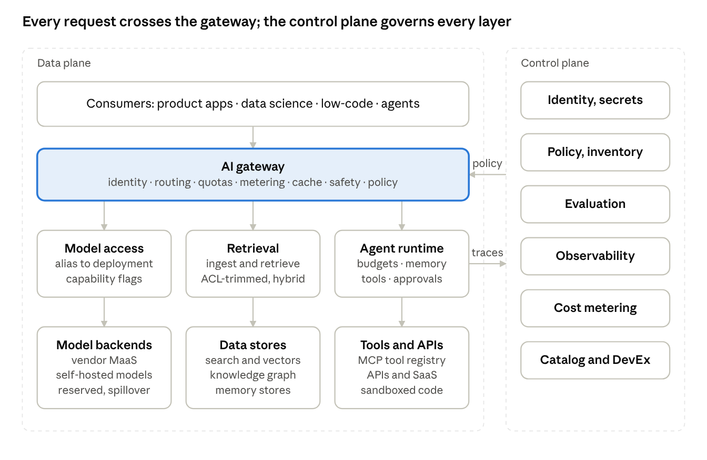
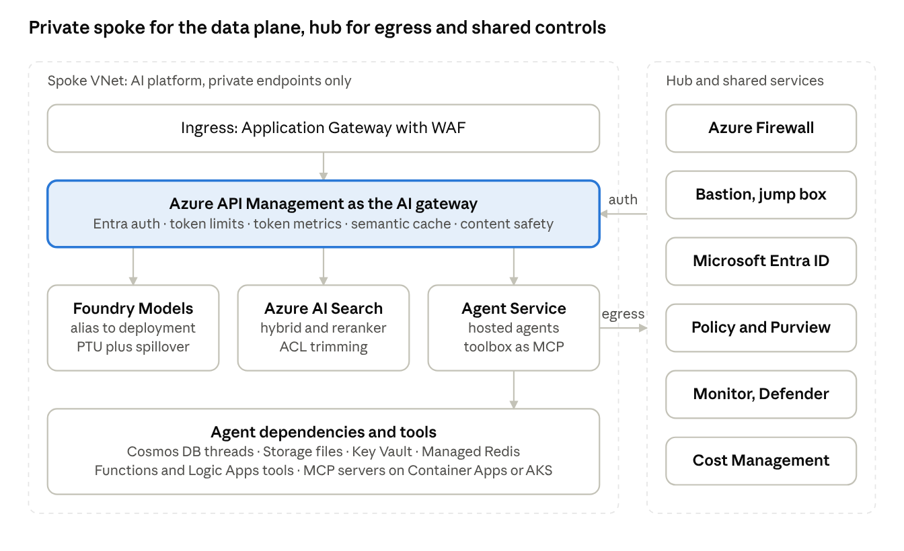
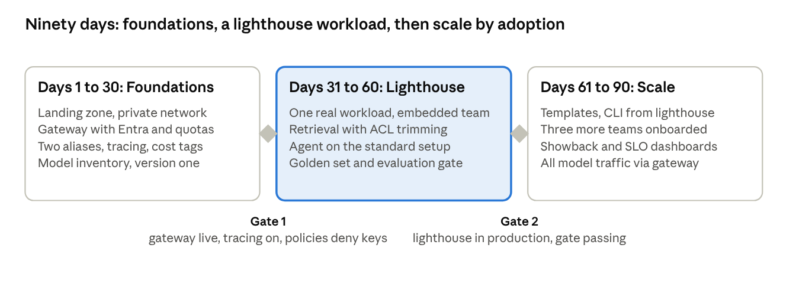

# AI as a Service: Concepts, Architecture, and Implementation on Azure

Ahmed Jawad, Ph.D. · October 17, 2026

## Part I — Foundations

## 1. Introduction: from AI projects to AI platforms

Most enterprises do not have an AI problem. They have an AI *repetition* problem. The first generative AI pilot is thrilling. The tenth is a liability: ten teams, ten ways to call a model, ten retrieval pipelines, ten prompt files in ten repositories, and ten ad-hoc answers to the question "is this safe to ship?" Each works in isolation. Together they are expensive, inconsistent, and impossible to govern.

AI as a Service (AIaaS) is the architectural and organizational answer to that repetition. It treats AI capability — model access, retrieval, agents, evaluation, safety, observability — as a *product* delivered to internal teams, and sometimes to customers, through stable, self-service interfaces. The hard parts are built and operated once, centrally, by people whose job is to operate them well. Everyone else consumes them.

The phrase sounds like marketing. The practice is unglamorous engineering: versioned contracts, a gateway in front of every model call, a retrieval service with access control baked in, evaluation gates in the deployment pipeline, cost metering per consumer, and a developer experience good enough that teams *choose* the shared path over rolling their own. That last point is the whole game. A platform nobody adopts is a cost center with a nice architecture diagram.

### Why now

Three forces have made the platform approach the default rather than an optimization.

**The model layer commoditized faster than the engineering around it.** Capable models are an API key away, from several vendors, at falling prices. What differentiates one organization's AI from another's is no longer the model. It is the system wrapped around the model: grounding in the right data, evaluation that catches regressions, governance that satisfies auditors, and cost control that survives contact with real traffic. Those are shared concerns, and shared concerns belong in a platform.

**Agents raised the stakes.** A chatbot that says something wrong is embarrassing. An agent that *does* something wrong — files the ticket, moves the money, emails the customer — is an incident. Autonomy demands shared guardrails, identity for non-human actors, human-in-the-loop checkpoints, and tracing that reconstructs exactly what happened. No product team should build those alone, and none should be allowed to skip them.

**Regulation and procurement caught up.** The EU AI Act's obligations phase in through 2026 and 2027. ISO/IEC 42001 gives auditors a management-system standard for AI. Enterprise customers' security questionnaires now ask how AI features handle data, prompts, and model risk. Evidence has to be produced systematically, which means the controls have to exist systematically. A central platform is the only place that can be true.

### What this article covers

The article is written for architects, principal engineers, and platform leaders who are building or scaling an AI platform inside a company. It has four parts.

**Part I** defines the terms and makes the business case. It separates the two things people mean by "AIaaS" — AI sold as a cloud service, and AI delivered as an internal platform — and explains why the second is where most enterprise value is created or lost.

**Part II** walks through the core concepts one at a time: contracts and abstraction, the AI gateway, retrieval as a service, agentic frameworks, evaluation, governance, multi-tenancy, observability, FinOps, lifecycle management, developer experience, a cloud-agnostic reference architecture, and the trade-offs that separate a platform teams love from one they route around.

**Part III** builds it on Azure. It maps every concept to a concrete Azure service, lays out a reference architecture, and then shows working code: API Management policies that turn it into a GenAI gateway, Azure AI Search for retrieval, agents on Foundry Agent Service and on self-hosted frameworks, the evaluation SDK, tracing into Application Insights, identity and cost controls, and infrastructure as code with a GitHub Actions pipeline. It closes with a 90-day enablement roadmap.

**Part IV** turns the material into interview talking points: how one would build this service on Azure, told in the first person, and how prior experience maps onto the concepts.

### How to read it

Skim Part I if the business case is already made where you work. Read Part II for the principles; they are cloud-agnostic and are the part that ages slowest. Read Part III when you are ready to build; the service names will change, the shape will not, and the equivalents on AWS and Google Cloud are noted where it helps.

The article assumes familiarity with large language models, embeddings, and REST APIs. It is not a guide to training models, and it is not a vendor comparison. Where it recommends something, it says why, and where reasonable people disagree, it says that too.

## 2. What "AI as a Service" means

"AI as a Service" names two different things, and most confusion about the term comes from mixing them.

**External AIaaS** is AI sold as a cloud product. OpenAI's API, Azure OpenAI, Amazon Bedrock, Google's Vertex AI, and dozens of specialized vendors sell inference, embeddings, speech, vision, and increasingly whole agents, by the token or by the hour. The buyer rents capability instead of training or hosting models. This is the "as a Service" of the public cloud: metered, elastic, and operated by someone else.

**Internal AIaaS** — platform enablement — is AI delivered as a product *inside* an organization. A central team builds shared services on top of the external offerings, and sometimes on self-hosted models, and offers them to product teams through APIs, SDKs, templates, and governance. The consumers are colleagues. The currency is adoption. The operating model is that of an internal developer platform, applied to AI.

The two relate the way a power utility relates to a building's wiring. The utility sells electricity; the building still needs a distribution board, circuit breakers, a meter per tenant, and sockets where people actually work. External AIaaS is the utility. Internal AIaaS is the wiring. This article is about the wiring, because that is where enterprise value, and enterprise risk, concentrate.

### The cloud-stack analogy

AI capability stacks the way cloud capability does. Each layer hides the one below it and is operated by a different party.

| Layer | What it provides | Who operates it | Examples |
| --- | --- | --- | --- |
| Infrastructure | GPUs and accelerators, networking, serving runtimes | Cloud provider, or a platform team for self-hosting | GPU node pools on AKS or EKS, vLLM, Triton, TensorRT-LLM |
| Model as a Service (MaaS) | Hosted inference, embeddings, speech and vision behind an API, metered per token | Model vendor or cloud provider | Azure OpenAI, Foundry Models, Amazon Bedrock, Vertex AI, OpenAI, Anthropic, Mistral |
| Platform services | Model gateway, retrieval, agent runtime, memory, evaluation, guardrails, prompt management, observability, cost metering | The internal platform team (a Center of Excellence) | The subject of this article |
| Application AI | A finished feature or product with domain logic and a user | Product teams | A contract-review assistant, a support agent, a pricing copilot, a document-classification pipeline |

The platform-services layer is where a Center of Excellence earns its keep. It should be thick enough to absorb the undifferentiated work — every team needs a governed way to call a model, retrieve documents, trace a request, and prove quality — and thin enough that product teams still own their domain logic, their prompts' intent, and their users. Where that line sits is the central design decision of an AI platform, and Section 16 returns to it.

### What makes something "a service"

A capability is "as a service" when it passes four tests.

1. **Consumable through a stable interface.** A consumer calls an API or imports an SDK and gets a result without understanding the internals. The interface is versioned and does not break under them.
2. **Self-service.** Onboarding, provisioning, and routine configuration happen without a ticket to a human. A platform that onboards teams through a work queue is a consultancy with extra steps.
3. **Metered.** Usage is attributed to the consumer that caused it, in units they understand: tokens, requests, documents indexed, agent runs. Without metering there is no cost control and no fair conversation about budgets.
4. **Operated with commitments.** Someone owns availability, latency, quality, and the lifecycle of the thing, and writes those commitments down as service-level objectives. A shared library has none of this; a service has all of it.

Most "AI platforms" fail at least one test. A shared Python package fails tests 2 through 4. A model endpoint that any team can hit with a copied key fails test 3. A retrieval pipeline that one team built and others cloned fails test 4. The tests are useful precisely because they are unforgiving: they separate a platform from a pile of reusable code.

### What internal AIaaS is not

It is not a chatbot that everyone in the company uses; that is an application, and a good one is usually the platform's first consumer rather than the platform itself. It is not a model zoo or a hosting layer; hosting is one component. It is not a governance committee; a committee that reviews designs without providing services slows teams down and is routed around. And it is not a framework. A framework is a library teams import; it can be part of a platform, but on its own it carries no operations, no metering, and no commitments.

### Who consumes it

An internal AI platform serves four kinds of consumer, each needing a different paved road.

- **Product engineering teams** want APIs, SDKs, and templates that fit their existing CI/CD, plus the confidence that security and compliance reviews are already satisfied by the shared path.
- **Data science and ML teams** want model access, evaluation tooling, and experiment tracking without re-implementing the serving and governance layers.
- **Business technologists** building in low-code tools want connectors to the same governed models and retrieval indexes, with the guardrails applied for them.
- **Agents themselves** are the newest consumers. A supervisor agent that calls a retrieval tool, a sub-agent that invokes an internal API, or a partner's agent reaching in through an agent-to-agent protocol all need identity, quotas, and audit trails just as human-driven code does.

Designing for the fourth consumer, the machine, is what distinguishes a 2026 AI platform from a 2023 one. The rest of this article treats it as a first-class case.

### Terms used throughout

A few terms recur. A **consumer** is a team, application, or agent that uses a platform service. A **tenant** is a boundary within which data and quotas are isolated; a consumer belongs to one tenant, and a tenant may hold many consumers. A **paved road**, or golden path, is the supported, documented, pre-approved way to do something; teams may leave it, but they then own what they build. A **guardrail** is a control that constrains model or agent behavior at runtime. The **control plane** is where policy, configuration, identity, and metering live; the **data plane** is where requests, tokens, and documents flow. The glossary in the appendix collects the rest.

## 3. The case for a platform

A central AI platform pays for itself when three or more teams would otherwise build the same thing. Below that threshold it is premature abstraction. Above it, the question is not whether to build one but how to keep it from becoming a bottleneck.

### The economics of undifferentiated heavy lifting

Every AI feature needs the same scaffolding before it needs anything specific: a way to call a model with the right credentials, a way to ground answers in company data, a way to know whether the output is any good, a way to stop it from leaking data or saying something harmful, a way to see what it cost, and a way to reconstruct what happened when a user complains. None of that is the feature. All of it is required.

When ten teams build that scaffolding independently, the organization pays for it ten times, in engineering hours and in the slower currency of inconsistency. Ten prompt-injection defenses of varying quality. Ten log formats, so no one can answer "how much did we spend on model calls last month?" Ten vendor integrations, so a price change or a model deprecation becomes ten migrations. Ten security reviews, each starting from zero. The platform collapses that to one, and the saving compounds with every new consumer.

The second economic argument is about risk rather than cost. Controls that exist in ten places are controls that fail in ten places, on ten different schedules. A platform concentrates the controls where they can be tested, audited, and upgraded once. In a regulated business this is often the decisive argument: the compliance function can attest to one gateway's logging, one retrieval service's access control, and one evaluation pipeline's gates, rather than chasing every team.

### The Center of Excellence model

Most enterprises house the platform in an AI Center of Excellence (CoE). A CoE that works does four things, in this order of importance.

1. **Builds and operates shared services.** The gateway, the retrieval service, the agent runtime, the evaluation harness. This is the product work, and it is what gives the CoE the standing to do the rest.
2. **Publishes reference architectures and standards.** How to structure a RAG application, what an agent must log, which models are approved for which data classifications. Standards without services are ignored; standards embodied in services are followed by default.
3. **Enables teams.** Pairing, office hours, templates, documentation, and a lighthouse project or two where CoE engineers embed with a product team to prove the path works.
4. **Reviews designs.** Lightly, late, and against published criteria. Review is the least valuable of the four and the one failing CoEs lean on most, because it feels like control. A CoE that primarily says "no" is routed around within two quarters.

The Team Topologies vocabulary is useful here. The CoE is a **platform team**, which builds the services, and often also an **enabling team**, which coaches **stream-aligned teams** to adopt them. The platform's consumers remain responsible for their own outcomes; the platform reduces their cognitive load without taking ownership of their products.

### Paved roads

The single most effective adoption mechanism is the paved road, a term Netflix popularized and Spotify's "golden path" made famous. A paved road is the supported way to do a thing: a template repository, a starter SDK, a pipeline that already includes the evaluation gate, a deployment target that already has tracing and cost attribution wired in. It is not mandatory. Teams may build their own road, but then they own paving it: security review, cost reporting, on-call.

Paved roads work because they change the default. An engineer with a deadline chooses the path with the least friction. If the governed path is also the fastest path, governance becomes a side effect of convenience. If the governed path is slower, governance becomes a tax, and taxes get evaded.

The corollary is uncomfortable for platform teams: developer experience is a governance control. A confusing SDK or a two-day onboarding is not a usability bug. It is a compliance risk, because it pushes teams off the road.

### Build, wrap, or buy

For each platform capability the team faces the same decision.

| Option | What it means | Choose it when |
| --- | --- | --- |
| Buy | Adopt a managed service as-is and expose it directly | The capability is commodity, the vendor's controls meet policy, and no cross-cutting logic is needed |
| Wrap | Put a governed facade over a managed service: identity, metering, policy, logging | Most of the time. The vendor does the heavy lifting; the facade adds the organization's rules and keeps the vendor swappable |
| Build | Implement the capability in-house | The capability is differentiating, no vendor meets a hard requirement (residency, latency, cost at scale), or the vendor's roadmap is a risk |

The gateway is almost always *wrap*: a managed API gateway product configured as a model gateway. Retrieval is usually *wrap* over a managed search or vector service, with the ingestion and access-control logic built. Agent runtimes are the open question of 2026: managed agent services are maturing fast, and many organizations wrap one while keeping a self-hosted option for workloads that need it. Evaluation is typically *build* on top of a vendor SDK, because the golden datasets and judging criteria are inherently the organization's own.

### Measuring success

A platform's health is measured by its consumers' behavior, not its own uptime. The metrics that matter are the ones that would embarrass the team if they went the wrong way.

| Metric | What it measures | Healthy signal |
| --- | --- | --- |
| Share of model traffic through the gateway | Whether the platform is actually the path | Rising toward 100% of production calls |
| Time to first successful call | Onboarding friction | Under a day for a new team, self-service |
| Active consumers and workloads | Adoption | Growing quarter over quarter without mandates |
| Lead time for a consumer change | Whether the platform is a bottleneck | Consumers ship without waiting on the platform team |
| Evaluation coverage | Share of production workloads with regression gates | Every workload past pilot |
| Cost per unit of outcome | FinOps effectiveness | Falling as caching, routing and right-sizing take effect |
| Incidents attributable to shared controls | Risk concentration | Few, fixed once, never repeated |

Notice what is absent: the number of features the platform shipped, the elegance of its architecture, the count of models it supports. Those are inputs. Adoption is the output, and it is the only metric a platform cannot fake.

### When not to build one

Two situations argue against a platform. The first is too few consumers: with one or two teams doing AI, build the first application well, extract the shared parts when a third team appears, and resist the urge to design the platform before you know what the applications need. The second is a platform team without a product mandate: if the team can set standards but not ship services, it will become a review board. Better to delay the CoE until it can be funded to build.

## Part II — The core concepts of an AI platform

## 4. Abstraction and contracts: the model access layer

The first service a platform ships is the one every other service depends on: a single, governed way to call a model. Get its contract right and model swaps, vendor changes, and price negotiations become platform decisions invisible to consumers. Get it wrong and every change is a migration for every team.

### One endpoint, one identity, one schema

From a consumer's point of view the model access layer should look boring. One base URL. Authentication with the identity the consumer already has, never a copied API key. One request and response schema. The OpenAI chat-completions and responses formats have become the de facto lingua franca, and most gateways, SDKs, and frameworks speak them natively, so standardizing on that shape costs nothing and buys compatibility with the whole ecosystem. The gateway, covered in Section 5, translates to whatever each backend actually speaks.

Behind that boring surface the platform makes the interesting decisions: which vendor serves the request, which region, which deployment type, whether the response comes from a cache, and how much it cost.

### Logical names, not physical deployments

The central abstraction is the **model alias**: a logical name that consumers request and the platform maps to a physical deployment. Consumers ask for `chat-default` or `chat-reasoning` or `embed-default`; the platform decides that `chat-default` means a particular GPT-4-class deployment in a particular region today and something cheaper or better next quarter.

| Alias | Backed by today | Intended use | Who changes the mapping |
| --- | --- | --- | --- |
| `chat-default` | A mid-tier general model, global standard deployment | Most interactive workloads | Platform, with notice |
| `chat-reasoning` | A reasoning-class model | Multi-step analysis, agent planning | Platform, with notice |
| `chat-small` | A small, fast model | Classification, routing, extraction | Platform, freely |
| `embed-default` | A specific embedding model and dimension | All new indexes | Platform, never silently (see below) |
| `chat-eu-resident` | A data-zone deployment pinned to the EU | Workloads with residency obligations | Platform, with compliance sign-off |

Two rules keep aliases honest. First, an alias change is a release: it is announced, it runs through the evaluation gates of the consumers that depend on it (Section 8), and it can be rolled back. Second, embedding aliases are special. Changing the embedding model silently invalidates every vector index built with the old one, so `embed-default` is versioned explicitly (`embed-v2`) and old versions stay available until every index has been rebuilt.

Consumers who need a specific model version for reproducibility can pin to a physical name, but pinning is a choice with a cost: the pinned deployment will one day be retired, and the consumer owns that migration. The platform publishes vendor retirement dates as they are announced and nags accordingly.

### Capability flags

Models differ in what they can do: context length, tool calling, structured outputs, vision, audio, reasoning effort. A consumer that assumes a capability and gets an alias that lacks it fails at runtime, often subtly. The access layer should expose a capability descriptor per alias, and the SDK should surface it, so a consumer can assert `requires=["tools","json_schema"]` and fail fast at startup rather than in production.

### Structured outputs and tool schemas are contracts too

The output of a model is part of the contract. Where a consumer needs machine-readable results, the platform should encourage, and make easy, schema-enforced structured outputs rather than prompt-and-parse. A JSON Schema attached to the request turns an unreliable string into a typed object, and it becomes a versionable artifact in its own right.

Tool calling extends the idea. The schema of a tool, its name, parameters, and description, is the contract between a model and the code it can invoke. Treat tool schemas like API definitions: owned, versioned, reviewed. The Model Context Protocol (MCP) has become the common wire format for exposing tools to agents across frameworks, and OpenAPI remains the right source of truth for the underlying service; a good platform generates the former from the latter rather than hand-maintaining both.

### The SDK: thin, instrumented, boring

A platform SDK should be a thin client over the HTTP contract, with four things baked in: authentication using the consumer's identity, retries with backoff and idempotency keys, telemetry (trace context propagated on every call), and the capability descriptor above. It should exist in the two or three languages the organization actually uses, with feature parity.

What it should not become is a framework. The moment the SDK starts dictating how to structure a prompt, chain calls, or run an agent loop, it competes with the open-source frameworks teams already use and loses. Keep the SDK at the transport layer. Offer framework integrations, a LangChain or Semantic Kernel or Agent Framework adapter that routes through the gateway, as separate, optional packages.

```python
# A consumer's view: logical alias, structured output, telemetry for free
from aiplatform import Client

client = Client()  # identity from the environment; base URL from config

result = client.chat(
    model="chat-default",
    messages=[{"role": "user", "content": contract_text}],
    response_schema=ContractSummary,   # pydantic model -> JSON Schema, enforced
    requires=["json_schema"],          # fail fast if the alias cannot do this
    tags={"workload": "contract-review", "tenant": "legal"},  # cost attribution
)
summary: ContractSummary = result.parsed
```

### Versioning and deprecation

The HTTP contract carries a version (`/v1/`), and breaking changes get a new major version with both running side by side for a published window, 90 days being a common minimum. Alias remappings are announced with the same discipline. A deprecation notice names the date, the replacement, the migration guide, and the consumers affected, which the platform knows because it meters them.

The quiet part of versioning is behavioral. Two models can satisfy the same schema and behave differently on the same prompt. A contract that only covers shape is incomplete; the full contract includes the consumer's evaluation suite, and an alias change is only safe when those suites pass. This is why the access layer and the evaluation service are designed together.

### Consumer-driven contract tests

Mature platforms borrow a practice from microservices: consumers publish the subset of the contract they rely on, as executable tests, and the platform runs them before any change. For an AI platform the tests include a handful of golden prompts and expected structured outputs per consumer. They run in minutes, they catch the regressions that matter to real workloads, and they turn "we upgraded the model" from an act of faith into a release with evidence.

## 5. The AI gateway: a control plane for every model call

If the model access layer is the contract, the gateway is where the contract is enforced. Every model call in the organization passes through it, which makes it the one place where identity, policy, metering, resilience, and safety can be applied consistently. Nothing else in the platform has that leverage, and nothing else is as damaging when teams bypass it.

### What the gateway does

A gateway is a reverse proxy with opinions. The opinions, in rough order of how often they save you, are these.

| Responsibility | What it means in practice |
| --- | --- |
| Identity | Consumers authenticate with their own identity (a workload identity, a service principal, an OAuth token). The gateway authenticates *to* the model backends with its own managed identity. Consumers never hold model API keys. |
| Routing | Resolves a logical alias to a physical backend: which provider, which region, which deployment type. Prefers reserved capacity and spills over to pay-as-you-go when it is saturated. Can route by policy, such as sending EU-tagged tenants only to EU deployments. |
| Resilience | Load balances across backends (round-robin, weighted, priority, or session-aware), trips a circuit breaker on a failing backend using its `Retry-After` hint, retries idempotent calls with backoff, and enforces timeouts. |
| Rate limits and quotas | Tokens-per-minute limits per consumer, plus token quotas per hour, day, week, or month. Prompt tokens can be estimated before the call so an over-quota request is rejected without touching the backend. |
| Metering | Emits token counts per request with dimensions: consumer, workload, tenant, model, region. This is the raw material for cost attribution and the single most-requested feature once finance notices the bill. |
| Caching | Exact-match caching for repeated requests and semantic caching for near-duplicates, using an embedding of the prompt and a vector-capable cache. Returns a prior completion when a new prompt lands within a similarity threshold. |
| Safety | Runs prompt and completion through a content-safety service, applies prompt-injection detection, redacts or blocks configured PII classes, and enforces per-consumer policy tiers. |
| Logging | Captures prompts and completions, with retention and access controls that match data classification, into the observability stack. Off by default for sensitive tenants; on for everything that needs an audit trail. |
| Protocol translation | Presents one OpenAI-compatible schema while speaking each provider's native API behind it. Lets a consumer move between vendors by changing an alias. |
| Agent mediation | Exposes existing REST APIs as MCP tools, passes through remote MCP servers under the same identity and quota rules, and registers agent-to-agent endpoints. The gateway governs tools the way it governs models. |

### A request's journey

The order matters, because cheap checks should run before expensive ones.

1. **Authenticate** the consumer and resolve its policy tier, tenant, and quotas.
2. **Validate** the request shape and the alias; reject unknown aliases and disallowed capabilities.
3. **Check quota** against the consumer's remaining token budget, estimating prompt tokens if configured.
4. **Screen the prompt** for injection patterns and disallowed content; redact what policy says to redact.
5. **Look up the cache**; on a hit, return the cached completion, log it, and stop.
6. **Route** to a backend: alias to pool, pool to a healthy member by priority and weight.
7. **Call the backend** with the gateway's own identity, streaming the response back if requested.
8. **Screen the completion**, count tokens, emit metrics, write the log record with the trace id.
9. **Store** in the cache if the response is cacheable and the consumer's policy allows it.

Steps 4 and 8 are where regulated organizations spend their configuration effort. Steps 3 and 5 are where everyone else saves money.

### Gateway products

Every major cloud and several independents now ship an AI-aware gateway. The choice is usually made by what the organization already runs.

| Product | Shape | Notes |
| --- | --- | --- |
| [Azure API Management](https://learn.microsoft.com/azure/api-management/genai-gateway-capabilities) | Managed API gateway with GenAI policies | Token limits and quotas, token metrics, semantic cache, content safety, backend load balancing with circuit breakers, managed-identity auth to Foundry models, MCP and A2A mediation; also fronts Bedrock, self-hosted, and OpenAI-, Anthropic- and Vertex-schema backends. Section 19 builds on it. |
| Kong AI Gateway | Plugins on the Kong gateway | Multi-provider routing, prompt guards, token rate limiting, semantic caching; fits organizations already on Kong, on any cloud. |
| Amazon API Gateway + Bedrock | Cloud-native | Bedrock supplies guardrails and cross-region inference; API Gateway or a custom layer adds per-consumer metering. |
| Apigee | Google's managed gateway | AI policies for Vertex AI and third-party models. |
| LiteLLM, Portkey, Cloudflare AI Gateway, Envoy AI Gateway | Independent or open-source | Lightweight, provider-agnostic; common where a team wants a gateway before the platform exists. |

The column that is missing is "best". The right gateway is the one the platform team can operate with confidence, that integrates with the organization's identity provider, and that exposes its policies as code.

### Design decisions that recur

**The gateway is in the critical path.** It adds a network hop and must be as available as the most available backend behind it. That means multi-zone or multi-region deployment, autoscaling, and a tested answer to "what happens when the gateway is down?" The usual answer is that it is never fully down, because it is a managed service with an SLA higher than the application's, and the application has no fallback to direct backend access. Fallback keys defeat the purpose.

**Streaming must work end to end.** Token-by-token streaming is table stakes for interactive workloads, and every gateway feature, metering, safety screening, caching, has to be designed for a response that arrives in chunks. Completion screening on a stream means buffering, or screening at the end with the ability to cut off the stream. Decide this early; it shapes the policies.

**Policies live in version control.** Gateway configuration is code: policy documents, backend pools, alias maps, quotas per consumer. It is reviewed, tested in a non-production gateway, and deployed by the same pipeline as everything else (Section 24). A gateway configured by hand in a portal is an outage waiting for a Friday.

**Semantic caching is a product decision, not a flag.** A cache hit returns an answer generated for a different prompt that happened to be similar. For a FAQ bot that is ideal. For a contract summarizer it is a correctness bug. Expose caching per alias or per consumer with a conservative default, and record cache hits in the trace so a surprising answer can be explained.

**Tenancy is enforced here first.** The gateway is the first place the request's tenant is known, so it is where residency routing, tenant quotas, and tenant-scoped logging are applied. Later layers refine the enforcement; they never relax it.

### Anti-patterns

Three mistakes account for most gateway failures. Letting teams keep direct keys "temporarily", which makes the metrics lie and the controls optional. Putting business logic in gateway policies, which turns the policy files into an undocumented application. And using the gateway as an orchestrator, chaining calls or running agent loops inside it, which belongs in the agent runtime (Section 7) where it can be traced, tested, and versioned with the rest of the application.

## 6. Retrieval as a service

Most failures blamed on the model are retrieval failures. The answer was wrong because the right passage was never found, or the wrong tenant's passage was. Retrieval is therefore the platform service with the highest ratio of hidden complexity to apparent simplicity, and the one product teams most often rebuild badly. A platform should offer it as a service with two interfaces, ingest and retrieve, and own everything in between.

### Anatomy of the service

Retrieval has two pipelines and one feedback loop.

The **ingestion pipeline** turns sources into searchable units: connectors pull documents and their permissions from systems of record; parsers extract text, tables, and layout from PDFs, slides, and HTML; a chunker splits content into units sized for the embedding model and the context window; an enrichment step adds metadata, summaries, and extracted entities; an embedding step vectorizes each chunk under a versioned embedding alias; and an indexer writes chunks, vectors, metadata, and access-control lists into the index.

The **query pipeline** turns a question into grounded context: an optional rewrite step expands or decomposes the query; a hybrid search runs keyword and vector retrieval in parallel; filters apply tenant, access-control, and metadata constraints; a reranker reorders the top candidates with a cross-encoder or a semantic ranker; and an assembler builds the context block with citations, deduplicated and trimmed to a token budget.

The **feedback loop** is evaluation: golden question-to-passage sets measured as recall and ranking quality, plus end-to-end groundedness on the generated answers, tracked per index over time.

### Decisions that determine quality

| Decision | Options | Guidance |
| --- | --- | --- |
| Chunking | Fixed-size, sentence or paragraph, layout-aware, parent-child | Layout-aware with overlap for documents; parent-child (retrieve small, return large) when answers need surrounding context; keep tables intact |
| Embedding model | Vendor models, open models, multilingual, multimodal | Pick once per index, version it, and record it in index metadata; changing it means re-indexing |
| Vector storage | HNSW, exhaustive KNN, quantized vectors | HNSW for scale; scalar or binary quantization to cut memory when recall holds; exhaustive for small indexes and ground truth |
| Search mode | Keyword, vector, hybrid, hybrid with reranking | Hybrid with reranking wins on most enterprise corpora; keyword catches identifiers and codes vectors miss |
| Metadata | Source, owner, date, classification, tenant, language | Index everything a filter might need; filtering before ranking is cheaper and safer than after |
| Freshness | Scheduled re-crawl, change detection, event-driven | Event-driven for systems that emit changes; change detection with deletion tracking otherwise |

### Access control is the hard part

A retrieval service that returns a passage the user is not allowed to see has failed, no matter how relevant the passage was. The principle is **security trimming at query time**: the index carries, for each chunk, the identities or groups allowed to see it, inherited from the source system, and the query filters on the caller's identity before ranking. Post-filtering results after ranking is not acceptable; it leaks through result counts and through the empty slots it leaves, and it wastes the ranker's budget on documents that will be dropped.

The inheritance must be kept current. When a document's permissions change in the source, the index must follow, which means connectors have to sync ACL changes, not just content changes. Managed search services increasingly do this for common sources; for everything else the platform builds it, and it is the part of the ingestion pipeline most worth testing adversarially.

Tenancy is enforced one layer up. A shared index with a mandatory tenant filter is cheaper and easier to operate; an index per tenant gives harder isolation, independent scaling, and simpler deletion. Regulated tenants, large tenants, and tenants with residency constraints tend to get their own index; the long tail shares one. The service should hide the choice behind the same `retrieve` interface.

### Freshness and deletion

Stale retrieval is wrong retrieval. The service tracks each source's last successful sync, exposes it in the response metadata so consumers can show "as of" dates, and alerts when a source falls behind. Deletion is the harder half: a document removed from the source, or a person exercising a right to erasure, must disappear from the index, from any caches, and from any logged prompts that embedded the passage. Design for deletion from the start; retrofitting it is miserable.

### The interface

Two endpoints carry the service.

```http
POST /v1/retrieve
{
  "knowledge_source": "policies-eu",
  "query": "notice period for contract termination in Germany",
  "top_k": 8,
  "filters": {"doc_type": ["policy", "guideline"], "effective_after": "2024-01-01"},
  "mode": "hybrid+rerank",
  "on_behalf_of": "<caller identity token>"
}
```

The response returns chunks with scores, source citations, the embedding version used, the sync timestamp of each source, and a flag indicating whether security trimming applied. The `ingest` endpoint accepts documents or registers a connector; it returns a job id and the service reports progress and failures per document. Everything else, chunking strategy, embedding alias, index topology, is configuration the platform owns per knowledge source.

### Retrieval as a tool, and agentic retrieval

In agent architectures, retrieval is best exposed as a **tool** the agent calls when it decides it needs facts, rather than context stuffed into every prompt. This saves tokens on the turns that need no grounding and lets the agent retrieve iteratively: ask, read, refine, ask again.

Managed search services have started to internalize that loop. Azure AI Search's agentic retrieval, for example, uses a model for query planning and decomposition, runs the resulting subqueries in parallel across knowledge sources, and returns a merged result with citations and execution details ([feature list](https://learn.microsoft.com/azure/search/search-features-list)). Whether that lives in the search service or in the agent runtime is an implementation choice; the platform should offer one governed way to do it.

### Knowledge graphs as a complement

Vector retrieval finds passages that resemble the question. It does not answer questions whose shape is relational: which disclosures apply to this product in this channel, which policy supersedes which, what depends on what. A knowledge graph, queried with openCypher, Gremlin, or SPARQL, answers those by traversal, and it doubles as a compliance schema that constrains what an agent may do. The two are complementary, not competing: the graph is retrieval for structure, the index is retrieval for text, and a mature platform offers both behind the same tool interface. GraphRAG-style approaches that build a graph from the corpus automatically are useful for summarization across many documents; curated graphs are what regulated domains actually rely on.

### Measuring retrieval

The service reports, per knowledge source: recall at k and reciprocal rank on its golden set, the share of queries returning no result above the relevance threshold, median and tail latency by mode, index freshness, and the groundedness score of answers generated from it. The second metric, the "no good result" rate, is the early-warning signal for missing content, broken connectors, or a drifted embedding, and it should page someone when it moves.

## 7. Agentic frameworks and orchestration

An agent is a loop: the model reads the state, decides whether to call a tool or answer, the tool runs, the result is appended, and the loop repeats until a stop condition or a budget is hit. Everything else, planning, delegation, memory, approval, is structure around that loop. The platform's job is to make the loop safe, observable, and cheap to build, without dictating which framework a team uses to write it.

### Workflows and agents

The first design question is how much control flow the model owns.

|  | Workflow | Agent |
| --- | --- | --- |
| Control flow | Fixed graph written by an engineer; model calls are steps | Chosen by the model at runtime from available tools |
| Predictability | High; testable step by step | Lower; tested statistically against scenarios |
| Best for | Document pipelines, extraction, classification, fixed approval chains | Open-ended tasks, research, troubleshooting, multi-system coordination |
| Failure mode | Brittle when inputs vary | Loops, wandering, over-calling tools |
| Rule of thumb | If you can draw the flow, build a workflow | If you cannot draw it, build an agent and bound it |

Most production systems are hybrids: a workflow whose steps include bounded agents, or an agent whose tools are workflows. The platform should support both shapes with the same runtime, tracing, and budget controls.

### Orchestration patterns

**Single agent with tools** is the default and covers more than teams expect. One model, a curated set of tools, a system prompt, a step budget.

**Supervisor and sub-agents** splits a task across specialists. A supervisor plans, delegates sub-tasks to agents with narrower prompts and tool sets, and composes the results. The specialists are cheaper to test and easier to constrain; the supervisor is where loops and budget enforcement live. Running the sub-agents in the same process as the supervisor is simpler and faster; running them as separately hosted agents, reached through an agent-to-agent protocol, is warranted when they need independent scaling, a separate security boundary, or reuse by other applications.

**Planner with a shared scratchpad**, sometimes called deep agents, adds an explicit plan the supervisor writes and updates, a working memory all agents read, and the ability to spawn sub-agents for sub-problems. It suits long, multi-step tasks where a single prompt would lose track.

**Routing** uses a small, fast model to classify the request and dispatch it to the right agent or workflow. It is the cheapest way to add capability without making one agent's prompt do everything.

### Tools are the attack surface and the value

An agent is only as useful as its tools and only as dangerous. The platform treats tools as governed resources.

- Every tool has a schema, an owner, and a version (Section 4). The Model Context Protocol is the common way to expose tools to agents across frameworks; OpenAPI stays the source of truth for the service behind the tool.
- Tools are registered centrally and reached through the gateway, so the same identity, quota, and audit rules that govern model calls govern tool calls.
- Each agent runs with a least-privilege identity and an allow-list of tools. A contract-review agent cannot call the payments tool, whatever the model decides.
- Side-effecting tools are idempotent, accept an idempotency key, and are classified by blast radius. Above a threshold they require human approval before execution.
- Tool results are untrusted input. A document retrieved by a tool can contain instructions; the runtime labels tool output as data, and prompt-injection defenses treat it that way.
- Code execution happens in a sandbox with no network by default and no access to the agent's own credentials.

### Memory and state

Agents need three kinds of memory, and the platform should offer each as a service rather than letting every team pick a database.

**Thread memory** is the conversation or run state: messages, tool calls, intermediate results. It must be checkpointed so a run can resume after a crash or a human approval that takes a day.

**Working memory** is the scratchpad a planner uses within a run: the plan, partial results, notes between agents.

**Long-term memory** persists across runs: facts about a user, a tenant's preferences, outcomes of earlier tasks. It carries the most risk, since it is where personal data accumulates, so it has retention rules, consent tracking, tenant isolation, and a deletion path from day one.

Long-running agents raise the bar further. A task that spans hours, waits on external systems, or needs a human in the loop requires durable execution: checkpoints, resumable state, and the ability to steer or cancel a run in flight. Managed agent services are adding exactly these primitives; a self-hosted runtime has to provide them with a workflow engine or a checkpointing library.

### Human in the loop

Human approval is not an admission of failure; it is a control the platform makes easy to add. The runtime offers an interrupt primitive: the agent pauses before a designated action, the pending action is surfaced to a reviewer with context, and the run resumes with the reviewer's decision recorded in the trace. Where it is required is a policy decision: side effects above a cost or risk threshold, outputs that will be published externally, anything touching a regulated process. Where it is optional, teams should still start with it on and relax it as evaluation evidence accumulates.

### What the shared runtime provides

The agent runtime is the platform's second-largest service after retrieval, and the one with the fastest-moving vendor landscape. Whatever hosts the agents, the runtime should guarantee the following.

| Capability | Why it is the platform's job |
| --- | --- |
| Isolated execution per session, scaling to zero | One tenant's run must not see another's memory or files; idle agents must not cost money |
| Agent identity | The agent authenticates to tools and downstream systems as itself, or on behalf of a user with delegated consent, never with a shared key |
| Budgets | Step, token, cost, and wall-clock limits enforced by the runtime, not trusted to the prompt |
| Tracing | Every model call, tool call, and hand-off in one trace, exported in a standard format |
| Memory services | Thread, working, and long-term memory with the controls above |
| Tool gateway | Registered, governed tools reachable by MCP |
| Evaluation hooks | Runs can be replayed against evaluators; traces feed the golden sets |
| Approval primitive | Interrupt, review, resume |

Managed options now exist on every cloud: Foundry Agent Service on Azure, Bedrock AgentCore on AWS, Agent Engine on Google Cloud. Each hosts framework-written agents and supplies identity, memory, tool gateways, and observability. Self-hosting on a container platform remains the right call for workloads that need a framework or a runtime the managed service does not yet support, or for organizations that want one runtime across clouds.

### Frameworks: bless two, support many

The framework landscape changes quarterly. LangGraph is widely used for graph-shaped workflows and supervisor patterns. Microsoft Agent Framework is the successor to Semantic Kernel and AutoGen, in Python and .NET, with the team describing it as Semantic Kernel's next major version ([announcement](https://devblogs.microsoft.com/agent-framework/semantic-kernel-and-microsoft-agent-framework/)). OpenAI's Agents SDK, Google's ADK, PydanticAI, and CrewAI each have a following.

A platform should not pick a winner for everyone. It should bless one or two frameworks as paved roads, with templates, tracing adapters, gateway integration, and evaluation harnesses ready-made, and keep the runtime framework-agnostic so a team with a good reason can bring another. The platform's own SDK (Section 4) offers a base agent class with budgets, tracing, and the approval hook built in, and adapters that route each framework's model and tool calls through the gateway.

### The loop, without a framework

It helps to keep the essential loop in view, because every framework is this with features added.

```python
def run(task: str, llm, tools: dict, budget: Budget) -> str:
    msgs = [{"role": "system", "content": SYSTEM}, {"role": "user", "content": task}]
    for step in range(budget.max_steps):                 # hard step cap
        out = llm(msgs, tools=list(tools.values()))
        budget.charge(out.usage)                          # tokens and cost; raises when exhausted
        if not out.tool_calls:
            return out.text                               # final answer
        for call in out.tool_calls:
            tool = tools[call.name]                       # allow-list: unknown tool -> KeyError
            if tool.requires_approval:
                await_approval(call)                      # interrupt; resumes with the decision
            result = tool(**call.args, idempotency_key=call.id)
            msgs.append(out.as_message())
            msgs.append({"role": "tool", "name": call.name, "content": as_untrusted(result)})
    raise StepBudgetExceeded(task)                        # circuit breaker, surfaced in the trace
```

The budget object, the allow-list, the approval hook, and the untrusted-data wrapper are the platform's contribution. The prompt, the tools, and the task are the team's.

## 8. Evaluation as a product

Without evaluation, every change to an AI system is an act of faith: a new prompt, a model alias remapped, a retrieval index rebuilt, a framework upgraded. With it, each becomes a release with evidence. The platform's evaluation service is what turns "it seems better" into a number that gates a deployment, and it is the service that most distinguishes organizations that ship AI reliably from those that ship it once.

### Layers of evaluation

No single technique is enough. Mature teams layer several, cheapest first.

| Layer | What it checks | Examples | Cost |
| --- | --- | --- | --- |
| Deterministic checks | Hard rules the output must satisfy | Valid JSON against the schema; citation present; required disclosure attached; no PII class detected; length within bounds | Negligible, run on every call |
| Reference-based metrics | Agreement with a known answer | Exact match and F1 for extraction; ROUGE for summaries; recall at k and reciprocal rank for retrieval | Low, needs labeled data |
| Model-as-judge | Rubric-scored quality where no single reference exists | Groundedness against the retrieved context; relevance to the question; coherence; pairwise preference between two versions | Moderate, one judge call per sample |
| Safety evaluators | Harm and attack resistance | Violence, sexual, self-harm, hate categories; jailbreak and indirect prompt-injection attempts; protected-material reproduction | Moderate, often vendor-provided |
| Agent evaluators | Whether the agent did the right thing, not just said it | Intent resolved; correct tool chosen with correct arguments; task adherence; trajectory efficiency | Moderate to high, needs trace data |
| Human review | Calibration and the cases machines cannot judge | Expert-labeled samples; periodic blind review of production outputs | High, used sparingly and to calibrate the judges |
| Online evaluation | Behavior on live traffic | Sampled production traces scored asynchronously; user feedback; escalation and abandonment rates; drift against the golden baseline | Ongoing |

Vendor SDKs now package most of these. Azure's `azure-ai-evaluation` library, for instance, ships quality evaluators (`GroundednessEvaluator`, `RelevanceEvaluator`, `CoherenceEvaluator`), retrieval evaluators, safety evaluators (`ViolenceEvaluator`, `IndirectAttackEvaluator`, `ProtectedMaterialEvaluator`), and agent evaluators (`IntentResolutionEvaluator`, `ToolCallAccuracyEvaluator`, `TaskAdherenceEvaluator`), with an `evaluate()` function that runs them over a dataset or a live target ([SDK reference](https://learn.microsoft.com/azure/ai-studio/how-to/develop/evaluate-sdk)). Open-source options such as Ragas, DeepEval, and promptfoo cover similar ground. The platform's value is not in writing evaluators; it is in running them consistently, storing the results, and wiring them into deployment.

### Golden datasets

A golden set is a versioned collection of inputs with expected outputs, or expected properties, that represents what the workload must get right. Building one is the most valuable unglamorous work on the platform.

Good golden sets come from three sources. Real traffic, sampled, redacted, and labeled by the people who own the workload. Subject-matter experts writing the cases they know break systems: edge cases, ambiguous requests, questions whose correct answer is "I cannot answer that". And synthetic generation, where a model produces candidate cases from the corpus and a human reviews them before they are admitted. Synthetic data without review produces a golden set that tests what the generator finds easy.

A golden set has a version, an owner, a refresh cadence, and a coverage map against the workload's scenarios. It is kept out of any training or fine-tuning data. And it grows from production: every incident, every escalated conversation, every thumbs-down that turns out to be deserved becomes a case.

### Calibrating the judge

A model judging a model is useful and biased. Judges favor longer answers, answers in the first position of a pairwise comparison, and answers from their own model family. Before a judge gates anything, the platform measures its agreement with human labels on a calibration set, and it keeps measuring as models change. Practical rules: use a different model family as judge than the one being judged; score with a written rubric rather than a bare "rate 1 to 5"; randomize position in pairwise comparisons; and report the judge's agreement rate alongside its scores so consumers know how much to trust them.

### Gates in the pipeline

Evaluation becomes a control when it blocks a deployment. The pipeline runs the workload's golden set on every change to a prompt, a model alias, a retrieval index, or a framework dependency, and compares against the last accepted baseline. The platform supplies the harness and the baseline storage; the workload supplies the thresholds.

Two patterns keep gates from becoming a tax. First, tier the suites: a fast smoke suite of deterministic checks and a few dozen judged samples runs on every commit; the full suite runs before promotion to production. Second, distinguish blocking metrics from watched ones. Groundedness below threshold blocks. A two-point drop in a style score warns.

### Online evaluation and drift

The golden set is the past. Production is the present, and it drifts: new question types, new documents, a vendor's silent model update. The platform samples production traces, with the same redaction rules as logging, scores them asynchronously with the same evaluators, and charts the scores against the golden baseline per workload. Shadow deployments, where a candidate version processes real traffic without serving it, and canaries, where it serves a small share, give evidence that no offline suite can.

User signals round it out: explicit feedback, but also implicit signals such as escalation to a human, regeneration requests, and abandonment. They are noisy individually and decisive in aggregate.

### Red teaming

Safety evaluation is adversarial by nature. The platform runs periodic automated red-team campaigns: generated jailbreaks, indirect injections planted in retrievable documents, attempts to extract system prompts or other tenants' data, requests for protected material. Findings become golden-set cases and gateway rules. Managed red-teaming agents now exist; they are a starting point, and the platform adds the organization's own threat model on top.

### Quality SLOs

Evaluation produces numbers; SLOs give them meaning. Each production workload declares its quality objectives in the same place it declares latency and availability: groundedness at or above a threshold on the golden set, a maximum rate of unsupported claims on sampled production traffic, a ceiling on safety-evaluator flags, a floor on task completion for agents. The platform dashboards them next to cost and latency, and breaches page the workload's owner the way an availability breach would. Quality is operational, or it is not real.

### The service, in one view

The evaluation service exposes four things: a registry of evaluators, built-in and custom; a dataset store with versioning and access control; a run API that evaluates a dataset against a target, a deployed endpoint, or a set of traces; and a results store with baselines, dashboards, and the hooks the pipeline needs to pass or fail a gate. Traces flow in from observability (Section 11), and cases flow back into the golden sets. That loop, trace to case to gate, is the platform's quality flywheel.

## 9. Governance, safety, and policy enforcement

Governance fails when it is a meeting and succeeds when it is a feature. A review board that inspects designs cannot keep up with the rate at which teams ship AI, and it should not try. A platform that embodies the rules in its services, so that the compliant path is the default path, scales with the organization. This section is about building governance in, not bolting it on.

### The threat model

AI systems inherit every classic application risk and add their own. The OWASP Top 10 for LLM Applications is the common reference; the risks that drive the most platform design are these.

- **Prompt injection**, direct through the user's input and indirect through content the system retrieves or a tool returns. Indirect injection is the more dangerous, because the attacker never touches the application; they plant instructions in a document, a web page, or an email the agent will read.
- **Sensitive information disclosure**: the model repeating another tenant's data, a secret from a system prompt, or personal data it should have redacted.
- **Excessive agency**: an agent with more tools, permissions, or autonomy than its task needs, so that a manipulated model does real damage.
- **Improper output handling**: model output passed to a shell, a SQL engine, a browser, or an email sender without validation.
- **Unbounded consumption**: denial of wallet, where runaway loops or abuse exhaust budgets.
- **Supply chain**: models, embeddings, datasets, prompts, and third-party tools of unknown provenance.

Each maps to a control that lives in a specific platform layer, which is the point: the threat model tells you where the controls go.

### Controls by layer

| Layer | Controls |
| --- | --- |
| Gateway | Content-safety screening of prompts and completions; prompt-injection classifiers; PII detection and redaction; per-consumer quotas; approved-model enforcement; policy tier per tenant |
| Retrieval | Security trimming on identity; tenant partitioning; retrieved content labeled as untrusted; provenance recorded on every chunk |
| Agent runtime | Least-privilege identity per agent; tool allow-lists; sandboxed code execution; step, token, cost and time budgets; approval interrupts for side effects; untrusted-data wrapping of tool results |
| Output | Schema validation; required citations and disclosures; deterministic compliance checks before publication; moderation on externally visible text |
| Data | Classification drives which models, regions and features a workload may use; retention rules on logs, memory and caches; contractual guarantees that vendor models do not train on the organization's data |
| Identity | Every call attributable to a human, a workload, or an agent acting for one; delegated consent for agents acting on a user's behalf |

Defense in depth is not redundancy here; it is necessity. An injection that slips past the gateway classifier should still meet a tool allow-list, an approval gate, and an output validator.

### Policy as code

Rules that live in documents are suggestions. Rules that live in a policy engine, evaluated at the gateway and in the runtime, are controls. A policy is data: the tenant's classification, the workload's risk tier, the model's approval status, the region, the time. The engine answers one question, is this call allowed and under what conditions, and the answer is logged.

```yaml
# A policy the gateway evaluates per request (illustrative)
rule: restricted-data-handling
when:
  tenant.classification: restricted
then:
  allowed_aliases: [chat-eu-resident, embed-v2-eu]
  semantic_cache: off
  prompt_logging: metadata_only
  require_citation: true
  tools.max_blast_radius: read_only
```

Policies are versioned in git, tested against example requests, and deployed through the same pipeline as the gateway and the runtime. Changing a policy is a change with a reviewer, a diff, and a rollback. The engine can be a general-purpose one such as Open Policy Agent, a cloud-native one, or the gateway's own policy language; what matters is that the decisions are centralized, explainable, and auditable.

### Risk tiers, not uniform rules

Applying the strictest controls to every workload is how governance becomes a tax. Instead the platform classifies each workload once, at intake, into a tier that determines the controls it must meet.

| Tier | Example workloads | Required controls |
| --- | --- | --- |
| Low | Internal drafting aid, code assistant on non-sensitive code | Gateway defaults; usage metering; basic evaluation |
| Medium | Customer-facing assistant with retrieval over public and internal documents | Security-trimmed retrieval; golden-set gates; content safety on output; logged traces with retention |
| High | Agents with side effects; outputs in regulated processes (financial, medical, legal, HR) | Everything above plus approval interrupts; deterministic compliance checks; restricted model and region set; impact assessment; periodic human review; evidence pack |

Intake is a short form, not a committee: purpose, data classes involved, who the users are, what the system can do on its own. The tier is derived from the answers, and the platform's templates for that tier already include the required controls. A high-tier workload does not have to discover what it needs; it inherits it.

### Model risk management

The platform keeps a model inventory: every model and version in use, its vendor and terms, the data classifications it is approved for, the regions it may run in, the evaluation evidence behind its approval, and its retirement date. Approving a new model is a documented decision against published criteria. The inventory is what an auditor asks for first, and it is what makes an alias change (Section 4) a governed act rather than a configuration edit.

This maps directly onto the frameworks regulators and customers reference. The NIST AI Risk Management Framework's functions, govern, map, measure, manage, are satisfied by the intake tiering, the inventory, the evaluation service, and the operational controls respectively. ISO/IEC 42001 asks for a management system with exactly these elements. The EU AI Act layers obligations by risk category and phases them in through 2026 and 2027; a platform with tiering, documentation, logging, and human oversight built in has most of the groundwork done, and the legal team decides which workloads fall into which category.

### Auditability

Every call leaves a record: who or what made it, under which policy decision, with which model and version, what tools ran, who approved what, and what came back. Records are retained according to the data classification, immutable for the retention period, and linked by trace id so an investigator can reconstruct a conversation end to end. The platform generates evidence packs, exports of these records with the relevant policies and evaluation results, on demand, so that an audit is a query rather than a project.

### Transparency to users

Governance is also about the people on the other side of the screen. The platform's templates disclose that a user is interacting with AI, show citations where retrieval is used, surface uncertainty rather than hiding it, and give users a way to flag a bad answer that reaches the owning team and the golden set. In regulated and customer-facing contexts these are obligations; everywhere else they are what makes users trust the system enough to keep using it.

### Regulated SaaS specifics

A SaaS company that sells to regulated customers carries their obligations into its own platform. Commitments that customers now ask for in contracts and security questionnaires, and that the platform must be able to prove, include: no training of vendor models on customer data; customer data processed only in agreed regions; model vendors listed as sub-processors; deletion propagated to indexes, memory, caches, and logs; and audit logs available to the customer for their own tenant. Each is a platform feature, and each is far cheaper to build once than to promise per deal.

## 10. Multi-tenancy, identity, and data isolation

A platform serves many consumers on shared infrastructure, and the moment it does, isolation becomes its most important property. The model never enforces tenancy; it will happily summarize whatever context it is given. Isolation is enforced by identity and by the data path, at every layer, and it is tested like a security control because it is one.

### Tenancy models

| Model | How it works | Isolation | Cost and operations | Fit |
| --- | --- | --- | --- | --- |
| Pooled | All tenants share every resource; isolation is logical, through filters, partition keys and policy | Weakest; one bug can cross tenants | Cheapest; one of everything to run | Internal teams with similar classification; the long tail of small tenants |
| Siloed | Dedicated resources per tenant: index, memory store, sometimes model deployments and keys | Strongest; blast radius is one tenant | Most expensive; many of everything, automated or it does not scale | Regulated tenants, large enterprise customers, residency-bound tenants |
| Bridge | Shared control plane and gateway; per-tenant data plane for the stores that hold tenant data | Strong where it matters | Moderate; automation provisions the per-tenant parts | The usual answer for a SaaS platform |

A platform typically runs all three at once: pooled for internal workloads, bridge for most customers, siloed for the few who need it. The service interfaces hide the difference; a consumer calls `retrieve` the same way regardless of where its index lives.

### Where tenancy is enforced

Tenancy is not one control but a chain of them, and the chain is only as strong as the layer that forgets.

- **Gateway.** The tenant is derived from the caller's identity, never from a request field the caller can set. It drives quotas, routing (residency, reserved capacity for premium tiers), the policy tier, and the tenant tag on every log and metric.
- **Retrieval.** Index per tenant, or a mandatory tenant filter applied before ranking, plus security trimming on the user's own identity within the tenant.
- **Memory.** Partitioned by tenant with a partition key the runtime sets, not the agent; encrypted with the tenant's key where tenants bring their own.
- **Caches.** Keyed by tenant. A semantic cache shared across tenants is a cross-tenant data leak with extra steps; it is tenant-scoped or it is off.
- **Logs and traces.** Tagged by tenant, retained per the tenant's policy, exportable per tenant, and queryable only by people entitled to that tenant.
- **Models.** Any fine-tuned or customized model is tenant-specific or shared only with the data owner's explicit consent; pooled fine-tuning on customer data is not done.

### Identity for humans, workloads, and agents

Three kinds of principal call the platform, and each needs a first-class identity.

**Humans** arrive through the organization's identity provider with OpenID Connect; their groups and claims drive security trimming and approvals.

**Workloads** use workload identity: a managed identity, a service principal with federated credentials, or a SPIFFE identity, never a long-lived secret in a configuration file. Pipelines deploying the platform use the same mechanism (Section 24).

**Agents** are the new case. An agent needs an identity of its own so that its tool calls are attributable, rate-limited, and least-privileged. When it acts for a user, it does so through an on-behalf-of flow that carries the user's identity downstream, so that retrieval trims on the user's permissions and the audit log names the person as well as the agent. When it needs to call an external system with OAuth, it uses a token vault managed by the runtime: the agent asks for a token for a named connection and never sees the refresh token or the client secret.

### Identity propagation end to end

The subtle requirement is propagation. A request enters as a user, passes through an application, hits the gateway, is handed to an agent, which calls a retrieval tool, which queries a store. At each hop the original subject must still be known, or the store cannot trim correctly and the audit trail breaks. The platform standardizes this: the gateway validates the user token and issues or forwards a short-lived token that the runtime attaches to every tool call, and tools reject calls without it. Service-to-service trust alone, where the retrieval service trusts anything the runtime sends, is how one tenant's agent reads another tenant's documents.

### Data isolation mechanics

Encryption at rest with per-tenant keys, customer-managed where the contract requires it, gives a tenant a kill switch: revoke the key and their data is unreadable everywhere it lives. Residency is enforced by routing at the gateway and by provisioning the tenant's data plane in the required region; it is verified by a test that follows a tagged request through every hop. Noisy-neighbor protection comes from per-tenant quotas at the gateway and from reserved capacity for tiers that pay for it, so one tenant's traffic spike cannot consume the pooled capacity.

Stores enforce isolation with their own mechanisms, and the platform uses all of them rather than trusting the application layer: row-level security policies in relational and vector databases, mandatory filter expressions in search indexes, labels or properties in graph databases. The query that forgets the filter should fail, not return everything.

### Deletion across every store

A tenant leaving, or a person exercising a right to erasure, triggers deletion in every place their data landed: source indexes, embeddings, memory, caches, prompt and completion logs, evaluation datasets built from traffic, and backups within the retention window. The platform tracks these locations centrally, because no product team can enumerate them, and it reports completion per store. Design this as a workflow with a receipt, not as a runbook.

### Testing isolation

Isolation is proven adversarially and continuously. The pipeline includes cross-tenant leak tests: queries from tenant A crafted to retrieve tenant B's documents, memory lookups across partitions, cache probes with near-duplicate prompts from different tenants, and injection attempts aimed at making an agent call a tool with another tenant's identifiers. They run on every change to the gateway, the retrieval service, or the runtime, and a single failure blocks the release.

### External agents

Agents from partners or customers, reaching in through an agent-to-agent protocol, are external callers. They get their own identity, their own quota, the narrowest tool allow-list that serves the use case, and the same content screening as any other input. The convenience of an agent talking to an agent does not change who is accountable for what it is allowed to do.

## 11. Observability, reliability, and SLOs

An AI platform is operated through its traces. When a user reports that the agent did something strange, the only way to answer is to reconstruct exactly which prompt went to which model with which context, which tools ran with which arguments, what each returned, and what it all cost. Classic logs and metrics do not capture that. Tracing does, and it is the platform's job to make tracing automatic for every consumer.

### One trace per request, end to end

A request's trace begins at the gateway and spans the application, the agent runtime, every sub-agent, every tool call, every retrieval, and every model call, with the same trace id carried through each hop. OpenTelemetry is the standard to build on: it has semantic conventions for generative AI that name the attributes a model-call span should carry, such as the model requested, the operation, and input and output token counts, and it is exported by every major framework and accepted by every major backend. The conventions are still maturing, which argues for adopting them anyway: a platform that standardizes on them today inherits each improvement without re-instrumenting.

Prompts and completions are the sensitive part. The platform records them as span events with the same redaction and retention rules as logging (Section 9), on by default for low-tier workloads and metadata-only for restricted ones. Without them, a trace shows that something happened but not why; with them, it is personal data and is handled as such.

### The signals that matter

The classic golden signals, latency, traffic, errors, saturation, still apply. AI adds a set of its own.

| Signal | Why it matters | Where it comes from |
| --- | --- | --- |
| Time to first token, and tokens per second | Perceived responsiveness for streaming interfaces; reasoning models can be slow in ways p50 hides | Gateway and runtime spans |
| Token volume and cost per request, per workload, per tenant | The bill, attributed; the basis for FinOps (Section 12) | Gateway metrics with dimensions |
| Cache hit rate | Savings realized; a sudden drop means prompts changed or the cache broke | Gateway |
| Steps per run, tool calls per run, budget exhaustion rate | Agents that loop or wander; the leading indicator of cost incidents | Runtime |
| Tool error rate by tool | A failing downstream system shows up here before users notice | Runtime spans |
| Approval queue depth and wait time | Human-in-the-loop as a bottleneck | Runtime |
| Online quality scores and safety flags | Drift and incidents in quality, not just availability | Evaluation service over sampled traces |
| Refusal and escalation rates | Over-cautious models or missing content | Runtime and application |
| Backend throttling (429s) and failover events | Capacity problems and their cost | Gateway |

Each consumer gets a self-service dashboard of its own signals, and the platform team gets the aggregate. The consumer view is what makes teams own their quality; the aggregate is what lets the platform spot a vendor degradation before any single team does.

### Tooling

The collection standard is OpenTelemetry; the backend is a choice. Cloud-native monitoring, Application Insights on Azure for instance, is the path of least resistance and integrates with the rest of the cloud's alerting. Purpose-built LLM observability tools, Langfuse, Arize Phoenix, LangSmith, and others, add prompt-centric views, dataset curation from traces, and evaluation integration. Many platforms run both: traces to the cloud backend for operations, and a subset to an LLM tool for debugging and dataset building. Because the data is OpenTelemetry, the choice is reversible, which is the point of standardizing on it.

For regulated workloads the observability backend is inside the organization's own boundary, self-hosted or a private deployment, because traces contain prompts.

### Failure modes unique to AI

Most outages on an AI platform are not crashes. They are behaviors.

- **Loops and wandering.** An agent repeats a tool call, or keeps planning without acting. The budget stops it; the trace shows it; the metric counts it.
- **Cascading tool failures.** A downstream API degrades, the agent retries, the retries exhaust the budget, and the user gets a vague apology. Circuit breakers on tools and clear error messages back to the model avert this.
- **Capacity throttling.** Model backends return 429s under load. Reserved capacity with spillover, backend pools with priority, and client-side backoff on idempotent calls are the standard answers.
- **Silent model updates.** A vendor changes a model behind a version name, or the platform remaps an alias, and quality moves. Online evaluation catches it; the model inventory names the date.
- **Context overflow.** Long conversations or large retrieved contexts exceed the window, and the framework silently truncates. Token accounting per span makes this visible; context budgeting in the assembler prevents it.
- **Cost spikes.** A new workload, a prompt change that doubled context, a loop at scale. Budgets per consumer, alerts on rate of spend, and the gateway's quotas bound the damage.

### Resilience patterns

The standard distributed-systems toolkit applies, with AI-specific tuning. Timeouts on every call, sized to the model, since reasoning models legitimately take longer. Retries with jitter only for idempotent operations; a retried side-effecting tool call is a duplicate action. Circuit breakers per backend and per tool. Bulkheads per tenant and per workload so one consumer cannot starve the rest. Fallback aliases that degrade to a smaller or alternative model when the primary is unavailable, with the degradation recorded in the trace and surfaced to the user where it matters. Multi-region and, where contracts allow, multi-provider failover at the gateway. And graceful degradation as a design principle: an assistant that says it cannot help right now and offers a human is a better outcome than one that hallucinates under load.

### Service-level objectives

Each platform service publishes SLOs, and each consumer workload declares its own. Availability and latency are familiar. Two are newer. Quality SLOs, defined in Section 8, make evaluation an operational concern with an error budget. Cost SLOs, a ceiling on spend per unit of work, make FinOps one too. All four are dashboarded together, because they trade off: a faster model is cheaper and worse, a reasoning model is slower and better, and the SLOs are where a workload records which trade it chose.

Error budgets drive priorities. A platform service burning its budget stops shipping features and fixes reliability; a consumer burning its quality budget pauses prompt changes and investigates. Incident reviews end with new golden-set cases, new alerts, or new policies, which is how the platform learns.

### On-call for an AI platform

The platform team carries the pager for the gateway, the retrieval service, the runtime, and the evaluation service. Consumers carry it for their workloads. Runbooks cover the behaviors above, not just the crashes: how to identify a looping agent, how to fail over a backend, how to roll back an alias, how to purge a poisoned cache, how to pull a document from every index. The first incident of each kind is a learning exercise; the second should be a runbook step.

## 12. FinOps for AI

AI spend is unusual: it is variable, it is usage-driven down to the individual request, and it can be changed by an engineer editing a prompt. That makes it both more dangerous and more controllable than most cloud cost. A platform that meters every call and exposes the levers turns cost from a quarterly surprise into a daily engineering parameter.

### Where the money goes

Tokens dominate, and not all tokens cost the same. Output tokens are priced higher than input tokens; reasoning models consume hidden tokens while thinking; long contexts, whether from retrieval stuffing or long conversations, multiply input cost on every turn. Around the tokens sit the secondary costs: embedding at ingestion, vector storage and the memory it needs, reranking calls, the judge calls that evaluation makes, observability storage for traces that contain prompts, and reserved capacity that sits idle at night.

The agent era adds a multiplier. A single user request can trigger a dozen model calls across a supervisor and sub-agents, each with its own context. The cost of a request is no longer the cost of a prompt; it is the cost of a trajectory, and trajectories vary by an order of magnitude between an easy case and a hard one.

### Metering and attribution

Nothing else in FinOps works without attribution. The gateway tags every request with the consumer, workload, tenant, environment, and feature, emits token counts with those dimensions, and the platform joins them with the cloud bill. The result is a cost per workload, per tenant, and per feature that updates daily.

Showback comes first: each team sees its own spend, trends, and the top drivers, with no money changing hands. Chargeback, where teams are billed, follows once the numbers are trusted and the levers are available; charging a team for cost it cannot control breeds resentment rather than efficiency.

### Unit economics

Raw spend is not a useful number. Cost per unit of outcome is: per conversation, per document processed, per ticket resolved, per contract reviewed. The platform computes these by joining cost to the workload's own outcome events, and the trend is the KPI. A workload whose cost per conversation is falling while volume rises is healthy at any absolute spend; one whose cost per conversation is rising needs attention regardless of the total.

Unit economics also settle the build-versus-buy question for a workload. If an agent resolves a ticket for a fraction of the cost of a human handling it, and the quality SLO holds, the spend is an investment; the number makes that argument for the team.

### The levers

| Lever | What it does | Where it lives |
| --- | --- | --- |
| Model-tier routing | A small, fast model for classification, routing, extraction and easy turns; a frontier model only where it earns its price | Alias design and the runtime's routing step |
| Context discipline | Retrieve only what the turn needs; trim conversation history; cap retrieved chunks by token budget | Retrieval assembler and runtime |
| Caching | Exact-match for repeated requests; semantic for near-duplicates where correctness allows | Gateway |
| Output control | Length limits; structured outputs instead of verbose prose; stop sequences | Request defaults in the SDK |
| Batch processing | Offline work through batch endpoints at discounted rates, with asynchronous results | Workload design |
| Reserved capacity | Provisioned throughput for the steady base load, billed per unit per hour or discounted through one-month or one-year reservations; pay-as-you-go spillover for peaks | Gateway routing and capacity planning |
| Deployment placement | Global, data-zone, or regional deployments differ in price and residency; pick the cheapest that policy allows | Alias mapping |
| Embedding right-sizing | Smaller or quantized vectors where recall holds; avoid re-embedding on every sync | Retrieval service |
| Evaluation sampling | Judge a statistically sufficient sample of production traffic, not all of it | Evaluation service |
| Budgets and quotas | Hard token quotas per consumer per period; step and cost budgets per run | Gateway and runtime |

The first two levers usually matter most. Routing the easy majority of calls to a model an order of magnitude cheaper, and keeping contexts tight, typically changes the bill more than every other lever combined, and both are decisions the platform can make by default for consumers who do not specify otherwise.

### Capacity planning for reserved throughput

Provisioned capacity turns a variable cost into a fixed one, and the maths is simple to state: estimate requests per minute, average input and output tokens per request, and the share of input that will be served from cache, convert that to a throughput figure, and size the reservation to the base load the business is confident in. Cached tokens do not consume provisioned capacity on some platforms, which rewards caching twice. Azure's provisioned throughput guidance, for example, recommends provisioned deployments for predictable, latency-sensitive, production-scale traffic and pay-as-you-go for development, testing, and highly variable loads, and it notes that reservations discount the hourly rate in exchange for a one-month or one-year commitment while deployments stay independent of the reservation ([provisioned throughput concepts](https://learn.microsoft.com/azure/foundry/openai/concepts/provisioned-throughput)).

The operational rule is to size reservations below the base load, not at the peak, and let spillover absorb the rest. Over-reserving is paying for idle capacity around the clock; under-reserving is paying pay-as-you-go rates for a predictable load. Review quarterly against the metered actuals.

### Guardrails against surprises

Three controls stop the cost incident that every platform eventually has. Hard quotas per consumer per period at the gateway, generous enough not to block legitimate growth and set so that a runaway process hits the ceiling within hours, not weeks. Burn-rate alerts, where a workload spending at a pace that would exceed its monthly budget triggers a notification to its owner the same day. And budgets per run in the runtime, so that a looping agent costs a bounded amount before it is stopped.

Non-production environments get stricter quotas than production. The most expensive AI bill many organizations have paid was a load test against a frontier model.

### Cadence

FinOps is a routine, not a project. Monthly, each consumer reviews its unit economics and its top cost drivers with the platform team, and the platform publishes the aggregate: spend by model, by tenant tier, cache savings realized, reservation utilization. Quarterly, reservations are resized and the alias map is reviewed against new model pricing. The platform's own cost, the gateway, the search service, the observability storage, is published alongside, because a platform that hides its own bill cannot credibly ask teams to watch theirs.

## 13. Lifecycle management: models, prompts, and change

An AI system has more moving parts than a conventional service, and more of them change without anyone in the organization deciding they should. Vendors retire models, update them in place, and launch replacements quarterly. Prompts are edited by product managers. Indexes drift as sources change. The discipline that keeps this manageable is the same one that tamed software delivery: every artifact has a version, every change goes through a pipeline, and the deployment unit is small enough to roll back in seconds.

### What is versioned

| Artifact | Changes when | Versioned how |
| --- | --- | --- |
| Model deployment | Vendor releases, retirements, capacity changes | Physical deployment name; recorded in the model inventory |
| Model alias | Platform remaps an alias to a new deployment | Alias map in git, with the evaluation evidence attached |
| Prompt | A team edits wording, structure, or examples | Prompt registry or repository, with a hash and metadata |
| Tool schema | A tool's parameters or semantics change | Semantic version on the tool; OpenAPI diff in review |
| Retrieval index | Sources change, chunking or embedding changes | Index generation number; embedding alias version |
| Policy | Governance rules change | Policy files in git |
| Evaluation dataset | Cases added, relabeled, retired | Dataset version with a changelog |
| Framework and SDK | Dependencies upgrade | Lock files; upgrade gated by evaluation |

The trace of every production request records the version of each artifact that served it. That is what makes "what changed?" answerable after an incident, and it is only possible if versions exist to record.

### Prompts as managed artifacts

Prompts are code with a worse reputation. Two models coexist. **Prompts in the repository** treats them like source: reviewed in pull requests, deployed with the application, tested by the evaluation gate. **A prompt registry** stores them as versioned objects with metadata, lets non-engineers edit them through a UI, and promotes versions through environments. Registries are convenient and dangerous in equal measure; a prompt edited in a production UI without an evaluation run is an untested deployment.

The platform supports both and enforces one rule: a prompt version reaches production only through the pipeline, with its evaluation results attached. The registry, if there is one, is the source; the pipeline is the only door. Templates with named variables, a link from every trace to the prompt version that produced it, and the ability to A/B two versions on live traffic complete the picture.

### The model lifecycle

A new model moves through a fixed sequence. The vendor releases it. The platform evaluates it on the shared benchmark and on the golden sets of the workloads most likely to adopt it, and records the results in the model inventory. Governance approves it for specified data classifications and regions. The platform announces an alias remap with a date. Canary traffic goes to the new deployment behind the alias, online evaluation watches, and the remap completes or rolls back. The old deployment stays available, pinned, until the vendor's retirement date, which the platform tracks and communicates.

Retirements are the part teams forget. Vendors publish retirement dates months ahead; a platform that ingests those dates into its inventory and nags the consumers pinned to retiring deployments avoids the scramble. Fine-tuned models have their own registry entries, their own evaluation evidence, and a documented base-model dependency, because a base model's retirement retires its fine-tunes too.

### The alias is the deployment unit

Because consumers call aliases, the alias map is the platform's release mechanism, and it is a good one. Remapping an alias is instant and reversible; that makes blue-green deployment of a model trivial and rollback a one-line change. Weighted aliases, where `chat-default` sends a configurable share of traffic to a candidate, give canaries. Per-tenant alias overrides give feature flags: a tenant that has agreed to pilot a new model gets it while everyone else does not. All of this lives in the gateway configuration, in git, deployed by the pipeline.

### Index lifecycle

An index is rebuilt for three reasons: a chunking change, an embedding change, or recovery from corruption. The pattern is blue-green: build the new generation alongside the old, evaluate retrieval quality against the golden set, swap the knowledge-source alias to the new generation, keep the old one for a rollback window, then delete it. Incremental syncs handle everyday source changes without a rebuild. An embedding-model change is the expensive case, since every chunk is re-embedded, and it is planned like a migration, with cost estimated from the chunk count and the embedding price.

### Environments and promotion

The platform runs at least three environments, with their own gateways, runtimes, and indexes: development, where anything goes within strict quotas; test, where the evaluation suites run against production-like configuration; and production. Production data stays in production; lower environments use synthetic or masked data, and the retrieval indexes in them are built from documents approved for that purpose. Promotion between environments is a pipeline stage with a gate: evaluation results, policy checks, and for high-tier workloads a named approver.

### Change records for free

Regulated organizations need a record of every production change: what, when, who, why, and with what evidence. A pipeline that already knows the diff, the evaluation results, the approver, and the deployment time can emit that record automatically into the change-management system. Teams never fill in a form; auditors get a better record than a form would have produced.

### Dependencies and provenance

Frameworks move fast and break things. The platform pins framework and SDK versions in its templates, upgrades them on a schedule with the evaluation suites as the gate, and publishes the upgrade so consumers can follow. It also keeps a bill of materials for each workload: the models, prompts, tools, datasets, and packages it depends on, with their versions and sources. When a vulnerability or a vendor incident is announced, the question "which workloads are affected?" is a query.

### Deprecation as a service

Every artifact above will one day be deprecated, and the platform does it the same way each time: a notice with a date, a replacement, a migration guide, and the list of affected consumers, drawn from metering. Reminders escalate as the date approaches. On the date, the old version is disabled, not deleted, for a grace period, so a missed consumer fails loudly and recoverably. Consistency in deprecation is what lets teams trust the platform to change under them without breaking them.

## 14. Developer experience and adoption

A platform is adopted or it is irrelevant. Everything in the preceding sections, the gateway, the retrieval service, the runtime, the evaluation harness, the controls, only matters if product teams choose to build on it, and they choose with their deadlines, not with the architecture diagram. Developer experience is therefore not a polish layer on the platform. It is the mechanism by which governance happens.

### The paved road, concretely

A paved road is a set of artifacts a team can use in an afternoon.

- **Templates** for each common shape: a retrieval-grounded assistant, a tool-using agent, a batch document pipeline, an evaluation-only project. Each template arrives wired to the gateway, with tracing on, with an evaluation harness and a starter golden set, with a CI pipeline that already includes the quality gate, and with infrastructure code for the workload's own resources.
- **A CLI** that scaffolds from the templates, registers the workload, provisions a sandbox, and runs the evaluation suite locally: `aip init agent --name contract-review`.
- **An SDK** in the organization's languages (Section 4), thin and instrumented.
- **A sandbox tenant** with its own quotas, synthetic data, and the full set of services, so a team can try before it registers.
- **Documentation** that is runnable: every page has a working example against the sandbox, and the examples are tested in CI so they never rot.
- **A catalog** of what exists: aliases and their capabilities, knowledge sources and their owners, registered tools, evaluators, policies, and the SLOs for each. Discoverability is half of reuse.

### Onboarding in an hour

The target is that a new team goes from nothing to a successful call in under a day, self-service, and the platform measures its own time-to-first-call to know whether it is true. Registration creates the workload's identity, assigns default quotas and the policy tier from the intake form (Section 9), grants access to the default aliases and the sandbox, and opens a dashboard. No ticket, no meeting. The meeting comes later, when the team is ready to go to production and wants a review of its evaluation results and its tier-specific controls.

### Lighthouse teams

A platform built in isolation and then announced is a platform nobody wanted. The alternative is to build it with one or two lighthouse teams: real workloads, with real deadlines, where platform engineers embed with the product team, deliver the workload on the emerging road, and extract the templates and services from what they learned. The lighthouse team gets delivery help; the platform gets requirements it could not have guessed; the organization gets a case study with numbers, which is the most persuasive adoption tool there is.

Choose lighthouses for representativeness, not glamour. A medium-tier retrieval assistant with a demanding business owner teaches more about the platform than an executive demo.

### Community and inner source

The platform team cannot build every evaluator, tool, and template the organization needs, and it should not try. It runs the platform as an inner-source project: consumers contribute tools to the registry, evaluators to the harness, templates for their shapes, and fixes to the SDK, through the same review process the platform team uses. A community of practice, with office hours, a channel, and a regular show-and-tell, is where that contribution comes from and where the platform team hears what is broken before it becomes an escalation.

### Measuring adoption

Section 3 gave the headline metrics. Operationally, the platform tracks an adoption funnel: teams aware of the platform, teams registered, teams with a first successful call, workloads in production, and the share of the organization's model traffic flowing through the gateway. It also tracks the exits: workloads that left the paved road, and why. An escape-hatch rate that is rising is the platform's most important bug report.

Qualitative signals matter too. A quarterly survey of consumers, a handful of questions about friction, trust, and what they would build if the platform made it easy, costs little and reorders the roadmap more reliably than internal debate.

### Influence without authority

The platform team rarely owns the product teams, and it should not want to. Its influence comes from five sources.

1. **Speed.** The paved road is the fastest way to ship. If it is not, fix that before anything else.
2. **Evidence.** Published wins, with numbers: time to production, cost per outcome, incidents avoided. Lighthouse case studies are the first; every subsequent workload adds one.
3. **A shared roadmap.** A consumer council that reviews priorities quarterly and can see its requests land. Teams support what they helped shape.
4. **Credible operations.** Published SLOs that are met, transparent incident communication, and a platform team that carries the pager. Trust is earned in incidents.
5. **One mandate, well chosen.** Not everything can be persuasion. The one rule worth executive backing is that production model traffic flows through the gateway, because every other control depends on it. Everything else stays optional, which is what makes the single mandate acceptable.

### Anti-patterns

The failure modes are consistent across organizations. Mandate first and build second, which produces compliance theater and shadow AI. Building for a year in isolation, then announcing. Shipping features over fixing friction, so the platform grows capabilities while its time-to-first-call stays at a week. Hiding the platform's own cost and incidents from consumers. Treating the escape hatch as betrayal rather than feedback. And documentation debt, which is the first thing a new team meets and the last thing a platform team funds.

The antidote to all of them is the same: treat the platform as a product, with consumers as customers, adoption as revenue, and friction as churn.

## 15. A cloud-agnostic reference architecture

The pieces from Sections 4 to 14 fit together in one shape, and the shape is the same on every cloud. Requests flow down a data plane; policy, identity, evaluation, observability, and cost flow across it from a control plane. The services are the vendor-specific part; the shape is not.



*Reference architecture: data plane in four layers, control plane in six services*

Consumers reach platform services only through the gateway; agents call models and tools back through it too, and every layer sends traces to the control plane that sets its policy.

### Data plane and control plane

The **data plane** is where requests, tokens, documents, and tool calls move. It has four layers. Consumers, the applications, teams, and agents that use the platform. The gateway, the single entry point that authenticates, routes, meters, and screens. The platform services, model access, retrieval, and the agent runtime, each with its own contract. And the backends, model endpoints, indexes, graphs, memory stores, and the tools and systems of record that agents act on.

The **control plane** is where the organization's rules and knowledge about the system live. Identity and secrets, so every principal is known and no credential is shared. Policy and the model inventory, so each call is allowed or denied against versioned rules and approved models. Evaluation, so quality is measured and gated. Observability, so everything is traceable. Cost metering, so everything is attributable. And the catalog and developer tooling, so everything is discoverable and easy to adopt. Control-plane services are consulted by every data-plane layer and store what the data plane emits; they are never in the request path except through the gateway's policy check.

### A request, end to end

An agent-backed request illustrates how the layers cooperate.

1. A user asks a product application a question. The application calls the platform SDK with the user's token and the workload's identity.
2. The gateway authenticates both, resolves the tenant and policy tier, checks quotas, screens the prompt, and routes the request to the agent runtime, attaching a trace id.
3. The runtime loads the agent's thread memory, starts a run under the workload's budget, and calls the model through the gateway using the `chat-default` alias.
4. The model asks for the retrieval tool. The runtime checks the tool allow-list and calls the retrieval service with the user's identity propagated.
5. The retrieval service runs a hybrid query against the tenant's knowledge source, trims results to what the user may see, reranks, and returns chunks with citations and provenance.
6. The runtime appends the chunks as untrusted content, calls the model again, receives a structured answer, validates it against the schema, and checks that a citation is present.
7. The gateway screens the completion, counts tokens, emits metrics with the workload and tenant dimensions, and streams the answer to the application.
8. The trace, spanning every step, lands in observability; a sample of such traces is scored asynchronously by evaluation; the cost is attributed to the workload; and the whole exchange is retained per the tenant's policy.

No step above is specific to a cloud. Each is a service with a contract, and Part III maps each to Azure.

### Environments and tenancy in the shape

The shape is instantiated once per environment, development, test, and production, with separate gateways, runtimes, indexes, and quotas, and with promotion gates between them. Within production, tenancy cuts across the data plane: pooled tenants share the services and are separated by identity and filters; siloed tenants get their own instances of the data stores and, where contracts require, their own model deployments behind the same gateway. The control plane is shared across all of them, because policy, inventory, and evaluation are organizational, not per tenant.

### What varies by cloud

Each layer has a native implementation on every major cloud, and the mapping is the subject of Part III. The short version is the table below; the long version is Sections 17 to 24.

| Layer | Azure | AWS | Google Cloud |
| --- | --- | --- | --- |
| Model backends | Azure OpenAI and Foundry Models | Amazon Bedrock | Vertex AI |
| Gateway | Azure API Management | Amazon API Gateway with Bedrock Guardrails, or a third-party gateway | Apigee |
| Retrieval | Azure AI Search; PostgreSQL with pgvector; Cosmos DB vector search | OpenSearch; Bedrock Knowledge Bases; Aurora with pgvector | Vertex AI Search; AlloyDB with pgvector |
| Knowledge graph | Cosmos DB for Apache Gremlin, or a partner graph database | Amazon Neptune | Partner graph databases |
| Agent runtime | Foundry Agent Service; Container Apps or AKS for self-hosting | Bedrock AgentCore; ECS or EKS | Vertex AI Agent Engine; Cloud Run or GKE |
| Evaluation | Azure AI Evaluation SDK and Foundry evaluations | Bedrock evaluations and open-source harnesses | Vertex AI evaluation service |
| Observability | Azure Monitor and Application Insights | CloudWatch and X-Ray | Cloud Monitoring and Cloud Trace |
| Identity and secrets | Microsoft Entra ID, managed identities, Key Vault | IAM, IAM Roles Anywhere, Secrets Manager | Cloud IAM, Workload Identity, Secret Manager |
| Policy | Azure Policy plus a policy engine | AWS Organizations SCPs plus a policy engine | Organization Policy plus a policy engine |
| Infrastructure as code | Bicep or Terraform | CloudFormation, CDK or Terraform | Terraform |

The control-plane disciplines, versioned policy, a model inventory, evaluation gates, tracing, and cost attribution, are implemented with the same tools on every cloud, because they are mostly practices wrapped around a few services. That is the comfort in the reference architecture: a platform team that gets the shape right once can re-platform a layer without re-platforming the organization.

## 16. Trade-offs and anti-patterns

Every platform decision is a trade-off between two goods, and the mature answer is rarely at either extreme. This section names the recurring tensions, says which way to lean and when, and lists the failure patterns that show up in nearly every organization that builds an AI platform.

### The recurring tensions

| Tension | The risk on each side | Lean toward |
| --- | --- | --- |
| Central platform vs team autonomy | A platform that gates everything becomes a bottleneck and gets routed around; full autonomy recreates the ten-of-everything problem | Central for undifferentiated capabilities and controls; autonomy for domain logic, prompts' intent, and user experience; self-service everywhere |
| Abstraction vs control | A thick abstraction hides vendor features teams need; a thin one leaks every vendor quirk to every consumer | A thin, stable contract with explicit escape hatches: pass-through parameters and a raw mode that still goes through the gateway |
| Build vs wrap vs buy | Building what vendors sell wastes a year; buying without a facade locks in and loses governance | Wrap by default; build only what is differentiating or unmet; buy outright only commodity with adequate native controls |
| Governance vs velocity | Uniform strict controls become a tax that pushes work into the shadows; weak controls become an incident | Risk tiers with proportionate controls, embedded in templates so compliance is the default |
| Managed agent runtime vs self-hosted | Managed services move fast and remove operations but constrain frameworks and portability; self-hosting is flexible and expensive to run well | Managed for most workloads, with a self-hosted path for the cases the managed service cannot serve; the same contracts over both |
| Shared index vs index per tenant | Shared is cheap and easy to leak; per tenant is isolated and costly to operate at scale | Shared with mandatory filters for the long tail; dedicated for regulated, large, or residency-bound tenants; automated provisioning for both |
| Reserved vs pay-as-you-go capacity | Reserving at peak pays for idle capacity; paying as you go for base load pays a premium | Reserve below base load, spill over for peaks, review quarterly |
| Blessing frameworks vs mandating one | A mandate fights the ecosystem and the engineers; no opinion leaves teams unsupported | Bless one or two with full paved-road support; keep the runtime framework-agnostic |
| Logging everything vs logging nothing | Full prompt logs are an audit trail and a privacy liability; no logs make incidents unanswerable | Classification-driven: full for low tiers, metadata-only for restricted, retention by policy |
| Model-as-judge vs human evaluation | Judges scale and are biased; humans are accurate and scarce | Judges for breadth, calibrated against human labels; humans for calibration and the cases that matter most |

The column that matters is the last. In most organizations the right answer is the proportionate one, and the mistake is treating the tension as a decision to be made once rather than a dial to be adjusted as the platform and its consumers mature.

### The platform-as-bottleneck trap

The most common way a platform fails is by succeeding at control. The team becomes the approver for every change, the owner of every incident, and the gate for every launch. Lead times grow; teams start asking for exceptions; exceptions become the norm; a parallel path appears. The signals are visible early: a growing backlog of consumer requests, meetings to prioritize them, and a rising escape-hatch rate. The remedies are structural, not heroic. Make every routine operation self-service. Let consumers contribute through inner source. Publish the criteria for the few decisions the platform must make, so teams can predict them. And measure consumer lead time as a platform SLO.

### Premature abstraction

The mirror image is the platform built before anyone needs it. A team designs the perfect gateway, retrieval service, and runtime from first principles, ships them to an empty room, and discovers that the first real workload needs something the design did not anticipate. The rule of three applies: extract a shared capability when the third consumer appears, from working code, not from a whiteboard. Lighthouse projects (Section 14) are how a platform stays grounded in real requirements while it is young.

### The framework trap

Platform teams are engineers, and engineers like building frameworks. An internal agent framework, an internal prompt language, an internal orchestration DSL: each feels like leverage and each becomes a maintenance burden that competes with a vibrant open-source ecosystem and loses. The platform's leverage is in operations, contracts, and controls, not in abstractions over the model loop. Build adapters, not frameworks.

### The demo-to-production gap

A prototype that works in a notebook is a few percent of a production system. The gap is retrieval access control, evaluation, tracing, budgets, approvals, tenancy, deployment pipelines, and on-call, which is to say the gap is the platform. Organizations without a platform discover this gap one workload at a time; the discovery is slow, expensive, and demoralizing, and it is why so many enterprise AI pilots never ship. The platform's reason to exist is to make the gap a template rather than a journey.

### Shadow AI

When the governed path is slower than the ungoverned one, teams use personal API keys, consumer tools, and unreviewed vendors. This is not a discipline problem; it is a product problem. The platform wins back shadow usage by being faster and better, and by offering amnesty: an easy migration path for the workloads built off the road, with no blame attached. The one mandate, production model traffic through the gateway, gives that migration a deadline.

### Feature factory

A platform roadmap full of capabilities and empty of friction fixes is a platform optimizing for its own satisfaction. The metrics in Section 3 are the corrective: time to first call, lead time, adoption, and escape-hatch rate rank above feature count. When those move the wrong way, the roadmap changes.

### Governance theater

A review board that approves documents nobody reads, a policy that lives in a wiki, a model risk register updated annually: these produce artifacts without producing control. Governance that is not enforced in a service is a hope. The test for any governance measure is simple. If a team ignored it, would anything stop them? If the answer is no, it is not yet a control.

### Buying the vendor's architecture

Every cloud and every vendor publishes a reference architecture, and each one, unsurprisingly, is composed entirely of that vendor's products. They are useful starting points and poor finishing points. The platform's contracts, alias names, retrieval interface, runtime guarantees, and evaluation harness, are what keep the organization in control of its own architecture; the vendor's services are what implement them today. Part III is written in that spirit: it uses Azure's services thoroughly, and it keeps the organization's contracts on top of them.

## Part III — Doing it on Azure

## 17. The Azure building blocks

Azure has a native service for every layer of the reference architecture, and most of them now sit under one umbrella, Microsoft Foundry, previously called Azure AI Foundry. The rest of Part III assembles them into the platform described in Part II. This section is the parts list: what each service is, which concept it implements, and what to know before relying on it. Service names and preview labels are as published on Microsoft Learn at the time of writing; both change, and the links are the source of truth.

### How Foundry is organized

Microsoft Foundry is the control surface for models, agents, tools, evaluation, and tracing. A Foundry resource holds model deployments and shared configuration; projects within it scope work, access, and connections for a team or workload. Three parts matter most to a platform team. **Foundry Models** is the catalog and deployment layer: Azure OpenAI models alongside partner and open models, deployed under the capacity types discussed in Section 12. **Foundry Agent Service** is the managed agent runtime, covered in Section 21. **Foundry Tools** gathers the supporting AI services, among them Content Safety and Document Intelligence. Evaluation and tracing are built into projects, with Application Insights as the telemetry backend.

Two deployment shapes are common, and Microsoft's AI Landing Zones reference implementations mirror them: a **Foundry-centric** shape, where applications call Foundry directly inside a private network, and a **gateway-centric** shape, where Azure API Management fronts Foundry models and agents for every consumer ([AI Landing Zones](https://github.com/Azure/AI-Landing-Zones)). The platform in this article is gateway-centric, because Part II's controls depend on one entry point; the Foundry-centric shape is what the gateway sits in front of.

### The service map

| Platform concept | Azure service | Role in the platform | Notes |
| --- | --- | --- | --- |
| Model backends (Section 4) | Azure OpenAI in Foundry Models; the wider Foundry Models catalog | Physical deployments behind the platform's aliases | Deployment types: standard (pay per token), provisioned (PTU, hourly or reserved), batch; global, data-zone and regional variants decide residency ([provisioned throughput](https://learn.microsoft.com/azure/foundry/openai/concepts/provisioned-throughput)) |
| Model routing | Model Router in Foundry | Picks a model per request behind one deployment | Useful as a cheap default for the `chat-default` alias; evaluate it on the workload's golden set before relying on it |
| Gateway (Section 5) | Azure API Management | The AI gateway: identity, routing, quotas, metering, cache, safety, MCP and A2A mediation | Policies `llm-token-limit`, `llm-emit-token-metric`, `llm-semantic-cache-lookup` and `-store`, content safety; backend load balancing with circuit breakers; managed-identity auth to Foundry ([AI gateway capabilities](https://learn.microsoft.com/azure/api-management/genai-gateway-capabilities)) |
| Retrieval: managed index (Section 6) | Azure AI Search | The retrieval service's index and query engine | Integrated vectorization, hybrid search, semantic ranker, quantization, agentic retrieval, document-level access control ([features](https://learn.microsoft.com/azure/search/search-features-list), [document-level access](https://learn.microsoft.com/azure/search/search-document-level-access-overview)) |
| Retrieval: co-located vectors | Azure Database for PostgreSQL with `pgvector` and `pg_diskann`; Azure Cosmos DB for NoSQL vector search | Vectors next to operational data, for workloads that need real-time freshness or already live there | Azure's own guidance on choosing between them is in its [vector search technology guide](https://learn.microsoft.com/azure/architecture/guide/technology-choices/vector-search) |
| Document parsing | Azure AI Document Intelligence | Layout-aware extraction of text and tables from PDFs and scans in the ingestion pipeline | Pairs with AI Search skillsets or a custom pipeline |
| Knowledge graph (Section 6) | Azure Cosmos DB for Apache Gremlin; partner graph databases from the Marketplace | Relational and compliance retrieval | Choose by query language: Gremlin natively; openCypher via a partner engine |
| Agent runtime (Section 7) | Foundry Agent Service | Managed runtime for prompt agents and hosted (containerized) agents, with toolboxes exposed as one managed MCP endpoint, agent identities, VNet isolation and tracing | Hosted agents run Agent Framework, LangGraph, the OpenAI Agents SDK and others; A2A v1.0 is generally available per the [overview](https://learn.microsoft.com/azure/ai-foundry/agents/overview); standard setup keeps threads, files and vector stores in your own Cosmos DB, Storage and AI Search ([standard setup](https://learn.microsoft.com/azure/foundry/agents/concepts/standard-agent-setup)) |
| Self-hosted runtime | Azure Container Apps; Azure Kubernetes Service; Azure Functions for tools and MCP servers | Runtime for frameworks or workloads the managed service does not cover | Container Apps for scale-to-zero services; AKS when the organization already runs it |
| Frameworks | Microsoft Agent Framework; Semantic Kernel; LangGraph; OpenAI Agents SDK | The code teams write agents in | Agent Framework is the successor to Semantic Kernel and AutoGen, in Python and .NET ([announcement](https://devblogs.microsoft.com/agent-framework/semantic-kernel-and-microsoft-agent-framework/)) |
| Evaluation (Section 8) | `azure-ai-evaluation` SDK; Foundry cloud evaluations; AI red teaming agent | Evaluators, datasets, runs, results in the project | Quality, retrieval, safety and agent evaluators ([SDK](https://learn.microsoft.com/azure/ai-studio/how-to/develop/evaluate-sdk)); Foundry's cloud evaluations and red teaming are in preview per its release notes |
| Safety (Section 9) | Azure AI Content Safety; Foundry content filters | Harm-category screening, Prompt Shields for direct and indirect injection, groundedness detection, protected-material detection, custom categories, task adherence | Prompt Shields and protected-material text detection are GA; task adherence entered preview in November 2025 ([what's new](https://learn.microsoft.com/azure/ai-services/content-safety/whats-new)) |
| Observability (Section 11) | Azure Monitor, Application Insights, Log Analytics | Traces, metrics, logs, alerts; Foundry tracing exports here over OpenTelemetry | `azure-monitor-opentelemetry` with `configure_azure_monitor`; prompt content recording is opt-in ([agent tracing](https://learn.microsoft.com/azure/ai-foundry/agents/concepts/tracing)) |
| Identity (Section 10) | Microsoft Entra ID; managed identities; workload identity federation; Entra Agent Registry | Humans, workloads and agents as principals; no keys | Agents in Foundry get their own Entra identity; pipelines authenticate with federated credentials |
| Secrets and configuration | Azure Key Vault; Azure App Configuration | Secrets, certificates, feature flags, alias maps | Policies can require managed identity and disable local keys |
| Policy (Section 9) | Azure Policy; a policy engine such as Open Policy Agent for request-time decisions | Guardrails on what can be deployed and how; request-level policy at the gateway | Built-ins cover key access disabled, restricted network access, Private Link, customer-managed keys and diagnostic logging ([policy reference](https://learn.microsoft.com/azure/ai-services/policy-reference)) |
| Data governance | Microsoft Purview | Sensitivity labels, audit, data-security posture for AI interactions | AI Search can evaluate Purview labels at query time, in preview |
| Threat protection | Microsoft Defender for Cloud, AI services plan | Alerts on suspicious prompts and responses for Foundry workloads, with evidence redacted by default | Enabled per subscription ([onboarding](https://learn.microsoft.com/azure/defender-for-cloud/ai-onboarding)) |
| Networking | Virtual networks, Private Link, Azure Firewall, Application Gateway with WAF, Azure Front Door, private DNS | Private data plane, controlled egress, protected ingress | The Foundry chat baseline shows the isolated topology ([baseline](https://github.com/Azure-Samples/microsoft-foundry-baseline)) |
| Cost (Section 12) | Microsoft Cost Management; API Management token metrics | Spend by resource; tokens by consumer | Join the two for cost per workload and tenant |
| Cache | Azure Managed Redis | Semantic cache backend for API Management; low-latency vector search where needed | RediSearch module |
| Events and integration | Event Grid, Service Bus, Logic Apps, Azure Functions | Ingestion triggers, approval workflows, tools | Logic Apps and Functions are the usual way to expose internal systems as tools |
| Infrastructure as code (Section 24) | Bicep; Terraform; Azure Verified Modules; AI Landing Zones | Everything above, versioned and deployable | AI Landing Zones ship Bicep and Terraform built on Azure Verified Modules and are in preview |
| Delivery | GitHub Actions or Azure Pipelines; Azure Developer CLI | Pipelines with OIDC authentication to Azure | Section 24 |

### Three things to internalize before building

**Entra ID is the spine.** Every service above authenticates with Microsoft Entra ID and supports managed identities. The platform disables key-based access wherever the service allows it and uses role assignments instead: API Management's managed identity to call Foundry models, Foundry's project identity to call AI Search and Cosmos DB, the pipeline's federated identity to deploy. The Azure Policy built-ins exist to enforce that posture across subscriptions.

**Private by default is achievable.** Foundry, API Management, AI Search, Cosmos DB, Storage, Key Vault, and Application Insights all support private endpoints, and Agent Service supports VNet injection for prompt agents and bring-your-own VNet for hosted agents. The reference implementations show the data plane with no public endpoints at all, with egress through Azure Firewall. It costs engineering time and some money; for a regulated platform it is the starting point, not an upgrade.

**Preview is a label, not a warning.** Several of the capabilities that make the platform good, agentic retrieval's planning features, document-level access control by ACL inheritance, cloud evaluations for agents, Model Router evaluation, carry preview labels at the time of writing. Preview features have no SLA and may change. The platform uses them where the alternative is building the capability by hand, keeps the dependency behind its own contract so it can be swapped, and tracks the GA dates. It does not put a preview feature on the critical path of a high-tier workload without a fallback.

## 18. An Azure reference architecture for internal AIaaS

On Azure the reference architecture becomes a hub-and-spoke network with the whole data plane on private endpoints, one gateway in, one firewall out, and Microsoft Entra ID on every hop. The picture below is the Section 15 shape instantiated with the Section 17 services; the rest of this section explains the choices in it.



*Azure reference architecture: spoke data plane behind one gateway, hub for egress and shared services*

Consumers enter through the web application firewall and API Management; Foundry Models, AI Search, and Agent Service sit on private endpoints inside the spoke; agent egress leaves only through the hub firewall; identity, policy, monitoring, and cost are shared services every hop consults.

### Landing zone structure

The platform lives in an application landing zone under the organization's Azure landing zone: a subscription, or one per environment, with the platform's management groups, policies, and hub connectivity inherited from the platform landing zone. Microsoft's AI Landing Zones accelerator provides exactly this starting point in two variants, a Foundry landing zone and an AI gateway landing zone, implemented in Bicep and Terraform on Azure Verified Modules ([AI Landing Zones](https://github.com/Azure/AI-Landing-Zones)). The platform described here uses both: the gateway variant for the entry point, the Foundry variant for everything behind it.

The hub holds what every spoke shares: Azure Firewall for controlled egress, Bastion and a jump box for private administration, private DNS zones for every private-endpoint service, and connectivity to on-premises and other spokes. The spoke holds the platform's data plane.

### Network design

Every platform-as-a-service component in the spoke is reached through a private endpoint, and public network access on each is disabled by policy: Foundry, API Management, AI Search, Cosmos DB, Storage, Key Vault, PostgreSQL, Managed Redis, and Application Insights ingestion. Private DNS zones in the hub resolve each service's name to its private address; a workstation without that resolution cannot reach the portal's data plane, which is why administration goes through the jump box.

Ingress terminates at Application Gateway with the web application firewall, which forwards to API Management. API Management itself is deployed in a virtual network, with its own private endpoint for internal consumers and the gateway as the only path to the models.

Egress is the subtle part. Agents that use web search or call external APIs need outbound internet; the platform routes that through Azure Firewall with fully qualified domain name rules, so an agent can reach the endpoints its tools are approved for and nothing else. Foundry Agent Service supports private networking for prompt agents and bring-your-own virtual network for hosted agents, where each session runs in an isolated sandbox attached to the spoke ([Agent Service overview](https://learn.microsoft.com/azure/ai-foundry/agents/overview)). Microsoft's chat baseline reference implementation shows this topology end to end: private Foundry endpoints, a delegated subnet for agent egress through the firewall, a dedicated subnet for private MCP calls, and a jump box for portal access ([baseline](https://github.com/Azure-Samples/microsoft-foundry-baseline)).

### Control plane on Azure

| Control-plane service | Azure implementation |
| --- | --- |
| Identity and secrets | Entra ID for humans; managed identities for API Management, Foundry projects, Container Apps and Functions; workload identity federation for pipelines; an Entra identity per agent; Key Vault for the few secrets that remain |
| Policy and inventory | Azure Policy assignments at the management group for deployment guardrails; a policy engine evaluated in API Management for request-time rules; the model inventory as a versioned file in the platform repository, mirrored into App Configuration for runtime lookups |
| Evaluation | Foundry evaluations and the `azure-ai-evaluation` SDK, with datasets in Storage and results in the Foundry project |
| Observability | Application Insights and Log Analytics in the platform subscription; Foundry tracing and API Management diagnostics export there; Defender for Cloud's AI plan on the subscription |
| Cost metering | API Management token metrics joined with Cost Management exports in a Log Analytics or Fabric workspace |
| Catalog and developer experience | API Center as the registry of gateway APIs and MCP servers; templates in GitHub; the Azure Developer CLI for scaffolding |

### Environments

Development, test, and production are separate subscriptions with the same Bicep or Terraform definitions and different parameters: smaller SKUs, tighter quotas, and synthetic data in the lower environments, zone redundancy and reserved capacity in production. Each has its own Foundry resource, API Management instance, AI Search service, and Agent Service setup. Promotion between them is a pipeline stage (Section 24).

### Tenancy on Azure

The tenancy models of Section 10 map cleanly. Pooled tenants share a Foundry resource, an AI Search index with mandatory tenant filters, and Cosmos DB containers partitioned by tenant. Bridge tenants get their own AI Search index and Cosmos DB containers, provisioned by the pipeline from a template, behind the shared gateway. Siloed tenants get their own Foundry project, their own AI Search service where scale or isolation demands it, their own model deployments in the required data zone, and customer-managed keys from a Key Vault they control. API Management subscriptions, one per consumer, carry the tenant identity that drives quotas, routing, and metrics.

### Residency

Azure's deployment types do the residency work. A global deployment routes inference across regions for availability; a data-zone deployment keeps processing within the EU or the US; a regional deployment keeps it in one region ([deployment types](https://learn.microsoft.com/azure/foundry/openai/concepts/provisioned-throughput)). The platform's aliases encode this: `chat-eu-resident` maps to an EU data-zone deployment and nothing else, and the gateway refuses to route an EU-tagged tenant anywhere else. Data at rest follows the same rule through the region of each tenant's AI Search index, Cosmos DB account, and Storage.

### The request on Azure

The end-to-end request of Section 15, with the services named.

1. The application obtains a user token from Entra ID and calls the platform SDK, which calls API Management with the user token and the application's managed identity.
2. API Management validates both tokens, resolves the subscription to a tenant and policy tier, applies `llm-token-limit`, screens the prompt through Content Safety, checks the semantic cache, and forwards the request to Agent Service over the private endpoint with a trace id.
3. Agent Service loads the thread from the platform's Cosmos DB, runs the hosted agent under its own Entra identity, and calls the model through API Management using the alias, which resolves to a provisioned deployment with spillover to standard.
4. The agent calls the retrieval tool, a Function that queries AI Search with the user's identity in the query-source authorization header, so document-level access control trims results before ranking.
5. The agent validates the structured answer, Content Safety screens the completion at the gateway, `llm-emit-token-metric` records tokens by consumer and tenant, and the response streams back through API Management and the web application firewall.
6. Traces from the gateway, the runtime, and the tools land in Application Insights under one operation id; a sample is scored by Foundry evaluations; cost is attributed by the token metrics; Defender for Cloud raises an alert if the prompt looked like an attack.

### Reliability

Production runs zone-redundant where the service offers it: API Management, AI Search with multiple replicas, Cosmos DB with availability zones, and Container Apps across zones. Models use provisioned capacity with spillover for peaks and a backend pool in API Management spanning a second region for failover, with the circuit breaker tripping on the backend's retry hints. AI Search indexes are rebuilt blue-green (Section 13) so an index failure is a rollback, not an outage. The platform's own SLOs are published per environment and measured from the gateway's diagnostics.

## 19. Implementing the model access layer with Azure API Management

Azure API Management becomes the platform's AI gateway with three pieces of configuration: backends and backend pools that implement the alias-to-deployment mapping, an API that exposes the OpenAI-compatible contract, and a policy document that applies identity, quotas, safety, caching, and metering to every call. All three are code, deployed by the pipeline. This section shows each, trimmed to what matters; the [AI gateway capabilities](https://learn.microsoft.com/azure/api-management/genai-gateway-capabilities) page and the policy references are the authority for current attributes.

### Aliases as backend pools

The simplest alias implementation on Azure is to make the alias the deployment name and provision that deployment identically in every Foundry resource that backs it. `chat-default` then exists as a deployment in the East US 2 provisioned resource and in the Sweden Central standard resource, and an API Management backend pool spreads traffic across them by priority and weight. Provisioned capacity gets priority 1; standard pay-as-you-go gets priority 2 and absorbs spillover when the circuit breaker trips on throttling.

```bicep
resource apim 'Microsoft.ApiManagement/service@2024-06-01-preview' existing = { name: apimName }

resource chatEastPtu 'Microsoft.ApiManagement/service/backends@2024-06-01-preview' = {
  parent: apim
  name: 'chat-default-eastus2-ptu'
  properties: {
    url: 'https://${foundryEast}.openai.azure.com/openai'
    protocol: 'http'
    circuitBreaker: {
      rules: [ {
        name: 'trip-on-throttle'
        failureCondition: { count: 3, interval: 'PT1M', statusCodeRanges: [ { min: 429, max: 429 } ] }
        tripDuration: 'PT1M'
        acceptRetryAfter: true        // honor the backend's Retry-After hint
      } ]
    }
  }
}

resource chatSwedenStd 'Microsoft.ApiManagement/service/backends@2024-06-01-preview' = {
  parent: apim
  name: 'chat-default-sweden-std'
  properties: { url: 'https://${foundrySweden}.openai.azure.com/openai', protocol: 'http' }
}

resource chatDefaultPool 'Microsoft.ApiManagement/service/backends@2024-06-01-preview' = {
  parent: apim
  name: 'chat-default-pool'
  properties: {
    type: 'Pool'
    pool: {
      services: [
        { id: chatEastPtu.id,   priority: 1, weight: 100 }   // reserved capacity first
        { id: chatSwedenStd.id, priority: 2, weight: 100 }   // spillover
      ]
    }
  }
}
```

Each alias in the alias map (Section 4) is one such pool. Remapping an alias is a change to the pool's members, reviewed and deployed like any other change, and instantly reversible.

### The API

The gateway exposes the Azure OpenAI inference API, imported from its OpenAPI specification, under a single base path such as `/ai`. Consumers call `/ai/openai/deployments/{alias}/chat/completions` exactly as they would call Foundry directly, which means every SDK and framework that speaks the Azure OpenAI dialect works unchanged. A product per policy tier (low, medium, high) groups the APIs and carries the tier's quotas; a subscription per consumer, named for the consumer and its tenant, identifies who is calling. Where the organization needs one endpoint across providers, API Management's unified model API, in preview at the time of writing, presents several backends through one OpenAI-compatible surface with format translation.

### The policy

The policy below runs on every call. It is deliberately explicit; in practice the shared parts are factored into a policy fragment that every AI API includes.

```xml
<policies>
  <inbound>
    <base />

    <!-- 1. Identity: the caller presents an Entra token for the gateway's app registration. -->
    <validate-azure-ad-token tenant-id="{{entra-tenant-id}}" header-name="Authorization"
                             failed-validation-httpcode="401">
      <audiences><audience>api://ai-platform-gateway</audience></audiences>
    </validate-azure-ad-token>

    <!-- 2. Alias: the deployment segment of the path is the logical alias. Unknown aliases fail fast. -->
    <set-variable name="alias" value="@(context.Request.MatchedParameters["deployment-id"])" />
    <choose>
      <when condition="@(!new[]{"chat-default","chat-reasoning","chat-small","chat-eu-resident","embed-v2"}.Contains((string)context.Variables["alias"]))">
        <return-response><set-status code="400" reason="Unknown model alias" /></return-response>
      </when>
    </choose>
    <set-backend-service backend-id="@((string)context.Variables["alias"] + "-pool")" />

    <!-- 3. The gateway authenticates to Foundry with its own managed identity; consumers never hold keys. -->
    <authentication-managed-identity resource="https://cognitiveservices.azure.com"
                                     output-token-variable-name="msi-token" ignore-error="false" />
    <set-header name="Authorization" exists-action="override">
      <value>@("Bearer " + (string)context.Variables["msi-token"])</value>
    </set-header>

    <!-- 4. Quotas per consumer: tokens per minute now, a token quota per month. -->
    <llm-token-limit counter-key="@(context.Subscription.Id)"
                     tokens-per-minute="{{tier-tpm}}"
                     token-quota="{{tier-monthly-tokens}}" token-quota-period="Monthly"
                     estimate-prompt-tokens="true"
                     remaining-tokens-variable-name="remainingTokens" />

    <!-- 5. Safety: harm categories and Prompt Shields on the prompt before it reaches a model. -->
    <llm-content-safety backend-id="content-safety" shield-prompt="true">
      <categories output-type="EightSeverityLevels">
        <category name="Hate" threshold="4" />
        <category name="Violence" threshold="4" />
        <category name="Sexual" threshold="4" />
        <category name="SelfHarm" threshold="4" />
      </categories>
    </llm-content-safety>

    <!-- 6. Semantic cache, partitioned by consumer and alias so no answer crosses a tenant boundary. -->
    <llm-semantic-cache-lookup score-threshold="0.05"
                               embeddings-backend-id="embed-v2-pool"
                               embeddings-backend-auth="system-assigned"
                               ignore-system-messages="true">
      <vary-by>@(context.Subscription.Id)</vary-by>
      <vary-by>@((string)context.Variables["alias"])</vary-by>
    </llm-semantic-cache-lookup>

    <!-- 7. Metering: tokens by consumer, tier, alias and calling workload. -->
    <llm-emit-token-metric namespace="ai-platform">
      <dimension name="Consumer" value="@(context.Subscription.Name)" />
      <dimension name="Tier"     value="@(context.Product.Name)" />
      <dimension name="Alias"    value="@((string)context.Variables["alias"])" />
      <dimension name="Workload" value="@(context.Request.Headers.GetValueOrDefault("Authorization","").AsJwt()?.Claims.GetValueOrDefault("azp","unknown"))" />
    </llm-emit-token-metric>
  </inbound>
  <backend><base /></backend>
  <outbound>
    <llm-semantic-cache-store duration="300" />
    <base />
  </outbound>
  <on-error><base /></on-error>
</policies>
```

A few notes on the choices. The tenant and consumer come from the API Management subscription, which the platform created, never from a header the caller could set. The token-limit policy estimates prompt tokens before the call, so an over-quota request is rejected without spending backend capacity, and it exposes the remaining budget in a variable the outbound section can surface as a header. The semantic-cache threshold starts low; Microsoft's guidance is to begin around 0.05 and warns that values above 0.2 risk returning mismatched answers, and that a cached answer can be wrong or stale, so the policy partitions by consumer and alias and the platform enables caching per product rather than globally ([semantic cache policy](https://learn.microsoft.com/azure/api-management/llm-semantic-cache-lookup-policy)). The cache itself is Azure Managed Redis, provisioned by the pipeline and registered as the gateway's external cache.

Streaming responses pass through the gateway unchanged; token accounting and metrics for streamed completions depend on the policy versions in use, so the platform verifies the behavior in the test environment on each gateway upgrade.

### Calling it

Consumers use the ordinary Azure OpenAI client, pointed at the gateway, with an Entra token for the gateway's audience and the alias as the deployment name.

```python
from azure.identity import DefaultAzureCredential, get_bearer_token_provider
from openai import AzureOpenAI

token_provider = get_bearer_token_provider(
    DefaultAzureCredential(), "api://ai-platform-gateway/.default")

client = AzureOpenAI(
    azure_endpoint="https://gw.contoso.com/ai",        # API Management, not Foundry
    azure_ad_token_provider=token_provider,
    api_version="2024-10-21",
    default_headers={"Ocp-Apim-Subscription-Key": SUBSCRIPTION_KEY},  # identifies the consumer
)

response = client.chat.completions.create(
    model="chat-default",                               # the alias
    messages=[{"role": "user", "content": question}],
    response_format={"type": "json_schema", "json_schema": CONTRACT_SUMMARY_SCHEMA},
)
```

The platform SDK of Section 4 wraps exactly this, adding the capability check, retries, and trace propagation. Frameworks that take an Azure OpenAI client, Agent Framework, Semantic Kernel, LangChain, work unchanged with this one.

### Tools and agents through the same gateway

The same instance governs tools. API Management can expose an existing REST API as an MCP server, pass through a remote MCP server under its own policies, and import agent-to-agent endpoints, so that a tool call from an agent meets the same identity, quota, and logging rules as a model call. The platform registers every tool this way and points Agent Service's toolboxes at the gateway's MCP endpoints rather than at the tools directly.

### Operating the gateway

The gateway is in the critical path, so production runs it zone-redundant with autoscaling and a second region in the backend pools. Policies and backend definitions live in the platform repository, are unit-tested with the API Management policy toolkit, and are deployed to the test instance before production. The gateway's diagnostics, including prompt and completion logging where the tier allows it, go to Application Insights and Log Analytics, which is where Section 23's cost attribution and Section 22's traces begin.

## 20. Implementing retrieval with Azure AI Search, with a pgvector alternative

Azure AI Search is the default engine for the platform's retrieval service: it owns the index, runs hybrid search with a semantic reranker, vectorizes at ingestion, and trims results to what the caller may see. The platform wraps it in the `retrieve` and `ingest` contract of Section 6 so consumers never touch the index directly. PostgreSQL with `pgvector` is the alternative for workloads whose vectors belong next to their operational data.

### Index design

One index per knowledge source for pooled tenants, with a mandatory tenant field, or one per tenant for bridge and siloed tenants. The fields below are the minimum the retrieval contract needs.

```python
from azure.search.documents.indexes import SearchIndexClient
from azure.search.documents.indexes.models import (
    SearchIndex, SearchField, SearchFieldDataType, SimpleField, SearchableField,
    VectorSearch, HnswAlgorithmConfiguration, VectorSearchProfile,
    AzureOpenAIVectorizer, AzureOpenAIVectorizerParameters,
    SemanticConfiguration, SemanticPrioritizedFields, SemanticField, SemanticSearch,
)

fields = [
    SimpleField(name="chunk_id", type=SearchFieldDataType.String, key=True),
    SimpleField(name="tenant_id", type=SearchFieldDataType.String, filterable=True),
    SimpleField(name="group_ids", type=SearchFieldDataType.Collection(SearchFieldDataType.String),
                filterable=True),                                  # security filter field
    SimpleField(name="doc_type", type=SearchFieldDataType.String, filterable=True, facetable=True),
    SimpleField(name="effective_date", type=SearchFieldDataType.DateTimeOffset, filterable=True, sortable=True),
    SimpleField(name="source_uri", type=SearchFieldDataType.String),
    SimpleField(name="embedding_version", type=SearchFieldDataType.String, filterable=True),
    SearchableField(name="title", type=SearchFieldDataType.String),
    SearchableField(name="content", type=SearchFieldDataType.String),
    SearchField(name="content_vector", type=SearchFieldDataType.Collection(SearchFieldDataType.Single),
                searchable=True, vector_search_dimensions=3072, vector_search_profile_name="hnsw-embed-v2"),
]

vector_search = VectorSearch(
    algorithms=[HnswAlgorithmConfiguration(name="hnsw")],
    profiles=[VectorSearchProfile(name="hnsw-embed-v2", algorithm_configuration_name="hnsw",
                                  vectorizer_name="embed-v2")],
    vectorizers=[AzureOpenAIVectorizer(
        vectorizer_name="embed-v2",
        parameters=AzureOpenAIVectorizerParameters(
            resource_url=FOUNDRY_ENDPOINT, deployment_name="embed-v2",
            model_name="text-embedding-3-large"),  # managed identity, no key
    )],
)

semantic = SemanticSearch(configurations=[SemanticConfiguration(
    name="default",
    prioritized_fields=SemanticPrioritizedFields(
        title_field=SemanticField(field_name="title"),
        content_fields=[SemanticField(field_name="content")]),
)])

SearchIndexClient(SEARCH_ENDPOINT, credential).create_or_update_index(
    SearchIndex(name="policies-eu", fields=fields, vector_search=vector_search, semantic_search=semantic))
```

The vectorizer lets the index embed query text itself at search time, with the search service's managed identity calling the embedding deployment. Ingestion-side embedding uses the same deployment, so query and content vectors always come from the same model, and the `embedding_version` field records which, so a model change (Section 13) can be rolled out index by index.

### Ingestion with integrated vectorization

For document stores the platform uses AI Search's indexers rather than custom code. A data source points at Blob Storage or Azure Data Lake; a skillset chains a layout-aware document-cracking step, a text-split skill for chunking, and an Azure OpenAI embedding skill; index projections write one search document per chunk with the parent document's metadata and access-control fields; and the indexer runs on a schedule with change and deletion detection enabled. Microsoft calls this integrated vectorization, "an end-to-end indexing pipeline from source files to queries" ([feature list](https://learn.microsoft.com/azure/search/search-features-list)). Sources that need custom parsing, connectors to internal systems, or real-time updates go through a platform-owned ingestion Function that pushes documents with the same schema.

Two configuration points earn attention. Scalar or binary quantization on the vector field cuts index memory substantially and the platform enables it by default, verifying recall on the golden set first. And the indexer's deletion-detection policy must be on from day one; an index that cannot forget a document is a compliance problem waiting for a request.

### Querying: hybrid, reranked, trimmed

The retrieval service's query is hybrid by default, with the semantic ranker on and a security filter applied before ranking.

```python
from azure.search.documents import SearchClient
from azure.search.documents.models import VectorizableTextQuery

def retrieve(query: str, tenant_id: str, caller_groups: list[str], top_k: int = 8, filters: str | None = None):
    client = SearchClient(SEARCH_ENDPOINT, "policies-eu", credential)
    groups = ",".join(caller_groups)
    security = f"tenant_id eq '{tenant_id}' and group_ids/any(g: search.in(g, '{groups}', ','))"
    results = client.search(
        search_text=query,                                       # keyword leg
        vector_queries=[VectorizableTextQuery(text=query, k_nearest_neighbors=50, fields="content_vector")],
        filter=security if not filters else f"({security}) and ({filters})",
        query_type="semantic", semantic_configuration_name="default",  # reranker
        select=["chunk_id", "title", "content", "source_uri", "effective_date", "embedding_version"],
        top=top_k,
    )
    return [{"id": r["chunk_id"], "title": r["title"], "text": r["content"],
             "citation": r["source_uri"], "score": r["@search.reranker_score"]} for r in results]
```

The `search.in` filter on `group_ids` is the generally available security-filter approach: the index stores, per chunk, the groups allowed to see it, and the caller's groups are passed as a filter that the engine applies before scoring, so trimmed documents never reach the ranker and never leak through counts ([document-level access](https://learn.microsoft.com/azure/search/search-document-level-access-overview)). The newer approach, in preview, inherits POSIX-style ACLs from Azure Data Lake and SharePoint permissions through the indexer and enforces them at query time from the caller's Entra token passed in the `x-ms-query-source-authorization` header. The platform uses security filters today, keeps the group field populated from the source systems by the ingestion pipeline, and plans the move to token-based enforcement when it reaches general availability.

The context assembler that wraps `retrieve` deduplicates overlapping chunks, orders them for the prompt, trims to the token budget, and attaches citations in a fixed format that downstream evaluators check for.

### Agentic retrieval

AI Search's agentic retrieval adds a model-driven query planner that decomposes a question into subqueries, runs them in parallel across knowledge sources, and returns a merged, cited result. Its query-planning and answer-synthesis features are in preview at the time of writing. The platform exposes it as a second mode of the same `retrieve` contract, `mode: "agentic"`, for workloads whose questions are multi-part, and measures its recall and latency against the hybrid mode on the golden set before recommending it.

### The alternative: PostgreSQL with pgvector

Some workloads keep their documents, or the records they ground on, in PostgreSQL already, change them continuously, and need those changes searchable at once. For them a separate index is an extra synchronization process. Azure's guidance is direct: when vectorized values change often and must be searchable in real time, a relational or NoSQL database with vector support is the better fit, and co-locating is usually cheaper ([vector search choices](https://learn.microsoft.com/azure/architecture/guide/technology-choices/vector-search)). Azure Database for PostgreSQL supports `pgvector` and the `pg_diskann` extension, with HNSW and IVFFlat indexing for vectors up to 2,000 dimensions.

```sql
CREATE EXTENSION IF NOT EXISTS vector;

CREATE TABLE chunks (
  chunk_id        text PRIMARY KEY,
  tenant_id       text NOT NULL,
  group_ids       text[] NOT NULL,
  doc_type        text,
  effective_date  date,
  source_uri      text,
  content         text NOT NULL,
  content_tsv     tsvector GENERATED ALWAYS AS (to_tsvector('english', content)) STORED,
  content_vector  vector(1536) NOT NULL,
  embedding_version text NOT NULL
);
CREATE INDEX ON chunks USING hnsw (content_vector vector_cosine_ops);
CREATE INDEX ON chunks USING gin (content_tsv);

-- Tenancy is enforced by the database, not the application.
ALTER TABLE chunks ENABLE ROW LEVEL SECURITY;
CREATE POLICY tenant_isolation ON chunks
  USING (tenant_id = current_setting('app.tenant_id', true));
```

The retrieval service sets `app.tenant_id` per connection from the caller's identity and applies the group check in the query. Hybrid search is a reciprocal-rank fusion of the vector query and the full-text query, written in SQL; reranking uses a cross-encoder model hosted on Container Apps or a Foundry reranker. The contract to consumers is identical; only the engine behind `knowledge_source` differs, and the catalog records which engine each source uses.

Azure Cosmos DB for NoSQL offers the same co-location for document-shaped application data, with DiskANN and quantized-flat vector indexes; the platform uses it where the application already lives in Cosmos DB, which, for agent thread state, it does.

### Freshness and deletion on Azure

Indexers run on a schedule with change detection against the source; Blob and Data Lake sources support deletion detection through soft-delete metadata, and the platform turns it on. Sources that must be fresh within seconds publish events to Event Grid, and a Function pushes the changed document into the index. A deletion request fans out through a Durable Functions workflow to every index, the semantic cache, memory stores, and logged prompts, and reports completion per store, which is the receipt Section 10 asked for.

### Measuring the service

The retrieval service's golden sets, question-to-chunk pairs per knowledge source, run through the `RetrievalEvaluator` and `DocumentRetrievalEvaluator` of the `azure-ai-evaluation` SDK in the pipeline, and the service dashboards recall, the no-good-result rate, latency by mode, and index freshness per knowledge source in Application Insights. A change to chunking, quantization, or the embedding alias is a blue-green rebuild gated on those numbers.

## 21. Implementing agents on Azure

The platform's agent runtime on Azure is Foundry Agent Service for most workloads, with Azure Container Apps or AKS as the self-hosted path for the rest. Both sit behind the same contracts: agents get an identity, a budget, tracing, memory, governed tools, and an approval primitive, whichever hosts them. This section shows the managed path first, then the self-hosted one, then the code a team actually writes.

### Foundry Agent Service

Agent Service hosts two kinds of agent. **Prompt agents** are defined by instructions, a model, and tools, and run with no code to maintain. **Hosted agents** are the team's own code, packaged as a container, run with a managed endpoint, scaling, and a dedicated Entra identity, with session-level state persisted by the service. Hosted agents can be written with Microsoft Agent Framework, LangGraph, the OpenAI Agents SDK, and other frameworks, which is what makes the runtime framework-agnostic in practice ([Agent Service overview](https://learn.microsoft.com/azure/ai-foundry/agents/overview)).

The platform always uses the **standard setup**, in which the service stores agent state in resources the organization owns: conversation threads and agent metadata in the platform's Cosmos DB, uploaded files in its Storage account, and agent-created vector stores in its AI Search, with Key Vault for secrets. That is what keeps thread data inside the tenant, under the platform's residency, encryption, and deletion controls. Two operational details matter: Cosmos DB needs at least 3,000 RU/s for the service's containers, and the capability settings that bind a project to these resources cannot be changed on an existing project, so the platform provisions projects from a template with the bindings right the first time ([standard setup](https://learn.microsoft.com/azure/foundry/agents/concepts/standard-agent-setup)). Microsoft publishes the Bicep for this setup in its Foundry samples, and the platform's module wraps it.

**Tools** reach the agent three ways. Built-in tools, among them web search, file search, code interpreter, and memory, with SharePoint, WorkIQ, and Fabric IQ available to hosted agents. Custom tools as functions, OpenAPI specifications, or MCP servers. And **toolboxes**, which curate a set of tools once and expose them through a single managed MCP endpoint with central authentication, governance, and versioning. The platform's rule from Section 19 applies: tools are registered in API Management, which exposes them as MCP servers under the gateway's policies, and toolboxes point at the gateway, not at the underlying services. Tool authentication supports keys, the agent's or project's managed identity, and OAuth identity pass-through on the user's behalf; the platform uses managed identity for internal tools and pass-through wherever a tool must act as the user.

**Identity, networking, and safety** are built in. Each agent can have its own Entra identity; prompt agents support private networking and hosted agents support bring-your-own virtual network with each session in an isolated sandbox attached to the spoke; content filters and guardrails against direct and cross-prompt injection apply to every run. Agents are versioned and published to stable endpoints, and to Teams, Copilot, or the Entra Agent Registry when a business audience needs them.

**Long-running work and approvals** are the newest primitives. Foundry's release notes for August 2026 list, in preview, long-running hosted agents that survive crashes and resume, state management and streaming with reconnect for such agents, a human-in-the-loop approval step, and the ability to steer an in-flight turn ([what's new](https://learn.microsoft.com/azure/foundry/whats-new-foundry)). These are exactly the durable-execution and interrupt capabilities Section 7 called for; the platform adopts them behind its approval contract so a workload can move from the self-hosted implementation to the managed one without changing its code.

### Agents and the gateway

Model calls from a hosted agent go to the project's Foundry endpoint. To keep the gateway's quotas and metering in the loop for agents too, the platform uses API Management's AI gateway integration with Foundry, in preview at the time of writing, which configures model quotas and rate limits and registers agents and MCP tools from the Foundry side while keeping the full gateway for advanced policies ([AI gateway capabilities](https://learn.microsoft.com/azure/api-management/genai-gateway-capabilities)). In the self-hosted runtime the framework's model client is simply pointed at the gateway, as in Section 19.

### Writing an agent with Microsoft Agent Framework

Agent Framework is the platform's blessed framework on Azure: it is Microsoft's successor to Semantic Kernel and AutoGen, it emits OpenTelemetry traces in the GenAI conventions, and it runs the same code locally, in a container on Container Apps, and as a hosted agent in Agent Service. The example below is a supervisor that delegates to a specialist and uses the platform's retrieval tool, with the platform's budget and approval hooks applied.

```python
# pip install agent-framework-foundry azure-identity
from agent_framework import Agent
from agent_framework.foundry import FoundryChatClient
from azure.identity import ManagedIdentityCredential   # production: a specific credential, not DefaultAzureCredential

from aiplatform.agents import budgeted, requires_approval, untrusted   # platform SDK helpers
from aiplatform.tools import retrieve                                # the governed retrieval tool

credential = ManagedIdentityCredential()
client = FoundryChatClient(
    project_endpoint="https://contoso-ai-prod.services.ai.azure.com",
    model="chat-default",                     # the alias, provisioned as a deployment name
    credential=credential,
)

# A specialist with a narrow prompt and a narrow tool set.
contract_reader = Agent(
    client=client,
    name="contract-reader",
    instructions="Extract obligations, dates and parties from the contract text you are given. Cite clauses.",
    tools=[untrusted(retrieve)],              # tool output is wrapped as untrusted data
)

@requires_approval(blast_radius="external")  # the runtime pauses here for a reviewer
async def file_renewal_notice(contract_id: str, notice_date: str) -> str:
    """File a renewal notice in the contracts system."""
    ...

async def read_contract(contract_id: str) -> str:
    """Delegate to the contract-reader specialist and return its findings."""
    result = await contract_reader.run(f"Read contract {contract_id} and summarize its obligations.")
    return result.text

supervisor = Agent(
    client=client,
    name="contract-supervisor",
    instructions=("You coordinate contract review. Use read_contract to get findings, "
                  "then decide whether a renewal notice is due. Never file a notice without the findings."),
    tools=[read_contract, file_renewal_notice],
)

@budgeted(max_steps=12, max_cost_usd=0.50, timeout_s=120)
async def handle(task: str, session_id: str) -> str:
    session = supervisor.create_session(session_id)        # thread state lives in the platform's Cosmos DB
    result = await supervisor.run(task, session=session)
    return result.text
```

The framework supplies the agent loop, tool calling, sessions, and tracing. The platform supplies four decorators that are the difference between a demo and a production agent: `budgeted` enforces step, cost, and time limits from the runtime side; `requires_approval` turns a tool into an interrupt that waits for a reviewer and records the decision; `untrusted` labels tool output so the prompt-injection defenses treat it as data; and `retrieve` is the governed retrieval tool from Section 20, which carries the user's identity through to the index. Packaged as a container with these helpers, the same code deploys as a hosted agent in Agent Service or as a Container Apps service.

Agent Framework also offers a service-managed shape, `FoundryAgent`, which binds to an agent defined in the Foundry project so that instructions and tools are managed in Foundry rather than in code. The platform uses it for prompt agents owned by business teams, and the code-first shape above for everything engineering owns ([Agent Framework on Foundry](https://learn.microsoft.com/en-us/agent-framework/agents/providers/microsoft-foundry)).

### The self-hosted path

When a workload needs a framework the managed service does not host, a runtime shared with another cloud, or control the managed service does not yet give, the platform runs it on Azure Container Apps: one container per agent service, a managed identity per app, scale-to-zero, KEDA-based scaling on queue depth for asynchronous work, and private endpoints to the same Cosmos DB, AI Search, and Key Vault. Thread checkpoints go to Cosmos DB through the framework's checkpointing support, so a run survives a restart or a day-long approval wait. AKS replaces Container Apps when the organization already runs it and needs its scheduling control. The contracts, budgets, approval hook, tracing, and governed tools are the same; only the host differs, and the catalog records which host each agent uses.

### Multi-agent on Azure

Sub-agents that share a workflow run in the same container as their supervisor, as in the example. Sub-agents that need independent scaling, a separate security boundary, or reuse by other applications are deployed as their own hosted agents and called over the agent-to-agent protocol, which Agent Service supports with A2A version 1.0 generally available. External agents, a partner's or a customer's, arrive the same way, through the gateway, with their own identity and quota.

### What the platform template includes

A new agent scaffolded from the platform's template arrives with: the project binding to the standard-setup resources; a managed identity with least-privilege role assignments; the budget, approval, and untrusted-data helpers wired in; tracing to Application Insights with content recording set by tier; a starter golden set and an evaluation job; the toolbox pointed at the gateway's MCP endpoints; and a pipeline that deploys to the test project, runs the evaluation gate, and promotes to production. A team's first production agent should take days, not quarters, and the template is how.

## 22. Evaluation, observability, and safety on Azure

On Azure the quality flywheel of Section 8 runs on three services: the `azure-ai-evaluation` SDK and Foundry evaluations score outputs, Application Insights holds the traces they are scored from, and Azure AI Content Safety with Defender for Cloud guards the edges. The platform's contribution is wiring them together so that every workload gets all three without asking.

### Evaluation with the SDK

The SDK ships the evaluators a workload needs out of the box: quality (`CoherenceEvaluator`, `FluencyEvaluator`), retrieval and grounding (`RetrievalEvaluator`, `DocumentRetrievalEvaluator`, `GroundednessEvaluator`, `GroundednessProEvaluator`, `RelevanceEvaluator`, `ResponseCompletenessEvaluator`), similarity (`SimilarityEvaluator`, `F1ScoreEvaluator`, `RougeScoreEvaluator`), safety (`ViolenceEvaluator`, `SexualEvaluator`, `SelfHarmEvaluator`, `HateUnfairnessEvaluator`, `IndirectAttackEvaluator`, `ProtectedMaterialEvaluator`, `CodeVulnerabilityEvaluator`), and agent behavior (`IntentResolutionEvaluator`, `ToolCallAccuracyEvaluator`, `TaskAdherenceEvaluator`). Quality evaluators take a judge-model configuration; the safety evaluators and the groundedness-pro evaluator run as a service and take the Foundry project instead ([SDK reference](https://learn.microsoft.com/azure/ai-studio/how-to/develop/evaluate-sdk)).

The platform's evaluation job is a thin wrapper that reads the workload's golden set, runs the workload as a target, applies the workload's evaluator set, logs to the Foundry project, and compares against thresholds. The core of it is below.

```python
# pip install azure-ai-evaluation
from azure.ai.evaluation import (
    evaluate, AzureOpenAIModelConfiguration,
    GroundednessEvaluator, RelevanceEvaluator, RetrievalEvaluator,
    ContentSafetyEvaluator, IndirectAttackEvaluator,
    IntentResolutionEvaluator, ToolCallAccuracyEvaluator, TaskAdherenceEvaluator,
)

judge = AzureOpenAIModelConfiguration(
    azure_endpoint="https://gw.contoso.com/ai",     # the judge also goes through the gateway
    azure_deployment="chat-judge",                  # a different model family from the one under test
    api_version="2024-10-21",
)
project = {"subscription_id": SUB, "resource_group_name": RG, "project_name": "ai-platform-prod"}

result = evaluate(
    data="golden/contract-review-v7.jsonl",            # query, context, ground_truth per row
    target=contract_review_workload,                   # callable: query -> {response, context, tool_calls}
    evaluators={
        "groundedness": GroundednessEvaluator(judge),
        "relevance": RelevanceEvaluator(judge),
        "retrieval": RetrievalEvaluator(judge),
        "content_safety": ContentSafetyEvaluator(azure_ai_project=project),
        "indirect_attack": IndirectAttackEvaluator(azure_ai_project=project),
        "intent_resolution": IntentResolutionEvaluator(judge),
        "tool_call_accuracy": ToolCallAccuracyEvaluator(judge),
        "task_adherence": TaskAdherenceEvaluator(judge),
    },
    evaluator_config={"default": {"column_mapping": {
        "query": "${data.query}", "context": "${outputs.context}",
        "response": "${outputs.response}", "ground_truth": "${data.ground_truth}",
        "tool_calls": "${outputs.tool_calls}"}}},
    azure_ai_project=project,                          # results appear in the Foundry project
    output_path="eval/contract-review.json",
)

# The gate: blocking thresholds from the workload's manifest; watched metrics only warn.
m = result["metrics"]
blocking = {"groundedness.groundedness": 4.2, "retrieval.retrieval": 4.0,
            "task_adherence.task_adherence": 4.0, "indirect_attack.xpia_label": 0.0}
failures = {k: v for k, v in blocking.items() if m.get(k, 0) < v}
if failures:
    raise SystemExit(f"evaluation gate failed: {failures}; see {result['studio_url']}")
```

The judge deployment is itself an alias behind the gateway, chosen from a different model family than the one under test where the catalog allows, and its agreement with human labels is tracked on the calibration set. Foundry's cloud evaluations run the same evaluators as a managed job, on datasets stored in the project, and its AI red teaming agent generates adversarial cases; both are in preview at the time of writing, and the platform runs them on a schedule rather than in the blocking path until they are generally available. Microsoft documents running evaluations from Azure DevOps and GitHub pipelines, and the platform's templates include that stage ([evaluations in pipelines](https://learn.microsoft.com/azure/foundry/how-to/evaluation-azure-devops)).

### Tracing into Application Insights

Every Foundry project is connected to the platform's Application Insights resource, and every runtime emits OpenTelemetry. For code the team writes, the setup is two lines.

```python
# pip install azure-ai-projects azure-identity azure-monitor-opentelemetry opentelemetry-sdk
import os
from azure.ai.projects import AIProjectClient
from azure.identity import ManagedIdentityCredential
from azure.monitor.opentelemetry import configure_azure_monitor

project = AIProjectClient(credential=ManagedIdentityCredential(), endpoint=os.environ["PROJECT_ENDPOINT"])
configure_azure_monitor(connection_string=project.telemetry.get_application_insights_connection_string())

# Prompt and completion content is NOT recorded unless the tier allows it; the template sets this per tier.
os.environ["AZURE_TRACING_GEN_AI_CONTENT_RECORDING_ENABLED"] = "true" if TIER == "low" else "false"
os.environ["OTEL_SERVICE_NAME"] = "contract-review-agent"      # distinguishes workloads in one resource
```

Agent Framework, Semantic Kernel, and the Azure packages for LangChain, LangGraph, and the OpenAI Agents SDK emit spans in the OpenTelemetry GenAI conventions, extended with multi-agent spans such as `execute_task`, `agent_to_agent_interaction`, and `agent_planning`, and tool attributes such as `tool.call.arguments` and `tool.call.results` ([agent tracing](https://learn.microsoft.com/azure/ai-foundry/agents/concepts/tracing)). Content recording is off by default and the platform keeps it that way for medium and high tiers, recording metadata and token counts only. API Management's diagnostics go to the same Application Insights resource, so one operation id spans gateway, runtime, tools, and model calls, viewable in Foundry's Tracing page or Application Insights' end-to-end transaction view.

The conventions themselves are still evolving; the OpenTelemetry project describes them as under active development while already widely used, with content captured only when explicitly enabled and metrics for operation duration and token usage ([OpenTelemetry blog](https://opentelemetry.io/blog/2026/genai-observability/)). Standardizing on them means the platform inherits each revision through SDK upgrades rather than re-instrumenting.

### Metrics, dashboards, and alerts

Three streams land in Log Analytics: the gateway's `llm-emit-token-metric` custom metrics with their consumer, tier, alias, and workload dimensions; the runtime's traces; and evaluation results logged as custom events by the platform's evaluation job. From these the platform builds its dashboards per consumer and in aggregate, and the alerts Section 11 called for. A representative query finds agents that are looping.

```kusto
// Runs with more tool calls than the budget should allow, last hour, by workload
dependencies
| where timestamp > ago(1h) and name == "execute_tool"
| summarize tool_calls = count() by operation_Id, cloud_RoleName
| where tool_calls > 12
| join kind=inner (requests | project operation_Id, duration, resultCode) on operation_Id
| order by tool_calls desc
```

Alert rules fire on a token burn rate that would exceed a consumer's monthly quota, on a rising share of 429 responses from a backend pool, on a workload's online groundedness score dropping below its SLO, and on any Defender for Cloud AI alert. Each alert routes to the owning team's action group with the runbook link.

### Safety: Content Safety, filters, and Defender

Azure AI Content Safety runs at two points. At the gateway, the `llm-content-safety` policy from Section 19 screens prompts for harm categories and runs Prompt Shields against jailbreak and indirect attacks before any model sees the request. In Foundry, each model deployment carries a content filter configuration the platform sets by tier: severity thresholds per category, Prompt Shields, protected-material detection on output, and groundedness detection where the workload is retrieval-based. Prompt Shields and protected-material text detection have been generally available since 2024; task adherence detection for agents, which flags tool calls and responses that drift from the user's task, entered preview in November 2025 ([Content Safety release notes](https://learn.microsoft.com/azure/ai-services/content-safety/whats-new)). The platform treats task adherence as a watched signal for high-tier agents until it is generally available.

Microsoft Defender for Cloud's AI services plan, enabled on the platform subscription, analyzes prompts and responses for Foundry workloads and raises security alerts, with suspicious prompt evidence available to analysts and sensitive data redacted automatically; the platform leaves prompt evidence enabled, because an alert without evidence cannot be triaged ([Defender onboarding](https://learn.microsoft.com/azure/defender-for-cloud/ai-onboarding)). Microsoft Purview adds data-security posture and audit for AI interactions where calls carry a user-context Entra token, which the platform's on-behalf-of flow ensures for user-facing workloads.

### How it comes together for a workload

A workload's template, from Section 21, carries all of this: the evaluation job and thresholds in its manifest, the tracing setup with content recording set by tier, the dashboard and alert rules provisioned by infrastructure code, and the content-filter configuration on its deployments. The team adds cases to its golden set and reads its dashboard. The platform does the rest, which is the only way this amount of rigor is applied consistently across dozens of workloads.

## 23. Governance, identity, and FinOps on Azure

Azure's governance tooling maps onto Section 9 almost one for one: Entra ID and managed identities for principals, Azure Policy for what may be deployed, Key Vault and customer-managed keys for secrets and encryption, Purview for data posture, Azure Monitor for the audit trail, and Cost Management with the gateway's token metrics for FinOps. The platform's job is to assign them once, at the right scope, and bake the results into templates.

### Identity: no keys anywhere

Every component authenticates with Microsoft Entra ID. The platform disables key-based access on every service that allows it and assigns least-privilege roles to managed identities. The core assignments are few enough to list.

| Principal | Role assignment | Scope |
| --- | --- | --- |
| API Management's managed identity | Cognitive Services OpenAI User | Each Foundry resource in its backend pools |
| API Management's managed identity | Cognitive Services User (Content Safety) | The Content Safety resource used by `llm-content-safety` |
| Foundry project identity | Search Index Data Contributor; Storage Blob Data Contributor; Cosmos DB Built-in Data Contributor | The standard-setup AI Search, Storage, and Cosmos DB resources |
| Each hosted agent's identity | Cognitive Services OpenAI User; Search Index Data Reader; Key Vault Secrets User; the specific tool roles it needs | Only the resources that agent uses |
| Retrieval service identity (Function or Container App) | Search Index Data Reader | The knowledge-source indexes it serves |
| Evaluation job identity | Azure AI Developer on the Foundry project; Storage Blob Data Reader on the golden-set container | The project and dataset storage |
| Pipeline's federated identity | Contributor and User Access Administrator, or narrower custom roles | The platform resource groups, per environment |
| Platform engineers | Azure AI Developer, API Management Service Contributor, Monitoring Reader, with privileged roles through Privileged Identity Management | The platform subscription |

User context flows through the on-behalf-of pattern: the application presents the user's token to the gateway, the agent runtime exchanges it for a downstream token where a tool must act as the user, and the retrieval service passes the user's identity to AI Search so document-level trimming applies. This is also what makes Purview's auditing of AI interactions work, since it attaches policy to calls that carry a user-context Entra token.

Agents are principals in their own right. Agent Service gives each agent an Entra identity, and the platform's catalog records which identity, which roles, and which tools each agent has, so that "what can this agent do?" is a lookup rather than an investigation.

### Secrets and encryption

The few secrets that remain, third-party API keys for external tools, certificates for Application Gateway, live in Key Vault with private endpoints, RBAC authorization, and rotation. Foundry, AI Search, Cosmos DB, and Storage all support customer-managed keys; the platform uses platform-managed keys by default and customer-managed keys for siloed tenants that require them, with the tenant's Key Vault as the key source, which gives the tenant the revocation kill switch from Section 10.

### Azure Policy: guardrails on what gets deployed

Azure Policy assignments at the platform's management group make the secure posture mandatory rather than conventional. The built-in definitions for Azure AI services cover the essentials, and equivalents exist for AI Search, Cosmos DB, Storage, Key Vault, and API Management ([AI services policy reference](https://learn.microsoft.com/azure/ai-services/policy-reference)).

| Policy (built-in display name) | Effect the platform assigns |
| --- | --- |
| Azure AI Services resources should have key access disabled (disable local authentication) | Deny |
| Azure AI Services resources should restrict network access | Deny |
| Azure AI Services resources should use Azure Private Link | Audit, with DeployIfNotExists in production |
| Azure AI Services resources should encrypt data at rest with a customer-managed key (CMK) | Deny, for the siloed-tenant resource groups only |
| Diagnostic logs in Azure AI services resources should be enabled | DeployIfNotExists, to the platform's Log Analytics workspace |
| Allowed locations | Deny outside the approved regions and data zones |
| Require a tag and its value on resources (workload, tenant, environment, cost-center) | Deny |

Beyond the built-ins, the platform defines custom policies for the decisions that are its own: which model families may be deployed in which environments, which deployment types a subscription may create, and which SKUs are allowed. Microsoft documents custom policies that restrict model deployments in Foundry, and the platform's model inventory is the source those policies are generated from, so an approved model is deployable and an unapproved one is not, by construction.

### Request-time policy

Azure Policy governs resources; it does not see requests. Request-time rules, which aliases a tenant may use, whether caching is allowed, whether prompt logging is on, which tools a tier may call, are evaluated at the gateway. The platform encodes them as API Management policy fragments keyed on the product and subscription, with named values holding the per-tier parameters, and calls an external policy service, Open Policy Agent on Container Apps, for decisions that need more context than the gateway holds. Both are versioned in the platform repository, and every decision is logged with the request's trace id.

### The model inventory

The inventory is a versioned file in the platform repository, one entry per model and version: Foundry model name, approved data classifications, approved regions and deployment types, evaluation evidence links, vendor terms, and the retirement date from Microsoft's published model lifecycle. The pipeline validates every deployment against it, generates the custom policies above from it, and mirrors it into App Configuration so the gateway and the catalog can read it at runtime. Retirement dates feed the deprecation notices of Section 13.

### Data governance and audit

Microsoft Purview provides sensitivity labels, which AI Search can evaluate at query time in preview, and data-security posture and audit for AI interactions. The platform's logs, API Management diagnostics, runtime traces, policy decisions, approval records, and evaluation results, retain according to data classification in Log Analytics, with long-term archive and exports to immutable Storage for the records regulators expect to be tamper-evident. The evidence pack of Section 9 is a Logic App that, given a workload and a period, exports those records with the policies and inventory entries in force at the time.

### FinOps on Azure

Cost attribution joins two sources. Microsoft Cost Management exports the bill by resource and tag daily to Storage, and from there to Log Analytics or a Fabric lakehouse; the gateway's `llm-emit-token-metric` dimensions give tokens by consumer, tier, alias, and workload. Tags are enforced by policy so every resource carries its workload, tenant, environment, and cost center, and the join produces cost per workload and per tenant, which the platform publishes as showback dashboards in Power BI or Fabric.

```kusto
// Tokens and estimated cost by consumer and alias, last 30 days
customMetrics
| where timestamp > ago(30d) and name in ("Prompt Tokens", "Completion Tokens", "Total Tokens")
| extend consumer = tostring(customDimensions["Consumer"]), alias = tostring(customDimensions["Alias"])
| summarize tokens = sum(valueSum) by consumer, alias, name
| evaluate pivot(name, sum(tokens))
| join kind=leftouter (PriceTable) on alias           // per-token prices maintained by the platform
| extend est_cost_usd = (['Prompt Tokens'] * input_price + ['Completion Tokens'] * output_price) / 1e6
| order by est_cost_usd desc
```

The levers of Section 12 have specific Azure forms. Provisioned throughput units for base load, purchased through one-month or one-year reservations after confirming capacity with a deployment, with standard deployments as spillover ([provisioned throughput](https://learn.microsoft.com/azure/foundry/openai/concepts/provisioned-throughput)). Deployment-type choice per alias, since global, data-zone, and regional deployments are priced differently. Model Router behind the default alias for the easy majority. The semantic cache at the gateway, with its hit rate reported per consumer. Batch deployments for offline work. And hard limits: `llm-token-limit` quotas per subscription, Cost Management budgets with action groups per workload, and tighter quotas in non-production subscriptions.

The cadence is the same monthly and quarterly review as Section 12, with the platform's own costs, API Management, AI Search, Cosmos DB, Log Analytics ingestion, which is often the surprise line item once prompt logging is on, published alongside the consumers'.

## 24. Infrastructure as code and CI/CD

Everything in Sections 18 to 23 is deployed from code, by a pipeline that authenticates to Azure without a stored secret and will not promote a change that fails its evaluation gate. This section gives the repository layout, the Bicep that assembles the platform from Azure Verified Modules, the GitHub Actions workflow, and the workload pipeline that consumers inherit.

### Repository layout

The platform is one repository; each workload is another, scaffolded from the platform's template.

```text
ai-platform/
  infra/
    modules/            # network, gateway, foundry, search, agents, observability, policy
    envs/               # dev.bicepparam, test.bicepparam, prod.bicepparam
    main.bicep
  gateway/
    policies/           # API Management policy XML and fragments
    aliases.yaml        # alias -> backend pool members, with priorities and weights
    products.yaml       # tiers: quotas, caching, logging
  governance/
    model-inventory.yaml
    policies/           # Azure Policy custom definitions and assignments
    opa/                # request-time rules and their tests
  eval/
    calibration/        # judge calibration set and agreement reports
  templates/
    agent/              # the workload template: code, infra, pipeline, golden set
    rag-app/
  .github/workflows/
```

The alias map, the tier definitions, and the model inventory are data files that the pipeline turns into gateway configuration and policy assignments. Changing an alias is a pull request against `aliases.yaml`, which is the governed act Section 13 described.

### Bicep on Azure Verified Modules

Azure Verified Modules are Microsoft's maintained, tested Bicep and Terraform modules, and the AI Landing Zones accelerator is built from them, so the platform builds from them too and only writes the glue ([AI Landing Zones](https://github.com/Azure/AI-Landing-Zones)). The main template composes resource modules; the excerpt below shows the shape, with versions pinned in the real file.

```bicep
targetScope = 'resourceGroup'

param env string                      // dev | test | prod
param location string
param vnetId string                   // spoke created by the network module
param privateEndpointSubnetId string
param logAnalyticsId string

// Foundry resource: the model deployments behind the aliases.
module foundry 'br/public:avm/res/cognitive-services/account:<version>' = {
  name: 'foundry-${env}'
  params: {
    name: 'cog-aiplatform-${env}'
    kind: 'AIServices'
    location: location
    disableLocalAuth: true                       // Entra only; matches the policy
    publicNetworkAccess: 'Disabled'
    managedIdentities: { systemAssigned: true }
    privateEndpoints: [ { subnetResourceId: privateEndpointSubnetId } ]
    deployments: [
      {
        name: 'chat-default'                     // the alias is the deployment name
        model: { format: 'OpenAI', name: 'gpt-4.1', version: '2025-04-14' }
        sku: { name: env == 'prod' ? 'GlobalProvisionedManaged' : 'GlobalStandard', capacity: env == 'prod' ? 100 : 50 }
      }
      {
        name: 'embed-v2'
        model: { format: 'OpenAI', name: 'text-embedding-3-large', version: '1' }
        sku: { name: 'GlobalStandard', capacity: 120 }
      }
    ]
    diagnosticSettings: [ { workspaceResourceId: logAnalyticsId } ]
  }
}

// The gateway, in the VNet, with its own identity for calling Foundry.
module gateway 'br/public:avm/res/api-management/service:<version>' = {
  name: 'apim-${env}'
  params: {
    name: 'apim-aiplatform-${env}'
    publisherEmail: 'ai-platform@contoso.com'
    publisherName: 'AI Platform'
    sku: env == 'prod' ? 'Premium' : 'Developer'
    zones: env == 'prod' ? [ '1', '2', '3' ] : []
    managedIdentities: { systemAssigned: true }
    diagnosticSettings: [ { workspaceResourceId: logAnalyticsId } ]
  }
}

// Retrieval: AI Search with managed identity and no public access.
module search 'br/public:avm/res/search/search-service:<version>' = {
  name: 'search-${env}'
  params: {
    name: 'srch-aiplatform-${env}'
    sku: env == 'prod' ? 'standard2' : 'basic'
    replicaCount: env == 'prod' ? 3 : 1
    semanticSearch: 'standard'
    disableLocalAuth: true
    publicNetworkAccess: 'Disabled'
    managedIdentities: { systemAssigned: true }
    privateEndpoints: [ { subnetResourceId: privateEndpointSubnetId } ]
  }
}

// Agent Service standard setup: threads, files and vector stores in our own resources.
module cosmos 'br/public:avm/res/document-db/database-account:<version>' = { /* 3,000+ RU/s, private endpoint */ }
module storage 'br/public:avm/res/storage/storage-account:<version>' = { /* private endpoint, no shared keys */ }
module keyvault 'br/public:avm/res/key-vault/vault:<version>' = { /* RBAC authorization, private endpoint */ }

// Role assignments: the gateway calls Foundry; the project identity reaches its stores.
module roles 'modules/roles.bicep' = {
  name: 'roles-${env}'
  params: {
    gatewayPrincipalId: gateway.outputs.systemAssignedMIPrincipalId
    foundryResourceId: foundry.outputs.resourceId
    // ... Search, Cosmos, Storage assignments for the project identity
  }
}
```

The gateway's backends, pools, products, and policies are deployed by a second module from the data files, so that a change to `aliases.yaml` produces a change to the backend pools and nothing else. Foundry's own Bicep samples cover the standard agent setup and the project capability bindings, and the platform's `agents` module wraps them ([standard setup](https://learn.microsoft.com/azure/foundry/agents/concepts/standard-agent-setup)). Teams that prefer Terraform use the same Azure Verified Modules in their Terraform form, with state in a Storage account with locking and the plan posted to the pull request.

### Authentication without secrets

The pipeline authenticates with workload identity federation: an Entra application with a federated credential that trusts GitHub's OpenID Connect issuer for a specific repository and environment, and no client secret anywhere. GitHub's documentation gives the setup and the workflow shape, including the `id-token: write` permission and the `azure/login` inputs ([OIDC in Azure](https://docs.github.com/en/actions/how-tos/secure-your-work/security-harden-deployments/oidc-in-azure)). The subject claim is scoped to the environment, so the production credential can only be obtained by a job running in the `prod` environment, which has required reviewers.

```bash
az ad app federated-credential create --id $APP_ID --parameters '{
  "name": "github-prod",
  "issuer": "https://token.actions.githubusercontent.com",
  "subject": "repo:contoso/ai-platform:environment:prod",
  "audiences": ["api://AzureADTokenExchange"]
}'
```

### The platform workflow

````yaml
name: platform
on:
  pull_request:
  push:
    branches: [main]

permissions:
  id-token: write
  contents: read
  pull-requests: write

jobs:
  validate:
    runs-on: ubuntu-latest
    steps:
      - uses: actions/checkout@v4
      - run: az bicep build --file infra/main.bicep          # lint and compile
      - run: python governance/validate.py                   # aliases, inventory, tiers are consistent
      - run: dotnet test gateway/policies.tests              # API Management policy toolkit unit tests
      - run: opa test governance/opa                          # request-time rules

  plan:
    needs: validate
    runs-on: ubuntu-latest
    environment: test
    steps:
      - uses: actions/checkout@v4
      - uses: azure/login@v2
        with:
          client-id: ${{ secrets.AZURE_CLIENT_ID }}
          tenant-id: ${{ secrets.AZURE_TENANT_ID }}
          subscription-id: ${{ secrets.AZURE_SUBSCRIPTION_ID }}
      - name: What-if
        run: |
          az deployment group what-if -g rg-aiplatform-test \
            -f infra/main.bicep -p infra/envs/test.bicepparam > whatif.txt
      - uses: actions/github-script@v7        # post the what-if to the pull request
        with:
          script: |
            const fs = require('fs');
            github.rest.issues.createComment({ ...context.repo, issue_number: context.issue.number,
              body: '```\n' + fs.readFileSync('whatif.txt','utf8') + '\n```' });

  deploy-test:
    if: github.ref == 'refs/heads/main'
    needs: plan
    runs-on: ubuntu-latest
    environment: test
    steps:
      - uses: actions/checkout@v4
      - uses: azure/login@v2
        with: { client-id: ${{ secrets.AZURE_CLIENT_ID }}, tenant-id: ${{ secrets.AZURE_TENANT_ID }}, subscription-id: ${{ secrets.AZURE_SUBSCRIPTION_ID }} }
      - run: az deployment group create -g rg-aiplatform-test -f infra/main.bicep -p infra/envs/test.bicepparam
      - run: python gateway/deploy.py --env test          # backends, pools, products, policies from the data files
      - run: python eval/run_platform_suite.py --env test  # smoke suite: every alias answers, trimming holds, caches are tenant-scoped

  deploy-prod:
    needs: deploy-test
    runs-on: ubuntu-latest
    environment: prod                                     # required reviewers; prod federated credential
    steps:
      - uses: actions/checkout@v4
      - uses: azure/login@v2
        with: { client-id: ${{ secrets.AZURE_CLIENT_ID_PROD }}, tenant-id: ${{ secrets.AZURE_TENANT_ID }}, subscription-id: ${{ secrets.AZURE_SUBSCRIPTION_ID_PROD }} }
      - run: az deployment group create -g rg-aiplatform-prod -f infra/main.bicep -p infra/envs/prod.bicepparam
      - run: python gateway/deploy.py --env prod
      - run: python governance/emit_change_record.py       # the auto-generated change record of Section 13
````

The values stored as repository secrets are identifiers, not credentials: a client id, a tenant id, a subscription id. The federated credential and the environment protection rules are what make the production job trustworthy.

### The workload pipeline

A workload scaffolded from the template gets a shorter version of the same workflow: validate, build the agent container and push it to Azure Container Registry with the same federated identity, deploy the workload's own infrastructure (its project binding, identity, role assignments, dashboard, alert rules), deploy to the test project, **run the evaluation gate from Section 22**, and promote to production on approval. A change to a prompt, an alias the workload pins, a tool schema, or a framework version triggers the gate; a change to documentation does not. Rollback is a redeploy of the previous container tag and, for alias changes, a pull request reverting one line.

### Drift and compliance

A nightly job runs `what-if` against production and opens an issue when the deployed state has drifted from the repository, which happens when someone edits a portal setting under pressure. Azure Policy's compliance view, exported to the same Log Analytics workspace, reports resources that violate the assignments, and the platform treats a non-compliant resource as an incident, because it usually means a path around the controls has appeared.

### What this buys

A new environment, a disaster-recovery region, or a siloed tenant's dedicated resources is a parameter file and a pipeline run. A model swap is a reviewed data change with evaluation evidence attached. An audit is a query over change records the pipeline wrote. None of that is exotic engineering; it is the ordinary discipline of infrastructure as code, applied without exception to the parts of an AI platform that teams are most tempted to configure by hand.

## 25. A 90-day enablement roadmap on Azure, and closing thoughts

Ninety days is enough to stand up the gateway, prove the platform on one real workload, and onboard the next three teams, provided the sequence is right. The sequence below has two gates; neither phase after a gate starts until the gate is met.



*90-day roadmap: three phases, two gates*

Each phase ends at a gate the next phase cannot start without; the lighthouse workload in the middle is what turns the foundations into templates.

### Days 1 to 30: foundations

The first month builds the smallest platform that is already governed. The application landing zone is deployed from the AI Landing Zones accelerator with the spoke network, private endpoints, hub firewall rules, and private DNS. API Management goes live as the gateway with Entra authentication, two aliases backed by provisioned and standard deployments, token limits per product, token metrics, and tracing to Application Insights. Azure Policy assignments deny key access and public network access on AI services, and require the cost tags. The model inventory exists, with two entries. The pipeline authenticates by federated identity and deploys everything from the repository.

Gate 1 is simple to verify: every model call in the test environment goes through the gateway, a trace spans the gateway and the caller, and a deployment with keys enabled is refused by policy.

### Days 31 to 60: the lighthouse

The second month delivers one real workload with the owning product team, with platform engineers embedded. The workload is chosen for representativeness: a medium-tier retrieval assistant or a bounded agent with one or two side-effecting tools and a business owner who cares about the outcome. Along the way the platform builds, from that workload's needs, the retrieval service on AI Search with security filters, the Agent Service standard setup with threads in the platform's Cosmos DB, the governed tool pattern through the gateway's MCP endpoints, the first golden set, and the evaluation gate in the workload's pipeline. Content filters, Defender for Cloud's AI plan, and prompt-content recording by tier go live in production as part of the launch.

Gate 2 is the lighthouse in production, its evaluation gate passing on every deploy, its dashboard showing cost per outcome, and the team's own assessment that they would do it again.

### Days 61 to 90: scale by adoption

The third month converts the lighthouse into leverage. Its repository becomes the first template; the CLI scaffolds from it; the documentation is written from what the embedded engineers explained in person. Three more teams onboard, self-service, with the platform measuring time to first call and fixing whatever made it longer than a day. Showback dashboards and SLO dashboards are published per consumer. The consumer council meets for the first time. And the one mandate takes effect: production model traffic flows through the gateway, with the migration of any direct-key workloads done with the platform's help and no blame.

By day 90 the metrics of Section 3 exist and point the right way: share of traffic through the gateway, time to first call, active workloads, evaluation coverage, and cost per outcome for the lighthouse.

### What to defer

Several capabilities are deliberately absent from the first ninety days. The self-hosted runtime on Container Apps waits until a workload needs it. Multi-region failover for the gateway and backend pools waits until the availability SLO demands it. Siloed tenancy with customer-managed keys waits for the first customer who requires it. Agentic retrieval, long-running agents, and the Foundry gateway integration wait for general availability or for a workload that cannot proceed without them. The platform adds each when a consumer pulls it, which is the only way to keep the roadmap honest.

### Readiness checklist

A platform team can use this list before declaring any environment production-ready.

- [ ] All production model calls pass through API Management; no consumer holds a Foundry key
- [ ] Every alias in `aliases.yaml` resolves to a backend pool with reserved capacity first and spillover second
- [ ] Azure Policy denies key access, public network access, untagged resources and disallowed regions
- [ ] Every platform resource is on a private endpoint; agent egress goes only through the hub firewall
- [ ] Retrieval applies tenant and security filters before ranking; the cross-tenant leak tests pass in the pipeline
- [ ] Agent Service runs on the standard setup with threads, files and vector stores in platform-owned resources
- [ ] Every production workload has a golden set, an evaluation gate with blocking thresholds, and a quality SLO
- [ ] Traces span gateway, runtime, tools and model calls under one operation id; content recording follows the tier
- [ ] Token metrics carry consumer, tier, alias and workload; showback is published monthly
- [ ] Defender for Cloud's AI plan is on; Content Safety screens prompts at the gateway and completions at the deployment
- [ ] The model inventory is the source for deployment policy, alias changes and retirement notices
- [ ] The pipeline deploys by federated identity, posts what-if to pull requests, and writes change records
- [ ] A deletion request fans out to indexes, caches, memory and logs, with a receipt per store
- [ ] Time to first call for a new team is under one day, measured, not assumed

### Closing thoughts

AI as a Service is a modest idea with demanding execution: treat AI capability as a product, build the shared parts once, make the governed path the easy path, and measure yourself by whether teams use it. The technology in Part III will be renamed, repriced, and partly replaced within a few years. The contracts in Part II, aliases, a retrieval interface, runtime guarantees, evaluation gates, metering, will not, and a platform team that keeps its organization on those contracts can change everything underneath them without asking anyone's permission.

The most durable advice in this article is the least technical. Start with a real workload. Ship the gateway before the framework. Put developer experience ahead of features. Publish your own costs and incidents. And when a team leaves the paved road, ask why before asking them to come back; the answer is usually the platform's next priority.

## Part IV — Interview talking points

## 26. How I would build this service on Azure

If I were asked in the room to describe how I would stand up AIaaS enablement for a Commercial AI Center of Excellence on Azure, this is what I would say, in roughly the order I would say it. The substance is Parts II and III; the voice is mine.

### The two-minute answer

"I would build it as a product with one non-negotiable and three contracts. The non-negotiable is that every production model call goes through one gateway, because every other control, identity, quotas, metering, safety, tracing, depends on it. The three contracts are the model access layer, where teams call logical aliases and I own the mapping to deployments; the retrieval service, where teams call `retrieve` and I own ingestion, access control, and freshness; and the agent runtime, where teams bring their framework and I guarantee identity, budgets, tracing, memory, governed tools, and an approval primitive. Everything else, evaluation gates, policy as code, FinOps, templates, is what makes those three contracts safe and easy to adopt. I would measure myself on adoption: share of traffic through the gateway, time to first call, and cost per outcome. In a regulated SaaS business, governance is the product; I would make the compliant path the fastest path so nobody has a reason to leave it."

### The sequence I would run

**First thirty days: foundations that are already governed.** I would deploy the application landing zone from Microsoft's AI Landing Zones accelerator, private endpoints throughout, egress through the hub firewall. I would put Azure API Management in front of Foundry on day one with Entra authentication, two aliases, token limits per tier, token metrics, and tracing into Application Insights. I would assign the Azure Policy built-ins that deny key access and public network access on AI services. I would write the model inventory with two entries and make the pipeline deploy everything by federated identity. The gate is simple: no model call in the test environment can bypass the gateway, and a deployment with keys enabled is refused by policy.

**Days thirty-one to sixty: one real workload, with me embedded.** I would pick a representative medium-tier workload, in a tax-compliance business probably a retrieval-grounded assistant over regulatory content or a bounded agent with one or two side-effecting tools, and deliver it with the owning team. From that work I would build the retrieval service on Azure AI Search with security filters before ranking, the Agent Service standard setup with threads in our own Cosmos DB, the governed-tool pattern through the gateway's MCP endpoints, the first golden set, and the evaluation gate in the workload's pipeline. I have done this embedded-delivery shape before; it is how a platform learns what teams actually need instead of what I imagine they need.

**Days sixty-one to ninety: templates, three more teams, and the one mandate.** The lighthouse becomes the template and the CLI. I would onboard three teams self-service and measure time to first call, fixing whatever makes it longer than a day. I would publish showback and SLO dashboards per consumer, convene a consumer council, and then make the mandate real: production traffic through the gateway, with the platform doing the migration work for anyone on direct keys, no blame.

### The decisions I would defend

| Decision | My call | Why | What would change my mind |
| --- | --- | --- | --- |
| Gateway | Azure API Management with the AI gateway policies | It is managed, it speaks Entra natively, it meters tokens with dimensions, caches semantically, screens with Content Safety, and mediates MCP and A2A, all as code | An existing Kong estate the organization already operates well; I would then run Kong's AI plugins the way I do today |
| Alias implementation | The alias is the deployment name, provisioned identically in every backend of a pool | No body rewriting, no per-backend mapping; a remap is a pool-membership change and instantly reversible | Backends that cannot share deployment names, which pushes the mapping into policy |
| Retrieval engine | Azure AI Search by default; PostgreSQL with pgvector where vectors belong next to operational data | Hybrid, semantic ranker, integrated vectorization, and document-level trimming are managed features; co-location wins when freshness is real-time | Mostly transactional data with constant change, where a separate index is a liability |
| Access control | Security filters on a group field, generally available today | Trims before ranking, works with every data source, no preview dependency on the critical path | ACL inheritance from Data Lake and SharePoint reaching general availability; then I move to token-based enforcement |
| Agent runtime | Foundry Agent Service, standard setup, hosted agents written in Microsoft Agent Framework | Managed identity per agent, state in our own resources, toolboxes as one MCP endpoint, tracing built in, and the framework is Microsoft's own successor to Semantic Kernel and AutoGen | A framework the service does not host, a cross-cloud runtime requirement, or a control the service does not yet expose; then Container Apps with the same contracts |
| Supervisor and sub-agents | Co-located in one hosted agent; separate hosted agents over A2A only when scaling, security boundary, or reuse demand it | Shared state, fewer hops, lower cost; this is the choice I made on AgentCore and would make again | A specialist two other applications want to call |
| Compliance knowledge graph | Retrieval-only, consulted by agents through a governed tool; deterministic checks plus human review enforce the rules | The graph tells the agent what applies; it does not execute authority; keeping it advisory keeps writes governed elsewhere | A hard-enforcement requirement, which I would meet with a deterministic policy-check step that queries the graph and blocks, not with the model policing itself |
| Evaluation | `azure-ai-evaluation` evaluators in the workload pipeline with blocking thresholds; cloud evaluations and red teaming on a schedule until they leave preview | A gate in CI is the only evaluation that changes behavior; scheduled jobs are how I use preview features without betting a release on them | General availability of cloud evaluations, at which point they join the blocking path |
| Policy | Azure Policy for what may be deployed; API Management fragments plus Open Policy Agent for request-time rules; the model inventory as the source for both | Resources and requests are different control points; one file generating both keeps them consistent | A policy engine the organization already standardized on |
| Capacity | Provisioned throughput below base load with reservations, standard deployments as spillover, reviewed quarterly | Reserving at peak pays for idle capacity; paying as you go for base load pays a premium | Traffic so variable that no base load exists, which is the case for pilots |
| Preview features | Use them behind my own contract, never on a high-tier critical path without a fallback | They are often the fastest route to a capability; the contract makes them swappable | A feature reaching general availability, or a workload that cannot ship without it |

### The tensions I would raise before being asked

I would say out loud that a central platform can become the bottleneck, and that the cure is self-service for every routine operation, inner-source contributions, published criteria for the few decisions I must make, and consumer lead time as one of my own SLOs. I would say that my abstraction will leak, and that the escape hatch is a pass-through mode that still goes through the gateway. I would say that governance applied uniformly becomes a tax and that risk tiers with controls embedded in templates are how to avoid it. And I would say that preview labels on Azure are a planning input, not a reason to wait.

### How I would drive adoption

Speed first: if the paved road is not the fastest way to ship, nothing else I do matters. Evidence second: the lighthouse case study with numbers, then every subsequent workload's numbers. A shared roadmap with a consumer council that sees its requests land. Credible operations, with published SLOs and my team carrying the pager for the gateway, retrieval, runtime, and evaluation services. And one mandate, backed by leadership, for the one rule the rest depends on. This is influence without authority as I have practiced it: at E.ON I grew one analytics use case into a portfolio of four production AI systems and a fifteen-person function by delivering value teams could see, not by being granted authority over them.

### What I would be honest about

My deepest recent production experience is on AWS, where the Capital Group platform runs on Bedrock AgentCore, Neptune, pgvector, Kong, and Langfuse, and on GCP from the Noctal work. My Azure production history is from E.ON and Xiom.AI: Azure Data Factory, Databricks, Azure Machine Learning, and the MLOps around them. The concepts in this article transfer one for one, and the Azure services mapped in Part III are what I would use; I would expect to be fluent in the Foundry and API Management specifics within the first weeks, because they implement contracts I already operate. I would rather say that plainly than claim a depth I have not yet earned on this cloud.

### What I would ask Vertex

Where does model traffic go today, and how much of it is through a gateway? Which teams are furthest along, and which are furthest off the road? What is the current evaluation practice, if any, before a prompt or model change ships? What has the compliance function asked for that nobody can currently produce? And what does the CoE's success look like to its executive sponsor in twelve months: adoption, risk reduction, cost, or revenue from AI features? The answers decide which of the ninety days above move.

## 27. My past experience in this light

Read against the concepts in Part II, my career is a sequence of building the pieces of an AI platform before they had that name, in regulated and revenue-critical businesses, and then running them. The table maps each role to the sections of this article it exercised and the number I would say about it; the paragraphs after it are how I would tell each story.

| Role | What I built | Sections it maps to | The number to say |
| --- | --- | --- | --- |
| Principal AI Engineer, TEKHQS, client Capital Group (2024 to present) | Marketing Process Automation: self-improving agentic workflows, a compliance knowledge graph plus RAG, a model gateway, a managed agent runtime, evaluation, observability, infrastructure as code, in a regulated asset manager | 4 to 11, 13, 24 | A production agentic platform for a $3.2 trillion asset manager, with human-in-the-loop legal and editorial review |
| Director of Engineering, Noctal (via TEKHQS) | An end-to-end agentic AI platform and the model-serving infrastructure under it on GCP; led research, ML, backend and DevOps | 2, 3, 7, 13, 14, 15 | 80% throughput uplift and 90% user-engagement lift from the multimodal serving work |
| Senior Data Scientist, Deep Ranking and Pricing, Virtual Minds (via TEKHQS) | Production ML services across 1,000+ ad-serving entities; a two-tower ranking model at 10K QPS with A/B harnesses, statistical gates and rollback | 8, 11, 13 | About 100% CTR uplift, shipped with daily incremental updates and gated releases |
| Co-founder and AI Lead, Xiom.AI for RDX Sports (2023 to 2024) | An LLM-first inventory and pricing platform from concept to production in nine months, on Azure ML and Databricks, with an Ask-AI copilot over RAG | 3, 12, 14, 25 | $1.5M in saved and added revenue, 15% better stock handling, 89% forecast accuracy |
| Senior Data Scientist, then Head of Smart Agents, E.ON SE (2019 to 2023) | Built and led a fifteen-person AI function; turned executive use cases into architectures, roadmaps and acceptance criteria; MLOps on Azure | 3, 12, 13, 14 | Four production AI systems from one use case; 25% cloud-cost reduction on Optiheat; 30% intent-accuracy gain on the customer-service chatbot |
| Senior Data Scientist, Adidas, Telefónica O2, innogy, Boehringer Ingelheim (2016 to 2019) | Segmentation and promotional-lift analysis; streaming footfall analytics; rapid AI prototypes and startup evaluation; A/B testing of medical campaigns and trials with physicians | 8, 9 | Experimentation rigor in consumer, telecom, energy and pharma settings |
| Lead Data Scientist, Allianz SE (2012 to 2016) | The Automatic Predictive Modeler, an on-the-fly predictive modeling service for personalization across Allianz web properties; churn, risk and lifetime-value models; telematics | 2, 11, 13 | 20% accuracy improvement over baselines; an internal modeling-as-a-service before the term existed |
| Ph.D., University of Bonn and Fraunhofer IAIS; team lead, Mobilink | Research on structure-preserving analysis of trajectory data; telecom customer analytics | Foundations | DAAD scholar; ACM SIGSPATIAL best poster award |

### Capital Group: the platform, on AWS

This is the story closest to the Vertex role, and I would lead with it. At Capital Group I own the engineering of Marketing Process Automation: agentic workflows that draft, check, and route marketing content through editorial and legal review in a business where a compliance miss is a regulatory event. The architecture is the one in this article with AWS names. A supervisor agent delegates to specialized sub-agents inside one Bedrock AgentCore runtime, which I chose over a runtime per agent for shared state, fewer hops, and cost, while documenting the split through a gateway and MCP as the path once an agent needs independent scale. Retrieval is a tool the agents call: pgvector for text, and a Neptune knowledge graph queried with openCypher for the compliance schema, which is retrieval-only by design so the graph informs the agent without becoming an action surface. Kong is the gateway in front of every model call, for authentication, routing, quotas, and metering. Langfuse traces every supervisor, sub-agent, tool, and model call with cost per step. Terraform and GitHub Actions deploy all of it, with evaluation as a gate before a prompt or model is promoted. Human-in-the-loop review is a first-class step, not an afterthought, and the digital twins I built for editorial and legal review detect conflicts and plan rewrites before a human sees the content.

In the terms of this article: Sections 5, 6, 7, 8, 9, 11, and 24, built and operated for a regulated enterprise. Every Azure service in Part III has an equivalent I have run in production on AWS, and I would say that the shape, not the vendor, is what I have learned to get right.

### Noctal: owning a platform and the team around it

As Director of Engineering at Noctal I architected an end-to-end agentic platform for film and sound production: LangGraph orchestration, Pinecone retrieval, prompt optimization, human-in-the-loop review, a Python and FastAPI backend, and the model-serving infrastructure on GCP Vertex AI and GKE with GPU and TPU serving. Shipping multimodal models, vision transformers, audio spectrogram transformers, and diffusion models, raised throughput by 80% and user engagement by 90%. I also led the cross-functional engineering organization: research, ML engineering, backend, and DevOps, with hiring, architecture reviews, delivery cadence, and the quarterly roadmap. That is the Center of Excellence job in Section 3, done at startup scale: build the services, set the standards, enable the teams, review the designs lightly.

### Virtual Minds: evaluation gates at 10K queries per second

At Virtual Minds I trained and deployed a two-tower deep ranking model serving 10K QPS across more than a thousand ad-serving entities, with daily incremental updates. The uplift, roughly 100% in click-through rate, matters less for this role than how it shipped: A/B harnesses, statistical gates, and rollback paths on every release. That is Section 8's evaluation-as-a-gate and Section 13's alias-as-deployment-unit discipline, learned on a system where a bad release costs money by the minute. The same engagement included agentic and RAG workflows with LangGraph, MCP, Bedrock, and pgvector, and embedding-based retrieval for advertiser scoring, so retrieval as a service is not new to me either.

### Xiom.AI: unit economics and a lighthouse

Co-founding the AI arm for an Amazon retailer taught me the FinOps and adoption half of this article. I took an LLM-first inventory and pricing platform from concept to production in nine months on Azure Machine Learning and Databricks: agent-based multi-LLM workflows for planning, forecasting, pricing, and replenishment; an Ask-AI copilot with retrieval over reviews and sales data; integrations with Helium10, Jungle Scout, Google Analytics, and Linnworks into one data model. The business saw $1.5M in saved and added revenue, 15% better stock handling, and 89% forecast accuracy, and the scope grew from inventory into pricing and replenishment because the value was visible. That is the lighthouse pattern of Sections 14 and 25: deliver one workload the business cares about, then let its results pull the next ones.

### E.ON: building a function by influence

At E.ON, Europe's largest energy utility, I built and led the Smart Agents team, first as interim Head of Advanced Analytics and then as Head of Smart Agents, translating executive use cases into architectures, roadmaps, and acceptance criteria for a fifteen-person team. The Optiheat district-heating optimization ran on Azure Data Factory, Databricks, and Azure Machine Learning pipelines with MLOps, and cut cloud cost by 25%. The customer-service chatbot work, Hugging Face Transformers and attention-based models behind a Flask service with CI/CD, improved intent accuracy by 30%, iterating on real feedback. I grew the portfolio from one analytics use case to four production AI systems without authority over the business units that used them. That is Section 14's influence without authority and Section 12's FinOps, and it is also my Azure production history: the data and ML estate, which is the part of Azure that does not change when the AI services are renamed.

### The earlier years: rigor in regulated settings

Between 2016 and 2019 I worked across Adidas, Telefónica O2, innogy's innovation hub, and Boehringer Ingelheim, where the work was A/B testing of medical campaigns and trials with physicians: experimentation discipline in a domain where the controls are not optional. At Allianz, from 2012, I architected the Automatic Predictive Modeler, a service that built predictive models on the fly for personalization across Allianz's web properties, and established explainability and monitoring practices around churn, risk, and lifetime-value models with actuaries. In this article's vocabulary that was an internal modeling-as-a-service with lifecycle management and monitoring, in an insurer, a decade before the current wave. Before that, a doctorate at Bonn and Fraunhofer IAIS on structure-preserving analysis of trajectory data, and a data-mining team lead role at Mobilink.

### How I would summarize it

"I have built every layer of an AI platform in production: the gateway, retrieval with a compliance graph, a managed agent runtime with a supervisor and specialists, evaluation gates, tracing with cost per step, policy and human review in a regulated financial business, and the infrastructure code under it. I have led the team that does this, grown a function from one use case to four systems by influence rather than mandate, and co-founded a product whose numbers the business could see. My production cloud depth is AWS and GCP, my Azure history is the data and ML estate at E.ON and Xiom.AI, and the contracts I would bring to Vertex are the ones in this article, implemented on the Azure services I have mapped here."

### Gaps, said plainly

Two, and I would name them before they are asked. First, Azure's AI services specifically: Foundry Agent Service, the API Management AI gateway policies, AI Search's document-level access control. I know them from study and from their equivalents in production, not yet from operating them; I expect that gap to close in weeks, and this article is part of closing it. Second, the tax-compliance domain: I have worked in regulated finance, insurance, energy, and pharma, which is where the governance instincts come from, but Vertex's domain specifics I would learn from its people. Neither is a reason to hire someone else; both are reasons I would start with a lighthouse workload and a consumer council rather than a grand design.

## 28. Likely probes, crisp answers, and questions to ask

Each answer below is sized to be said in under a minute, with the section to re-read beside it. The last part lists what I would ask them.

### Architecture and platform

**Walk me through how you would architect AIaaS for us.** One gateway in front of every model call, with identity, quotas, metering, safety, and cache. Three contracts behind it: aliases for model access, a `retrieve` service with trimming before ranking, and an agent runtime that guarantees identity, budgets, tracing, memory, governed tools, and approvals. A control plane of policy, inventory, evaluation, observability, and cost that every layer consults. On Azure: API Management, Foundry Models, AI Search, Foundry Agent Service on the standard setup, the evaluation SDK, Application Insights, Azure Policy, all private, all deployed by pipeline. Sections 15 and 18.

**Why a gateway? Teams can call Foundry directly.** Because every control depends on one entry point. Without it, metrics lie, quotas are optional, safety is per-team, and a vendor change is a migration for everyone. With it, those are platform decisions. It is the one mandate I would ask leadership to back; everything else stays optional. Section 5.

**How do you stop the platform from becoming a bottleneck?** Self-service for every routine operation, inner-source contributions, published criteria for the few decisions I must make, and consumer lead time as one of my SLOs. If the escape-hatch rate rises, that is my most important bug report. Sections 14 and 16.

**Managed agent service or self-hosted?** Managed by default, Foundry Agent Service on the standard setup so state stays in our resources, with Container Apps as the path for anything the managed service cannot host. The same contracts over both, so a workload can move without a rewrite. Section 21.

**One runtime with sub-agents, or a runtime per agent?** Co-locate when agents share a workflow and state; split over A2A when one needs independent scale, a separate security boundary, or reuse. I made this call on Bedrock AgentCore and documented the split as the upgrade path. Section 7.

**How do you keep vendor lock-in manageable on Azure?** The organization lives on my contracts, not on the vendor's APIs. Aliases, the retrieval interface, the runtime guarantees, OpenTelemetry for traces. Azure implements them today; the gateway's unified model API and backend pools make another provider a routing change. Section 16.

### Retrieval and knowledge

**How do you prevent a user seeing documents they should not?** Security trimming at query time, before ranking, on a group field the ingestion pipeline keeps in sync with the source, plus a mandatory tenant filter. Never post-filtering. Token-based ACL enforcement when it leaves preview. Cross-tenant leak tests in the pipeline on every change. Sections 6, 10, and 20.

**Vector index or a graph?** Both, for different questions. The index finds passages that resemble the question; the graph answers relational questions, which disclosures apply to which product in which channel. At Capital Group the Neptune graph is the compliance schema, retrieval-only, and agents call it as a tool. Section 6.

**AI Search or pgvector?** AI Search when the corpus spans systems and needs managed extraction, hybrid search, reranking, and trimming. pgvector when vectors belong next to operational data that changes continuously. The `retrieve` contract hides the choice. Section 20.

### Evaluation, safety, governance

**How do you know a model or prompt change is safe?** It is not safe until the workload's golden set passes its blocking thresholds in the pipeline, groundedness, retrieval quality, task adherence, no indirect-attack flags. Judges are calibrated against human labels and drawn from a different model family. Online evaluation on sampled traffic catches drift. I ran this discipline at 10K QPS with A/B gates and rollback at Virtual Minds. Sections 8 and 22.

**How do you handle prompt injection?** Defense in depth: Prompt Shields at the gateway, retrieved and tool content labeled untrusted in the runtime, tool allow-lists and least-privilege identities per agent, approval interrupts on side effects, schema validation and deterministic compliance checks on output. An injection that beats one layer meets four more. Section 9.

**How does governance avoid becoming a tax?** Risk tiers set at intake, with the required controls already in the template for that tier. Low-tier workloads get defaults; high-tier workloads inherit approvals, deterministic checks, restricted models, and an evidence pack. Governance is a feature in the services, not a meeting. Section 9.

**What would an auditor get from you?** A query. Every call carries who, which policy decision, which model version, which tools, who approved what, with the trace id, retained by classification and exported to immutable storage. The pipeline writes change records with evaluation evidence automatically. Sections 9 and 23.

### Cost and operations

**How do you control AI spend?** Attribution first: token metrics by consumer, tier, alias, and workload joined to the bill. Then the two big levers, model-tier routing and context discipline, then caching, batch, and reservations below base load with spillover. Hard quotas per consumer and budgets per run so a loop costs a bounded amount. Cost per outcome, not spend, is the KPI. Sections 12 and 23.

**What are your SLOs?** Availability and latency as usual, plus quality SLOs from evaluation and cost SLOs per unit of work, dashboarded together because they trade off. Error budgets decide priorities. Section 11.

**What breaks first on an AI platform?** Behaviors, not crashes: loops, cascading tool failures, capacity throttling, silent model updates, context overflow, cost spikes. Budgets, circuit breakers, spillover, online evaluation, token accounting, and burn-rate alerts, each with a runbook. Section 11.

### Leadership

**How do you drive adoption without authority?** Make the paved road the fastest road, publish wins with numbers, run a consumer council, carry the pager credibly, and spend the one mandate on gateway traffic. At E.ON I grew one use case into four production systems and a fifteen-person function this way. Section 14.

**Tell me about a hard trade-off.** Keeping the compliance graph advisory rather than enforcing, because a model policing itself is not a control; the hard-enforcement path is a deterministic policy check plus human review, which is what I designed as the upgrade. Or co-locating sub-agents in one runtime for state and cost while documenting the split. Section 26.

**Tell me about a failure.** Pick one real incident, state the root cause, the fix, and the guardrail added so it cannot recur: a budget cap, a validation step, a human checkpoint. Ownership, not blame.

**Your Azure experience?** Production on Azure Data Factory, Databricks, and Azure Machine Learning at E.ON and Xiom.AI; current production depth on AWS with Bedrock AgentCore, Neptune, pgvector, Kong, and Langfuse. The Azure AI services in this article implement contracts I already operate; I expect fluency in weeks and I would rather say so plainly. Section 27.

### Questions I would ask them

1. How much of today's model traffic goes through any gateway, and who owns it?
2. Which product teams are furthest along with AI, and which have gone around the CoE, and why?
3. What happens today before a prompt or model change reaches production?
4. What has compliance or a customer asked for that nobody can currently produce?
5. Is the Azure estate already landing-zone shaped, with private endpoints and policy, or would the platform be the first?
6. What does success look like to the CoE's executive sponsor in twelve months: adoption, risk, cost, or AI revenue?
7. How is the CoE funded and staffed: a product team that ships services, or a standards body?

### The closing line

"AIaaS enablement is building the internal product that makes GenAI safe, consistent, and cheap for every product team to adopt. I am not here to ship one feature. I am here to ship the paved road, and to measure myself by how many teams drive on it."

## Appendix: glossary and sources

### Glossary

| Term | Meaning in this article |
| --- | --- |
| A2A | Agent-to-agent protocol: a standard way for one agent to call another over the network, with identity and discovery |
| Agent | A loop in which a model reads state, chooses to call a tool or answer, and repeats under a budget until done |
| AIaaS | AI as a Service: AI capability delivered through stable, metered, operated interfaces; external when sold by a vendor, internal when delivered as a platform inside an organization |
| Alias | A logical model name consumers call, which the platform maps to physical deployments |
| Backend pool | A gateway construct that spreads traffic across several model deployments by priority and weight, with circuit breakers |
| CoE | Center of Excellence: the central team that builds and operates the AI platform and enables product teams |
| Consumer | A team, application, or agent that uses a platform service |
| Control plane | Where policy, identity, inventory, evaluation, observability, and metering live |
| Data plane | Where requests, tokens, documents, and tool calls flow |
| Data zone | An Azure deployment type that keeps model processing within a geography such as the EU or the US |
| Evaluation gate | A pipeline stage that blocks promotion unless the workload's golden set scores above its thresholds |
| Golden set | A versioned dataset of inputs and expected outputs or properties that defines what a workload must get right |
| Guardrail | A runtime control that constrains model or agent behavior |
| HITL | Human in the loop: a designated point where a run pauses for a person's decision |
| Hybrid search | Keyword and vector retrieval run together and fused, usually followed by a reranker |
| Indirect prompt injection | Instructions planted in content a system retrieves or a tool returns, rather than in the user's input |
| Integrated vectorization | Azure AI Search's indexer pipeline that chunks and embeds content at ingestion and embeds queries at search time |
| Lighthouse workload | A real workload delivered with the platform team embedded, used to derive templates and prove the paved road |
| MaaS | Model as a Service: hosted inference behind an API, metered per token |
| MCP | Model Context Protocol: a common wire format for exposing tools and context to agents |
| Model inventory | The platform's register of approved models, versions, classifications, regions, evidence, and retirement dates |
| On-behalf-of | An identity flow in which a service acts for a user with a token that carries the user's identity downstream |
| Paved road | The supported, documented, pre-approved way to do something; optional, but the fastest path |
| Policy tier | A workload's risk classification, which determines the controls it must meet |
| PTU | Provisioned throughput unit: a fixed amount of reserved model capacity on Azure, billed hourly or by reservation |
| RAG | Retrieval-augmented generation: grounding a model's answer in retrieved content |
| Security trimming | Filtering retrieval results to what the caller may see, before ranking |
| Semantic cache | A cache that returns a stored completion for a new prompt that is similar enough to a cached one |
| Showback and chargeback | Reporting cost to the consumer that caused it; billing them for it |
| Spillover | Routing requests to pay-as-you-go capacity when reserved capacity is saturated |
| Standard setup | Foundry Agent Service's configuration that stores agent state in the organization's own Cosmos DB, Storage, and AI Search |
| Tenant | A boundary within which data and quotas are isolated |
| Toolbox | In Foundry Agent Service, a curated set of tools exposed through one managed MCP endpoint |
| Trace | The record of one request across every service it touched, as nested spans with attributes |
| Workload identity federation | Authenticating a pipeline or service to Azure with a short-lived token from a trusted issuer instead of a stored secret |

### Sources opened for this article

The Azure-specific facts in Part III were checked against these pages at the time of writing; service names, preview labels, and limits change, and these links are the authority.

- [AI gateway capabilities in Azure API Management](https://learn.microsoft.com/azure/api-management/genai-gateway-capabilities)
- [Azure API Management: llm-semantic-cache-lookup policy](https://learn.microsoft.com/azure/api-management/llm-semantic-cache-lookup-policy)
- [What's new in Microsoft Foundry](https://learn.microsoft.com/azure/foundry/whats-new-foundry)
- [Foundry Agent Service overview](https://learn.microsoft.com/azure/ai-foundry/agents/overview)
- [Foundry Agent Service standard agent setup](https://learn.microsoft.com/azure/foundry/agents/concepts/standard-agent-setup)
- [Tracing Foundry agents](https://learn.microsoft.com/azure/ai-foundry/agents/concepts/tracing)
- [Microsoft Agent Framework on Microsoft Foundry](https://learn.microsoft.com/en-us/agent-framework/agents/providers/microsoft-foundry)
- [Semantic Kernel and Microsoft Agent Framework](https://devblogs.microsoft.com/agent-framework/semantic-kernel-and-microsoft-agent-framework/)
- [Azure AI Search features list](https://learn.microsoft.com/azure/search/search-features-list)
- [Document-level access control in Azure AI Search](https://learn.microsoft.com/azure/search/search-document-level-access-overview)
- [Choose an Azure service for vector search](https://learn.microsoft.com/azure/architecture/guide/technology-choices/vector-search)
- [Evaluate with the Azure AI Evaluation SDK](https://learn.microsoft.com/azure/ai-studio/how-to/develop/evaluate-sdk)
- [Run evaluations in Azure DevOps and GitHub](https://learn.microsoft.com/azure/foundry/how-to/evaluation-azure-devops)
- [Provisioned throughput in Microsoft Foundry](https://learn.microsoft.com/azure/foundry/openai/concepts/provisioned-throughput)
- [What's new in Azure AI Content Safety](https://learn.microsoft.com/azure/ai-services/content-safety/whats-new)
- [Enable Defender for Cloud AI services threat protection](https://learn.microsoft.com/azure/defender-for-cloud/ai-onboarding)
- [Azure Policy built-in definitions for Azure AI services](https://learn.microsoft.com/azure/ai-services/policy-reference)
- [AI Landing Zones (Azure)](https://github.com/Azure/AI-Landing-Zones)
- [Microsoft Foundry chat baseline reference implementation](https://github.com/Azure-Samples/microsoft-foundry-baseline)
- [GitHub Actions: configuring OpenID Connect in Azure](https://docs.github.com/en/actions/how-tos/secure-your-work/security-harden-deployments/oidc-in-azure)
- [Inside the LLM Call: GenAI Observability with OpenTelemetry](https://opentelemetry.io/blog/2026/genai-observability/)

### Standards and books referenced

Team Topologies (Skelton and Pais) for platform, enabling, and stream-aligned teams; the OWASP Top 10 for Large Language Model Applications for the threat model; the NIST AI Risk Management Framework and ISO/IEC 42001 for the governance mapping; and the EU Artificial Intelligence Act for the regulatory timeline. None were quoted; each is named so a reader knows where the vocabulary comes from.
