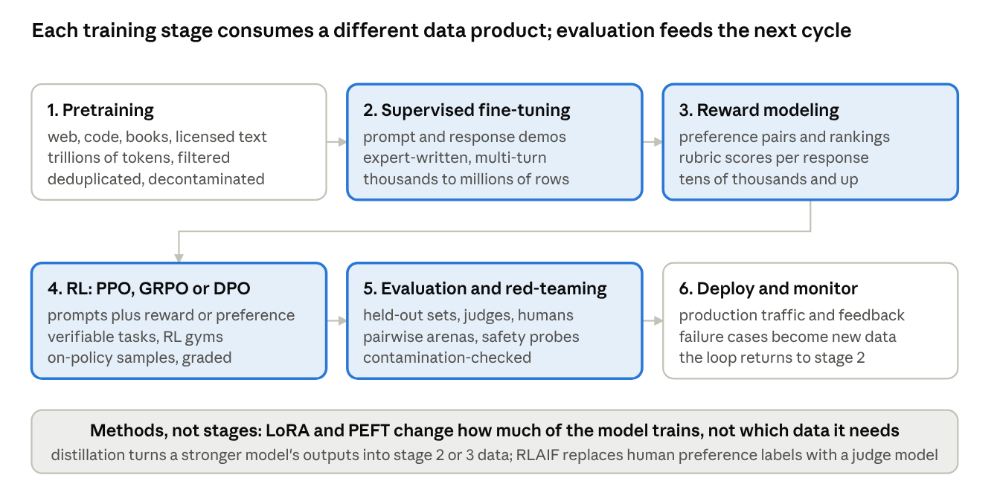
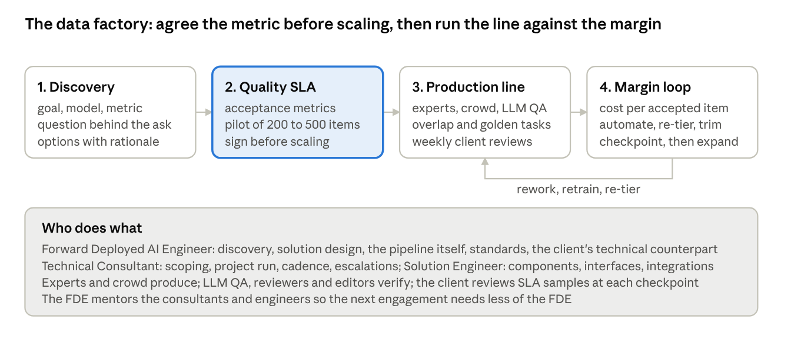

# Toloka Forward Deployed AI Engineer: The Final-Round Book

Ahmed Jawad, Ph.D. · October 17, 2026

## Part I — Toloka and the role

## 1. What Toloka does

Toloka sells the data that teaches models to reason and the evidence that they do. Its homepage positions it as "training data for AI agents and LLMs," produced by an expert network, a global crowd, and a technology platform with more than a decade of quality-control engineering behind it ([toloka.ai](https://toloka.ai)). The buyers are frontier labs, big tech, AI-native startups, and enterprises; the named clients in the 2025 investment announcement were Amazon, Anthropic, Microsoft, poolside, Recraft, and Shopify ([Nebius press release](https://www.businesswire.com/news/home/20250507227499/en/Nebius-Welcomes-Bezos-Expeditions-as-Lead-Investor-in-AI-Data-Business-Toloka)).

### Origins and ownership

Toloka was founded in 2014 as an internal crowdsourcing project inside a large corporation and grew into a standalone AI data business under Nebius Group. In May 2025 Bezos Expeditions led a strategic investment, with Mikhail Parakhin, CTO of Shopify, participating and becoming Executive Chairman of a newly constituted board; Nebius kept a significant majority economic stake but gave up majority voting control to give Toloka more independence, and founder and CEO Olga Megorskaya continues to run the company. Megorskaya has described the round as $72 million, funding the core data products and a newer consumer-facing product, Tendem ([CEO interview](https://pulse2.com/toloka-profile-olga-megorskaya-interview/)).

### The three pillars

**Experts.** The site claims an expert network across 90+ domains, with more than 70% of contributors holding advanced degrees, 6,000+ active contributors, and on the platform page 200,000+ experts in four tiers: domain experts, AI tutors, general annotators, and the global crowd ([platform](https://toloka.ai/platform)). This is the part of Toloka that produces physician-written medical rubrics, lawyer-checked compliance data, and coding problems written by vetted developers.

**Crowd.** The original business: contributors in 100+ countries speaking 40+ languages, still relevant for scale tasks, multilingual work, and physical-world data such as robotics collection.

**Platform.** The technology that makes the first two reliable: the site cites 50+ automated quality-control methods and 60+ anti-fraud methods, an "LLM QA system" that checks every output, and an AI assistant that turns a plain-language goal into a multi-stage pipeline with a recommended expert-tier mix. Megorskaya's framing is that Toloka treats quality "as an engineering challenge," with two pillars under everything: proprietary LLM QA technology and a global marketplace of experts.

### What they sell

| Offering | What it is | Who buys it |
| --- | --- | --- |
| Agent data | Environments and RL gyms (simulated companies, computer-use mockups, MCP replicas), agent trajectory demonstrations, trajectory evaluations, benchmark extensions (TAU-bench, MCP-bench, TinyTAU), agent safety red-teaming including MCP and computer-use injection testing ([agent data](https://toloka.ai/agent-data)) | Frontier labs and agent builders |
| LLM and VLM datasets | Domain-specific demonstrations (SFT), preference and ranking data, reinforcement-learning tasks, multilingual and multi-domain sets | Labs, model developers, enterprises fine-tuning |
| Coding data | Problems and solutions written by vetted developers, coding-assistant training and evaluation | Labs and coding-assistant companies; poolside is the named example |
| Creative and multimodal data | Text, image, video, and audio training and evaluation data; egocentric video | Media and multimodal model teams |
| Evaluation and red-teaming | Human and LLM-assisted evaluation, safety evaluation, Toloka Arena for comparative evaluation | Everyone shipping a model or agent |
| Self-service platform | Describe a task, get a pipeline, pay for work that passes QA | AI teams that want data without a managed engagement |
| Tendem | A hybrid AI agent for individuals with human experts verifying output | Prosumers; not relevant to this role except as context |

The direction of travel, in the CEO's words, is upstream: from annotation toward complex post-training work, RL gyms, and evaluation pipelines, with developers served by self-service and the hardest problems served by managed engagements. The forward-deployed role sits at the managed end.

### How they produce it

Two published artifacts show the method. The **Quality Loop** is a five-stage closed feedback system: calibration of standards (a "BILT Quality Agent" that encodes Toloka's practices as quality standards), scoping and task design ending in a Quality SLA with control points across the pipeline, expert onboarding with automatic matching and anti-fraud checks, in-production control with a production copilot giving real-time guideline checks, and evaluation and improvement in which quality agents score work against the SLA and feed retraining. Example targets quoted on the page: 200 to 400 words, 95%+ completeness, under 5% off-topic, reviewer ratings of 4 of 5 or higher; claimed outcomes include a 65% increase in first-pass acceptance and three times faster ramp-up ([quality loop](https://toloka.ai/blog/quality-loop/)).

The **multi-domain SFT case study** shows an engagement end to end: 10,000 prompt-completion pairs across seven skills, multiple languages and domains from finance to automotive engineering, delivered in four months as 80 sub-datasets; several hundred native-speaking domain experts onboarded in under three weeks; a three-stage pipeline of generation, expert review, and editor revision; every item checked by at least two experts plus automated checks for grammar, artifacts, per-skill requirements, contributor performance, and embedding-based prompt diversity; and an evaluation in which models fine-tuned on the set beat the same models fine-tuned on a public baseline with a 74.1% win rate under a GPT-4 judge on held-out domain prompts ([case study](https://toloka.ai/blog/multi-domain-multi-language-sft-dataset-pushes-llm-performance-to-the-next-level/)). The lessons the article draws are the ones a forward-deployed engineer lives on: a prompt type that was too shallow was redesigned mid-project, automated checks rejected bad content early so editors spent time on real issues, and weekly client check-ins refined prompt types and style guides.

For agent data the page describes the production loop as: experts execute tasks in versioned environments while the raw trace is logged; automated QA with tool-enabled checks for rubric adherence, cross-step consistency, environment invariants, and task completion; senior human review of complex or flagged trajectories plus a statistical sample; per-step and per-task labels and calibrated scores used for SFT selection and RLAIF reward shaping; and deterministic resets, audit logs, PII scrubbing, and containerized testbeds for reproducibility and security.

### How an engagement makes money

A data engagement is priced per unit of accepted data, and its cost is mostly human time. Revenue is units times price; cost of goods is expert and crowd time at their rates, including rework and the overlap used for quality, plus the compute for LLM-assisted generation and QA and the platform's share. Gross margin is what is left after those; contribution margin subtracts the delivery team's time, the solution engineers, consultants, and the forward-deployed engineer who designed and ran the pipeline. The levers are therefore the ones the JD names: how much of the work can be automated or pre-labeled by models and only verified by humans, how much overlap quality really requires, which expert tier each stage needs, how much rework the quality loop prevents, and how fast throughput ramps. Section 11 does the arithmetic; the point here is that at Toloka the engineering decisions and the commercial outcome are the same decisions.

### Why this matters for the interview

Mateusz leads the technical consultants who turn client goals into these pipelines. Everything above is the vocabulary he will use: quality SLA, expert tiers, overlap, first-pass acceptance, trajectories, RL gyms, win rate under a judge. Speaking it fluently, and knowing where Toloka's published numbers come from, is the difference between a candidate who read the website and one who understands the business.

## 2. The role, decoded

The Freelance Forward Deployed AI Engineer is, in the JD's words, "Toloka's most senior client-facing technical role": the primary technical counterpart to CTOs, VPs of Engineering and ML, and research leaders, who designs and builds the data-generation, labeling, and evaluation pipelines rather than training the models, owns the solution from discovery through delivery, owns the commercial outcome, and raises the technical bar of the solution engineers and technical consultants around them. Every line of the JD maps to something Mateusz can test in a conversation. This section does the mapping.

### Line by line

| JD says | What it means in practice | How it gets tested |
| --- | --- | --- |
| Primary technical counterpart to CTOs, VPs, research leaders | You are the person a lab's research lead calls when the data is not moving the metric | Can you talk about SFT, RLHF, DPO, reward models, and evals as a peer, not a vendor? Section 4 to 6 |
| Lead executive conversations with an answer-first (BLUF) approach | State the recommendation, then the reasoning, then the options | Every answer you give in the interview is a sample of this. Section 13 |
| Manage escalations and expectations with composure and integrity | Bad news early, with options and a recommendation; no surprises | A story where something went wrong and you told the client first. Section 15 |
| Build trusted relationships by recommending evidence-based solutions | Pilot, measure, show the win rate, then scale | The case study pattern: experiment proves the pipeline before production. Section 10 |
| Ask excellent questions to uncover the question behind the question | A client asks for "10,000 labeled examples"; you find out which metric they are trying to move and whether labels are even the right lever | The two practical use cases. Section 12 and 14 |
| Understand their model, which metrics they want to move, how they train or evaluate | Discovery is anchored on the model's stage (pretrain, SFT, RL, eval) and the metric | Section 4 and 12 |
| Propose the data that solves the problem, with options and rationale | "Based on your goal, you likely need preference pairs with rubrics, or graded trajectories; here is the trade-off" | Section 5 and 14 |
| Design and build the data solutions yourself: labeling components, quality controls, UIs, agentic systems, RAG, synthetic data, multi-stage pipelines | Hands-on: you configure the pipeline, write the QA code, prototype the generation step | Code-level questions and the use cases. Section 7, 9, 10 |
| Run experiments to prove the pipeline delivers quality and speed; iterate from MVP to production | A pilot batch with acceptance metrics before scaling | Section 8 and 10 |
| Technical leadership across engagements; reusable standards; mentor solution engineers and consultants | You leave behind templates, checklists, and better engineers | Leadership stories; the E.ON and Noctal team-building. Section 15 |
| Own delivery end to end and the commercial outcome: gross margin and contribution margin, with levers, trade-offs, and checkpoints named | You can say what a data point costs, why, and which lever changes it | Section 11, and expect a numbers question |
| Identify and drive expansion opportunities | Noticing the adjacent problem and quantifying it | Xiom.AI and E.ON expansion stories. Section 15 |

### The "About you" bullets, as a checklist

- **Executive communication**: clear, concise, structured, persuasive, calm under pressure. The interview is the test; prepare answers in the BLUF shape and keep them under two minutes.
- **Strong understanding of modern LLM development**: SFT, RLHF/RLAIF, DPO/PPO, reward modeling, LoRA/PEFT. Part II is written so that each can be explained in one paragraph and connected to the data it needs.
- **Hands-on solution engineering**: multi-stage pipelines, agentic workflows, RAG, synthetic data, Python with NumPy and pandas, API integration, independent prototyping. Part III has the code.
- **Solid software engineering foundations**: version control, testing, MVP thinking, iterative development, production software. Your production history covers this; say it in those words.
- **Exceptional discovery and problem framing**: working through ambiguity, asking the right questions, translating research goals into data and evaluation strategies. Section 12 is a script; the use cases are rehearsal.
- **Seniority and track record**: 8+ years, influence beyond individual projects, standards, mentoring, cross-functional leadership; consulting or applied ML/LLM background. Fifteen years, a 15-person function built at E.ON, an engineering organization directed at Noctal, a product co-founded at Xiom.AI.
- **Ownership mindset**: outcomes, trade-offs between time, cost, and quality, technical and commercial success. The margin conversation in Section 11 is where this is proved.
- **Nice to have**: fine-tuning or agentic systems experience (both present), an advanced degree (a doctorate), crowdsourcing or data-centric AI experience (the gap to name honestly and bridge with evaluation and HITL experience).

### What the role is not

It is not a research role: the JD is explicit that you do not train the models, you build the data and evaluation that others train with. It is not a pure consulting role: you build the pipelines yourself. And it is not a people-management role, though it carries technical leadership and mentoring. The nearest analogy from your own history is the Capital Group engagement: senior technical counterpart to the client, hands-on on the pipeline, accountable for quality, cost, and delivery.

### The three things Mateusz is listening for

Misha's note names them: communication skills, previous experience working directly with clients, and technical background in ML and LLMs. Every answer should carry at least two of the three. A technical answer that ends with how you explained it to the client's VP is worth more than a deeper technical answer that does not.

## 3. The final interview with Mateusz

Mateusz is the Head of the Technical Consultants team: the people who scope and run engagements, and whom this role would mentor. Misha's brief says the conversation is the point: he wants to get to know you, understand your experience and technical background, discuss projects you have worked on, and walk through two practical use cases of the kind Toloka works on, judged on how you approach the problem, structure your thinking, ask questions, communicate, and make technical decisions, not on a single correct answer. He is paying particular attention to communication, direct client experience, and ML and LLM knowledge. After this round, if it goes well, comes the offer.

### The shape of the hour

Expect four movements. An opening where he asks about you and you give a two-minute account of your background aimed at this role. A projects conversation where he picks something from your resume and goes deep on decisions, trade-offs, and stakeholders. Two use cases, each ten to fifteen minutes, where he describes a client situation and you work it live. And your questions at the end, which are also assessed: the questions a consultant asks reveal how they think.

### How to answer anything he asks

Use the structure the JD itself names: **answer first** (bottom line up front), then the reasoning, then the options and the trade-off, then what you would do next. In a use case, the structure is slightly different because the answer is not yet known: **restate the goal in your words, ask two or three questions that change the design, state your working assumptions, propose the pipeline with its quality controls and metrics, name the risks and the commercial levers, and say what the first checkpoint would be.** Keep it interactive; he wants a working session, not a presentation. Thinking aloud is fine when it is structured; silence is not.

Three habits to keep visible throughout. Ask before you answer when the question is ambiguous, and say why the answer depends on it. Give numbers where you have them: sizes, rates, win rates, costs, timelines. End each story with the result and what you changed.

### The two-minute introduction

"I'm a principal AI engineer who has spent fifteen years as the technical counterpart to the people who own a model's outcome, and then built the pipelines myself. Today I lead AI engineering for Capital Group, the largest active-funds asset manager, where I design agentic and retrieval pipelines with structured human review and automated evaluation in a regulated business. Before that I directed engineering at Noctal, where we fine-tuned and shipped multimodal models on Vertex AI; I trained and deployed a ranking model at ten thousand queries a second with A/B gates at Virtual Minds; I co-founded an AI product that delivered $1.5 million in measurable value for a retailer; and at E.ON I built a fifteen-person AI function from one use case and owned its roadmap, acceptance criteria, and budget. I understand how models are post-trained and evaluated well enough to tell a research lead which data will move their metric, and I like the part of the work where you sit with the client, find the question behind the question, and prove the pipeline with a pilot before you scale it. That is why this role."

### Common questions, answered in advance

Misha mentioned a document from Mateusz covering common questions so they need not take interview time. Whether or not it has arrived, these are the ones to have settled, with the positions already stated in your cover letter.

| Question | Answer |
| --- | --- |
| Where are you based, and what time zone? | Irvine, California, Pacific time; fully remote. Overlap with the Netherlands, Serbia, and the UK is my morning and their afternoon; I routinely work European mornings with the Capital Group and E.ON history to prove it. |
| Availability and start date | Available immediately, as stated in the cover letter. Be ready to say how the current Capital Group engagement is wound down or shared, and how many hours per week you can commit from day one. |
| Contract structure | Freelance on a business-to-business, corp-to-corp basis through my employer TEKHQS Inc.; I cannot contract as an individual. Toloka's freelance model fits that; the paperwork runs through TEKHQS. |
| Rate | Set with TEKHQS, not quoted by me in the interview; if pressed, say the commercial conversation sits with them and you are aligned with the role's seniority. |
| Citizenship, travel, work authorization | German citizen with a residence in Germany, so EU travel and on-site days are easy; in the US on an employer-sponsored visa, which is why the contract runs through the employer. |
| Languages | English, business fluent; German, professional working proficiency; Urdu, Hindi, and Punjabi native. Useful for multilingual data work. |
| Why Toloka, why now | The leverage: the data that trains and evaluates frontier models is the highest-leverage engineering there is, and Toloka's experts-plus-platform model is the credible way to produce it. I have been on the consuming side of that data for years; I want to be on the producing side with the people who do it best. |
| Why a freelance forward-deployed role rather than a staff job | Because the forward-deployed shape is the work I am best at: multiple engagements, direct client ownership, hands-on building, and standards that outlast the engagement. Freelance suits how I already work. |
| Experience with crowdsourcing or data-centric AI | Honest gap on crowdsourcing operations; strong on the adjacent skills: evaluation design, human-in-the-loop review, LLM-as-judge, synthetic data, quality gates, and the A/B discipline. Bridge it with what you learned from Toloka's published method (Section 1) and the quality-control code in Section 9. |
| Experience with frontier labs | None as a direct client; enterprise and startup clients, and deep familiarity with how labs post-train and evaluate from the engineering side. |
| Hands-on fine-tuning | Yes: LoRA/PEFT and evaluation of LLMs and multimodal models at Noctal and in your own work; say what you tuned, on what data, and how you measured it. |
| Notice period and conflicts | State it plainly; no conflicts with Toloka's clients. |
| Equipment, security, NDA | Standard; Toloka is ISO 27001 and 27701 certified and SOC 2 compliant, and most client work is under NDA; say you are used to regulated confidentiality from financial services. |

### What not to do

Do not lecture; he knows the field. Do not answer a use case with a technology before asking what the client is measuring. Do not claim crowdsourcing experience you do not have; claim the evaluation and quality experience you do. Do not let a story run past two minutes without a number in it. And do not treat the questions at the end as optional.

## Part II — The LLM knowledge Mateusz will probe

## 4. How LLMs are trained, and what data each stage needs

A modern LLM is produced in stages, and each stage consumes a different kind of data with different quality requirements, volumes, and producers. A forward-deployed engineer's credibility with a research lead rests on knowing which stage the client is at, which metric that stage moves, and therefore which data product to propose.



*LLM training pipeline: six stages, the data each consumes; the four highlighted stages are where Toloka's products sit*

Pretraining builds capability from scale; supervised fine-tuning teaches format and behavior from demonstrations; reward modeling learns what people prefer; reinforcement learning optimizes against that preference or against verifiable rewards; evaluation measures all of it; and production feedback starts the cycle again. The highlighted stages are the ones Toloka's offerings serve.

### Pretraining

The base model learns language, facts, and reasoning patterns by predicting the next token over trillions of tokens of web text, code, books, and licensed corpora. The data work here is filtering, deduplication, quality classification, and decontamination against evaluation sets; human effort goes into quality classifiers and curated high-value subsets (textbooks, code with tests, math), not into writing the data. Labs rarely buy pretraining data from vendors at scale, but they do buy curated, licensed, and expert-verified subsets for the later phases of pretraining where data mixture matters most.

### Supervised fine-tuning (SFT)

The base model is trained on prompt-response pairs, and increasingly multi-turn conversations and agent trajectories, so that it answers in the desired format, follows instructions, uses tools, and behaves like an assistant. The loss is the same next-token prediction, now on responses written the way the lab wants them. Data quality dominates quantity: a few thousand expert-written, diverse, correct examples outperform far larger noisy sets, which is the finding behind the instruction-tuning literature and behind Toloka's own case study, where 10,000 expert-made pairs beat a public baseline with a 74% win rate (Section 1). The producers are domain experts, with crowd and model assistance for scale, and the quality criteria are correctness, instruction adherence, style consistency, diversity of prompts, and coverage of the target domains and skills.

### Reward modeling

A reward model is a classifier trained to score responses the way humans would. Its training data is preference data: for a prompt, two or more responses with a human judgment of which is better, or a ranking, or a rubric-based score per response. The reward model's quality bounds everything downstream, so the preference data needs careful rater instructions, calibration, agreement measurement, and coverage of the behaviors that matter, including the hard cases where the better answer is a refusal or an admission of uncertainty. Reward models are also built for specific properties, helpfulness, harmlessness, factuality, and for process rewards that score each reasoning step rather than the final answer.

### Reinforcement learning: RLHF, RLAIF, PPO, GRPO, DPO

**RLHF** (reinforcement learning from human feedback) optimizes the SFT model against the reward model: the policy generates responses, the reward model scores them, and an RL algorithm updates the policy to score higher while a penalty keeps it from drifting too far from the SFT model. **PPO** is the classic algorithm; **GRPO** (group relative policy optimization) samples several responses per prompt and uses their relative rewards, removing the need for a separate value model and making RL on verifiable tasks (math, code with tests) cheap enough to run at scale. **DPO** (direct preference optimization) skips the reward model and the RL loop: it fine-tunes the policy directly on preference pairs with a loss that raises the chosen response's likelihood relative to the rejected one. DPO is simpler and more stable; PPO and GRPO can keep improving with fresh on-policy samples and reward signals that DPO cannot use. **RLAIF** replaces human preference labels with judgments from a strong model under a written constitution or rubric, trading some fidelity for scale, usually with humans calibrating the judge.

The data for this stage is prompts plus a reward source: preference pairs for DPO, a trained reward model for PPO, verifiable checkers or graded environments for GRPO-style training on tasks, and RL gyms, simulated environments where an agent's trajectory can be scored, for agentic skills. This is the stage Toloka is moving into with environments, trajectories, and graded evaluation signals.

### Evaluation and red-teaming

Evaluation runs throughout: held-out test sets per capability, pairwise arenas where humans or judges compare models, safety and red-team probes, and agent benchmarks that score trajectories. Its data is distinct from training data and must be kept out of it; contamination, training on the test, is the most common way an evaluation lies. Section 6 is the detail.

### Methods that cut across stages

**LoRA and PEFT** (parameter-efficient fine-tuning) train a small number of added parameters, low-rank adapters on the attention and feed-forward weights, instead of the full model, cutting memory and compute by orders of magnitude at a modest cost in capacity. They change how a lab trains, not what data it needs; an enterprise with one GPU node fine-tunes with LoRA on the same SFT and DPO data a lab would use. **Distillation** uses a stronger model's outputs as training data for a smaller one, which makes synthetic SFT and preference data a product in itself, with the quality risks Section 5 covers. **Continued pretraining** on domain corpora precedes SFT when the target domain's vocabulary and facts are thin in the base model.

### The conversation with a research lead

The questions that locate a client on this pipeline, and that Section 12 turns into a script: Which stage are you at, and which metric is not moving? Is the gap capability (the model cannot do it, so pretraining or heavy SFT), behavior (it can but does not reliably, so SFT or preference data), or judgment (it does the wrong thing in hard cases, so reward modeling and RL)? How do you evaluate today, and is that evaluation trusted? What do you already have, synthetic or human, and what did it fail to fix? The answers decide whether the proposal is demonstrations, preferences, graded trajectories, an evaluation set, or an honest recommendation that data is not the lever.

## 5. Data for post-training

Post-training data comes in a handful of shapes, and each shape has a schema, a producer, a quality definition, and a failure mode. Knowing them lets you propose a data product rather than a vague "dataset," and lets you price it (Section 11).

### The catalog

| Data product | Shape | Trains | Who produces it | Quality means | Typical failure |
| --- | --- | --- | --- | --- | --- |
| Instruction demonstrations | prompt, response | SFT | Domain experts; crowd for simple tasks; models with expert review | Correct, complete, in the target style, diverse prompts | Homogeneous prompts; subtle errors experts miss; style drift between writers |
| Multi-turn conversations | messages with roles, sometimes with context and tool calls | SFT | Experts role-playing user and assistant, or scripted users with expert assistants | Coherent across turns; correct use of earlier context; natural user turns | Users too cooperative; assistants that never ask clarifying questions |
| Agent trajectories | task, environment state, sequence of actions and observations, final result | SFT for agents; selection for RL | Experts executing tasks in instrumented environments; models with expert verification | Task completed; actions valid; efficient; no unsafe steps | Trajectories that reach the answer by luck; environment leakage; unreproducible states |
| Preference pairs | prompt, chosen, rejected, optional rationale | Reward models, DPO | Raters comparing model outputs under rater guidelines | Agreement with experts; consistent criteria; coverage of hard cases | Length and style bias; raters comparing the wrong dimension; near-identical pairs |
| Rankings and ratings | prompt, several responses, ranking or per-response scores on a scale | Reward models | Raters with anchored scales | Calibrated scales; agreement | Scale drift; central tendency |
| Rubric-scored responses | prompt, response, rubric, per-criterion verdicts | Reward models, process rewards, evals | Experts writing rubrics; raters or judges applying them | Rubric specificity; verdict consistency | Vague rubrics; judges agreeing with everything |
| Verifiable tasks | problem, checker or tests, reference solution | GRPO-style RL, evals | Experts (mathematicians, developers) writing problems and checkers | Unambiguous; checker correct; difficulty calibrated | Checker bugs; problems solvable by pattern matching; leaked solutions |
| RL environments | simulated systems with state, tools, resets, graders | Agent RL, agent evals | Engineers building the environment; experts writing tasks and graders | Realistic; deterministic resets; graders correct | Grader exploitable; environment too easy or too artificial |
| Safety and red-team data | adversarial prompts, attack trajectories, desired refusals or safe completions | Safety SFT, reward models, evals | Red-teamers; safety experts; models generating attacks with human review | Coverage of attack classes; realistic; correct desired behavior | Stale attacks; refusals that over-generalize |

### Demonstrations, in depth

SFT data is where most enterprise engagements start. The design questions are the schema (single-turn or conversation, with or without context and tools), the prompt distribution (which skills, domains, languages, difficulty levels, and in what proportions), the response specification (length bounds, style guide, citation rules, refusal rules), and the review pipeline (who writes, who reviews, who adjudicates). Toloka's case study split a 10,000-pair set into 80 sub-datasets by language, skill, and domain with seven skill types, and found that an extraction-only prompt type was too shallow and had to be joined by an "inference" type that let experts add domain knowledge beyond the given context. The general lesson: prompt diversity is designed, not hoped for, and measured, with embedding-based similarity checks rejecting near-duplicates.

### Preference data, in depth

Preference data looks simple and is the easiest to get wrong. Rater guidelines must say what "better" means for this client, in order of priority: correctness before completeness before style, or safety before everything. Pairs should be informative: two responses that differ in the dimension of interest, not two near-identical outputs or one obviously broken one. Raters need calibration on a shared set before they rate, and agreement is measured continuously (Section 9). Rationales, a sentence on why the chosen response won, cost a little and double the value, because they train better reward models, enable rubric extraction, and make disagreements diagnosable. And the distribution of prompts matters as much as the labels; a reward model trained on easy prompts learns nothing about the hard cases the client cares about.

### Agentic data, in depth

The product Toloka is moving toward is data for agents: trajectories, environments, and graded signals. A trajectory is a log of what an agent saw and did in an environment, and a demonstration trajectory is an expert doing the task well, with each step recorded. Quality is checked at the step level (valid action, guideline adherence) and the task level (completed, efficient, safe), with automated checks for cross-step consistency and environment invariants and human review of flagged and sampled trajectories, which is exactly the loop Toloka describes on its agent-data page (Section 1). The hard parts are environment fidelity (an agent trained on a toy CRM fails on a real one), reproducibility (versioned environments with deterministic resets), and graders that cannot be exploited by an RL policy, which is why graders are tested adversarially before training runs against them.

### Synthetic data and its failure modes

Synthetic data, generated by a model from seeds, templates, or stronger-model outputs, is cheap, fast, and dangerous in specific ways. **Mode collapse**: generated data is less diverse than the real distribution, so the trained model narrows. **Error propagation**: a generator's systematic mistakes become the student's beliefs; without verification the data encodes the generator's ceiling. **Contamination**: generated prompts leak evaluation sets or copyrighted text. **Model collapse** over generations: training on your own outputs repeatedly degrades the tails of the distribution. The remedies are the pipeline patterns of Section 10: generate from diverse seeds and real prompts, filter with verifiers and judges, deduplicate by embedding, decontaminate against evaluation sets, keep a human-verified fraction and measure the synthetic fraction's effect on held-out evaluation. Toloka's platform lists "synthetic data validation" as a task type for a reason: the valuable product is verified synthetic data, and the verification is the human part.

### Data mixing

Post-training sets are mixtures: domains, skills, languages, difficulty, and the ratio of human to synthetic. The mixture is a tunable, and its effect is measured on held-out evaluations by capability, so that adding 20% more coding data is a decision with a number attached. Rules of thumb that survive: oversample the capabilities the client's metric depends on, keep a general-purpose slice to prevent regression on everything else, and treat the ratio of hard to easy examples as a knob. The data vendor's job is to deliver sets labeled by these dimensions so the lab can mix.

### Schemas

The formats are simple, and the discipline is in the metadata. A row carries the data, the provenance (who produced it, which pipeline version, which reviews it passed), the labels that make mixing possible (domain, skill, language, difficulty), and the quality signals (reviewer scores, agreement, automated check results).

```json
// SFT conversation row
{"id": "sft-00042", "messages": [
   {"role": "system", "content": "You are a tax research assistant."},
   {"role": "user", "content": "..."},
   {"role": "assistant", "content": "..."}],
 "meta": {"domain": "tax", "skill": "closed_qa", "language": "en", "difficulty": 3,
          "author_tier": "domain_expert", "reviews": 2, "review_score": 4.5, "pipeline_version": "2026-10-01"}}

// Preference row (DPO / reward model)
{"id": "pref-01877", "prompt": "...", "chosen": "...", "rejected": "...",
 "rationale": "Chosen cites the clause; rejected invents a date.",
 "meta": {"criterion": "correctness", "raters": 3, "agreement": 1.0, "rater_tier": "domain_expert"}}

// Trajectory row (agent SFT / evaluation)
{"id": "traj-0311", "task": "Refund order 1042 per policy", "environment": "crm-sim@v7",
 "steps": [{"observation": "...", "action": {"tool": "lookup_order", "args": {"id": 1042}}, "ok": true}, "..."],
 "outcome": {"completed": true, "steps": 6, "unsafe": false, "grader_score": 0.95},
 "meta": {"expert_id": "e-77", "reviewed": true, "flags": []}}
```

Section 7 trains on the first two formats; Section 9 shows how the quality fields are computed.

## 6. Evaluation data and what quality alignment means

Evaluation is the half of Toloka's business that decides whether the other half worked. A client who buys training data without an agreed evaluation is buying hope; a forward-deployed engineer's first job in discovery is to get the evaluation agreed, which Toloka's own method calls quality alignment. This section covers the kinds of evaluation data, how they are built, and how to turn "good data" into a number both sides sign.

### Kinds of evaluation

| Kind | What it measures | Data it needs | Strength | Weakness |
| --- | --- | --- | --- | --- |
| Held-out capability sets | Accuracy on a task family with known answers | Prompts with reference answers or checkers, stratified by domain, skill, difficulty | Cheap to run repeatedly; objective where checkers exist | Narrow; saturates; contaminates |
| Human pairwise evaluation | Which of two model outputs people prefer | Prompts, outputs from two systems, rater guidelines, calibrated raters | Closest to what users experience | Expensive; slow; rater bias |
| LLM-as-judge | A model's verdict against a rubric | Prompts, outputs, rubrics, a calibration set of human labels | Scales; consistent; fast | Position, verbosity, and self-preference bias; needs calibration |
| Rubric-based evaluation | Per-criterion verdicts on each response | Expert-written rubrics per item or per task family | Diagnostic; ties scores to specific requirements | Rubric authoring cost |
| Arenas | Relative ranking of models from many pairwise votes | A stream of prompts and blind pairwise votes from humans | Hard to game; tracks real preference | Needs volume; aggregate only |
| Agentic evaluation | Whether an agent completes tasks in an environment and how | Tasks, environments with graders, reference trajectories | Measures doing, not saying | Environment fidelity; grader exploits |
| Safety and red-teaming | Resistance to misuse and harm | Adversarial prompts and trajectories by attack class, desired behaviors | Finds failures before users do | Attacks age; coverage is never complete |

Public benchmarks (general knowledge and reasoning sets, coding benchmarks with tests, agent benchmarks such as TAU-bench and MCP-bench) give comparability across labs and are increasingly saturated or contaminated, which is why labs buy private, expert-built evaluation sets and benchmark extensions; Toloka lists TAU-bench and MCP-bench extensions among its agent-data products for exactly that reason (Section 1).

### Building an evaluation set

An evaluation set is designed like a survey, not collected like a pile. Define the capability and the population of prompts it should represent; stratify by domain, skill, language, and difficulty so that results can be read per stratum; write items with experts, each with a reference answer, a checker, or a rubric; have a second expert verify every item; hold the set out of all training data, with contamination checks on both sides; version it; and size it for the decisions it must support. A set of 300 items can detect a difference of roughly ten points in pass rate between two systems with reasonable confidence; detecting a three-point difference needs thousands. The client's decision, ship or not, sets the required resolution and therefore the size and cost.

### Contamination

Contamination is training on the test. It happens through public benchmarks scraped into pretraining data, through synthetic generation that paraphrases evaluation prompts, and through evaluation items reused as training examples inside a company. Controls: canary strings embedded in private sets so their presence in training data is detectable; n-gram and embedding-overlap checks between training and evaluation sets before every run; strict separation of the teams and pipelines that produce the two; and periodic refresh of evaluation sets with new items whose scores are compared against old ones to detect leakage.

### Human evaluation that can be trusted

Human evaluation is only as good as its raters and its instructions. Guidelines state the criteria in priority order with examples of each verdict; raters pass a qualification on a labeled set; a calibration session resolves disagreements before production; every item is rated by two or more raters; agreement is measured and raters whose agreement drops are retrained or removed; and a sample is reviewed by senior experts. For pairwise evaluation, outputs are presented in randomized order and raters do not know which system produced which. Section 9 has the agreement arithmetic.

### LLM-as-judge, in one paragraph

A judge is a model with a rubric, run at temperature zero, asked to reason before it decides, with one criterion per judge, a binary or pairwise verdict, position swapping for pairwise, a different model family than the one judged, and a published agreement rate against a human calibration set. The companion field guide's Part 4 is the full treatment. In Toloka's case study the judge was GPT-4 Turbo on 1,500 held-out prompts across correctness, conciseness, observance, safety, and overall quality, and the headline result, a 74.1% win rate, is a judge number; a client is entitled to ask how the judge was calibrated, and the engineer should have the answer ready.

### Agentic evaluation

Agents are evaluated on outcomes and trajectories: did the task complete, how many steps, which tools in which order, any unsafe action, and how the trajectory compares to a reference. Environments must reset deterministically so a run is reproducible, and graders must be tested against adversarial policies, because an RL-trained agent will find a grader's blind spot before a human does. Toloka's agent-data page describes per-step and per-task labels (guideline adherence, failure categories, safety flags) and calibrated scores used both for evaluation and for selecting SFT examples and shaping RLAIF rewards, which is the right design: the same instrumented trajectory serves training and evaluation, with the sets kept apart.

### Safety and red-teaming

Red-team data is organized by attack class (jailbreaks, prompt injection through content and tools, harmful-capability requests, privacy extraction, deception) and by the desired behavior (refuse, safely complete, ask, escalate). The data product is the attack set plus the labeled desired responses, which serves safety SFT, reward modeling, and evaluation. Coverage is measured against a taxonomy, and sets are refreshed because attacks age. For agents, injection through tool results and computer-use interfaces is the frontier, and Toloka names MCP injection and computer-use injection red-teaming among its offerings.

### Quality alignment, in metric terms

"Quality" becomes a contract when it is written as acceptance metrics before scaling. The ones that recur, and that a Quality SLA in Toloka's method would carry:

- **Acceptance rate**: the share of delivered items that pass the client's own review on a sample, with the sample size and the pass threshold stated (for example, 95% of a 300-item sample, reviewed blind by the client's experts).
- **Agreement**: inter-rater agreement on the labels, as Cohen's kappa or Krippendorff's alpha, above a threshold (0.7 is a common floor for subjective labels; verifiable labels are held to exact match).
- **Defect rate by class**: errors per thousand items by category (factual, formatting, policy), each with a ceiling.
- **Coverage**: the distribution of items across the agreed strata, within tolerances, and a diversity measure such as the share of near-duplicate prompts under an embedding threshold.
- **Downstream effect**: for training data, the change in the client's held-out evaluation after fine-tuning on a pilot batch, as a win rate against their baseline under an agreed judge or human protocol, with the sample size that makes the difference meaningful.
- **Throughput and latency**: items per week at the agreed quality, and the ramp.

The pilot proves the pipeline against these numbers on a few hundred items before the production line runs; the numbers are checked at every checkpoint; and the commercial levers of Section 11 are pulled against them, never against quality the client cannot measure. This is the quality-alignment conversation, and it is the hardest and most important one in an engagement, because it is where a client's wish ("we want better reasoning") becomes a thing that can be delivered, measured, and paid for.

## 7. Code: fine-tuning, preference optimization, reward models, and an RLAIF loop

The role does not train the client's models, but the engineer who has run these loops proposes better data, because they know what the training code expects and where bad data shows up. The examples use Hugging Face's `transformers`, `peft`, `trl`, and `datasets`; the library APIs move, so treat the shapes as stable and check names against the current documentation before running.

### LoRA supervised fine-tuning

LoRA adds trainable low-rank matrices to chosen weight matrices and freezes the rest. On a 7 to 8 billion parameter model this trains well under 1% of the parameters and fits on a single large GPU. The data is the SFT conversation format from Section 5.

```python
# pip install transformers peft trl datasets accelerate
from datasets import load_dataset
from peft import LoraConfig
from trl import SFTTrainer, SFTConfig

dataset = load_dataset("json", data_files={"train": "sft_train.jsonl", "eval": "sft_eval.jsonl"})
# each row: {"messages": [{"role": "system", ...}, {"role": "user", ...}, {"role": "assistant", ...}]}

lora = LoraConfig(
    r=16, lora_alpha=32, lora_dropout=0.05,
    target_modules=["q_proj", "k_proj", "v_proj", "o_proj", "gate_proj", "up_proj", "down_proj"],
    task_type="CAUSAL_LM",
)

args = SFTConfig(
    output_dir="out/sft-lora",
    per_device_train_batch_size=4, gradient_accumulation_steps=8,
    learning_rate=2e-4, num_train_epochs=2, lr_scheduler_type="cosine", warmup_ratio=0.03,
    max_length=4096, packing=True,                  # pack short conversations; respect the client's max length
    assistant_only_loss=True,                      # compute loss on assistant turns only, not on prompts
    bf16=True, logging_steps=20, eval_strategy="steps", eval_steps=200, save_steps=200,
)

trainer = SFTTrainer(
    model="meta-llama/Llama-3.1-8B-Instruct",      # or the client's base checkpoint
    train_dataset=dataset["train"], eval_dataset=dataset["eval"],
    peft_config=lora, args=args,
)
trainer.train()
trainer.save_model("out/sft-lora")                 # saves the adapter; merge later if serving needs one artifact
```

What the data vendor learns from this: the loss is computed on assistant turns, so the quality of the response text is everything and the prompt only needs to be representative; packing and a max length mean very long examples are truncated or wasted, so length bounds in the data spec are not pedantry; and evaluation loss on a held-out slice is a sanity check, not a quality measure, which is why Section 6 exists.

### Direct preference optimization

DPO trains on preference pairs directly. The reference model is the SFT model; `beta` controls how far the policy may move from it.

```python
from trl import DPOTrainer, DPOConfig
from transformers import AutoModelForCausalLM, AutoTokenizer

pairs = load_dataset("json", data_files="pref_train.jsonl")["train"]
# each row: {"prompt": [{"role":"user",...}], "chosen": [{"role":"assistant",...}], "rejected": [{"role":"assistant",...}]}

model = AutoModelForCausalLM.from_pretrained("out/sft-merged", torch_dtype="bfloat16")
tokenizer = AutoTokenizer.from_pretrained("out/sft-merged")

args = DPOConfig(
    output_dir="out/dpo", beta=0.1,                 # 0.05-0.5: smaller moves further from the reference
    learning_rate=5e-7, num_train_epochs=1,
    per_device_train_batch_size=2, gradient_accumulation_steps=16,
    max_length=4096, max_prompt_length=2048, bf16=True, logging_steps=20,
)
trainer = DPOTrainer(model=model, ref_model=None, args=args, train_dataset=pairs,
                     processing_class=tokenizer, peft_config=lora)   # ref_model=None with PEFT: adapter off = reference
trainer.train()
```

The metrics DPO logs, reward margins and the accuracy of preferring chosen over rejected, are also a data-quality instrument: pairs the model cannot learn to separate are either noisy labels or near-identical responses, and listing them by margin finds the bad rows in the dataset.

### A reward model

A reward model is a sequence classifier with one output trained on the same pairs with a ranking loss, used by PPO-style RL and as a reusable judge.

```python
from trl import RewardTrainer, RewardConfig
from transformers import AutoModelForSequenceClassification

rm = AutoModelForSequenceClassification.from_pretrained("out/sft-merged", num_labels=1, torch_dtype="bfloat16")
args = RewardConfig(output_dir="out/rm", learning_rate=1e-5, num_train_epochs=1,
                    per_device_train_batch_size=4, max_length=4096, bf16=True, logging_steps=20)
RewardTrainer(model=rm, args=args, train_dataset=pairs, processing_class=tokenizer).train()

# Using it as a scorer
import torch
def reward(prompt_messages, response_text) -> float:
    text = tokenizer.apply_chat_template(prompt_messages + [{"role": "assistant", "content": response_text}], tokenize=False)
    with torch.no_grad():
        return rm(**tokenizer(text, return_tensors="pt", truncation=True).to(rm.device)).logits.item()
```

A reward model's accuracy on a held-out set of expert-labeled pairs is the number that tells the client whether their preference data was good enough; below roughly 70 to 75% pairwise accuracy the data is usually the problem.

### Verifiable rewards with GRPO

Where a checker exists, no human labels are needed for the reward: the policy samples several responses per prompt and is updated toward the ones the checker accepts.

```python
from trl import GRPOTrainer, GRPOConfig

def unit_test_reward(completions, tests, **kwargs):
    """completions: list of model outputs; tests: the row's test suite. 1.0 if all tests pass."""
    return [run_tests(code=c, tests=t) for c, t in zip(completions, tests)]

problems = load_dataset("json", data_files="coding_tasks.jsonl")["train"]   # {"prompt": ..., "tests": ...}
trainer = GRPOTrainer(model="out/sft-merged", reward_funcs=unit_test_reward,
                      args=GRPOConfig(output_dir="out/grpo", num_generations=8, max_completion_length=2048,
                                      learning_rate=1e-6, bf16=True),
                      train_dataset=problems)
trainer.train()
```

This is why verifiable tasks with correct checkers, written by vetted developers and mathematicians, are a product in themselves: the checker is the reward, and a buggy checker trains the model to exploit the bug.

### A minimal RLAIF loop

RLAIF replaces the human in the preference step with a judge model under a rubric, with humans calibrating the judge and auditing a sample. The loop: sample responses, judge pairs, filter by confidence, train with DPO, evaluate, repeat.

```python
import random, json
from pydantic import BaseModel

class Pref(BaseModel):
    reasoning: str
    winner: str          # "A" or "B" or "tie"
    confidence: float    # 0-1

def judge_pair(prompt, a, b) -> Pref:
    # one criterion, reasoning first, structured output; a different model family than the policy
    return call_judge(RUBRIC, prompt=prompt, response_a=a, response_b=b, schema=Pref)

def build_pairs(prompts, policy, n=4, min_conf=0.8):
    rows = []
    for p in prompts:
        cands = [policy(p) for _ in range(n)]
        for i in range(len(cands)):
            for j in range(i + 1, len(cands)):
                a, b = cands[i], cands[j]
                v1 = judge_pair(p, a, b); v2 = judge_pair(p, b, a)          # position swap
                if v1.winner == "A" and v2.winner == "B" and min(v1.confidence, v2.confidence) >= min_conf:
                    rows.append({"prompt": p, "chosen": a, "rejected": b, "rationale": v1.reasoning})
                elif v1.winner == "B" and v2.winner == "A" and min(v1.confidence, v2.confidence) >= min_conf:
                    rows.append({"prompt": p, "chosen": b, "rejected": a, "rationale": v1.reasoning})
    return rows

pairs = build_pairs(prompt_pool, policy=current_model_generate)
human_audit = random.sample(pairs, 200)      # experts label these; judge agreement must clear the threshold
with open("pref_train_rlaif.jsonl", "w") as f:
    for r in pairs: f.write(json.dumps(r) + "\n")
# -> DPO as above -> evaluate on the held-out set -> next round with the new policy
```

The two lines that matter commercially are the position swap and the human audit. The swap removes the judge's position bias at the cost of a second call; the audit is the human-in-the-loop that makes an RLAIF dataset defensible to a client, and the 200 expert labels are what a vendor is paid for even when the other hundred thousand labels came from a model.

### What this means for data design

SFT wants correct, diverse, in-style responses with loss on the assistant turn. DPO and reward models want informative pairs with clean labels and coverage of hard cases, and their training metrics expose the bad rows. GRPO wants correct checkers more than it wants labels. RLAIF wants a calibrated judge and an audited sample. An engineer who can say which of these a client's pipeline needs, and show the training loop that consumes it, is the counterpart a research lead wants.

## Part III — How Toloka builds data

## 8. The data factory

Toloka produces data the way a factory produces parts: a specification is agreed, a pilot proves the line, the line runs under statistical control, and the unit cost is driven down while the specification holds. The forward-deployed engineer designs the line and owns the first two phases; the consultants and engineers run it; the margin loop is everyone's.



*The engagement as a factory: four phases, the rework loop, and the roles around it, drawn from Toloka's published method*

Discovery produces options; quality alignment produces a signed metric and a pilot; the production line produces accepted items under control; the margin loop lowers the cost of each accepted item and decides when to expand. Rework flows back into the line, never silently into the client's dataset.

### Phase 1: discovery

The engineer meets the client's technical leadership and finds the question behind the question: the model, the stage it is at, the metric that is not moving, how they evaluate, what data they already have and why it did not work. The output is two or three options with rationale ("based on your goal you likely need graded trajectories, or preference pairs with rubrics; here is what each costs and proves"), a recommended pilot, and the acceptance metrics the pilot will be judged on. Section 12 is the script.

### Phase 2: quality alignment and the pilot

The acceptance metrics from Section 6 are written into a quality SLA: what passes, how it is measured, on what sample, by whom. A pilot of a few hundred items runs through the full pipeline, including the client's own review of a blind sample, and the numbers come back. The pilot is where task designs get fixed (Toloka's case study changed a prompt type here), where rater guidelines get their examples, where the expert tier mix is set, and where the price per item becomes real because the time per item is now measured. Nothing scales until the pilot clears the SLA, and the client has signed the SLA because they helped write it.

### Phase 3: the production line

The line is a multi-stage pipeline (Section 10): generation by experts, crowd, or models; verification by overlap, golden tasks, and LLM QA; review and adjudication by senior experts and editors; and automated checks at every stage for format, duplicates, artifacts, and guideline adherence. Contributors are qualified before they start, monitored by skill scores while they work, and retrained or removed when they drift. The client sees a weekly sample and a dashboard of the SLA metrics, and raises issues against specific items, which become rework and often guideline edits. Toloka's platform language for this is the Quality Loop: calibration, scoping, onboarding, in-production control, and evaluation feeding retraining.

### Phase 4: the margin loop

Every accepted item has a cost: the expert minutes that produced it, the minutes spent verifying it, the share of rework it carried, the model calls, and the platform overhead. Once the line is stable, the engineer pulls levers that lower that cost without moving the SLA metrics: pre-labeling or drafting with a model so experts verify rather than write; reducing overlap where agreement is high and increasing it only where it is low; moving stages to a cheaper tier where the pilot shows it holds; automating the checks that catch most rejections; trimming rework by fixing the guideline that causes it. Each change is checked against the SLA at the next checkpoint, and the margin number is reported alongside the quality number. Section 11 does the arithmetic. When the line is both in spec and profitable, the conversation with the client turns to expansion: the adjacent dataset, the evaluation set that goes with the training set, the next language.

### What breaks

The factory fails in characteristic ways, and a forward-deployed engineer is judged on spotting them early. **Spec drift**: the client's notion of quality moves after the SLA is signed; the remedy is a change-control conversation, not silent absorption. **Guideline ambiguity**: agreement drops because raters interpret a rule differently; the remedy is examples, not more rules. **Tier mismatch**: a task given to the crowd that needs experts, or to experts that the crowd could do; the pilot is meant to catch it, and the skill-score data catches it later. **Automation that passes garbage**: an LLM QA step tuned on the pilot that misses a new failure mode; the human sample catches it, which is why the sample never goes to zero. **Throughput cliffs**: experts in a rare domain run out; the remedy is a sourcing plan agreed at discovery. **Margin chasing**: pulling a lever that moves the SLA; the remedy is the rule that quality is measured at every checkpoint before margin is reported.

### The roles

The JD and the factory map onto each other. The forward-deployed engineer owns discovery and solution design, builds the pipeline and its quality controls, sets the standards other engagements reuse, and is the client's technical counterpart throughout. Technical consultants scope and run engagements and own the cadence and escalations; solution engineers build the components, interfaces, and integrations; experts and the crowd produce; LLM QA, reviewers, and editors verify; and the client reviews samples against the SLA at each checkpoint. The mentoring line in the JD means the engineer's job is also to make the next engagement need less of them.

## 9. Quality control in human data

Human-produced data is a measurement, and quality control is the statistics that make the measurement trustworthy. The techniques below are a decade old in crowdsourcing and still the core of how expert data is verified; Toloka's platform lists more than fifty automated quality-control methods, and most are variations on these. The code is plain NumPy and pandas, which is what the JD asks for.

### The toolkit

| Technique | What it does | When to use | Cost |
| --- | --- | --- | --- |
| Qualification test | A labeled entry test contributors must pass before working | Always; sets the floor and documents it | One-time per contributor |
| Golden (control) tasks | Items with known answers mixed invisibly into the stream; wrong answers lower a contributor's skill score | Objective or near-objective labels | A few percent of volume, plus writing the goldens |
| Overlap | Each item done by k contributors; labels aggregated | Subjective or error-prone labels | Multiplies cost by k on the overlapped share |
| Aggregation | Majority vote, weighted vote, or a probabilistic model such as Dawid-Skene that learns each contributor's confusion matrix | Whenever overlap is used | Compute only |
| Skill scores | A running estimate of each contributor's accuracy from goldens and agreement; drives routing, pay, and removal | Always, on any line that runs longer than a day | Compute only |
| Honeypots and anti-fraud | Traps for bots and careless work: impossible items, timing checks, duplicate detection, device and behavior signals | Crowd tiers especially | Small |
| Review tiers | Senior experts or editors review a sample, flagged items, and disagreements; their verdicts override and recalibrate | Expert data; anything with a style guide | Expert time on a sample |
| Inter-annotator agreement | Cohen's kappa, Fleiss' kappa, Krippendorff's alpha: agreement corrected for chance | Guideline quality and rater calibration | Compute only |
| LLM-assisted QA | A model checks guideline adherence, format, artifacts, and consistency on every item; flags for human review | Every pipeline; the lever that moved Toloka's first-pass acceptance | Model calls |
| Dynamic overlap | Overlap only until the aggregated label is confident, then stop | Large volumes with mixed difficulty | Saves most of the overlap cost |

### Agreement: the number that says whether the task is well defined

Raw percent agreement overstates quality on skewed labels; chance-corrected agreement is what to report. For two raters, Cohen's kappa; for many raters with missing data and any scale, Krippendorff's alpha. A rule of thumb for subjective labels: alpha above 0.8 is reliable, 0.67 to 0.8 is usable with care, below 0.67 means the guideline, not the raters, needs work.

```python
import numpy as np, pandas as pd

def cohen_kappa(a: pd.Series, b: pd.Series) -> float:
    tab = pd.crosstab(a, b)
    n = tab.values.sum()
    po = np.trace(tab.values) / n
    pe = (tab.sum(axis=1).values @ tab.sum(axis=0).values) / n**2
    return (po - pe) / (1 - pe)

def krippendorff_alpha_nominal(labels: pd.DataFrame) -> float:
    """labels: rows = items, columns = raters, NaN where a rater did not label the item."""
    units = [row.dropna().tolist() for _, row in labels.iterrows() if row.notna().sum() >= 2]
    values = sorted({v for u in units for v in u})
    idx = {v: i for i, v in enumerate(values)}
    o = np.zeros((len(values), len(values)))              # observed coincidence matrix
    for u in units:
        m = len(u)
        for i, vi in enumerate(u):
            for j, vj in enumerate(u):
                if i != j:
                    o[idx[vi], idx[vj]] += 1 / (m - 1)
    n = o.sum(); nc = o.sum(axis=1)
    do = n - np.trace(o)                                   # observed disagreement (nominal: any difference counts 1)
    de = (n * n - (nc * nc).sum()) / (n - 1)               # expected disagreement
    return 1 - do / de
```

Use it at three moments: on the calibration set before production, to decide whether the guideline is ready; continuously on the overlapped share, to detect drift; and per rater against the aggregate, to find who needs retraining.

### Aggregation: majority vote and Dawid-Skene

Majority vote is fine when raters are equally good and labels are balanced. Dawid-Skene is better when raters differ: it learns each rater's confusion matrix and the class priors by expectation-maximization and weights votes accordingly, which also yields a per-rater quality estimate for free.

```python
def dawid_skene(df: pd.DataFrame, n_iter: int = 30):
    """df: columns item, rater, label. Returns item posteriors and per-rater confusion matrices."""
    items = df.item.unique(); raters = df.rater.unique(); classes = sorted(df.label.unique())
    I, R, C = {v: i for i, v in enumerate(items)}, {v: i for i, v in enumerate(raters)}, {v: i for i, v in enumerate(classes)}
    votes = np.zeros((len(items), len(raters), len(classes)))
    for row in df.itertuples():
        votes[I[row.item], R[row.rater], C[row.label]] = 1
    post = votes.sum(axis=1); post /= post.sum(axis=1, keepdims=True)        # init with majority vote
    for _ in range(n_iter):
        prior = post.mean(axis=0)                                            # M-step: class priors
        conf = np.einsum("ic,irk->rck", post, votes) + 1e-3                   # rater r: true c -> labeled k
        conf /= conf.sum(axis=2, keepdims=True)
        logp = np.log(prior)[None, :] + np.einsum("irk,rck->ic", votes, np.log(conf))   # E-step
        post = np.exp(logp - logp.max(axis=1, keepdims=True)); post /= post.sum(axis=1, keepdims=True)
    return (pd.DataFrame(post, index=items, columns=classes),
            {r: pd.DataFrame(conf[R[r]], index=classes, columns=classes) for r in raters})

posteriors, confusions = dawid_skene(labels_long)
final = posteriors.idxmax(axis=1)                       # the aggregated label
confidence = posteriors.max(axis=1)                     # route low-confidence items to an expert
rater_accuracy = {r: np.trace(c.values @ np.diag(posteriors.mean().values)) for r, c in confusions.items()}
```

The confidence column is what dynamic overlap uses: stop collecting labels for an item once its posterior clears a threshold, keep collecting for the contested ones.

### Golden tasks and skill scores

Goldens are written by experts, cover the label space including the hard cases, are refreshed so they cannot be memorized, and are mixed in at a few percent of volume. A contributor's skill score is a smoothed accuracy on goldens combined with agreement with the aggregate; it gates access to harder tasks and higher pay, and a score below threshold pauses the contributor for retraining.

```python
def skill_score(golden_correct: pd.Series, agreement_with_final: pd.Series, prior=0.8, prior_weight=20) -> float:
    """Bayesian-smoothed accuracy: a new contributor starts near the prior and earns their own score."""
    hits = golden_correct.sum() + agreement_with_final.sum()
    n = len(golden_correct) + len(agreement_with_final)
    return (hits + prior * prior_weight) / (n + prior_weight)
```

### Review tiers

Expert data runs through tiers: the author, a peer reviewer, and for a sample or for flagged items an editor or lead whose verdict is final. Toloka's case study used exactly this three-stage shape, with every item seen by at least two experts. The reviewer's job is not only to fix the item but to tag the reason, because reason counts are what tell you whether the guideline, the author, or the task design is the problem.

### LLM-assisted QA

A judge model checks every item for format, length bounds, guideline adherence, artifacts (broken links, placeholder text), near-duplication by embedding, and cross-field consistency, and attaches flags. Flagged items go to humans; clean items are sampled for humans anyway, at a rate that never reaches zero. The judge is calibrated against the reviewers' verdicts the same way any judge is (companion guide, Part 4), and its precision and recall on the reviewers' sample are reported. This is the lever behind Toloka's claimed 65% increase in first-pass acceptance and the 45% efficiency gain in the case study, and in commercial terms it is the lever that moves margin most, because it converts expert writing time into expert verification time.

### A quality dashboard

The line reports, per batch: acceptance rate on the client's sample, agreement on the overlapped share, defect counts by reason, golden accuracy by tier, the share of items escalated to review, LLM-QA flag rate and its precision on the human sample, throughput, and rework rate. The SLA names the thresholds; the dashboard shows the margin against them; and the weekly client review reads from the same page.

## 10. Pipelines and tooling

A data pipeline at Toloka is a sequence of stages, each with an input schema, an output schema, a worker type (model, crowd, expert, reviewer), and a quality check, wired so that rejected items flow back and accepted items flow forward. The engineer's craft is choosing the stages, placing the humans where they add the most value per minute, and proving with a pilot that the line delivers the SLA.

### The canonical shape

```text
seed prompts / client corpus
   -> [generate]      model drafts prompts or responses from seeds and retrieved context     (cheap, fast)
   -> [pre-label]     model proposes labels, flags, or structure                               (cheap)
   -> [produce]       experts or crowd write, edit, or label; UI shows context and guidelines   (the cost center)
   -> [verify]        overlap + goldens + LLM QA; agreement and flags computed                  (statistics)
   -> [review]        senior experts adjudicate disagreements, flagged and sampled items        (expensive, small)
   -> [export]        schema validation, dedup, decontamination, metadata, versioned release
   <- [rework]        rejected items return to produce with the reviewer's reason attached
```

Every arrow is a queue with a schema, which is what lets stages be re-tiered or automated later without redesigning the line.

### A pipeline skeleton

The structure is more important than the framework. In practice this runs on a workflow engine (Airflow, Prefect, or a queue-driven set of services); the skeleton below is the shape, in plain Python with pandas, which is what gets whiteboarded.

```python
from dataclasses import dataclass
import pandas as pd

@dataclass
class Stage:
    name: str
    run: callable            # DataFrame -> DataFrame, adds columns; never drops rows
    accept: callable         # row -> bool; rejected rows carry a reason

def pipeline(items: pd.DataFrame, stages: list[Stage], max_rework: int = 2) -> tuple[pd.DataFrame, pd.DataFrame]:
    accepted, rejected = [], []
    work = items.assign(rework=0)
    while len(work):
        df = work.copy()
        for s in stages:
            df = s.run(df)
            ok = df.apply(s.accept, axis=1)
            rejected_now = df[~ok].assign(rejected_at=s.name)
            df = df[ok]
            if len(rejected_now):
                rejected.append(rejected_now)
        accepted.append(df)
        rw = pd.concat(rejected)[lambda d: d.rework < max_rework] if rejected else pd.DataFrame()
        work = rw.assign(rework=rw.rework + 1) if len(rw) else work.iloc[0:0]
        rejected = [pd.concat(rejected)[lambda d: d.rework >= max_rework]] if rejected else []
    return pd.concat(accepted), (pd.concat(rejected) if rejected else pd.DataFrame())

stages = [
    Stage("generate",  run=draft_with_model,        accept=lambda r: len(r.draft) > 0),
    Stage("pre-label", run=prelabel_with_model,     accept=lambda r: True),
    Stage("produce",   run=route_to_experts,        accept=lambda r: r.expert_done),
    Stage("verify",    run=overlap_and_llm_qa,      accept=lambda r: r.agreement >= 0.8 and not r.qa_flags),
    Stage("review",    run=adjudicate_sample,       accept=lambda r: r.review_verdict != "reject"),
    Stage("export",    run=validate_dedup_decontam, accept=lambda r: r.schema_ok and not r.duplicate and not r.contaminated),
]
final, dead_letter = pipeline(batch, stages)
```

The rework loop is bounded, the dead-letter frame is reviewed by a human, and every row carries the stage that rejected it and why, which is the raw material for the quality dashboard and for fixing guidelines.

### Generation with retrieval and verification

Synthetic generation is a stage, not a dataset. The pattern that survives contact with experts: retrieve real context for each seed (a document, a code file, a ticket) so prompts are grounded rather than invented; generate several candidates with diversity constraints; verify with a checker where one exists and with a judge where not; deduplicate by embedding similarity; decontaminate against the client's evaluation sets; and send a fixed fraction to experts for review, with their verdicts calibrating the judge.

```python
def generate_grounded(seeds, retriever, llm, judge, embed, eval_embeddings, n=3, sim=0.92, contam=0.95):
    rows = []
    for seed in seeds:
        ctx = retriever.search(seed.topic, k=3)                       # real context, not hallucinated
        cands = [llm.draft(seed, ctx, temperature=0.9) for _ in range(n)]
        cands = [c for c in cands if judge.passes(c, rubric=seed.rubric)]  # one criterion per judge call
        for c in cands:
            v = embed(c.prompt)
            if max(cosine(v, e) for e in eval_embeddings) > contam:    # leaks the eval set -> drop
                continue
            if any(cosine(v, r.vec) > sim for r in rows):              # near-duplicate -> drop
                continue
            rows.append(Row(prompt=c.prompt, response=c.response, vec=v, context_ids=[d.id for d in ctx]))
    return rows
```

### Labeling interfaces

The interface is where expert minutes are spent, so its design is a cost lever. The rules: show the guideline and two examples beside the task; show the retrieved context and let the expert open the source; pre-fill what the model is confident about and ask the expert to verify rather than type; make the common verdict one click and the rare one two; capture a reason code on every rejection; and log time per item, which is the input to the margin arithmetic. A prototype in Streamlit or Gradio is a day's work and is how a pilot starts; the production interface lives on the platform.

### Toloka's platform, programmatically

The classic Toloka platform exposes projects, pools, tasks, and quality-control rules through a Python SDK, and the shape of a pool configuration is a compact statement of this section. The AI-assisted platform on the website now builds much of this from a plain-language goal, but the primitives underneath are the same.

```python
# pip install toloka-kit  (classic platform SDK; field names illustrative, check the current reference)
import toloka.client as tk
from toloka.client import quality_control as qc

client = tk.TolokaClient(token=TOKEN, environment="PRODUCTION")

pool = tk.Pool(
    project_id=PROJECT_ID, private_name="preference-pairs-batch-7",
    reward_per_assignment=0.40, assignment_max_duration_seconds=900,
    defaults=tk.Pool.Defaults(default_overlap_for_new_task_suites=3),          # overlap of 3
    filter=(tk.filter.Languages.in_("EN") & (tk.filter.Skill(DOMAIN_SKILL_ID) >= 80)),  # qualified experts only
)
pool.set_mixer_config(real_tasks_count=9, golden_tasks_count=1)                 # 10% goldens per task suite
pool.quality_control.add_action(
    collector=qc.collectors.GoldenSet(history_size=20),
    conditions=[qc.conditions.GoldenSetCorrectAnswersRate < 85.0],
    action=qc.actions.RestrictionV2(scope="POOL", duration_unit="DAYS", duration=3, private_comment="golden accuracy"),
)
pool.quality_control.add_action(
    collector=qc.collectors.MajorityVote(answer_threshold=2),
    conditions=[qc.conditions.IncorrectAnswersRate > 30.0],
    action=qc.actions.SetSkill(skill_id=DOMAIN_SKILL_ID, skill_value=0),
)
pool = client.create_pool(pool)
client.create_tasks([tk.Task(pool_id=pool.id, input_values=row) for row in batch_rows], allow_defaults=True)
```

Overlap, goldens, skill-gated access, and automatic restriction on golden accuracy are all here, which is why a quality conversation with Toloka's own consultants can go straight to the parameters.

### From MVP to production

The pilot is the MVP: the whole line, end to end, on a few hundred items, with the client's blind review at the end. The checklist for calling it production-ready: the SLA metrics clear on the pilot; the guideline has examples for every rejection reason the pilot produced; the expert tier mix is set from measured time per item; the LLM QA step's precision on the reviewers' sample is known; the export passes schema validation, dedup, and decontamination; the dashboard shows the SLA; and the cost per accepted item is computed and compared with the price. Then the line scales in batches, each batch a checkpoint, with the margin loop of Section 8 running on top.

### Reusable standards

The JD asks the engineer to leave behind standards. The ones that pay: a schema library for the data products of Section 5; a guideline template with mandatory examples and reason codes; a pilot protocol with sample sizes; a judge-calibration procedure; the dashboard definition; and the cost model of Section 11 as a spreadsheet every consultant can fill in. A mentored consultant with those can scope an engagement that would otherwise need the engineer in the room.

## 11. Commercial ownership: margin, levers, checkpoints

The JD says the engineer owns gross margin and contribution margin "with the levers, trade-offs, and next checkpoints named, not just described." That is a request for arithmetic. This section does it on a worked example, with illustrative rates; the structure is what matters, and the structure is the same for any data product.

### Definitions

**Revenue** is accepted units times price per unit. **Cost of goods sold** is what producing the accepted units cost: contributor time at tier rates, including overlap, goldens, and rework; model calls for generation and QA; and the platform's operating share. **Gross margin** is revenue minus cost of goods, as a share of revenue. **Contribution margin** subtracts the engagement's delivery team, the consultant, solution engineer, and forward-deployed engineer time charged to it, so it is what the engagement contributes to the company's fixed costs. The cost that drives everything is **cost per accepted item**, because rejected items are paid for and not sold.

### A worked example: 10,000 preference pairs

A client wants 10,000 expert-rated preference pairs for a reward model, priced at $9.00 per accepted pair, so revenue is $90,000. The pilot measured the line as follows (rates illustrative).

| Cost line | Baseline assumption | Cost per accepted pair |
| --- | --- | --- |
| Rating time | 3 raters per pair (overlap 3), 3 minutes each, AI-tutor tier at $30 per hour | $4.50 |
| Golden tasks | 5% of volume, same cost per task | $0.23 |
| Rework | 10% of pairs redone once | $0.45 |
| LLM QA and pre-screen | Two model calls per pair | $0.05 |
| Platform and operations | 10% of contributor cost | $0.52 |
| **Cost of goods per pair** |  | **$5.75** |

Gross margin at baseline: revenue $90,000, cost of goods $57,500, gross margin $32,500, or 36%. The delivery team over eight weeks, a consultant at half time, a solution engineer at a third, and the engineer at a fifth, costs about $14,000, so contribution margin is $18,500, or 21%. Acceptable, not good.

### The levers

Each lever changes one line of the table and is checked against the SLA before it is kept.

| Lever | What changes | Effect on cost per pair | Risk to quality | Checkpoint |
| --- | --- | --- | --- | --- |
| Dynamic overlap | Stop at 2 raters when they agree, use the third only on disagreement; average overlap falls from 3 to about 2.2 | about -$1.20 | Low where agreement is high; monitor agreement by stratum | Batch 2: agreement on the overlapped share unchanged |
| LLM pre-screen | The model drafts a rationale and highlights differences; raters verify, 3 minutes falls to 2.5 | about -$0.75 | Anchoring on the model's suggestion; measure rater-model agreement and keep a blind sample | Batch 2: blind-sample acceptance unchanged |
| Guideline fix | The pilot's top rejection reason was a vague rule; adding examples halves rework to 5% | about -$0.22 | None; this improves quality | Batch 1 |
| Tier change | Move the easy strata to general annotators at $18 per hour after they pass the qualification | about -$0.60 on those strata | Real; pilot it on one stratum with full overlap first | Batch 3 |
| Golden refresh cadence | Keep goldens at 5% but rotate; no cost change, prevents memorization | $0 | Protects quality | Monthly |

After the first three levers, cost per pair is about $3.60, cost of goods $36,000, gross margin $54,000, or 60%, and contribution margin $40,000, or 44%. The tier change could take it further and is the one that gets piloted rather than assumed. The margin number is reported at every checkpoint alongside the SLA metrics, in the same review, so that no one can improve one without seeing the other.

### The trade-offs, named

- **Overlap against agreement.** Less overlap is cheaper and less certain; dynamic overlap buys most of the saving and keeps certainty where it is needed.
- **Automation against anchoring.** Model pre-labeling speeds raters and biases them; the blind sample is the cost of knowing.
- **Tier against expertise.** Cheaper tiers are right for easy strata and wrong for hard ones; the pilot says which, and the skill scores say when it changes.
- **Speed against rework.** Pushing throughput before the guideline is stable produces rework that costs more than the time saved.
- **Price against scope.** A client who wants the price lower is offered a narrower spec, lower overlap on easy strata, or a longer timeline, never silent quality loss.

### Pricing a data point

The price per unit is set from the pilot's measured time per item, the tier mix, the overlap, the expected rework, the model and platform costs, and the target margin, plus the client's own review cost if Toloka carries it. Stating it that way to a client, "an accepted pair costs us about six dollars at pilot settings; at nine we can fund the quality loop and the delivery team; the levers that bring it down are these, and here is the one we will not pull," is the credible version of a price. It also sets up the next conversation, because every lever is a reason the price can fall at the next checkpoint.

### Checkpoints

An engagement has a checkpoint per batch, typically weekly: SLA metrics, cost per accepted item, throughput, rework rate, open guideline issues, and the decision for the next batch (continue, change a lever, pause). The checkpoint is where expectations are managed, because a client who sees the numbers every week is never surprised at the end, and because the expansion conversation happens naturally when the numbers are good.

### Expansion

Expansion is noticing the adjacent problem and quantifying it. The reward-model client will need an evaluation set for the same behaviors; the SFT client will need preference data for the next stage; the agent client will need the environment extended to the next workflow; the multilingual client will need the next language. The engineer who has the numbers from the current engagement can price the next one on the spot, which is why commercial ownership and technical ownership are the same job here.

## Part IV — Working the client

## 12. Discovery: the question behind the question

Clients arrive with a request shaped like a purchase order: "we need 20,000 labeled conversations." Discovery is the conversation that finds what the request is for, because the right answer is often a different product, a smaller one, or occasionally no data at all. Mateusz's use cases will start exactly this way, and the first thing he is assessing is whether you ask before you answer.

### The question behind the question

A request has three layers. The **ask** is what they said: labeled conversations. The **goal** is the metric they want to move: fewer escalations in their support assistant. The **constraint** is why they have not moved it already: their last fine-tune made the model more confident and no more correct. The product that serves the goal under the constraint is not necessarily the ask; it might be an evaluation set that distinguishes confident-wrong from correct, plus preference data that penalizes confident-wrong, plus a smaller SFT set than they planned. Finding the goal and the constraint is the job; the ask is the opening line.

### The script

Run it as a conversation, not a form, and write the answers down in front of the client.

1. **Outcome.** What will be different for your users or your business when this works? How will you know; which number moves, by how much, by when?
2. **Model and stage.** Which model, base or fine-tuned, and where are you in the pipeline: still pretraining, SFT, preference and RL, or evaluating a candidate? Who owns the training run?
3. **The metric and the evaluation.** How do you measure the thing today? Is there a held-out set, a judge, human review, an arena? Do you trust it? If the evaluation is weak, the first product is the evaluation.
4. **What you have tried.** What data did you use before, where did it come from, and what happened when you trained on it? This question finds the constraint faster than any other.
5. **The failure.** Show me ten examples where the model fails. Are they capability failures (cannot do it), behavior failures (can, but does not reliably), or judgment failures (does the wrong thing in hard cases)? Each points to a different data product.
6. **The distribution.** Which domains, skills, languages, formats, difficulty levels, and in what proportions? What is the long tail you care about?
7. **Who can produce it.** Does this need physicians, lawyers, senior developers, native speakers, or can trained generalists do it with a guideline? Can a model draft it for experts to verify?
8. **Acceptance.** What would make you reject a delivery? Who reviews, how many items, against what rubric? Let us write the acceptance metrics now.
9. **Constraints.** Timeline, budget, data residency and confidentiality, licensing of sources, contributor requirements, how the data must be delivered.
10. **Decision rights and cadence.** Who signs the spec, who reviews weekly, who can change the guideline, who approves a tier or overlap change.

The answers produce the two or three options, the pilot design, and the first draft of the quality SLA, in the same meeting if it goes well.

### Options with rationale

The JD's phrase is "based on your goal, you likely need this, or this." The form of a good option is: what it is, what it proves, what it costs in time and money, and what it does not do. Three examples.

**A lab wants its coding model to use tools better.** Option A: 5,000 expert-demonstrated agent trajectories in instrumented repositories, for SFT; proves behavior on known workflows; eight weeks; highest cost per item. Option B: 2,000 verifiable tasks with tests plus an RL environment, for GRPO-style training; proves generalization under reward; longer setup, cheaper per item after; needs their training team engaged. Option C: a 500-item trajectory evaluation set first, to find which failure dominates; two weeks; small cost; the recommendation if their evaluation is weak, because A and B cannot be judged without it.

**An enterprise wants its assistant to stop hallucinating policy.** Option A: a grounded SFT set written by their policy experts from the actual documents. Option B: preference pairs penalizing unsupported claims, for DPO. Option C: fix retrieval first, because the ten failures they showed were all retrieval misses; data would not have helped. The rationale for C is the evidence from question five, and saying it costs Toloka a sale and earns a client.

**A lab wants multilingual reasoning data.** Option A: translate the English set; cheap, loses cultural grounding, risks translationese. Option B: native experts author in each language from shared specifications; expensive, correct. Option C: B for the two languages that matter commercially, A with native review for the rest. The trade-off is explicit and the client chooses.

### Reading the room

Discovery with a CTO is different from discovery with a research lead. The CTO wants the outcome, the cost, the risk, and the date; the research lead wants the data spec, the evaluation, and the training implications. Ask who is in the room, lead with what they own, and keep the other layer ready. In a use case with Mateusz, say which stakeholder you are imagining and why.

### Anti-patterns

Answering the ask instead of the goal. Proposing a technology before a metric. Accepting "high quality" as a requirement without turning it into a number. Agreeing a volume before a pilot. Skipping question four because it feels like criticism of the client's past work. And finishing discovery without a written list of what was agreed, which is the document the quality SLA grows from.

### The one-page output

The meeting ends with one page: the goal and metric, the model and stage, the data product chosen and the options rejected with reasons, the pilot size and acceptance metrics, the strata and volumes, the timeline and checkpoints, the price basis, and the names of who decides what. It is sent the same day. Everything in the engagement traces back to it, which is why the discovery conversation is the one to practice most before the interview.

## 13. Executive communication

The JD asks for conversations with CTOs and VPs that are "clear, concise, structured, persuasive, and calm under pressure," led "answer-first." These are habits, and they can be rehearsed. This section gives the structures and phrases, because in the interview the structure of your answers is the evidence.

### Answer first

BLUF, bottom line up front, means the first sentence is the recommendation or the finding, the second is why, and the rest is the support and the options. It works because executives decide in the first thirty seconds whether to keep listening, and because it forces you to have a position.

Before: "So we ran the pilot, and there were some interesting findings around the rater agreement, especially in the legal domain, where the guideline had some ambiguity, and we also saw that the throughput was a bit lower than planned, so taking all of that together..."

After: "The pilot passed on quality and missed on speed: acceptance was 96% against the 95% target, throughput was 60% of plan. The cause is one ambiguous rule in the legal guideline that slowed experts and caused rework; we have rewritten it with examples. I recommend we start production next week at the planned rate, with legal items at 1.5 times overlap for the first batch as insurance. The alternative is a second pilot week, which costs a week and buys certainty we already have on everything but legal."

### The structure for any update

Four parts, in order, and the same four every time so the client learns where to look: **status against the agreed numbers** (quality, throughput, cost, timeline, each green, amber, or red), **what changed and why**, **decisions needed from them**, with your recommendation, and **next checkpoint**. One page, sent before the meeting, read in the meeting.

### Managing escalations

An escalation is a client, or a client's boss, unhappy enough to go above the project. The sequence that works: acknowledge without defending; state what you know and what you do not, with times; give the next concrete step and when they will hear from you; then follow through visibly. Never argue the facts in the first conversation; establish them. Never promise a fix before you know the cause.

"You are right that batch four's quality dropped; our own dashboard flagged it on Tuesday and I should have called you then rather than waiting for the review. Here is what we know: acceptance fell from 96 to 88% on medical items only; two new experts onboarded that week and their golden accuracy was low. We have paused them, re-queued their items for review, and the corrected batch will be with you Friday. I will send a one-line update every day until then."

### Managing expectations

Bad news travels early, with its impact, its options, and your recommendation. The expectation to manage most carefully is the one the client set themselves: a volume, a date, or a price that discovery showed was unrealistic. Say so at discovery, in numbers, and offer the version that is realistic. A client told in week one that 20,000 expert items in four weeks is 10,000 in six at this quality, with the arithmetic, respects the arithmetic; the same client told in week five does not.

### Pushing back without losing the room

Push back on the idea, anchored to the client's goal, with an alternative. "If we cut overlap on medical items to hit the date, acceptance there will fall below your 95%, and that is the stratum your evaluation weighs most. Two ways to hit the date without that: move the easy general-domain items to the lower tier, which saves the same money, or deliver medical a week later and everything else on time. I recommend the first."

### Translating for the audience

The same fact, three ways. To the CTO: "Cost per accepted pair is down from $5.75 to $3.60 with quality unchanged, which takes the engagement from 36% to 60% gross margin; the next lever needs a pilot." To the research lead: "We moved to dynamic overlap; agreement on the contested stratum is unchanged at 0.82, and the reward-model accuracy on your held-out pairs went from 71 to 76% on the last batch." To the procurement lead: "Unit price can come down 15% from batch five if we keep the current spec; here is the schedule." One number per audience, the one they own.

### Writing

The written forms are the one-page discovery summary (Section 12), the weekly update in the four-part structure, and the checkpoint memo with the SLA and margin numbers on one page. Short sentences, numbers with units, the decision requested in bold, and nothing that needs a meeting to understand.

### In the interview

Mateusz will hear the structure before he hears the content. Answer first, then why, then options; ask before answering when the question is open; say numbers; end with the result and the next step; and when a use case is going well, say what you would send the client that evening. Calm under pressure, in an interview, means a pause before answering a hard question and a willingness to say "I don't know that; here is how I would find out."

## 14. Two practical use cases, worked end to end

Misha said the two use cases will be "related to the type of data and AI projects we work with at Toloka," judged on approach, structure, questions, communication, and technical decisions. The two below are the shapes Toloka's public material makes most likely: a frontier lab wanting agentic data and evaluation, and an enterprise wanting a domain assistant made trustworthy. A safety variant follows. Each is worked in the order you would work it live.

### Use case A: a frontier lab wants its coding agent to handle real repositories

**The prompt as Mateusz might give it.** "A lab's coding agent does well on benchmark tasks and badly on customers' real repositories: it edits the wrong files, breaks tests it did not run, and gives up on multi-step changes. They have asked us for 10,000 agent trajectories. Walk me through what you would do."

**Questions first.** How do they evaluate today, and does the benchmark they trust show the failure (if not, the evaluation is the first product)? Which model stage: SFT on demonstrations, or RL with a reward? What do the failures look like in ten real examples: wrong file (navigation), untested edits (process), giving up (planning)? Which languages, repository sizes, and task types matter commercially? Can we get real or realistic repositories with tests, under license? Who on their side owns the training run and will consume the data format? What volume and date, and is 10,000 a number with reasoning behind it?

**Working assumptions, stated.** The three failures are process and planning failures, not capability; SFT on expert trajectories plus a verifiable reward will address them; they can share or let us construct realistic repositories; their evaluation is benchmark-only today.

**The proposal, answer first.** "I would not start with 10,000 trajectories. I would start with a 500-item trajectory evaluation set on realistic repositories, because without it we cannot tell which of the three failures the data fixes. Then a pilot of 300 expert demonstrations and 300 verifiable tasks, measure the model's delta on the evaluation set, and scale whichever moves it. Here are the three pieces."

*Evaluation set.* Tasks on real-shaped repositories with hidden tests, stratified by language, size, and task type; graders that check task completion by tests, process (did it run tests before claiming done), navigation (did it touch the right files), and safety (no destructive commands); reference trajectories from senior developers. This is the TAU-bench-extension shape Toloka already sells.

*Demonstrations.* Senior developers complete tasks in instrumented sandboxes; every step is logged; a second developer reviews for correctness and process; automated checks for cross-step consistency and environment invariants; a statistical sample goes to a lead. The guideline encodes the process the lab wants (run tests, read before edit, small commits), because the demonstrations teach process as much as outcome.

*Verifiable tasks for RL.* Problems with hidden test suites and an environment with deterministic resets, so the lab can run GRPO-style training with the tests as reward; the checkers are reviewed adversarially because a policy will exploit a weak checker.

```python
# A step-level process check used by the automated QA on every demonstration
def process_checks(traj) -> dict:
    ran_tests_before_done = any(s.tool == "run_tests" for s in traj.steps_before("declare_done"))
    read_before_edit = all(traj.was_read(s.file) for s in traj.steps if s.tool == "edit_file")
    destructive = [s for s in traj.steps if s.tool == "shell" and looks_destructive(s.args.cmd)]
    return {"ran_tests_before_done": ran_tests_before_done, "read_before_edit": read_before_edit,
            "destructive_steps": len(destructive), "tests_pass": traj.final_tests_passed}
```

**Quality SLA.** Evaluation items: every task solvable by a reference trajectory and verified by a second developer; grader precision on a human-labeled sample above 95%. Demonstrations: tests pass on 100%, process checks pass on 98%, reviewer acceptance above 95% on the lab's blind sample. Agreement on reviewer verdicts above 0.8.

**Commercials.** Senior developers are the expensive tier; the levers are model-drafted task descriptions verified by developers, automated process checks that replace most of the second review, and reusing one repository for many tasks. Price per demonstration is set from measured minutes; the evaluation set is priced as a fixed project.

**Risks and checkpoints.** Repository realism (sandbox too simple); grader exploits; developers producing clean-room trajectories that do not look like real work. Checkpoint one is the evaluation set accepted; two is the pilot's measured delta on it; three is production batch one.

**What I send that evening.** The one-page discovery output: the three products, the pilot, the SLA numbers, the first checkpoint date, and the question I still need answered about their training stage.

### Use case B: an enterprise wants its domain assistant to stop being wrong

**The prompt.** "An insurer's customer-facing assistant answers policy questions. It is fluent and sometimes wrong, and legal is nervous. They want a dataset to fine-tune it. What do you do?"

**Questions first.** Show me ten wrong answers: are they retrieval misses (the right document never reached the model), grounding failures (the document was there and the model contradicted it), or policy gaps (the document does not say)? How is the assistant built, retrieval plus a model or a fine-tuned model alone? What does legal need to see to be comfortable: a number, a review process, both? Who are the experts, and how much of their time can we get? What languages and product lines? What is the cost of a wrong answer, and what is the current escalation rate?

**Assumptions.** Failures are mostly grounding and some retrieval; the assistant uses retrieval; legal needs an evaluation they trust and a review process.

**The proposal, answer first.** "The first product is an evaluation set their legal team signs, because nothing else will make legal comfortable and nothing else tells us whether data helps. Then grounded preference data for the grounding failures, and a retrieval fix for the retrieval misses, which is engineering, not data. I would not propose a generic SFT set; it would make the assistant more fluent, which is the problem."

*Evaluation set.* 600 questions written by the insurer's policy experts from real tickets, stratified by product line and difficulty, each with the governing document section and an expert-approved answer, including the questions whose correct answer is "the policy does not cover this; here is who to ask." Rubric per item: grounded, complete, correct escalation, no invented terms. Judged by a calibrated LLM judge with a human sample, and legal reviews the rubric and a sample of verdicts.

*Preference data.* For each of 3,000 questions, two assistant answers; experts choose the grounded one and write a one-line rationale; unsupported claims are the first criterion in the guideline. This trains a reward model or a DPO step that penalizes exactly the failure.

*The retrieval finding.* Reported to the client as an engineering recommendation with evidence from the ten failures, priced separately or handed to their team.

**Quality SLA.** Evaluation items verified by two experts, 100%; rubric agreement above 0.8 on a calibration set; preference pairs with three-rater agreement above 0.85 on a 10% overlapped sample; client blind-sample acceptance above 95%.

**Commercials.** Policy experts are scarce; the levers are model-drafted candidate answers (experts choose and correct rather than write), retrieval-grounded prompts so experts do not search, and generalists for the easy product lines after qualification. Legal review time is the client's cost and is scheduled.

**Risks and checkpoints.** Expert availability; legal changing the rubric mid-project (change control); the assistant's retrieval changing under the evaluation (version it). Checkpoint one: legal signs the rubric and the first 100 items. Two: the pilot of 300 pairs and the reward-model accuracy on held-out pairs. Three: the assistant's evaluation score before and after.

**The sentence for legal.** "You will get a 600-question test your own experts wrote, a weekly score on it, and a review process you control. Nothing ships to customers that drops the score."

### Variant C: safety red-teaming for an agent

**The prompt.** "A company deploying a computer-use agent wants to know how it behaves under prompt injection before launch."

**Approach.** Agree the threat model and the desired behaviors (refuse, ask, proceed safely) per attack class; build an attack set by class, with red-teamers writing injections into documents, web pages, and tool results in a sandboxed environment; run the agent, log trajectories, and label each with outcome and severity; deliver the attack set, the labeled trajectories, and a coverage report against the taxonomy; refresh quarterly because attacks age. SLA: coverage of every agreed class; labeler agreement on severity above 0.8; reproducibility of every finding from the logged trajectory. The commercial lever is reuse of the environment across clients; the risk is the client treating a pass as permanent.

### What the three have in common

Questions before design; the evaluation before the training data; options with the one you recommend; a pilot with numbers before volume; the SLA written in the first conversation; the levers and risks named; and a one-page note the same evening. Mateusz is not grading the pipeline. He is grading that sequence.

## Part V — Me in the room

## 15. My stories, mapped to what Mateusz is assessing

Misha's advice was to prepare concrete examples of working with clients, dealing with ambiguity, making technical decisions, and explaining complex topics to different stakeholders. The table maps each role to those four, and to the data-and-evaluation skills the JD lists; the stories after it are in STAR form, each about ninety seconds spoken, each ending with the result and what changed.

| Role | Client work | Ambiguity | Technical decisions | Explaining to stakeholders | Data and evaluation skills shown |
| --- | --- | --- | --- | --- | --- |
| Capital Group via TEKHQS (2024 to now) | Lead AI engineer for a $3.2 trillion asset manager's marketing incubator | Turning "automate marketing review" into a pipeline legal would accept | Agentic workflows with structured human review; knowledge graph plus retrieval; multi-LLM orchestration | Engineers, marketing, legal and compliance, each in their own terms | HITL review design, automated evaluation, LLM-as-judge, synthetic data for testing, regulated-data handling |
| Noctal (Director of Engineering) | Internal, with a product owner and a research team as the clients | A creative-AI product with no fixed spec | Fine-tuning and serving multimodal models on Vertex AI and GKE; a Dialogflow CX conversational layer; HITL review in the platform | A founder, researchers, and engineers | Training data pipelines for audio, image and video models; prompt optimization; evaluation of generative output; 80% throughput and 90% engagement gains |
| Virtual Minds | Ad-tech client at broadcaster scale | Which metric to optimize when revenue and volume conflict | Two-tower ranking at 10K QPS; daily incremental updates; A/B harnesses with statistical gates and rollback | Commercial owners of yield and pricing | Experiment design, statistical gating, training data from logs, embedding retrieval; roughly 100% CTR uplift |
| Xiom.AI for RDX Sports (co-founder) | A retailer's operations and finance leadership | Nine months from concept to production with a moving business | LLM-first inventory and pricing on Azure ML and Databricks; RAG over reviews and sales data; agent-based multi-LLM workflows | Operators who think in stock and margin | Grounded RAG, integration of four data sources into one model, $1.5M saved or added, 15% better stock handling, 89% forecast accuracy |
| E.ON (Head of Smart Agents) | Executive sponsors across business units of Europe's largest utility | Executive use cases with no acceptance criteria | Optiheat forecasting and MLOps on Azure; customer-service chatbot; computer vision on drone imagery | Executives, business owners, a 15-person team | Intent-labeled chatbot data and a 30% intent-accuracy gain; 25% cloud-cost cut; acceptance criteria as the contract |
| Adidas, Telefónica O2, innogy, Boehringer Ingelheim (2016 to 2019) | Enterprise clients in retail, telecom, energy, pharma | Prototyping in an innovation hub; A/B tests of medical campaigns with physicians | Segmentation, streaming analytics, uplift modeling | Marketing and medical stakeholders | Experiment design in regulated settings; evaluation of startups' data science |
| Allianz (Lead Data Scientist) | Insurance digital and actuarial teams | Personalization across many web properties with no shared models | The Automatic Predictive Modeler, an on-the-fly modeling service | Actuaries and digital owners | Explainability and monitoring practices; 20% accuracy gains |

### Story 1: the question behind the question at Capital Group

**Situation.** The marketing incubator wanted content review automated: drafts were taking weeks to get through editorial and legal. **Task.** Make it faster without making legal nervous, in a regulated asset manager. **Action.** I did not start with a model. I sat with legal and editorial and asked what a review actually checked: disclosures, claims, tone, conflicts with existing content. That became a knowledge graph of rules and disclosures, retrieval over regulatory data and the content repository, and agentic workflows that detect conflicts and plan rewrites, with structured human review as a first-class step and automated evaluation on every change. I built digital twins of the editorial and legal reviewers to pre-check content before a human saw it. **Result.** The pipeline shipped into a regulated workflow because the people who owned the risk had designed the acceptance criteria. *What I would tell Mateusz:* the deliverable was a review process legal signed, and the data and models served it. That is the Toloka quality-alignment conversation in another industry.

### Story 2: leading a client's VP through a trade-off at E.ON

**Situation.** Optiheat, a district-heating optimization, needed forecasting at a cloud cost the business unit considered too high. **Task.** Deliver the accuracy the operators needed within a budget the executive would approve. **Action.** I put the trade-off on one page: three forecasting configurations, their accuracy on the held-out months, their monthly cloud cost, and my recommendation, which was not the most accurate option but the one whose marginal accuracy the operators could not use. I rebuilt the pipelines on Azure Data Factory and Databricks with MLOps so the cost was measured continuously. **Result.** Cloud cost fell 25% with accuracy the operators accepted, and the executive approved the next two systems because the first came with numbers. *What changed:* every system after that started with acceptance criteria and a cost line.

### Story 3: building a function from one use case, by influence

**Situation.** I joined E.ON as a senior data scientist with one analytics use case and no team. **Task.** Executives wanted AI; business units owned the budgets and had no obligation to use us. **Action.** I translated executive use cases into architectures, roadmaps, and acceptance criteria the business units could sign, delivered the first one, published the result, and let the next units pull. I hired and led the Smart Agents team to fifteen, as interim Head of Advanced Analytics and then Head of Smart Agents. **Result.** Four production AI systems and a function, built without authority over the people who used them. *For this role:* mentoring consultants and raising the bar across engagements is the same work.

### Story 4: statistical gates at 10K QPS

**Situation.** Virtual Minds served ads across more than a thousand entities; ranking changes moved revenue by the hour. **Task.** Ship a two-tower deep ranking model with daily incremental updates without ever shipping a bad one. **Action.** I built the A/B harness with statistical gates and rollback paths before the model: a release was a measured difference with a confidence interval, or it did not happen. Training data came from logs with care for feedback loops; embedding retrieval served advertiser scoring. **Result.** Roughly 100% CTR uplift, shipped daily, with no unreviewed release. *The Toloka translation:* a dataset's effect on the client's evaluation is the same kind of measured difference, and the pilot is the gate.

### Story 5: dealing with ambiguity at Noctal

**Situation.** A creative-AI product for film and sound with a founder's vision and no spec, a research team, and a deadline. **Task.** Direct engineering across research, ML, backend, and DevOps and ship. **Action.** I split the vision into a platform (LangGraph orchestration, Pinecone retrieval, prompt optimization, human review) and model work (vision and audio transformers, diffusion) with their own evaluation; set a delivery cadence and a quarterly roadmap; made every research claim prove itself on the platform's evaluation before it shipped; and built the conversational layer in Dialogflow CX so users could reach the workflows. **Result.** Multimodal models shipped on Vertex AI and GKE with an 80% throughput uplift and a 90% lift in user engagement. *What I would tell Mateusz:* the hardest part was the data pipelines for training and evaluating those models, which is this role's core.

### Story 6: commercial ownership at Xiom.AI

**Situation.** Co-founding the AI arm for an Amazon retailer whose owners cared about revenue and stock, not models. **Task.** Build something they would pay for and keep paying for. **Action.** Every decision was framed in their units: out-of-stock cost, overstock cost, margin per SKU. I integrated Helium10, Jungle Scout, Google Analytics, and Linnworks into one data model, built the forecasting and pricing workflows and an Ask-AI copilot with retrieval over reviews and sales data, and shipped an MVP in weeks, then iterated with operators in the loop. **Result.** $1.5 million in saved and added revenue, 15% better stock handling, 89% forecast accuracy, and scope that grew from inventory into pricing and replenishment because the value was visible. *For this role:* that is expansion driven by measured outcomes.

### Story 7: experiments in a regulated setting

**Situation.** At Boehringer Ingelheim, A/B testing of medical campaigns and trials with physicians. **Task.** Produce evidence that would hold up with medical and regulatory reviewers. **Action.** Experiment design with pre-registered metrics, sample sizes computed for the effect the sponsors cared about, and reporting that separated what was measured from what was inferred. **Result.** Decisions made on evidence the reviewers accepted. *For Toloka:* evaluation sets and pilots are experiments, and the discipline is the same.

### Story 8: proactive communication in a recent technical exercise

In a recent client-style take-home I asked how the labels had been produced before modeling anything, flagged an API-budget constraint the moment I found it with two options rather than going quiet, and asked whether the client wanted one approach presented or several compared. It is a small story and a useful one, because it is exactly the behavior the role describes: questions first, risks early, options attached.

### The gaps, and the honest version

No direct frontier-lab client, no crowdsourcing operations history. The honest version: I have built the evaluation, human-review, judge, and synthetic-data machinery that a data vendor's pipelines are made of, in regulated enterprises and at scale, and I have studied Toloka's published method closely enough to speak its vocabulary; what I would learn in the first engagement is the sourcing and tier economics of expert networks, which is the part a strong consultant team teaches fastest.

## 16. Questions to ask Mateusz, the closing line, and the night-before checklist

### 16.1 Why the questions are part of the test

Misha's email said Mateusz will pay attention to communication and to how I think about the client experience. The questions I ask him are the cleanest sample of both. A forward deployed engineer spends the first hour of every engagement asking questions; a head of technical consultants will judge my discovery instinct by the quality of the questions I ask *him*. Three rules: every question should be one he cannot answer from the website, every question should show I have already thought about the work, and no question should be about me (rate, hours, perks) until he raises logistics.

### 16.2 Questions about the work itself

*How do engagements actually start?* "When a new lab or enterprise client comes in with a request like 'we need preference data for our coding model', who turns that into a specification — the technical consultant, the client's research team, or a shared working session? How many iterations does the guideline usually go through before the first batch?" This tells me how much of the role is discovery versus execution, and signals I expect the spec to be a joint artifact.

*Where does quality get argued?* "When the client's own evaluation disagrees with Toloka's acceptance metrics — their reward model says the data is noisy but our agreement numbers look fine — who owns the reconciliation, and how often does that happen?" This is the hardest moment in any data engagement and asking about it shows I have lived it.

*Which archetype is growing?* "From what I read on the site, the product surface runs from SFT and preference datasets through agentic environments and trajectories to red-teaming and evaluation. Which of those is the fastest-growing part of the technical consultants' workload right now, and which is the hardest to scope well?" This gives me a map of where the team's attention is and lets me steer my stories.

*How are experts calibrated?* "For domain-expert work — legal, medical, code review — how do you run calibration before production: shared golden sets, live sessions, written exemplars? And who maintains the guideline once production starts — the consultant, a dedicated quality lead, or the expert pool itself?" Shows I know calibration is where projects are won or lost.

*Agentic data specifically.* "For environment and trajectory data, how much do clients bring their own environments and tool schemas versus Toloka building them? Is the FDE expected to write the environment code, review it, or specify it?" This matters to me because it decides whether the role is 20% code or 60% code.

### 16.3 Questions about the team and how success is measured

*Definition of success.* "What does a great first ninety days look like for a freelance FDE on your team — one engagement end to end, or several in parallel? And, candidly, what has gone wrong with freelancers in the past that you would like to avoid?" The second half invites honesty and shows I am not fragile.

*The seams.* "How does the technical consultants team work with the people who build the platform and the quality tooling — the Quality Loop work described on the blog — and with the account side? When a client needs a platform change, how does that get prioritised?" Shows I understand the role sits at three seams: client, platform, commercial.

*Metrics.* "How do you measure a consultant — first-pass acceptance rate on their projects, time to first delivery, client expansion, something else?" Shows I expect to be measured and want to know by what.

*His own view.* "You have seen a lot of these engagements. What separates the clients who get real model improvement from their data spend from those who do not?" People like being asked for their judgment; the answer will be the best single piece of preparation for the actual job.

### 16.4 Logistics, only once he raises them

Time zones: I am in Irvine (Pacific); if the team and most clients are European, I will ask which hours of overlap matter most and say plainly that I can hold a morning Pacific block that covers the European afternoon. Hours: ask what the expected weekly load is and whether it flexes with engagements. Tooling and access: whether I will work inside the Toloka platform and internal dashboards, or mostly in client environments. Contracting: I contract B2B/C2C through TEKHQS Inc.; I should confirm the paperwork path if he asks and leave the commercial terms to the people who handle them — I do not quote a rate in the interview.

### 16.5 Questions not to ask

Anything the website answers (what Toloka does, who invested, how many experts). Anything about rate or compensation. "What is your tech stack?" as a generic question — ask about a specific decision instead. "Did I pass?" — ask about next steps instead. And never ask a question I will not listen to the answer of; Mateusz is assessing communication, and interrupting an answer costs more than a weak question.

### 16.6 The closing line

Something close to this, in my own words on the day: "What I heard today is that you need someone who can walk into a client's problem, turn it into a specification with acceptance criteria the client agrees with, and then own quality through delivery while keeping the client informed in plain language. That is the shape of what I did at Capital Group and at E.ON, and the post-training specifics — preference data, reward models, agent trajectories — are the part of the field I most enjoy. I would like to do this work with you. What does the next step look like?" Then stop talking. If he describes the next step, confirm my availability (immediate) and thank him.

### 16.7 The night-before checklist

**Re-read, in this order:** section 1 (what Toloka does, with the current numbers), section 3 (format and his common questions), section 12 (the discovery script), section 14 (the two worked use cases and the safety variant), section 15 (the stories). Skip the code sections; they are reference, not recital.

**Memorise, so they come out without notes:** the seven discovery questions; the BLUF structure (answer, reason, evidence, next step); the pipeline skeleton (intake, guideline, calibration, pilot, production with QC, delivery with report, rework loop); the quality thresholds I would propose and defend (agreement by kappa or Krippendorff's alpha at 0.7 as the floor for subjective preference labels and 0.8 as the reliable band, as in section 9; verifiable labels held to exact match against golden sets, with per-expert accuracy above 90%; the first-pass acceptance target set with the client during the pilot); and the unit-economics shape (cost per accepted item, rework rate, expert hours per item).

**Prepare one physical page:** the factory diagram from section 8 redrawn by hand, the JSONL schema for a preference pair, and the three numbers from my stories I am most likely to be asked to defend (the 10K QPS two-tower system, the 25% cloud-cost reduction at E.ON, the 80% throughput gain at Noctal). Having drawn it once makes drawing it live on a shared screen effortless.

**Set up the room:** camera at eye level, microphone tested, a quiet forty-five minutes either side of the slot, water, the meeting link opened once in advance, a blank shared document or whiteboard ready in a second tab for drawing the pipeline, phone on silent and face down. Convert the slot to Pacific time twice.

**Have in front of me:** the Toloka resume and cover letter (what I claimed, so I say the same things), the job description (the words they use — "forward deployed", "hands-on", "client-facing"), and this book's section 16.3 questions on a card.

**Then sleep.** Clarity beats cramming for a conversational interview; the assessment is how I think out loud, not what I can recall.

### 16.8 The in-interview running checklist

At the open: thank him, confirm the agenda ("Misha mentioned two practical cases and a conversation — shall we start with the cases?"), and ask how long we have so I can pace. For each use case: restate the problem in one sentence; ask three to five clarifying questions and say why I am asking; propose a structure out loud before any detail; name the two or three trade-offs that matter and pick a side; say how I would measure success and what I would show the client weekly; name the biggest risk and the mitigation; summarise in two sentences and ask what he would push back on. Once, if it happens, say "I don't know that; here is how I would find out" — it is a stronger signal than a confident guess. Keep answers under two minutes unless invited to go deeper. Close with the closing line, then the next-steps question, then thank him for the time and the specific thing I learned from the conversation.

## Appendix: glossary and sources

### A.1 Glossary

The terms below are the ones most likely to come up in the conversation with Mateusz. Each entry gives the working definition I would use out loud, not the textbook one.

| Term | Working definition |
| --- | --- |
| **Pre-training** | Next-token prediction on trillions of web, code and book tokens; produces a base model that completes text but does not follow instructions. Toloka's products do not sit here. |
| **SFT (supervised fine-tuning)** | Training the base model on curated prompt→response pairs so it answers in the desired format, tone and skill. The first Toloka product most clients buy. |
| **Preference data / pairwise comparison** | A prompt with two (or more) candidate responses and a human judgment of which is better, often with a rationale. Feeds reward models and DPO. |
| **Reward model (RM)** | A model trained on preference data to score responses; used as the signal in RLHF. Its quality is bounded by the consistency of the human preferences behind it. |
| **RLHF / RLAIF** | Reinforcement learning from human (or AI) feedback: optimising the policy model against a reward model with an algorithm such as PPO or GRPO. RLAIF uses a model-as-judge in place of some or all human labels. |
| **DPO (direct preference optimisation)** | Fits the policy directly to preference pairs with a classification-style loss, skipping the separate reward model and the RL loop. Simpler, cheaper, needs clean pairs. |
| **PPO / GRPO** | Policy-gradient algorithms used in the RL stage; GRPO drops the value model and normalises rewards within groups of sampled responses, which is why it became popular for reasoning models. |
| **LoRA / PEFT** | Parameter-efficient fine-tuning that trains small low-rank adapter matrices instead of all weights; what makes SFT and DPO affordable on a single GPU. |
| **Distillation** | Training a smaller student model on the outputs (or logits) of a larger teacher; the "synthetic data" that Toloka experts review and correct. |
| **Agent trajectory** | The full record of an agent episode: system prompt, user turns, tool calls with arguments, tool results, reasoning, final answer, and an outcome label. The unit of agentic training data. |
| **Environment / RL gym** | A simulated or sandboxed world (APIs, databases, file systems, web apps) in which an agent acts and receives rewards; Toloka builds and populates these for clients. |
| **TAU-bench, MCP-bench** | Public benchmarks for tool-using agents in customer-service-like and MCP-tool settings; clients ask Toloka to build private extensions in their own domains. |
| **MCP (Model Context Protocol)** | Open standard for exposing tools and data to models through a uniform server interface; the schema agents increasingly use for tool calls, hence "MCP-bench". |
| **Red-teaming** | Adversarial prompting by experts to find failures (jailbreaks, unsafe content, data leakage); the findings become safety training and evaluation data. |
| **LLM-as-judge** | Using a strong model with a rubric to grade responses at scale; must be calibrated against human labels and audited for bias (position, length, self-preference). |
| **Rubric** | A written scoring guide with criteria, levels and anchoring examples; the contract between the client, the experts and any automated judge. |
| **Golden set / control tasks / honeypots** | Items with known correct answers mixed into production to measure each expert's accuracy continuously. |
| **Inter-annotator agreement (IAA)** | How consistently independent annotators label the same items; measured by Cohen's kappa (two raters, nominal), Fleiss' kappa (many raters) or Krippendorff's alpha (any number of raters, any scale, missing data). |
| **Cohen's kappa** | Agreement corrected for chance: (observed − expected) / (1 − expected). Rough reading: 0.4–0.6 moderate, 0.6–0.8 substantial, above 0.8 near-perfect. |
| **Krippendorff's alpha** | Generalised agreement coefficient; the right default for a rotating pool of experts with missing labels and ordinal scales. |
| **Dawid–Skene** | EM algorithm that infers the true label and each annotator's confusion matrix from overlapping noisy labels; the classical "aggregate smarter than majority vote" method. |
| **Skill score** | Toloka's per-performer quality estimate that gates access to tasks and drives routing; derived from control tasks, agreement and reviewer verdicts. |
| **First-pass acceptance rate** | Share of delivered items the client accepts without rework; Toloka cites a 65% improvement from its Quality Loop method. The single number I would report weekly. |
| **Quality Loop / BILT / Quality SLA / Production Copilot** | Toloka's published method and tooling for continuous quality: guideline iteration, calibrated reviewers, contractual quality targets, and an operator copilot that flags drift. |
| **Calibration** | Pre-production exercise in which experts label a shared set, disagreements are discussed and the guideline is revised until agreement clears the threshold. |
| **Rework loop** | Items rejected at review or by the client go back through the pipeline with the guideline clarification that caused the rejection; its cost is the biggest lever on margin. |
| **COGS / gross margin / contribution margin** | Direct cost of producing a dataset (expert hours, review, tooling) / revenue minus COGS / gross margin minus the engagement's own delivery and consulting cost. |
| **FDE (forward deployed engineer)** | An engineer embedded with the client who owns the technical path from problem to delivered outcome; part consultant, part builder, part account steward. |
| **BLUF** | Bottom line up front: lead with the answer, then the reason, the evidence and the next step; the structure for every client update. |
| **HITL (human in the loop)** | Design pattern in which a human reviews or approves model outputs at defined checkpoints; what Toloka's experts do inside clients' production systems. |
| **Arena** | Toloka's human-evaluation product for side-by-side model comparison with expert raters and controlled prompts. |
| **Tendem** | A Toloka product line for AI-assisted work with experts, mentioned on the site alongside the core data products. |
| **Mindrift** | The brand under which Toloka recruits and manages domain experts and "AI tutors". |

### A.2 Sources consulted

**Toloka's own material (read on 17 October 2026):** the toloka.ai home page (positioning, the expert and crowd numbers, the product families); the Platform page (quality-control methods, LLM QA, routing and skill scores); the agent-data product pages (environments, trajectories, benchmark extensions, red-teaming); the Toloka blog post on the Quality Loop (BILT, Quality SLA, Production Copilot, the 65% first-pass acceptance figure); the Toloka blog case study on building an SFT dataset (10,000 pairs, seven skills, eighty sub-datasets, 74.1% win rate under a GPT-4 judge); the Pulse 2.0 interview with CEO Olga Megorskaya; and the BusinessWire press release of May 2025 on the strategic investment led by Bezos Expeditions with Mikhail Parakhin joining as Executive Chairman. Figures are as published on those pages on that date and should be re-checked the morning of the interview, since the home page numbers change.

**The engagement itself:** the job description for Freelance Forward Deployed AI Engineer as pasted into this session; Misha's email describing the final round with Mateusz; my Toloka resume and cover letter (the claims I am accountable for).

**Technical references behind the code and the math:** Ouyang et al., *Training language models to follow instructions with human feedback* (InstructGPT, 2022) for the SFT→RM→PPO recipe; Rafailov et al., *Direct Preference Optimization* (2023); Shao et al., *DeepSeekMath* (2024) for GRPO; Bai et al., *Constitutional AI* (2022) for RLAIF; Hu et al., *LoRA* (2021); Dawid and Skene, *Maximum likelihood estimation of observer error-rates using the EM algorithm* (1979); Krippendorff, *Content Analysis* (for alpha); Landis and Koch (1977) for the kappa interpretation bands; Yao et al., *τ-bench* (2024); the Hugging Face TRL documentation for `SFTTrainer`, `DPOTrainer`, `RewardTrainer` and `GRPOTrainer`; the toloka-kit documentation for projects, pools, control tasks and skills; and the Model Context Protocol specification.

### A.3 How this book was built, and how to keep it current

The book was written on 17 October 2026 from the sources above and from the author's own engagement history. Sections 1 and 2 (what Toloka does, the role decoded) are the ones that age; re-read the Toloka home page and the careers page before the interview and update the numbers. Sections 4 through 10 (training stages, data products, evaluation, code, factory, quality control, pipelines) are reference material that will stay valid for a year or more. Sections 12 through 16 are the parts to rehearse.
